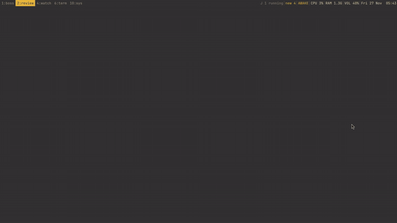
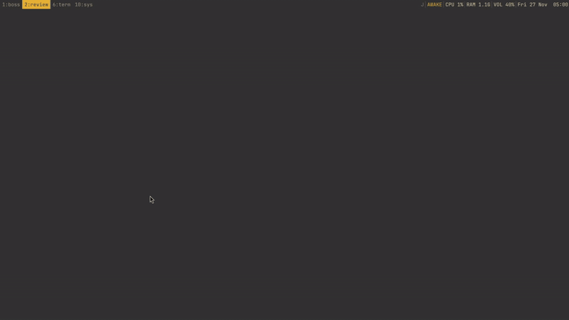
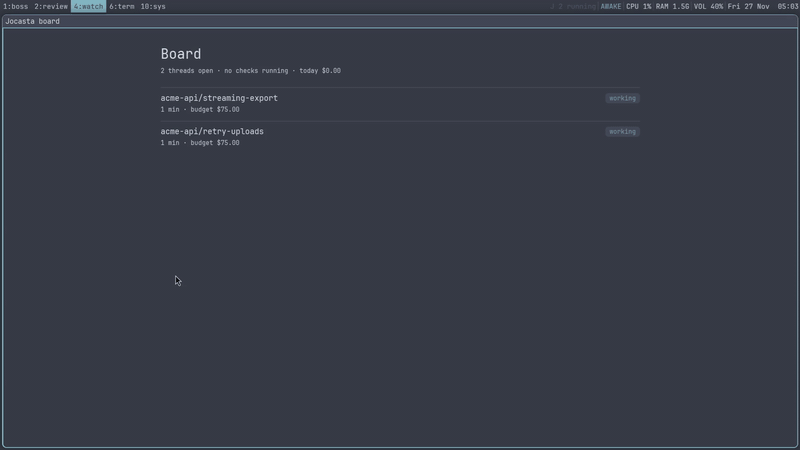
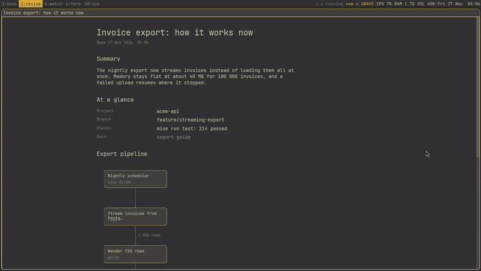
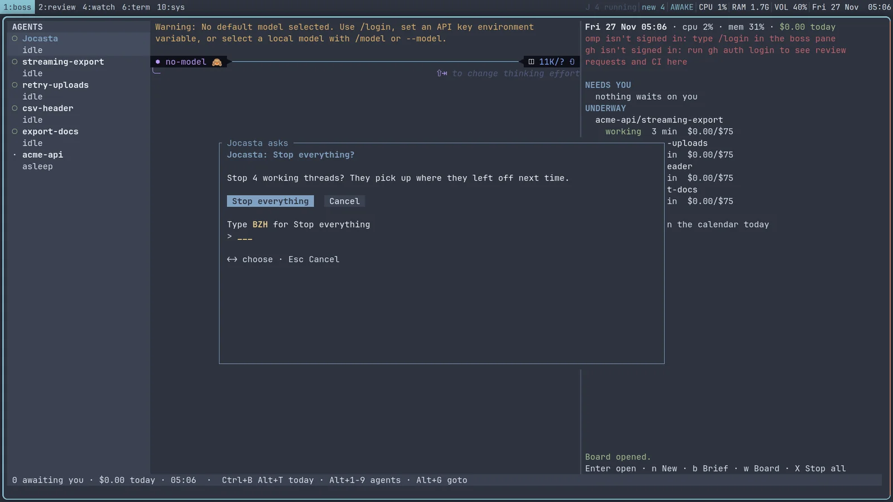
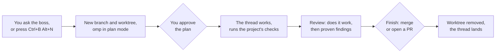

# Jocasta

**Run a team of coding agents from one conversation: each works on its own branch, and nothing lands until it is shown to work and you say so.**

[](docs/media/review-page.mp4)

<sub>Jocasta 0.2's review windows, recorded in the test VM of [ultron](https://github.com/zhivko-kocev/ultron). [Full-quality video](docs/media/review-page.mp4).</sub>

## Why

Coding agents now run for minutes or hours, and one at a time is too slow. Run five in five terminals and you become their dispatcher: you track which one waits on you, which one broke the build, which branch is whose, and you review diffs whose author says "done" without having run anything.

Jocasta gives that job to an agent. You talk to one omp, **the boss**. It turns each request into a **thread**: a separate omp on its own git branch and worktree, which plans first, works, runs your checks and is reviewed. Reviews start with whether the change *works*, every finding comes with a command that proves it, and you write the verdict in your own words. You hear about a thread when it needs you; otherwise it stays out of your way.

It is built on [omp](https://github.com/can1357/oh-my-pi) (oh-my-pi, the coding agent) and adds no code inside it: configuration, a few tools and a background service in its own terminal shell. omp's own features (plan mode, subagents, LSP, compaction, dictation) work as they always do.

> Status: v1 beta. It is used daily on Windows 11. The Linux and macOS builds pass the test suite in CI; on Linux, Jocasta is the default boss of [ultron](https://github.com/zhivko-kocev/ultron), whose test VM recorded the clips below.

## Features

Features marked *0.2* arrive with Jocasta 0.2, which the recordings show; earlier releases don't have them.

- **Threads on worktrees, with a boss.** The boss starts, watches and steers threads; it never edits your code itself. Threads run in parallel, each isolated on its own branch, and each starts in omp's plan mode and waits for you to approve its plan. A thread can carry `done_when` commands, and its review runs them.
- **Works-first reviews with proven findings** *(0.2)*. A review runs the project's check first, then the reviewer tries the change (commands for a CLI or library, a headless browser and screenshots for a web UI). A change that doesn't work ends the review at once with one P0 card, before any reviewer spend. Every finding carries a proof, a command and the output it must give, which Jocasta runs itself and keeps only when it reproduces; anything unproven is a question or one of at most three opinions. Notes are checked against the committed code, a change that weakens the tests fails, and design findings are judged against a shipped code-quality rubric.
- **The system view** *(0.2)*. The reviewer draws the system before and after the change, every part anchored to a line of code, plus what the change brings and what it takes away, each with its proof or anchor. The page shows After, with a Before / After switch.
- **Your words, one-click verdict** *(0.2)*. Edit any card, add your own comments and a summary, and press **Polish** (grammar and phrasing only, a local model first) or **To English** before you publish. **Approve**, **Request changes** or **Comment** sends one GitHub review with your kept comments, or votes on Azure DevOps. The diff stays behind a reveal until you ask for it.
- **Native windows that follow your desktop** *(0.2)*. Review pages, the boss's `show` briefs and the board are native windows drawn with [iced](https://iced.rs), on Windows, Linux and macOS. They, the `today` dock and the question box take their colours and font from an optional palette file (ultron writes it from its theme), Tokyo Night without one.
- **The board** *(0.2)*. `jocasta board` (or `w` in the dock) opens a live window of every open thread: its phase, what it runs now, its age, cost against budget, context, last check and its PR's CI. Each phase change is also a line in `notifications.jsonl`, which ultron turns into a phone push.
- **Clean-room checks** *(0.2)*. With Docker running, a check runs on the committed tree only, in a local container that sees no home folder, no host environment and no Docker socket. Other people's pull requests run there or not at all without your OK; your own threads run there once before Finish.
- **The guard.** A shipped rule list stops or asks about destructive commands (force pushes, `reset --hard`, recursive deletes, reading tokens). Merges, PRs and other irreversible steps need a code that you type into a question drawn over your terminal. A push to `main` asks you once per repo.
- **Light defaults.** News stays off until you list feeds, the weekly big-picture review runs only for projects you name, omp's advisor reviews at the end of a turn and interrupts only for blockers, the boss takes a model turn only for thread outcomes, and commit messages try a local model first.
- **`today`.** Beside the boss: what needs you, what's underway, what landed today, your calendar, your model quota and today's spend, your notes, and optional weather and news.
- **Cost in view.** Each thread shows its spend, its peak context, its cache hits and its compactions. A thread warns you at $50, and the tab bar shows today's total. A project's checks run once per git tree state, so an unchanged tree is never tested twice.
- **Briefs on demand.** The boss's `show` draws animated diagrams, code maps and diffs from a spec. `jocasta view <brief-id>` opens a stored brief again, and `jocasta brief open spec.json` lets any agent or script open its own spec the same way; briefs are kept 30 days *(all three 0.2)*.
- **Memory and inbox.** `history_search` lets every agent search past sessions of the same project. GitHub and Azure DevOps reviews and failed pipelines, plus an iCal calendar, appear in `today`.
- **Nothing runs behind your back.** When you close Jocasta, everything it started stops. Threads continue where they left off the next time you open it.
- **Windows, Linux and macOS.** One `jocasta` binary with its terminal shell built in; CI tests all three on every push.

## See it

All recorded with Jocasta 0.2 in ultron's test VM, with the placeholder project `acme-api`.

| | |
|---|---|
| [](docs/media/review-page.mp4) | **A review, top to bottom.** A finished thread's page: Works (a passed clean-room check, a failed try step), the System view with Before / After and Brings / Takes away, the thread's path, proven findings and the code behind *Show code*; then a pull request's page with comments written in Macedonian and Hebrew, Polish and To English on each, a comment of your own and the verdict buttons. [Video](docs/media/review-page.mp4) |
| [](docs/media/brief-entrance.mp4) | **A brief from the boss's `show`.** "Invoice export: how it works now" draws in once when it opens; Play walks the pipeline node by node with its caption, then the files changed and the next steps. [Video](docs/media/brief-entrance.mp4) |
| [](docs/media/board.mp4) | **The board on workspace 4.** Four threads start one after another; each row fades in with its phase, age and budget, under a header with open threads, running checks and today's spend. [Video](docs/media/board.mp4) |
| [](docs/media/theme-switch.mp4) | **Following the desktop.** The same brief under ultron's themes, among them Nord, Catppuccin Latte and Tokyo Night: the window takes the desktop's colours and font. [Video](docs/media/theme-switch.mp4) |
|  | **The boss and `today`.** Threads in the sidebar, the boss pane, and `today` naming what's missing in red (here: omp and gh not signed in); the question box asks you to type its code before Stop everything. |

## How a thread runs



While threads work, you keep talking to the boss. It tells you when one needs you (a plan to approve, a question, a review that is ready) and otherwise stays quiet.

## Requirements

- **Windows 11, Linux (x64) or macOS (Apple silicon).** Windows 11 is in daily use; the Linux and macOS builds pass the test suite in CI.
- **[omp](https://github.com/can1357/oh-my-pi)** on your PATH and signed in to a model provider: run `omp`, then `/login`. Use omp's latest release: Jocasta isn't pinned to one, a weekly check against the newest omp reports what breaks, and this release was last checked with omp 19.2.1. Jocasta names no model: the boss and threads use your omp model roles, and a `--heavy` thread uses your `slow` role.
- The terminal shell needs no install: it is built into `jocasta`.
- **git**, version 2.54 or newer for the push check.
- **[mise](https://mise.jdx.dev)**: installs Jocasta on Linux and macOS. On every system, setup pins gh with it, and each project can have its own check and test tasks.
- **On Linux and macOS:** a terminal that sends Alt and Shift keys through the kitty keyboard protocol: foot, kitty, WezTerm or Ghostty. **On Linux** also `notify-send` (libnotify) for notifications and `xdg-open` (xdg-utils) to open links and screenshots.
- **Optional:** Docker, for clean-room checks *(0.2)*; without it they are reported as not possible and your own threads still finish.

When something here is missing, Jocasta says so once at start, in a notification and in red at the top of `today`.

## Install

### Windows

In PowerShell:

```powershell
irm https://raw.githubusercontent.com/zhivko-kocev/jocasta/main/scripts/install.ps1 | iex
```

This installs to `%LOCALAPPDATA%\Programs\jocasta\` and adds that folder to your user PATH. The download is checked against a checksum committed in this repository. To upgrade, run the same command again, then close Jocasta and open it again.

### Linux and macOS

```sh
mise use -g github:zhivko-kocev/jocasta
```

mise downloads the latest release for your system, checks GitHub's build attestation of the archive, and puts `jocasta` on your PATH. To upgrade, run `mise upgrade`; a running Jocasta keeps the old build until you close it and open it again.

Without mise, `curl -fsSL https://raw.githubusercontent.com/zhivko-kocev/jocasta/main/scripts/install.sh | sh` installs to `~/.local/lib/jocasta/` (set `JOCASTA_INSTALL_DIR` for another folder) and adds it to your PATH in your shell's rc file, so open a new terminal afterwards; the download is checked against a checksum committed in this repository, and running the same command again upgrades.

On [ultron](https://github.com/zhivko-kocev/ultron), Jocasta is already installed and set up: it is the boss on workspace 1, its review windows open on workspace 2 and the board on workspace 4.

To install a build of your own instead, run `mise run build` in this repository, then `JOCASTA_INSTALL_FROM="$PWD/dist" sh scripts/install.sh`.

## First run

**1. Set up.** Open a new terminal, then run:

```sh
jocasta setup
```

Setup connects Jocasta to omp. It writes Jocasta's tuned omp files (settings, keys, language servers and a skill) over yours in `~/.omp/agent`, keeping a copy of each file it replaces; your logins, sessions and memory aren't touched. On Windows it also adds a Windows Terminal colour scheme. **Each change is shown as a diff and written only after you type `y`.** Run it again after each upgrade. Anything it writes, `jocasta uninstall` takes back out, and your own files come back.

**2. Add your projects.** A project is a git repository. Add one at a time:

```sh
jocasta project add ~/code/acme-api        # Linux and macOS
jocasta project add C:\code\acme-api       # Windows
```

You can also have Jocasta watch a folder in `~/.jocasta/agent/projects.yaml`. It then picks up every repository in that folder:

```yaml
version: 1
roots:
  - path: /home/you/code   # on Windows: C:/code
    depth: 1               # how many folder levels to look into
    ignore: [archive]      # optional
```

To check what Jocasta found, run `jocasta project list`.

**3. Open Jocasta.**

```sh
jocasta
```

This opens Jocasta's session. The boss is on the left, and `today` is docked on the right. Each project and each thread gets its own workspace (Alt+1…9 switch between them). If omp isn't signed in yet, type `/login` in the boss pane; a red line at the top of `today` names anything else that is missing and how to fix it.

**4. Start a thread.** Tell the boss what you want, for example "in acme-api, add retries to the HTTP client". You can also press **Ctrl+B, then Alt+N**, pick the project and write a brief. Either way:

1. The thread opens in a new workspace and writes a plan. Read it and approve it in that pane.
2. It works. `today` shows its state, time, cost and context use.
3. When it's done, you get a notification, and its review page opens in a window of its own.
4. Press **Ctrl+B, then Alt+F** to finish it. Choose Merge or PR, then type the three-letter code that the question shows.

## Using it

### Keys

| Keys | What they do |
|---|---|
| Ctrl+B, then Alt+N | Start a new thread (pick a project, write a brief) |
| Ctrl+B, then Alt+F | Finish the focused thread: merge it or open a PR |
| Ctrl+B, then Alt+R | Ask for a review of the focused thread's commits |
| Ctrl+B, then Alt+S | Stop the focused thread's current run |
| Ctrl+B, then Alt+Q | Quit Jocasta (it asks first if threads are working) |
| Alt+1 … Alt+9 | Switch workspaces (Alt+1 is the boss) |
| Alt+[ and Alt+] | Move between agents |
| Hold Right Ctrl | Talk to the boss from anywhere in Windows. omp transcribes your speech on your machine, and the text is sent when you let go |
| Ctrl+B, then Alt+T, or a click in `today` | Give `today` the keys: ↑↓ pick a row, Enter goes to it, f, s, r, n Finish, Stop, Review, New; b Brief, w Board; Esc gives them back. In a narrow window `today` opens over the boss pane until Esc |

Questions that need your permission appear in front of whatever you're doing, drawn over your terminal. To allow, type the code it shows. Esc denies, and so does no answer within 2 minutes.

### Commands

| Command | What it does |
|---|---|
| `jocasta` | Open the work surface, starting Jocasta's server if needed |
| `jocasta setup` | Show and apply Jocasta's changes to omp, mise and (on Windows) Windows Terminal |
| `jocasta setup --yes` | Apply them without asking (for install scripts); the list is still printed |
| `jocasta setup --refresh <file>` | Put `jocasta.json` or `mcp.json` back to the shipped version, keeping a backup |
| `jocasta project list \| add <path> \| remove <name or id>` | Manage projects |
| `jocasta thread new <project> "<brief>" [--done-when "<cmd>"] [--heavy]` | Start a thread from the command line |
| `jocasta thread list \| status \| send \| stop \| finish` | Inspect and steer threads (`send`, `stop` and `finish` ask for your permission) |
| `jocasta worktree leftover \| remove <path>` | List or remove leftover worktrees |
| `jocasta view <brief-id>` | Open a stored brief or review page in its own window *(0.2)* |
| `jocasta brief open <spec.json \| ->` | Check a `show` spec as the boss's `show` does and open it in a window *(0.2)* |
| `jocasta board` | Open the board *(0.2)* |
| `jocasta diagnose` | Collect state and logs, and open a read-only omp to find what's wrong |
| `jocasta status --json` | Print whether Jocasta runs, what needs you, today's spend and the open threads as one JSON line (for status bars) |
| `jocasta uninstall` | Remove everything install and setup added, after one confirmation |
| `jocasta --version` | Print Jocasta's and omp's versions |

The [manual](https://github.com/zhivko-kocev/jocasta/blob/main/docs/manual.md#commands) has every flag and exit code.

## Configuration

| Path | What's there |
|---|---|
| `~/.jocasta/agent/jocasta.yaml` | Jocasta's settings: port, quiet hours, weather, GitHub, Azure DevOps, calendar, news, clean-room checks |
| `~/.jocasta/agent/projects.yaml` | Your projects and watched folders |
| `%LOCALAPPDATA%\jocasta\data` (Windows), `~/.local/share/jocasta/data` (Linux), `~/Library/Application Support/jocasta/data` (macOS) | Data and logs (`logs/jocasta-YYYY-MM-DD.log`, kept for 7 days) |
| `~/.omp/agent/` | omp's own config, which setup edits only with your `y` |
| `AGENTS.local.md` in a project | Private notes that every agent in that project reads (keep it gitignored) |
| `~/.jocasta/agent/boss.yml`, `pane.yml` | Your own omp settings for the boss and for every project and thread pane (optional) |
| `~/.jocasta/agent/palette.json` | Colours that replace Jocasta's Tokyo Night by name, read at start (optional; ultron writes it from its theme) |

The omp settings setup installs carry the author's model roles, all Anthropic models. With another provider omp falls back to your default model. To choose your own models (or any other omp setting) durably, put them in `~/.jocasta/agent/boss.yml` for the boss and `~/.jocasta/agent/pane.yml` for every project and thread pane, for example `modelRoles: {default: openai/gpt-5.5}`. Jocasta loads them after its own settings and before the guard, so `jocasta setup` never overwrites them and the guard still has the last word.

Every key, its default and its range is in the [manual's Config section](https://github.com/zhivko-kocev/jocasta/blob/main/docs/manual.md#config).

## Safety: what to know

Jocasta's guard is a list of command patterns that omp blocks or asks about. It catches the usual ways to lose work or leak a login, but **it is pattern matching, not a sandbox.** Every agent runs as you, with your logins. A script the agent writes and then runs, a command hidden in an unusual form, or code run through omp's `eval` tool can get past it. Treat the guard as a seatbelt. The real gate is approving each plan: read it before you approve. Running threads in an isolated OS account is planned for after v1.

omp's `/share` inside Jocasta stays on your machine. In an omp outside Jocasta, it uploads the whole conversation.

The [manual](https://github.com/zhivko-kocev/jocasta/blob/main/docs/manual.md#what-the-guard-doesnt-stop) lists exactly what the guard stops and what it can't.

## Develop

You need [mise](https://mise.jdx.dev); it installs the pinned toolchain (Rust, Bun and the cargo tools). Jocasta is written in Rust, its windows are drawn with [iced](https://iced.rs), and the docs and config checks are TypeScript run with Bun.

```sh
mise trust mise.toml
mise install --locked
mise exec -- bun install --frozen-lockfile
mise run check                              # lint, type checks and every test
mise run build                              # release build into dist/
```

[CONTRIBUTING.md](CONTRIBUTING.md) covers how to propose a change, the decision records, the placeholder-names rule and releases; the [manual's development section](https://github.com/zhivko-kocev/jocasta/blob/main/docs/manual.md#development) has the details.

## Docs

- **[The manual](https://github.com/zhivko-kocev/jocasta/blob/main/docs/manual.md):** everything setup writes, `today` row by row, every config key, the guard's rules, and the Linux and macOS differences.
- **[CHANGELOG.md](CHANGELOG.md):** what each release brought.
- **[`docs/decisions/`](https://github.com/zhivko-kocev/jocasta/tree/main/docs/decisions):** why each behaviour is the way it is, with one record per decision.
- **[`docs/plan.md`](https://github.com/zhivko-kocev/jocasta/blob/main/docs/plan.md):** the design and the vision behind it.
- **[DESIGN.md](DESIGN.md):** the look: colours, type and motion.

## Credits

- [herdr](https://github.com/herdrdev/herdr) (Apache-2.0, no longer used; 0683): the shell was a fork of it until phase 6. The vendored [portable-pty](https://github.com/wezterm/wezterm/tree/main/pty) (MIT) with its ConPTY patches, and [alacritty_terminal](https://github.com/alacritty/alacritty) (Apache-2.0), make the shell's terminals.
- [oh-my-pi](https://github.com/can1357/oh-my-pi) (MIT): the agent in every pane, and dictation with its local Parakeet TDT 0.6B v3 model.
- [ratatui](https://github.com/ratatui/ratatui) (MIT): `today` and the questions.
- [iced](https://github.com/iced-rs/iced) (MIT): the review, brief and board windows.
- [Ponytail](https://github.com/DietrichGebert/ponytail) (MIT): in `config/ponytail.md`.
- News headlines come from [brutalist.report](https://brutalist.report), and weather from [Open-Meteo](https://open-meteo.com) (CC BY 4.0).

## License

MIT. See [LICENSE](LICENSE).
