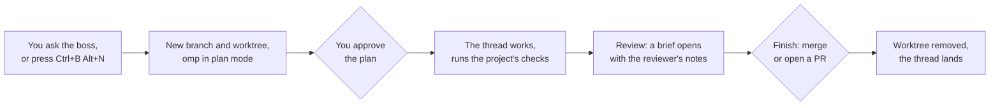

# Jocasta

Jocasta runs several coding agents for you at once, and you steer them all from one conversation.

It is built on [omp](https://github.com/can1357/oh-my-pi) (oh-my-pi, the coding agent) and its own terminal shell, built into `jocasta`. You talk to one omp, **the boss**, by typing or by holding a key and speaking. The boss turns each request into a **thread**: a separate omp working on its own git branch, in its own worktree and its own tab. Each thread plans first, waits for you to approve the plan, does the work, runs your project's checks and is reviewed. Nothing is merged or pushed without your say.

Jocasta adds no code inside omp. It adds configuration, a few MCP tools and a background service that runs inside its terminal server, so omp's own features (plan mode, subagents, LSP, compaction, dictation) work as they always do.

> Status: v1 beta. It is used daily on Windows 11. The Linux and macOS builds pass the test suite in CI, but nobody has used them yet.

## How a thread runs



While threads work, you keep talking to the boss. It tells you when one needs you (a plan to approve, a question, a review that is ready) and otherwise stays quiet.

## What you get

- **One boss, many threads.** The boss starts, watches and steers threads; it never edits your code itself. Threads run in parallel, each isolated on its own branch.
- **Plans before code.** Every thread starts in omp's plan mode and waits for your approval. A thread can carry `done_when` commands, and its review runs them.
- **Reviews you can trust.** When a thread finishes, a brief opens in your browser with its diff, its checks and the reviewer's notes, each note machine-checked against the committed code. A review fails if the change weakens the tests (a removed test, fewer assertions, an added skip). Design findings are judged against a shipped code-quality rubric.
- **`today`.** Beside the boss: what needs you, what's underway, what landed today, your calendar, your model quota and today's spend, your notes, and optional weather and news.
- **Cost in view.** Each thread shows its spend, its peak context, its cache hits and its compactions. A thread warns you at $50, and the tab bar shows today's total.
- **Checks once per tree.** A project's checks run once for each git tree state and the result is reused, so an unchanged tree is never tested twice.
- **Guard rails.** A shipped rule list stops or asks about destructive commands (force pushes, `reset --hard`, recursive deletes, reading tokens). Merges, PRs and other irreversible steps need a code that you type into a question drawn over your terminal. A push to `main` asks you once per repo.
- **Memory across sessions.** `history_search` lets every agent search past sessions of the same project.
- **Briefs.** The boss's `show` draws animated diagrams, code maps and diffs as pages in your browser, from a spec. There is no free-hand drawing: you ask for a new picture.
- **Your inbox in one place.** GitHub and Azure DevOps reviews and failed pipelines, plus an iCal calendar, appear in `today`.
- **Nothing runs behind your back.** When you close Jocasta, everything it started stops. Threads continue where they left off the next time you open it.

## Requirements

- **Windows 11.** Linux (x64) and macOS (Apple silicon) builds exist but are untested in daily use.
- **[omp](https://github.com/can1357/oh-my-pi)** on your PATH and signed in to a model provider: run `omp`, then `/login`. This release is checked against omp 19.2.0. Jocasta names no model: the boss and threads use your omp model roles, and a `--heavy` thread uses your `slow` role.
- The terminal shell needs no install: it is built into `jocasta`.
- **git**, version 2.54 or newer for the push check.
- **[mise](https://mise.jdx.dev)** (optional). With it, setup pins gh, and each project can have its own check and test tasks.
- A browser, for the briefs.

## Install

In PowerShell:

```powershell
irm https://raw.githubusercontent.com/zhivko-kocev/jocasta/main/scripts/install.ps1 | iex
```

This installs to `%LOCALAPPDATA%\Programs\jocasta\` and adds that folder to your user PATH. The download is checked against a checksum committed in this repository. To upgrade, run the same command again, then close Jocasta and open it again. On Linux and macOS, use `scripts/install.sh`, which installs to `~/.local/share/jocasta/`; on Linux an upgrade hands a running Jocasta to the new build without closing its panes.

## First run

**1. Set up.** Open a new terminal, then run:

```powershell
jocasta setup
```

Setup connects Jocasta to omp. It writes Jocasta's tuned omp files (settings, keys, language servers, a skill and Jocasta's MCP server) over yours in `~/.omp/agent`, keeping a copy of each file it replaces; your logins, sessions and memory aren't touched. It also adds a Windows Terminal colour scheme. **Each change is shown as a diff and written only after you type `y`.** Run it again after each upgrade. Anything it writes, `jocasta uninstall` takes back out, and your own files come back.

**2. Add your projects.** A project is a git repository. Add one at a time:

```powershell
jocasta project add C:\code\acme-api
```

You can also have Jocasta watch a folder in `~/.jocasta/agent/projects.yaml`. It then picks up every repository in that folder:

```yaml
version: 1
roots:
  - path: C:/code
    depth: 1          # how many folder levels to look into
    ignore: [archive] # optional
```

To check what Jocasta found, run `jocasta project list`.

**3. Open Jocasta.**

```powershell
jocasta
```

This opens Jocasta's session. The boss is on the left, and `today` is docked on the right. Each project and each thread gets its own workspace (Alt+1…9 switch between them).

**4. Start a thread.** Tell the boss what you want, for example "in acme-api, add retries to the HTTP client". You can also press **Ctrl+B, then Alt+N**, pick the project and write a brief. Either way:

1. The thread opens in a new workspace and writes a plan. Read it and approve it in that pane.
2. It works. `today` shows its state, time, cost and context use.
3. When it's done, you get a notification, and its brief opens with the review.
4. Press **Ctrl+B, then Alt+F** to finish it. Choose Merge or PR, then type the three-letter code that the question shows.

## Keys

| Keys | What they do |
|---|---|
| Ctrl+B, then Alt+N | Start a new thread (pick a project, write a brief) |
| Ctrl+B, then Alt+F | Finish the focused thread: merge it or open a PR |
| Ctrl+B, then Alt+R | Ask for a review of the focused thread's commits |
| Ctrl+B, then Alt+S | Stop the focused thread's current run |
| Ctrl+B, then Alt+Q | Quit Jocasta (it asks first if threads are working) |
| Alt+1 … Alt+9 | Switch workspaces (Alt+1 is the boss) |
| Alt+[ and Alt+] | Move between agents |
| Hold Right Ctrl | Talk to the boss from anywhere in Windows. omp transcribes your speech on your machine, and the text is sent when you let go |
| Ctrl+B, then Alt+T, or a click in `today` | Give `today` the keys: ↑↓ pick a row, Enter goes to it, f, s, r, n Finish, Stop, Review, New; Esc gives them back |

Questions that need your permission appear in front of whatever you're doing, drawn over your terminal. To allow, type the code it shows. Esc denies, and so does no answer within 2 minutes.

## Commands

| Command | What it does |
|---|---|
| `jocasta` | Open the work surface, starting Jocasta's server if needed |
| `jocasta setup` | Show and apply Jocasta's changes to omp, Windows Terminal and mise |
| `jocasta setup --refresh <file>` | Put `jocasta.json` or `mcp.json` back to the shipped version, keeping a backup |
| `jocasta project list \| add <path> \| remove <name or id>` | Manage projects |
| `jocasta thread new <project> "<brief>" [--done-when "<cmd>"] [--heavy]` | Start a thread from the command line |
| `jocasta thread list \| status \| send \| stop \| finish` | Inspect and steer threads (`send`, `stop` and `finish` ask for your permission) |
| `jocasta worktree leftover \| remove <path>` | List or remove leftover worktrees |
| `jocasta diagnose` | Collect state and logs, and open a read-only omp to find what's wrong |
| `jocasta uninstall` | Remove everything install and setup added, after one confirmation |
| `jocasta --version` | Print Jocasta's and omp's versions |

The [manual](https://github.com/zhivko-kocev/jocasta/blob/main/docs/manual.md#commands) has every flag and exit code.

## Where things live

| Path | What's there |
|---|---|
| `~/.jocasta/agent/jocasta.yaml` | Jocasta's settings: port, quiet hours, weather, GitHub, Azure DevOps, calendar and news |
| `~/.jocasta/agent/projects.yaml` | Your projects and watched folders |
| `%LOCALAPPDATA%\jocasta\data` | Data and logs (`logs\jocasta-YYYY-MM-DD.log`, kept for 7 days) |
| `~/.omp/agent/` | omp's own config, which setup edits only with your `y` |
| `AGENTS.local.md` in a project | Private notes that every agent in that project reads (keep it gitignored) |

## Safety: what to know

Jocasta's guard is a list of command patterns that omp blocks or asks about. It catches the usual ways to lose work or leak a login, but **it is pattern matching, not a sandbox.** Every agent runs as you, with your logins. A script the agent writes and then runs, a command hidden in an unusual form, or code run through omp's `eval` tool can get past it. Treat the guard as a seatbelt. The real gate is approving each plan: read it before you approve. Running threads in an isolated OS account is planned for after v1.

omp's `/share` inside Jocasta stays on your machine. In an omp outside Jocasta, it uploads the whole conversation.

The [manual](https://github.com/zhivko-kocev/jocasta/blob/main/docs/manual.md#what-the-guard-doesnt-stop) lists exactly what the guard stops and what it can't.

## Learn more

- **[The manual](https://github.com/zhivko-kocev/jocasta/blob/main/docs/manual.md):** everything setup writes, `today` row by row, every config key, the guard's rules, and the Linux and macOS differences.
- **[`docs/decisions/`](https://github.com/zhivko-kocev/jocasta/tree/main/docs/decisions):** why each behaviour is the way it is, with one record per decision.
- **[`docs/plan.md`](https://github.com/zhivko-kocev/jocasta/blob/main/docs/plan.md):** the design and the vision behind it.

## Development

You need [mise](https://mise.jdx.dev). It installs the pinned toolchain: Rust, Bun and the cargo tools.

```powershell
mise trust mise.toml
mise install --locked
mise exec -- bun install --frozen-lockfile
mise run check                              # lint, type checks and every test
mise run build                              # release build into dist/
```

Jocasta is written in Rust. The brief pages' script is plain JavaScript, checked with Bun. To install your own build, set `JOCASTA_INSTALL_FROM` to the `dist` folder and run `scripts/install.ps1`. Read [CONTRIBUTING.md](CONTRIBUTING.md) for how changes are made here, and the [manual's development section](https://github.com/zhivko-kocev/jocasta/blob/main/docs/manual.md#development) for the details.

## Credits

- [herdr](https://github.com/herdrdev/herdr) (Apache-2.0, no longer used; 0683): the shell was a fork of it until phase 6. The vendored [portable-pty](https://github.com/wezterm/wezterm/tree/main/pty) (MIT) with its ConPTY patches, and [alacritty_terminal](https://github.com/alacritty/alacritty) (Apache-2.0), make the shell's terminals.
- [oh-my-pi](https://github.com/can1357/oh-my-pi) (MIT): the agent in every pane, and dictation with its local Parakeet TDT 0.6B v3 model.
- [ratatui](https://github.com/ratatui/ratatui) (MIT): `today` and the questions.
- [Ponytail](https://github.com/DietrichGebert/ponytail) (MIT): in `config/ponytail.md`.
- News headlines come from [brutalist.report](https://brutalist.report), and weather from [Open-Meteo](https://open-meteo.com) (CC BY 4.0).

## License

MIT. See [LICENSE](LICENSE).
