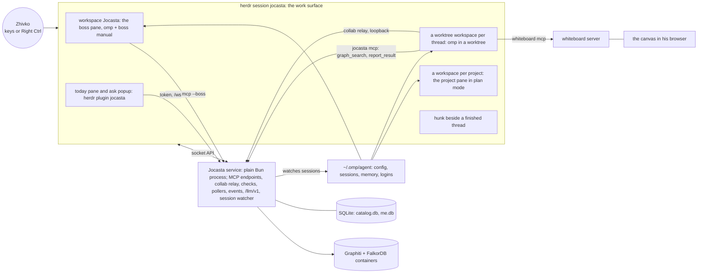

# Jocasta: the final plan

- **Status:** final plan, 2026-10-03.
- **Name:** the harness is Jocasta (0024, 0480). Frontier, the vision's name for the orchestrator, is Jocasta's orchestrator role.
- Jarvis was the working name until 0480.
- **Scope:** Jocasta only (0010).
- **Source of truth:** Zhivko's "Friday harness" vision, the whiteboard image shared on 2026-10-03 (section 1).
- **Other plans:**
  - this plan fills the vision's gaps from the v5 plan;
  - the v4 plan was the deep design reference for behavior specs (schemas, rule tables, algorithms), cited as "v4 §…";
  - material approved from the omp plan (`D:/friday-harness/omp-plan.md`) and the Go plan v2 (`D:/friday-harness/custom-harness-plan.md`) is cited as "omp plan §…" and "Go plan v2 §…" (0028);
  - the older plans are no longer consulted: their citations name what a slice covers, and the grilling program decides it fresh (0088).
- **Precedence:** vision > this plan > v5 > v4 > the older plans.

## 1. The vision

The image's statements are numbered V1–V14 so decisions can cite them.

- **V1. One entry point.** Frontier is a Jarvis-like interface and orchestrator: one entry point that orchestrates everything on the PC.
  - It starts with coding projects, and with every part of his day and night life as a software engineer and hacker.
  - It grows toward "Friday, the OS Tony Stark uses in his armor".
- **V2. Two inputs.** He can dictate and Frontier listens, or he can chat with it.
- **V3. A root process.** Frontier is like the root process of an operating system. It lives as long as the PC runs, or at least as long as its TUI runs.
- **V4. Projects from watched directories.** Frontier watches one or more directories that hold his projects, and shows the projects in its TUI, in a sidebar or similar.
- **V5. Tabs.** "Do this in that project" or "open that project" makes Frontier open or create a tab and start working on the project. Tabs may work like herdr's.
- **V6. Visuals.** Frontier can show animations and diagrams, like devdotfast/whiteboard.
- **V7. The harness runs in tabs.** His custom Pi harness runs in the tabs. Frontier itself may be a harness instance, or something else.
- **V8. A tailored harness.** At implementation time he decides every feature that goes in or stays out.
  - Candidates come from the most popular harnesses (omp, Claude Code, opencode and others), and from everything Pi lets him customize.
  - He also wants to introduce new ways of working.
- **V9. No sessions.** He marked this point as needing more grilling.
  - A project is one continuous thread with persistent memory, a knowledge graph or SQLite.
  - A workspace may be a thread.
  - main, master or dev is a scratch thread where he can only chat.
  - Nothing gets lost in messy sessions or messy configuration. There is no resuming or switching, and when the context window fills, compaction happens smoothly and automatically.
- **V10. Subthreads.** Frontier can continue or activate a project's thread with subthreads. Their name and shape are to be decided, by whatever is most logical.
- **V11. The boss.**
  - Activating a thread opens a tab. Frontier is the boss: he talks to it non-stop, and it never blocks him.
  - It tells him how the running threads are doing and reports the ones that are blocked.
  - He tells it what to do next.
- **V12. Working by hand.** He can open any tab and use the harness for that project by hand, like Pi's TUI. He chats within the thread the way he works with agents today.
- **V13. Built step by step.** The harness is built for him step by step. Memory management and tools need a lot of investigation.
- **V14. Grilling.** Whenever something is unclear, there is a grilling session.

## 2. What changed from v5

- **The harness is named Jocasta** (0024). The binary and command, the repo, the config dir and the env prefix use the name.
- **The plan covers Jocasta only** (0010). The friday CLI is not part of it: Jocasta keeps its config in its own dir, and v5's slices that served friday (adapter preset, session reader, shared git-guard script, doctor checks) are gone.
- **Frontier is new and central** (V1, V3–V7, V10–V12). It absorbs:
  - v5's fleet phase;
  - the daemon core of v5's assistant phase;
  - the custom TUI work v5 spread across phases.

  It becomes phase 4.
- **Sessions disappear from everything Zhivko sees** (V9). Pi's session files remain only as internal storage under each thread.
- **The thread model gains a project thread and workspace threads** (V9, V10), and the trunk branch becomes chat-only (V9). The details are grilling items in phase 1.
- **Dictation is a first-class input** (V2). Push-to-talk moves from v5's assistant phase into Frontier's phase.
- **Visuals get their own phase** (V6), with Whiteboard researched (section 5.6).
- **The feature catalog** (V8, appendix A) lists candidates from omp, Claude Code, opencode and Pi. Each one is decided in its slice (0008).
- **`ask` moves from power tools into phase 3.** Threads need it to report blocked questions to the boss.
- **The phase map changes** (0011, edited): 0 Foundation, 1 Projects and threads, 2 Guard, 3 Continuous threads, 4 Frontier, 5 Memory, 6 Power tools, 7 Visuals and voice, 8 Day and night life, 9 Sync and phone.
- **Approved material from the older plans** (0028): identity and persona (0.6), voice rules (4.8, 7.4), the determinism and cost ledgers (1.12, appendix G), role profiles and the boss manual (1.12, 4.4, 4.11), the guard corpus and the fixture gate (2.2, 0026), principles and evidence (section 4, appendices A and H), and seams and registries (appendix I).
- **Jocasta features from the films** (0029): proactive interjections (8.7), manner and voice (0.6, 7.4), protocols (8.10), recon (6.12), simulation (6.13), forensics (6.14), Iron Legion (6.15), the HUD and power level (4.12), the damage report (8.8), workshop prep (4.13) and house control (8.9).
- **Resources in containers** (0030). Docker manages Jocasta's resources wherever a container can host them; slice 0.7 decides the details.
- **Jocasta on upstreams** (0383–0397, 2026-10-13). The vision stays; the build stands on upstreams. The harness is his daily omp, whole and unforked, with settings, config files and memory only (0386, 0387). herdr is the work surface: a workspace per project, a tab per worktree thread, the boss as an omp pane (0388, 0392). Jocasta's own code lives outside omp: the `jocasta` command and the Electrobun companion with whiteboard's canvas, voice, dictation, `today`, pollers, the Graphiti proxy and the session watcher (0389, 0390, 0392, 0393). hunk opens beside every finished thread with omp's reviewer notes (0394). omp's approvals are the guard (0391). The program runs F0 → F1 → U → F2 → F3 → F4 (0384); the sections below name the records that retire or replace their slices.
- **Unchanged from v5:**
  - the own build on Pi's SDK (0009), in a new repo (0012);
  - the decision-log rules (0013–0018);
  - the guard design, the memory research and the toolbox facts.

## 3. Decisions so far

| # | Decision | Kind | Choice |
|---|---|---|---|
| 0001 | Slice cadence | process | Before a slice is built, every decision on its list goes through a grilling session (0020) |
| 0002 | Records before code | process | Each answer becomes a record before the slice's code is written |
| 0003 | Phase-end review | process | Slices in a phase run back to back; after the last one Zhivko reviews and commits, then the next phase opens |
| 0004 | Re-open planning decisions | process | Planning choices are asked again in their slice. The planning choice is the recommendation unless new facts changed it, and the question says what changed |
| 0005 | What counts as a decision | process | Anything visible or lasting is Zhivko's. The agent picks only unexported names, helper structure, test layout and comments |
| 0006 | Later-phase designs | process | Later phases stay proposals until their grilling sessions; every schema change ships as a numbered migration |
| 0007 | Scope | process | All phases of the map in section 6, in order, with a review at each phase end |
| 0008 | Features in their slice | process | No feature menus. Every feature is a decision in the slice that builds it, with facts, pros and cons |
| 0009 | Harness base | product | Own build on Pi 1.0's SDK (TypeScript on Bun). No Go rewrite and no source fork; a fork happens only under the condition in section 5.5 |
| 0010 | Plan scope | product | This plan covers Jocasta only; the friday CLI is not part of it |
| 0011 | Phase map | product | Phases 0–9 as in section 6 (edited for the vision; was v5's 0–8) |
| 0012 | Repo | product | A new repo for Jocasta; it holds Frontier and the harness role |
| 0013 | Record shape | process | One Markdown file per decision |
| 0014 | Changed decisions | process | Edited in place; git history keeps the old version |
| 0015 | File naming | process | `NNNN-<slug>.md` in one flat folder, numbered in the order decided; the slug names the question |
| 0016 | Feature register | process | The decisions index is the register, with Kind and Status columns; there is no separate backlog file |
| 0017 | First records | process | Process decisions are records and come first (0001–0008) |
| 0018 | Requests after v1 | process | GitHub issues on the Jocasta repo |
| 0019 | Source of truth | process | The vision image wins, then this plan, then v5, then v4 |
| 0020 | Grilling sessions | process | Every decision is made in a grilling session. Anything unclear in planning or during the build stops the work and opens one (V14) |
| 0021 | Frontier | product | Frontier is the single entry point and orchestrator (V1–V7, V10–V12). Its process model, tab layer and boss design are grilled in phase 4 |
| 0022 | No sessions | product | Threads replace sessions in everything Zhivko sees (V9). The thread hierarchy and the trunk rule are grilled in phase 1 |
| 0023 | Feature catalog | process | Harness features are chosen from omp, Claude Code, opencode and Pi (appendix A). Each is a decision in the slice that builds it (0008) |
| 0024 | Harness name | product | Jocasta: the binary and command, the repo, `piConfig.name`, the `JOCASTA_` env prefix and the config dir |
| 0025 | Principles | process | The principles in section 4 guide every recommendation; one that bends a principle says which and why |
| 0026 | Fixture gate | process | Until phase 2's guard lands, Jocasta works only in throwaway fixture repos; only slice 0.5 can lift the gate early |
| 0027 | Seams and registries | process | Appendix I lists the seams between phases and the claimed migrations, commands, env vars and exit codes; a slice that changes one updates it |
| 0028 | Older-plan material | process | Material from the older plans enters only with Zhivko's approval |
| 0029 | Jocasta features | product | Wanted from the films: proactive interjections, manner and voice, protocols, recon, simulation, forensics, Iron Legion, HUD and power level, damage report, workshop prep and house control. Each slice decides the design and whether it lands in v1 |
| 0030 | Resources in containers | product | Jocasta's resources run in containers managed through Docker wherever a container can host them; slice 0.7 decides the boundary, the runtime and the details |
| 0031 | Record template and index | process | The plan's preview template and four-line index header (slice 0.0) |
| 0032 | Non-goals for v1 | process | No up-front list; each non-goal is confirmed in the slice it touches (slice 0.0) |
| 0033 | One binary with two roles | product | One `jocasta` binary; the role is chosen at start (slice 0.1) |
| 0034 | Bare `jocasta` until phase 4 | product | Opens the harness TUI; phase 4 switches it to Frontier (slice 0.1) |
| 0035 | Repo visibility | product | Public, with the placeholder rule; the client-name check pattern lives in the config dir (slice 0.1, edited after 0051) |
| 0036 | Toolchain | product | Bun for runtime, build and tests; Biome for lint and format (slice 0.1) |
| 0037 | TypeScript settings | product | Strict, ESM, `tsc --noEmit` (slice 0.1) |
| 0038 | Repo layout | product | The slice 0.1 preview plus `docs/plan.md` (slice 0.1) |
| 0039 | Repo docs | product | README, AGENTS.md, CONTRIBUTING.md, MIT LICENSE, CHANGELOG (slice 0.1) |
| 0040 | Harness entry | product | Pi's `main(args, { extensionFactories })` (slice 0.2) |
| 0041 | Pi version pin | product | Exact `1.0.1` for every `@earendil-works/pi-*` package (slice 0.2) |
| 0042 | Bun pin | product | Bun 1.4.2 in CI and `package.json` (slice 0.2) |
| 0043 | Build targets in v1 | product | windows-x64, linux-x64, darwin-arm64 (slice 0.2) |
| 0044 | Packaging | product | Pi's layout including Pi's `docs/`, without `examples/` (slice 0.2, edited in 0.3) |
| 0045 | Pi packages and `/reload` | feature (v1) | Keep (slice 0.2) |
| 0046 | Built-in MCP, Codemode and tool_search | feature (v1) | Keep all four built-ins, llama.cpp included (slice 0.2) |
| 0047 | `/share` to a GitHub gist | feature (v1) | Keep, with a docs warning; no upstream PR (slice 0.2) |
| 0048 | Telemetry | product | None: `enableInstallTelemetry` off, through the seeded settings (0058) (slice 0.2) |
| 0049 | Install scripts | product | `install.ps1` and `install.sh` over HTTPS with checksum verification; Windows: `%LOCALAPPDATA%\Programs\jocasta\` on the user PATH; Unix: `~/.local/share/jocasta/` appended to PATH in the shell rc (slice 0.2) |
| 0050 | Self-upgrade command | feature (after v1) | After v1 (slice 0.2) |
| 0051 | Releases | product | GitHub Actions on a tag (slice 0.2) |
| 0052 | `--version` output | product | `jocasta 0.1.0 (pi 1.0.1, bun 1.4.2)` (slice 0.2) |
| 0053 | Bun bootstrap import | product | `src/entry.ts` imports Pi's two Bun bootstrap files by file path; a fork-condition item (slice 0.2) |
| 0054 | Config dir | product | `~/.jocasta/agent` via `piConfig.configDir: ".jocasta"` (slice 0.3) |
| 0055 | Config dir contents and owners | product | The slice 0.3 preview, plus `private-names.txt`, `models-store.json` and `bin/` (slice 0.3) |
| 0056 | Default settings | product | Seeded on first run when `settings.json` is missing: now GitHub Copilot `claude-opus-5.5` (0377) and `quietStartup: "header"` (0378); thinking `high`, theme `dark`, telemetry off (slice 0.3) |
| 0057 | Where history lives in phase 0 | product | Pi's default `<config dir>/sessions/` until phase 1 (slice 0.3) |
| 0058 | Telemetry off: mechanism | product | `enableInstallTelemetry: false` in the seeded settings (slice 0.3) |
| 0059 | fd and ripgrep downloads | product | Keep Pi's auto-download into `<config dir>/bin` (slice 0.3) |
| 0060 | Startup header | product | A Jocasta header through `ctx.ui.setHeader()` from a compiled-in extension; now the one startup line, the thread named in the terminal title (0378) (slice 0.3) |
| 0061 | Pi's update check | product | Off: `src/entry.ts` sets `PI_SKIP_VERSION_CHECK=1` (slice 0.3) |
| 0062 | Anthropic sign-in route | product | Subscription OAuth through Pi's `/login`, accepting extra-usage billing and enforcement risk; now shaped by `@gotgenes/pi-anthropic-auth`, Copilot first (0377) (slice 0.4) |
| 0063 | Credential storage | product | Pi's `auth.json` in `~/.jocasta/agent`; no keyring (slice 0.4) |
| 0064 | Providers | product | Keep Pi's full list (slice 0.4) |
| 0065 | Day-one guard | product | Wait for phase 2's guard; the fixture gate stays (slice 0.5) |
| 0066 | Identity | product | Written fresh: GitHub, Windows 11, tools on PATH; in `~/.jocasta/agent/AGENTS.md` (slice 0.6) |
| 0067 | Rules | product | Communication, development, research and security rules in `~/.jocasta/agent/AGENTS.md`; workflow left out (slice 0.6) |
| 0068 | Persona | product | His engineer; "sir" sparingly; one dry aside at most; in `~/.jocasta/agent/APPEND_SYSTEM.md` (slice 0.6) |
| 0069 | Where identity and persona live | product | Persona in `APPEND_SYSTEM.md`, identity and rules in `AGENTS.md` (slice 0.6) |
| 0070 | What runs in containers | product | Every headless resource behind a port or stdio (slice 0.7) |
| 0071 | Container runtime | product | Docker Desktop (slice 0.7) |
| 0072 | Container management | product | One `~/.jocasta/agent/compose.yaml`, owned by one Jocasta module (slice 0.7) |
| 0073 | When containers run | product | On demand, stopped after an idle time set per resource (slice 0.7) |
| 0074 | Container images | product | Official images pinned by digest; Jocasta's own from Dockerfiles in the repo (slice 0.7) |
| 0075 | When the container manager is built | process | With the first resource that needs it (4.8 today) (slice 0.7) |
| 0076 | Phase 0 smoke | process | `scripts/smoke-phase0.ps1`, with the header, sign-in and identity checks as printed manual steps (slice 0.8) |
| 0077 | Catalog additions from the harness comparison | product | Appendix A rows only: rule precedence, capability tiers, credential refresh lease, context epochs, lazy subcommands; Codex, opencode and omp join three rows (appendix A) |
| 0078 | Research list: FTS5 in a compiled binary, failing `tool_result` handlers | process | `bun:sqlite` FTS5 marked answered; phase 2 gains how redaction fails closed (5.4) |
| 0079 | Evals and hillclimbing | product | 1.10's eval question becomes six decisions; R15; the eval seam (1.10) |
| 0080 | Run budgets | product | A cost-ledger lever and a catalog row: caps on turns, spend and wall clock per run (appendix G) |
| 0081 | Catalog rows from Claude Code mods | product | Dry-run preview (2.4), context gauge (1.11, 3.4), edit replay (6.10), self-extension (1.11) (appendix A) |
| 0082 | Catalog rows from Strands Agents | product | Done check (3.7), resumable questions (3.6, 1.7), per-request context (3.3), history-aware rules (2.1) (appendix A) |
| 0083 | Loop-guard and nested AGENTS.md rows | product | mini-swe-agent joins the loop-guard row; opencode's nested AGENTS.md joins the path-scoped row (appendix A) |
| 0084 | Research answers: tool results in the session file, Pi's evals, Pi's faux provider | process | Phase 2 item answered; Pi's evals is a reference; Pi's faux provider is 1.10's first option (5.4, 1.10) |
| 0085 | The learning repo as a source | process | `D:/learn-harnesses` clones and lessons join phase openings and grilling evidence, read-only (section 4) |
| 0086 | Grilling program | process | One pass over every decision of phases 1–9 in phase order before the build; features open with their status; spikes become rules (section 4) |
| 0087 | Principles: minimal by default, the harness stands alone | process | Principles 8 and 9 (section 4) |
| 0088 | Older plans: decided fresh | process | The older plans are no longer consulted; carried-over designs get a fresh agenda (section 4) |
| 0089 | Question batching | process | Grouped confirmations of low-stakes unchanged recommendations; everything else one question per decision (section 4) |
| 0090 | Slice 1.1 agenda | process | Fresh agenda of eight, failure handling added (1.1) |
| 0091 | Slice 1.2 agenda | process | Fresh agenda of ten, display name added (1.2) |
| 0092 | Slice 1.3 agenda | process | Fresh agenda, status first (1.3) |
| 0093 | Slice 1.4 agenda | process | Fresh agenda of thirteen, branch naming and worktree cleanup added (1.4) |
| 0094 | Where client-naming config lives | product | Jocasta's config dir, `~/.jocasta/agent` (1.1) |
| 0095 | Data dir | product | The OS data dirs: `%LocalAppData%\jocasta\data` and the macOS and XDG equivalents (1.1) |
| 0096 | DB files | product | `catalog.db` plus one `project.db` per project; memory DBs in phase 5 (1.1) |
| 0097 | SQLite driver | product | `bun:sqlite` (1.1) |
| 0098 | Dir overrides | product | `JOCASTA_DATA_DIR`, and Pi's `JOCASTA_CODING_AGENT_DIR` for the config dir; no `JOCASTA_CONFIG_DIR` (1.1) |
| 0099 | SQLite connection settings | product | `busy_timeout = 5000` first, then WAL, `synchronous = NORMAL`, foreign keys on (1.1) |
| 0100 | SQLite schema rules | product | `STRICT` tables, RFC3339 UTC timestamps, numbered migrations in `PRAGMA user_version` per file (1.1) |
| 0101 | DB failures | product | Unopenable, newer or locked DB: a message naming file, cause and fix; exit 1; the file is never touched (1.1) |
| 0102 | Where projects come from | product | Watched roots in a config-dir file, plus `project add` and `remove`; no auto-registration (1.2) |
| 0103 | Project identity | product | Normalized origin (Azure DevOps forms collapsed), then first root commit, then path; git through its CLI (1.2) |
| 0104 | Clones and worktrees | product | One project with many paths: main, worktree, clone (1.2) |
| 0105 | What counts as a project | product | Git top-levels from the scan, plus non-git folders added by hand (1.2) |
| 0106 | Never-projects | product | Home and drive roots, refused by `project add` (1.2) |
| 0107 | Project ids | product | `p-` + first 16 hex of SHA-256 of the identity key (1.2) |
| 0108 | When roots are scanned | product | Every launch lists the roots; git runs only for new paths or a changed `.git/config`; live from phase 4 (1.2) |
| 0109 | The projects file | product | `~/.jocasta/agent/projects.yaml` with `roots`, `add` and `exclude` (1.2) |
| 0110 | Project display name | product | The repo name from origin, else the main path's folder name; renames are hand edits (1.2) |
| 0111 | `project` commands | product | `project list`, `add`, `remove`; `remove` never touches files (1.2) |
| 0112 | Project rename entry | product | A `names:` map keyed by project id in `projects.yaml` (1.2) |
| 0113 | Scopes status | product | v1, built with 4.4, its first reader; slice 1.3 moves to phase 4 (1.3) |
| 0114 | Thread hierarchy | product | A continuous, chat-only project thread on trunk plus workspace threads, one per branch and worktree (1.4) |
| 0115 | Thread ids | product | `t-` + 8 random hex (1.4) |
| 0116 | Dormant label | product | Dropped (0307) (1.4) |
| 0117 | The trunk rule | product | The project thread on trunk is chat-only, enforced by phase 2's guard (1.4) |
| 0118 | Workspace checkout | product | Reuse a clean checkout holding the branch, else a worktree at `<main-root>.wt/<thread-id>`; never `--force` (1.4) |
| 0119 | Closing a workspace thread | product | Merged, deleted or PR-closed signals propose closing; he confirms; the report goes to the project thread (1.4) |
| 0120 | Thread names | product | "Project thread" and "workspace thread"; commands say `thread` (1.4) |
| 0121 | Workspace branch names | product | `feature/<slug>` from the title, overridable; an existing branch binds as is (1.4) |
| 0122 | Worktree and branch cleanup | product | On confirmed close: `git worktree remove` and `git branch -d`, neither forced; what git refuses is kept (1.4) |
| 0123 | Creating workspace threads | product | He starts them, or the agent proposes and he confirms; the boss starts them when asked or when it sees a need; title and brief required (1.4) |
| 0124 | Detached HEAD and non-git projects | product | Detached HEAD opens the project thread; a non-git project's one thread has full tools (1.4) |
| 0125 | The home thread | product | Outside every project, `jocasta` opens one continuous, chat-only home thread, stored in `catalog.db` (1.4) |
| 0126 | The threads schema | product | The previewed `threads` table in `project.db`; the same columns in `catalog.db` for the home thread (1.4) |
| 0127 | The trunk set | product | The `origin/HEAD` target plus `main`, `master`, `develop`, `development`, `dev` (1.4) |
| 0128 | Branch renamed | product | Dropped (0307) (1.4) |
| 0129 | Opening continues | product | The entry passes `--session-dir <thread dir> --continue`: trunk opens the project thread, a worktree its workspace thread, elsewhere the home thread (1.5) |
| 0130 | A branch with no thread | product | Offer a workspace thread bound to the branch; declining opens the project thread; spoken once voice lands (1.5) |
| 0131 | Thread session storage | product | `<data>/projects/<pid>/threads/<tid>/`, and `<data>/home/<tid>/` for the home thread (1.5) |
| 0132 | Pi's session commands | product | Dropped (0307): Pi's `/new`, `/resume`, `/fork` work as shipped (1.5) |
| 0133 | How Jocasta's commands reach the CLI | product | Both: the entry dispatches `jocasta <command>` before Pi's `main()`, and an extension registers matching slash commands (1.6) |
| 0134 | Lazy-loaded subcommands | product | v1: the entry imports Pi only for the harness role (1.6) |
| 0135 | Opening the harness alone | product | `jocasta harness`, used by him and by Frontier's tabs (1.6) |
| 0136 | Past windows | product | Readable and searchable inside the thread (3.5); never a session list (1.5) |
| 0137 | Jocasta never shadows Pi's commands | product | Pi's `install`, `remove`, `update`, `list`, `config`, `mcp`, `auth` and flags stay Pi's (1.6) |
| 0138 | Headless run on a branch with no thread | product | Create a workspace thread titled from the branch, with the `-p` prompt as its brief (1.7) |
| 0139 | Headless flags | product | `--thread <id>` plus Pi's own flags (1.7) |
| 0140 | Exit codes | product | 0 done, 1 failed, 2 invocation error, 3 approval denied headless, 4 cancelled by the boss, 130 interrupted; set by the entry (1.7) |
| 0141 | Resumable headless runs | product | v1; 3.6 designs stopping on a pending question or approval and resuming when answered (1.7) |
| 0142 | Slice 1.8 agenda | process | Fresh agenda of seven; edit style and tool limits join (1.8) |
| 0143 | Slice 1.9 agenda | process | Fresh agenda of seven; Pi already loads `CLAUDE.md` where no `AGENTS.md` exists (1.9) |
| 0144 | Slice 1.11 agenda | process | Fresh agenda of six; Pi's cache warming is on by default today (1.11) |
| 0145 | Slice 1.12 agenda | process | Fresh agenda of twelve, with run budgets (1.12) |
| 0146 | Edit style | product | Hashline: tagged reads, edits by line and tag (1.8) |
| 0147 | Tool override mechanism | product | Hooks for guards; replace a built-in by name only when its schema changes (`read`, `edit`) (1.8) |
| 0148 | Edit-requires-read | product | Dropped (0307): hashline tags already catch stale edits (1.8) |
| 0149 | Bash interceptor | product | On, omp-style rules; piped stages and inactive tools never blocked (1.8) |
| 0150 | Spill large output | product | Over 32 KiB: written to `<thread dir>/artifacts/<n>.txt`, read back as `artifact://<n>` (1.8) |
| 0151 | Thread-local scratch files | product | v1: `local://<name>.md` in `<thread dir>/local/` (1.8) |
| 0152 | Loop guard | product | Stop at 5 identical calls or 3 malformed calls in a row, naming the reason (1.8) |
| 0153 | Core tool limits | product | Pi's 2,000 lines or 50 KB, and 500 characters per grep line (1.8) |
| 0154 | Claude-format project assets | product | Dropped (0231); was: loaded through `resources_discover` (1.9) |
| 0155 | AGENTS.md beside CLAUDE.md | product | Pi's order: `AGENTS.md` wins per folder (1.9) |
| 0156 | Path-scoped rules and nested AGENTS.md on read | product | v1: attached once per window, after the tool result; path-scoped rules dropped (0232) (1.9) |
| 0157 | User-level `~/.claude` | product | Never; Jocasta's user level is `~/.jocasta/agent` (1.9) |
| 0158 | Which Claude-format kinds load | product | Dropped (0231) (1.9) |
| 0159 | `@path` imports | product | Dropped (0231) (1.9) |
| 0160 | Command arguments | product | Dropped (0231); Pi's substitution for Pi's templates (1.9) |
| 0161 | Fake provider | product | Now the scripted-model test fixture, loaded as a Pi extension by tests and evals (0376); originally Pi's faux provider, registered when `JOCASTA_FAKE_SCRIPT` names a script (1.10) |
| 0162 | Fake script format | product | YAML: `version` and `turns` with `text`, `tool_calls` and optional `usage`; read by the scripted-model fixture (0376) (1.10) |
| 0163 | Eval cases | product | Mined from his transcripts first, then bug reports, hand-written and synthesized; client cases in the config dir (1.10) |
| 0164 | Eval graders | product | End-state checks first; a judge only for open-ended output, from another model, after a signed-off pilot (1.10) |
| 0165 | Eval runs and results | product | A fresh fixture per trial; the claude-api skill's `results.jsonl`, transcripts and report (1.10) |
| 0166 | Eval locations | product | Cases in `~/.jocasta/agent/evals/cases/`; runs in `<data>/evals/runs/<time>-<label>/` (0375) (1.10) |
| 0167 | Hillclimbing | product | Yes, by R15's rules, on Jocasta's prompts, tool descriptions, briefing, boss manual, bundled agents and role settings (1.10) |
| 0168 | Who runs a climb | product | Jocasta itself, once subagents land in 6.4; scripted climbs use the scripted-model fixture (0376) (1.10) |
| 0169 | When evals run | product | Scripted cases, with the scripted-model fixture (0376), in CI on every change; the real provider at each phase-end review (1.10) |
| 0170 | Cache warming | product | `streaming`, Pi's default (1.11) |
| 0171 | Pi's self-references in the prompt | product | The preamble names Jocasta on pi; the `examples/` lines are dropped (1.11) |
| 0172 | Jocasta's prompt section | product | The previewed section on threads, artifacts, `local://`, hashline and tool use; the tool-use line follows the active tools (0381) (1.11) |
| 0173 | Cost display | product | Dropped (0307): Pi's footer and `/session` (1.11) |
| 0174 | Context gauge | product | Dropped (0307): Pi's footer shows window % (1.11) |
| 0175 | Self-extension | product | v1: Jocasta writes extensions into `~/.jocasta/agent/extensions/` and loads them with `/reload` (1.11) |
| 0176 | Sampling parameters | product | Unset (1.12) |
| 0177 | Tool-call format | product | Provider-native structured calls only (1.12) |
| 0178 | Drifted edits | product | Fail loudly; met by hashline (1.12) |
| 0179 | Speculative tool execution | product | Off; Pi's behavior kept (1.12) |
| 0180 | Workspace tree in the prompt | product | Never (1.12) |
| 0181 | Stop detection | product | Mechanical: Pi's stop reasons, the loop guard and run budgets (1.12) |
| 0182 | Thinking level | product | Pinned per role and profile; never automatic (1.12) |
| 0183 | Fabricated tool results | product | The turn aborts on tool-result markup in assistant text; after v1 (0307) (1.12) |
| 0184 | Prompt-cache retention | product | Pi's 5-minute default with warming; subscription sign-in doesn't get 1-hour entries (1.12) |
| 0185 | Profiles mechanism | product | `~/.jocasta/agent/profiles/<name>.yaml` deltas over `settings.json`, chosen with `--profile <name>` (1.12) |
| 0186 | Strict profile | product | No model fallback, no account switching, no background summaries, fixed effort; warming stays (1.12) |
| 0187 | Run budgets status | product | After v1 (1.12) |
| 0188 | Slice 2.1 agenda | process | Fresh agenda of thirteen, with five catalog rows (2.1) |
| 0189 | Slice 2.2 agenda | process | Fresh agenda: rules, seeds, each disagreement, Windows shells, broken files (2.2) |
| 0190 | Slice 2.3 agenda | process | Fresh agenda of four (2.3) |
| 0191 | Slice 2.4 agenda | process | Fresh agenda of six, with the dry-run preview row (2.4) |
| 0192 | Pi pin moves to 1.1.0 now | process | Bumped 2026-10-08; `chord` arrives with it, held by `bun.lock`; the Pi facts of 0090–0187 are re-verified (phase 2 opening) |
| 0193 | Slice 2.5 agenda | process | Fresh agenda, status first; exit-1 and timeout behavior asked explicitly (2.5) |
| 0194 | Slice 2.6 agenda | process | Fresh agenda, the row's status first; how redaction fails closed (2.6) |
| 0195 | Slice 2.7 agenda | process | Fresh agenda of five, with hidden vs declared-and-denied tools (2.7) |
| 0196 | Policy file | product | `~/.jocasta/agent/permissions.yaml`, plus a project `.jocasta/permissions.yaml` (loads in every project, 0220) (2.1) |
| 0197 | Rule precedence | product | Deny, then ask, then allow, across every layer; first match in that order decides (2.1) |
| 0198 | Calls no rule matches | product | In normal mode: in-project reads and writes allowed, everything else asks (2.1) |
| 0199 | Permission modes | product | Normal, `yolo` (unmatched calls allowed; asks and denies hold) and plan mode (6.1) (2.1) |
| 0200 | Default mode | product | `yolo` (2.1) |
| 0201 | Critical patterns | product | Folded into 2.2's git-guard, which holds in every mode (2.1) |
| 0202 | `!` commands and the guard | product | Deny rules and the git-guard only (2.1) |
| 0203 | Shell parser spike rule | product | Hand parser vs tree-sitter on 2.2's corpus; tree-sitter if it passes all, loads < 150 ms and adds < 5 MB; unparseable means ask (2.1) |
| 0204 | Sandbox | product | None in v1; the guard is the boundary (2.1) |
| 0205 | History-aware rules | product | After v1 (0307) (2.1) |
| 0206 | Broken policy file | product | Blocks every guarded call, naming file and line (2.1) |
| 0207 | Asks in headless runs | product | Denied; the run exits 3 until 3.6's resumable runs (2.1) |
| 0208 | Rule grammar | product | `Tool(specifier)` strings with Jocasta's and Pi's tool names (0231) under `deny`, `ask`, `allow`; the `after:` history condition is after v1 (0307) (2.1) |
| 0209 | git-guard implementation | product | TypeScript rules with ids, a compiled-in YAML corpus, `guard test` and `guard check` (2.2) |
| 0210 | git-guard base rules | product | Deny: force push (lease asks, 0218), `reset --hard`/`clean -f`/`checkout -- .`, recursive deletes outside the project, disk tools; ask: `git push`, `branch -D`, `push --delete` (2.2) |
| 0211 | Guard denial text | product | `blocked by guard: <group>/<name> — <reason>.` (2.2) |
| 0212 | Guard corpus seeds | product | Continuations, spacing and case; separators and substitution; quoting that must pass; PowerShell and cmd; secret files through the shell (2.2) |
| 0213 | Recursive deletes inside the project | product | Allowed when every target is git-ignored; otherwise ask (2.2) |
| 0214 | Elevation and `git add` | product | Elevation asks; `git add` has no rule (2.2) |
| 0215 | Broken guard rules or corpus | product | The build fails on `guard test`; a throwing rule blocks at runtime (2.2) |
| 0216 | billion-context as a 3.4 and 3.5 candidate | product | A fifth 3.4 mechanism and a 3.5 option, decided at phase 3 with a spike (3.4, 3.5) |
| 0217 | firstmate as a phase 4 design reference | product | Design reference; catalog rows; cited in 4.4–4.6 (4.4–4.6) |
| 0218 | Force push with lease | product | `--force-with-lease` asks; `--force`, `-f`, `+refspec` deny (2.2) |
| 0219 | Project trust mechanism | product | Dropped (0307): Pi's own per-folder trust decides (2.3) |
| 0220 | What project trust gates | product | Pi's list (0231), gated by Pi's trust without hashes (0307) (2.3) |
| 0221 | Trust prompt and command | product | Dropped (0307) (2.3) |
| 0222 | Always grants | product | Dropped (0307) (2.4) |
| 0223 | Dry-run preview in approvals | product | After v1 (0307) (2.4) |
| 0224 | Approval overlay | product | In the tab: once, this run, no, no with a note ("always" dropped, 0307); boss relay decided at 4.6 (2.4) |
| 0225 | Claude-format hooks status | product | Dropped (0231); hooks are Pi extensions (2.5) |
| 0226 | Hook events | product | Dropped (0231) (2.5) |
| 0227 | Failing pre-tool hooks | product | Dropped (0231) (2.5) |
| 0228 | Hook timeouts and shell | product | Dropped (0231) (2.5) |
| 0229 | Lean Jocasta and the pruning pass | process | Lean recommendations from now on; after the grilling pass, a pruning pass over harness features Pi covers or nobody uses (narrowed by 0306) (all) |
| 0230 | Benchmark targets | product | Terminal-Bench 2.0, SWE-bench (Verified or Pro) and Jocasta's own evals (1.10) |
| 0231 | No Claude Code compatibility in v1 | product | No `.claude` assets, no Claude-format hooks, Pi tool names in rules; Pi's own `CLAUDE.md` loading stays (1.9, 2.1, 2.3, 2.5, 6.4) |
| 0232 | Nested AGENTS.md on read, without path-scoped rules | product | Nested `AGENTS.md` only (1.9) |
| 0233 | Secret redaction status | product | v1, one small extension (2.6) |
| 0234 | What counts as a secret | product | Known values (secret-named env vars, project `.env*`, `auth.json`) plus built-in token shapes, compiled in (2.6) |
| 0235 | Where redaction runs and how it fails | product | Tool results and `!` output; `[REDACTED:<kind>]`; a failed redaction withholds the result; model text not scanned (2.6) |
| 0236 | Untrusted content flag | product | After v1 (2.6) |
| 0237 | Chat-only allowed tools | product | Pi's read-only tools plus Jocasta's non-code tools; nothing that changes files (2.7) |
| 0238 | Chat-only shell commands | product | Read-only git, file reading and the project's test/lint/typecheck commands; anything else in a compound denies it (2.7) |
| 0239 | Chat-only tools declared and denied | product | Same tool list everywhere; the guard denies (2.7) |
| 0240 | Chat-only denial text and escape hatch | product | The previewed message; no escape hatch (2.7) |
| 0241 | Phase 3 slice status | product | v1: 3.2, 3.4, 3.5, 3.6, 3.7; 3.1 and 3.3 only if 3.4 picks the Jocasta rollover; 3.8 and 3.9 after v1 (phase 3) |
| 0242 | Smooth compaction spike rule | product | Pi's compaction vs billion-context vs Jocasta rollover; the smallest within 1 point of the best pass rate wins (3.4) |
| 0243 | Compaction thresholds, overflow and marker | product | Pi's defaults, Pi's compact-and-retry, the winner's own marker (3.4) |
| 0244 | Todo tool | product | Pi's example `todo` plus bulk init and done (3.2) |
| 0245 | History search | product | One `history_search` tool over the thread's session files; not built if billion-context wins (3.5) |
| 0246 | Ask tool | product | Pi's questionnaire plus `recommended` and `multi`; headless questions stop with exit 3 and continue when answered (3.6) |
| 0247 | Report-back | product | A `report` tool (status, summary ≤ 200 chars, commits, follow-ups) posts one message into the project thread (3.7) |
| 0248 | Done check status | product | After v1 (3.7) |
| 0249 | Frontier is Jocasta's own UI | product | Movie-Jarvis feel with animations and diagrams; whiteboard, herdr and firstmate as references (phase 4) |
| 0250 | What runs threads behind Frontier | product | In-process Pi sessions rendered by Frontier; `jocasta --thread` for terminal hand-work (4.1, 4.2) |
| 0251 | Frontier's UI surface | product | A local web UI served by Jocasta, opened as an Edge app window (4.1, 4.3) |
| 0252 | Phase 4 slice status | product | v1: 4.1, 4.3–4.9, 4.12, 4.13; after v1: 4.10 autostart, 4.11 role profiles (phase 4) |
| 0253 | Frontier server lifetime | product | Keeps running when the window closes; Quit in the UI stops it (4.1) |
| 0254 | Frontier port, access and single instance | product | 127.0.0.1, free port, token cookie, `<data>/frontier.json`; a second `jocasta` reuses the server (4.1) |
| 0255 | Browser fallback | product | Edge, else Chrome/Chromium app mode, else the default browser (4.1) |
| 0256 | Running threads when Frontier quits | product | Marked `interrupted`; continue on his word (4.1) |
| 0257 | Frontier layout | product | HUD strip; projects, boss or thread tab, and a canvas that opens when something is drawn; now Jocasta on the left with the crew of thread pills, the canvas or a thread on the right (0370) (4.3) |
| 0258 | Frontier look and motion | product | Clean minimal dark UI; motion only for state changes; the look is now JARVIS, composed (0369) (4.3) |
| 0259 | The boss relays threads' questions | product | Never answers them itself (4.4) |
| 0260 | The boss's shape and manual | product | A Jocasta session in a boss role with a shipped manual of firstmate's five rules, adapted; prefs stay in his AGENTS.md (4.4) |
| 0261 | The boss's tools | product | `projects`, `thread_start` (ship or scout), `thread_status`, `thread_send`, `thread_stop`, `show`; also `draw` since 0372 (4.4) |
| 0262 | What the boss sees, and scopes | product | Status only; one scope label per project in `projects.yaml` (4.4, 1.3) |
| 0263 | Boss digest and decisions one at a time | product | Four sections on demand, from the HUD and on return (4.4) |
| 0264 | The boss's model | product | The default model, thinking `low`, until phase 6's model roles (4.4) |
| 0265 | Starting work the boss is asked for | product | Start right away; the guard only, its asks relayed; now starts in plan mode (0285) (4.5) |
| 0266 | Thread runtime states | product | queued, starting, running, blocked, done, failed, cancelled, interrupted (4.5) |
| 0267 | Work sent to a busy thread | product | Steering for messages; a new thread for new tasks (4.5) |
| 0268 | How many threads run at once | product | 5; `frontier.maxRunningThreads` (4.5) |
| 0269 | Blocked flow | product | Questions and approvals from the tab or the boss chat; first wins; no timeout (4.6) |
| 0270 | Working by hand in a boss-run thread | product | Both steer; the boss's messages labeled (4.7) |
| 0271 | Notifications | product | Toast plus a short sound for blocked and done (4.9) |
| 0272 | Dictation engine | product | Local only; spike Parakeet vs whisper.cpp, smaller within 2 WER points wins (4.8) |
| 0273 | Dictation where, mode and submitting | product | Boss chat and tabs; hold Space or tap; never auto-submit (4.8) |
| 0274 | HUD contents | product | Running and blocked counts, today's spend, usage left when reported (4.12) |
| 0275 | Usage warning | product | One at 80%: toast and amber HUD figure (4.12) |
| 0276 | Workshop prep | product | On open: fetch; ff-only pull when clean on trunk, else a behind count; reopen the project thread (4.13) |
| 0277 | Where memory lives | product | Per project; a personal store of confirmed entries loaded everywhere (5.2) |
| 0278 | Memory layers | product | His layered design: `memory.md` per project, existing sessions for what happened, Graphiti by spike, git and code index referenced, promotion at close (5.0–5.5) |
| 0279 | Who writes memory.md | product | Proposals he confirms, one at a time through the boss (5.3) |
| 0280 | The boss's memory | product | Personal store plus a per-project decision log; relays show his likely answer (5.2, 4.4) |
| 0281 | Phase 5 remaining slices | product | v1: leak check, nightly consolidation, importer; nothing extra for contradictions or quarantine (5.3–5.9) |
| 0282 | Phase 6 slice status | product | v1: 6.1–6.6, 6.8, 6.9; 6.7 is Pi's MCP as is; after v1: 6.10–6.15 (6) |
| 0283 | Model roles and fallbacks | product | Pi virtual models `jocasta/default`, `cheap`, `strong`; ordered lists under `roles` in `settings.json`, seeded Copilot first, then Anthropic (0377) (6.2) |
| 0284 | Jobs, wait and send | product | `job`, `wait` and `send` tools (6.3) |
| 0285 | Plan mode | product | Pi's example, guard-denied writes; every workspace thread starts in plan mode and waits for his approval (6.1) |
| 0286 | Subagents | product | Pi's example spawning `jocasta`, output schemas, bundled scout/reviewer/worker, 8 at once (6.4) |
| 0287 | Advisor and stream rules | product | omp-style automatic advisor toggled by `/advisor`; `stream-rules.yaml` (6.5) |
| 0288 | LSP diagnostics | product | After edits and on demand; missing servers installed only with his OK (6.6) |
| 0289 | Eval and browser tools | product | Codemode, a persistent `python` tool, CDP-driven Edge (6.8) |
| 0290 | Code and web tools | product | `web_fetch`, `web_search` by rule, `conflict://`, `pr://`/`issue://` via `gh`/`az`; ast-grep after v1 (0307) (6.9) |
| 0291 | Phase 7 slice status | product | 7.1–7.4 all v1 (7) |
| 0292 | Animations | product | Draw-in, full-screen diagram tours and HUD pulses, from whiteboard; strokes now traced by hand (0371) (7.3) |
| 0293 | Voice engine | product | kokoro-js in Frontier's page, `bm_george` (7.4) |
| 0294 | Voice rules | product | Only the boss; reports and dictated answers; about 30 words; HUD mute; now every reply read aloud as it streams (0373) (7.4) |
| 0295 | How agents draw | product | Own canvas with whiteboard's typed blocks (`markdown`, `code_peek`, `sequence`, `flow_diagram`), code links, patch by id, scratchpad (7.1, 7.2) |
| 0296 | A speak tool | product | The boss gets a `speak` tool (7.4) |
| 0297 | Phase 8 slice status | product | v1: 8.1 (GitHub, Azure DevOps, Calendar), 8.2–8.5, 8.7; after v1: Gmail, 8.6, 8.8–8.10 (8) |
| 0298 | Event queue and quiet hours | product | One deduplicated queue in `catalog.db`; three priorities; `frontier.quietHours` (8.2) |
| 0299 | Delivery | product | Urgent: chat, toast, voice; normal: chat, toast when unfocused; low: digest and `today` (8.3) |
| 0300 | The today view | product | Calendar, Needs you, Threads, Overnight; opens each morning; no CLI command (8.4) |
| 0301 | Pollers | product | `gh` 2 min, `az` 5 min, secret iCal URL 10 min from `JOCASTA_CALENDAR_ICAL_SECRET`; `pollers` in `settings.json` (8.1) |
| 0302 | Worklog and inbox | product | Daily worklog in `<data>/worklog/`; inbox through the boss chat or voice (8.5) |
| 0303 | Proactive interjections | product | Urgent events and low disk; once plus one reminder after 30 minutes (8.7) |
| 0304 | Phase 9 status | product | All after v1 (9) |
| 0305 | Hacker-life areas | product | None for now (8) |
| 0306 | Pruning pass scope | process | Only harness features Pi already covers or that show no use; Jocasta's own features stay as decided (all) |
| 0307 | Harness prunes | product | Dropped: cost segment, context gauge, blocking Pi's session commands, grants, dormant label, reflog follow, edit stamps, Jocasta's hashed trust; after v1: dry-run preview, markup abort, history-aware rules, ast-grep (1.4–6.9) |
| 0308 | Subagent thinking effort | product | The role's level; a spawn may override; no cap (6.4) |
| 0309 | No voice command | product | Voice lives in Frontier; no CLI command (7.4) |
| 0310 | Approval prompt kept | product | The overlay stays as decided: once, this run, no, no with a note; the boss relays (2.4) |
| 0311 | In-flight cap and account rotation | product | v1: `providers.maxInFlightRequests` (unlimited by default) in `settings.json`; account rotation dropped (0377) (6.2) |
| 0312 | Building all of v1 without phase stops | process | Every v1 decision of phases 1–8, in phase order, from phase 1's fact check; phases run on without a review stop; he commits whenever (all) |
| 0313 | Strict profile file | product | `profiles/strict.yaml` seeded once: `defaultThinkingLevel: high`, `modelFallback: false` (rotation dropped, 0377); profile > project > global (1.12) |
| 0314 | Self-extension prompt line | product | Jocasta's prompt section points extensions to `~/.jocasta/agent/extensions/` (1.11) |
| 0315 | Branch override flag | product | `thread new … --branch <name>` (1.6) |
| 0316 | Phase 1 as-built texts and tables | product | CLI output, thread titles, hashline grammar, guard messages, branch offer text, `catalog.db` v1 tables as built (1.1–1.8) |
| 0317 | Eval case format | product | Case folders with `case.yaml`, `script.yaml`, `fixture/`; end-state checks; `bun run evals`; scripted trials install the scripted-model fixture (0376) (1.10) |
| 0318 | Real eval runs | product | 3 reps, 10 minutes per trial; `--reps`, `--timeout` (1.10) |
| 0319 | Model judge for evals | product | After v1 (1.10) |
| 0320 | Public benchmark adapters | product | Built at the end of phase 6; installs and runs asked first (1.10) |
| 0321 | Permission mode switch | product | `/permissions yolo|normal` and `--permissions <yolo|normal>` (2.1, 2.4) |
| 0322 | Phase 2 as-built texts | product | `guard rules`/`log` output, rule ids for his rules, optional `version: 1`, overlay as Pi's pick list, redaction kinds and details as built (2.1–2.6) |
| 0323 | billion-context from the start | product | 0.1.188 pinned in `jocasta.exe`, updates and advisories off, replacing Pi's compaction and `history_search`; spike not run (3.4, 3.5) |
| 0324 | Shake at task end and useless-result elision | product | omp's shake when a task ends or after 5 minutes idle, and useless-result elision, on top of billion-context (3.4) |
| 0325 | How billion-context's proxy ships | product | `billion-context/` next to `jocasta.exe`; Jocasta runs the proxy with `jocasta.exe` in Bun mode (3.4, 0.2) |
| 0326 | Phase 3 as-built texts | product | Todo actions, ask overlay keys, headless question flow, report format, shake thresholds and notice as built (3.2–3.7) |
| 0327 | billion-context's files under the data dir | product | `<data>/billion-context/{config,share,state}` (3.4) |
| 0328 | Frontier UI stack | product | React 19 with React Compiler, bundled by Bun (4.1, 4.3) |
| 0329 | In-app toasts and browser notifications | product | Styled in-app toasts when focused; browser notification when not (4.9) |
| 0330 | Parakeet for dictation, no spike | product | Parakeet TDT 0.6B v3 int8 via `sherpa-onnx-node`, English; download asks first (4.8) |
| 0331 | The boss manual's text | product | Five rules plus firstmate's intake, ship-by-default, brief-in-his-words, escalation and wording rules (4.4) |
| 0332 | Phase 4 as-built texts and test scripts | product | Titles, toasts, digest, running limit, UI labels, dictation placement as built; per-session fake scripts stay in tests, and the fake provider is a test fixture (0376) (4.1–4.12) |
| 0333 | Phase 4 as-built, second pass | product | Server names and `thread_runtime` as built; per-command thread env through Pi's `spawnHook`; a trust card in the page; React Compiler on; Linux and macOS dictation packages; dormant usage warning (4.1–4.12) |
| 0334 | Graphiti in v1, through Jocasta | product | No spike first; FalkorDB and Graphiti in containers; model calls through a Jocasta endpoint over Pi; the comparison runs after the build (5.0, 5.9) |
| 0335 | Phase 5 build defaults | product | `jocasta memory import`, the `remember` tool, a proposal card, one-line `memory.md` entries, the evaluator on the default model at `low`, nightly at 03:00 (5.1–5.8) |
| 0336 | Plan limits through pi-anthropic-auth | product | Now (0377) `@gotgenes/pi-anthropic-auth` 3.4.2 again, compiled in through a typed boundary; earlier Jocasta's own shaping (0337); originally the package shaping Anthropic OAuth requests to count against plan limits (0062) |
| 0337 | Jocasta's own Anthropic subscription shaping, modeled on omp | product | Dropped (0377): refused by Anthropic; originally omp's full logic written fresh (identity, betas, tool prefix, TLS profile), kept in step with omp (0336) |
| 0338 | A finisher hop after billion-context for subscription requests | product | Dropped (0377): billion-context's proxy stays on subscription requests with no finisher (5.9) |
| 0339 | omp drift check at every phase opening | process | Now (0377) a read of `@gotgenes/pi-anthropic-auth`'s npm metadata, its peer range checked on each Pi bump; originally the omp drift script at each phase opening (section 4) |
| 0340 | Phase 5 as-built, memory and graph | product | Promotion at report-back; catalog.db v4 and project.db v4 tables; word-match predictions; the `<memory>` section; importer limits; the proposal card; nightly stamp; containers and `graph_search` as built (5.1–5.9) |
| 0341 | Graphiti's models | product | Newest Sonnet main and Haiku small, Anthropic first, else GitHub Copilot (0377), moving onto 6.2's roles (5.9) |
| 0342 | A personal graph from confirmed facts and generalized decisions | product | Its own group, fed by accepted personal lines and by generalized decisions he accepts (5.2, 5.9; amends 0280) |
| 0343 | Phase 5 as-built, subscription shaping and graph plumbing | product | Graphiti's loopback API, `/llm/v1`, build files in `containers/`; `JOCASTA_CLAUDE_CODE_VERSION`, `install-id`, account lookup and shaping last dropped (0377) (5.9) |
| 0344 | Phase 5 as-built, last items | product | `graph_search` scope default, model pick by id version, name guard, personal graph keeps removed lines; `accountId`, SDK header and finisher summaries dropped (0377) (5.2, 5.5, 5.9) |
| 0345 | The python and browser tools run on the host | product | On Windows, through the guard; 0070 no longer covers 6.8 (6.8) |
| 0346 | Account rotation the omp way | product | Dropped (0377): Pi's `/login anthropic` holds one account (6.2; amends 0311) |
| 0347 | web_search the omp way | product | Anthropic web search on his subscription first, then DuckDuckGo and Mojeek, then Brave with a key (6.9; amends 0290) |
| 0348 | Phase 6 as-built, browser and subagent placement | product | Chrome first for the browser tool; read-only subagents in plan mode and project threads; the rest of phase 6 as built (6.1–6.9) |
| 0349 | The in-flight cap's mechanics and subagent approvals | product | Shared slot files, cap off by default; subagents run yolo and the `subagent` call asks once in normal tabs, omp's way (6.2, 6.4) |
| 0350 | Phase 6 as-built, rotation and search | product | The search chain's order and limits; the rotation items dropped (0377) (6.2, 6.9) |
| 0351 | Phase 6 as-built, last items | product | The subagent card lists agent and task; `wait` and `send` never ask; read-only children keep the safe shell; search skips the proxy; the bili-plugin line is hidden (6.4, 6.9) |
| 0352 | The canvas and voice libraries | product | React Flow with ELK, as whiteboard, libavoid removed (0379); `marked` and `shiki`; `kokoro-js` with a first-use model download (7.2–7.4) |
| 0353 | The calendar parser | product | `node-ical` 0.27.3 for the iCal feed (8.1) |
| 0354 | Phase 7 as-built and the voice's speed | product | Voice on WebGPU, threaded wasm fallback with files served by Jocasta; draw, scratchpads, speech texts, canvas and voice card as built; the boss now draws (0372) (7.1–7.4) |
| 0355 | Phase 7 as-built, the voice files | product | `<data>/voice/` served at `/voice/`; downloaded by Jocasta after his click; pinned sources; an isolated page (7.4) |
| 0356 | Phase 8 as-built | product | GitHub review requests and failing PR checks, Azure reviews and red pipelines; today, worklog, inbox tools, event lines, toasts and spoken wording as built (8.1–8.5, 8.7) |
| 0357 | Thread tabs are the harness TUI | product | `jocasta --thread` in a PTY per thread under a herdr-style background host, xterm.js in the page, IPC to Frontier; Quit asks; a status strip; dictation in the boss chat only (4.1, 4.2, 4.8) |
| 0358 | Frontier's fixed port | product | `frontier.port`, default 47400 (4.1) |
| 0359 | Workspace threads commit and report | product | A `report` guideline: commit on the branch and report, or report failed/blocked (3.7) |
| 0360 | Browser screenshots in the thread's TUI | product | Headless browser; measured at build, screenshots stay Pi's `[Image: …]` placeholder in the fullscreen TUI (6.8) |
| 0361 | `report` can end a thread blocked | product | `report`'s status gains `blocked` (3.7) |
| 0362 | Choices from the v1 beta | product | Boss relay rule, dictation download card, speech after first click, input focus; subscription spend as a labelled list-price equivalent; one Frontier window; Quit closes it; boss thinking on its own line; needs-you toasts close when answered (4.4, 4.8, 4.9, 4.12, 7.4) |
| 0363 | Ask only about what goes beyond the plan | process | Builders choose details that carry out a record; he is asked only about what goes outside the plan or enhances it; harness polish as listed, the startup list now hidden (0378) (v1 beta) |
| 0364 | Search through the headless browser; more browser actions | product | Mojeek's ALTCHA completed in the headless browser, omp's way; browser read-only in chat-only and plan mode; scroll; several tabs (6.8, 6.9) |
| 0365 | Keyless Exa in `web_search` | product | Exa's keyless endpoint first after Anthropic; Mojeek captcha work dropped; pi-web-access's extras after v1 (6.9) |
| 0366 | Frontier's window opens in Chrome first | product | Chrome app mode, then Edge, then Chromium, then the default browser (4.1) |
| 0367 | Frontier becomes an Electrobun desktop app | product | Electrobun full app with the system webview; Frontier's server and the boss in its main process; tray, global push-to-talk key and autostart in v1; a spike first (4.1, 4.8, 4.10) |
| 0368 | Electrobun after the spike, and the global push-to-talk key | product | Electrobun with WebView2 despite web security and isolation off (strict CSP); Right Ctrl held anywhere sends to the boss and the answer is spoken (4.1, 4.8) |
| 0369 | Frontier looks like JARVIS, composed | product | One look: midnight ink, cyan used only as light, champagne for what awaits him; Mona Sans and Geist Mono bundled (OFL); the Presence; the spoken line marked; amends 0258 (4.3, 7.3) |
| 0370 | Frontier's layout: Jocasta presents his crew | product | Jocasta on the left (greeting, crew of thread pills, boss chat, docked requests); the canvas or a thread's TUI on the right; a projects sheet; amends 0257 and 0357's placement (4.3) |
| 0371 | The canvas draws like a hand | product | Outlines and strokes traced by a point of light, labels wiped in, fresh ink drying; whiteboard's timings (0379); the tour lists its stops; refines 0292 (7.3) |
| 0372 | The boss draws | product | The boss gets `draw`, on Jocasta's scratchpad or a project's; his manual says when; amends 0354 (7.2, 4.4) |
| 0373 | The boss reads his answers aloud | product | Every reply to his message, typed or dictated, read aloud sentence by sentence as it streams; code, paths and tables skipped; he cuts it short by talking; amends 0294 (7.4) |
| 0374 | v1 beta 2: what was fixed as built | product | Guard spellings of decided rules, markdown in the boss chat and cards, plan sub-points, thread titles, taller diagrams, the boss marked in TUIs (2.2, 4.3, 4.4, 6.1, 7.3) |
| 0375 | Harness first, measured | process | The program's order (A1 … H) and loop: grill beyond the records, record, build, check, real model, evals before and after; keep when the pass rate holds and tokens, wall time or lines drop 10%; eval variants, metrics and `compare` (program; amends 0166) |
| 0376 | The fake provider leaves the product | product | The faux provider becomes the scripted-model test fixture, loaded as a Pi extension by tests and evals; `yaml.ts` moves to `src/shared/` (1.10; amends 0161, 0162, 0168, 0169, 0317, 0332) |
| 0377 | Anthropic through pi-anthropic-auth, Copilot first | product | `@gotgenes/pi-anthropic-auth` 3.4.2 compiled in through a typed boundary replaces Jocasta's own shaping; rotation dropped; seeds and roles list Copilot first, then Anthropic (5.9, 6.2; amends 0056, 0062, 0283, 0311, 0313, 0336–0339, 0341, 0343, 0344, 0346, 0350) |
| 0378 | Jocasta everywhere | product | `quietStartup: "header"` seeded; the session is named after the thread so the terminal title reads it; `/bug` kept, Pi's own words noted in the README (0.3; amends 0056, 0060, 0363) |
| 0379 | The canvas like whiteboard | product | Fixed 210×62 boxes with a one-line cut, ELK's own routes and edge labels, 176 px lanes and 76 px rows, whiteboard's motion; libavoid removed (7.2–7.3; amends 0352, 0371) |
| 0380 | Review the diff after every task | feature | v1: a smooth, watchable diff review after every task, built with code review; details grilled at R (4.3, 7.3) |
| 0381 | Tool guidance follows the active tools | product | The prompt names only the active ones of read, grep, find and ls (1.11; amends 0172) |
| 0382 | Beta-2 suggestions | product | `git stash drop`/`clear`, `git reflog expire`, `git gc --prune=now` and pipe-to-shell ask; `gh repo delete` is denied; the duplicate blocked toast and the docs drift are fixed (2.2, 4.9; amends 0374) |
| 0383 | Fork only what needs a patch | process | Upstreams consumed as released; a GitHub fork (branch `jocasta` = tag + small patches, submodule `forks/<name>`) only when settings and seams can't make the change; unpatched source builds are submodules at the tag; he does every git write (program; amends 0009, 0038, 5.5) |
| 0384 | The program on upstreams | process | Now, staged: F0 → F1 → U → F2 → F3 → F4; 0375 pauses and resumes after F4 with E, A6, B2, G1, H where they apply; installed Jocasta is the fallback until a stage passes; his word keeps a stage (program; amends 0375) |
| 0385 | Installs for the upstreams | process | Approved when their stage starts: herdr 0.9.4, Node 24 + pnpm 11, Rust via rustup, whiteboard 0.2.4 desktop (unused) (program) |
| 0386 | The harness is omp plus config | product | Whole omp, unforked, with settings, config files and memory only; no Jocasta code inside omp; `src/harness`, Pi, billion-context and pi-anthropic-auth leave (program; amends 0009, 0040, 0053, 0060, 0142–0187, 0282–0290, 0323–0325, 0345–0351, 0365, 0376–0378, 0381) |
| 0387 | The config home is his daily omp | product | Harness config `~/.omp/agent`, command `omp`; Jocasta-only files in `~/.jocasta/agent` with settings in `jocasta.yaml`; commands `jocasta`, `setup`, `mcp`, `project`; `thread`, `guard`, `memory import`, `harness` retire (program; amends 0024, 0033, 0034, 0054–0059, 0061, 0063, 0133–0141) |
| 0388 | Threads are herdr worktrees | product | A workspace thread is a herdr tab on a worktree running `omp --continue`; the project thread a pane in plan mode; longevity via compaction and `/handoff`; thread tables, `report` and exit codes retire (program; amends 0114–0132, 0140, 0241–0248, 0256, 0265–0268, 0359) |
| 0389 | Memory: omp's backend plus Graphiti | product | omp's SQLite memory backend + Graphiti; `graph_search` from `jocasta mcp`; the session watcher stores compaction and handoff summaries and sends watched projects' to Graphiti; `memory.md` and proposals retire (program; amends 0277–0281, 0334–0343) |
| 0390 | The Graphiti proxy in the companion | product | The companion serves `/llm/v1` through omp's model registry and logins; graph writes wait while it is closed (program; amends 0341, 0343, 0377) |
| 0391 | The guard is omp's approvals | product | `tools.approvalMode`, per-tool policies and omp's dangerous-command prompts; Jocasta's guard, chat-only mode, overlay and redaction retire; the fixture gate ends (program; amends 0026, 0065, 0188–0240, 0310, 0321, 0322, 0382) |
| 0392 | herdr is the work surface, with a companion | product | herdr session `jocasta` (workspace Jocasta with the boss pane, one per project, a tab per thread), one herdr module; the Electrobun app becomes the companion (canvas, voice, dictation, today, tray, pollers, service) (program; amends 0249–0276, 0329, 0331, 0333, 0357, 0358, 0360–0362, 0366–0370, 0373) |
| 0393 | whiteboard's canvas, merged | product | whiteboard v0.2.4 from source mounts in the companion through a `ReviewCanvasBridge`; its server a child with telemetry off; agents draw through `whiteboard mcp`; `draw` retires (program; amends 0295, 0352, 0354, 0371, 0372, 0374, 0379) |
| 0394 | hunk review after every task | feature | v1: a hunk pane beside each finished thread, omp's reviewer posting hunk comments, the boss told "review ready: N notes" (program; amends 0380) |
| 0395 | The UX pass | process | Research every surface, one proposal with mocks, walked through with him; each answer a record (program; amends 0257, 0258, 0332, 0369–0371) |
| 0396 | The omp settings walkthrough | process | A guide to omp's docs and settings; he walks `/settings`; his non-defaults become a record and `jocasta setup` writes them into a missing `config.yml` (program; amends 0056, 0058) |
| 0397 | The suggestions register | process | His 2026-10-13 tool list becomes candidate rows in appendix A/B, triaged in U, the stage they touch or after v1 (program) |
| 0398 | omp settings for Jocasta | product | Guard: `yolo`, `bash.gitGuard`, `bash.patterns` (force push, `reset --hard`, `clean -f`, `branch -D`, `gh repo delete` denied; recursive deletes, stash drop/clear, reflog expire, `gc --prune=now`, pipe-to-shell prompt); telemetry, auto-QA, update checks, recaps off; streaming cache warming; LSP diagnostics on edit; no paste menu; `config/omp-config.yml` (program; amends 0391's open values) |
| 0399 | One continuous thread per worktree | product | `compaction.methodOrder` shake, handoff, soft, snapcompact, remote at 60%; idle compaction on above 100k tokens; new panes in plan mode through the per-project overlay; a thread lives until he removes it (program) |
| 0400 | One memory bank per project, and what feeds Graphiti | product | mnemopi (`llmMode: smol`), one bank per project via `<data>/projects/<pid>/omp.yml` passed as `--config`; the boss's bank isolated; notes in `<repo>/.omp/AGENTS.md`; Graphiti gets handoff/soft summaries plus a `/handoff` the companion sends at task end (program; amends 0389) |
| 0401 | One shared theme: Tokyo Night | product | herdr `tokyo-night`, omp `dark-tokyo-night`, a matching Windows Terminal scheme from `jocasta setup`, hunk on the terminal palette, the companion on the same colours (program; amends 0369) |
| 0402 | Sidebar rows: state, model, cost | product | Agents `[state_icon, workspace, tab]` / `[state_text, $model, $cost]`, blocked first, the waiting question as the label; Spaces add `$running` (program) |
| 0403 | The HUD in herdr's tab bar | product | The service writes `<data>/hud.txt`; herdr's tab bar shows it every 2 s with the time (program) |
| 0404 | The boss pane: a pinned first workspace | product | Workspace Jocasta always first and recreated if closed: one omp pane in `<data>/home` (program) |
| 0405 | Events reach the boss and the voice | product | One `[event]` line per change into the idle boss pane (urgent at once) plus one spoken line, within quiet hours (program; amends 0373) |
| 0406 | hunk opens beside the thread | product | Right of the thread at half width; zoom for split view; revisited after use (program) |
| 0407 | Notifications from one place | product | herdr toasts and sounds off; the service raises boss lines, speech and a companion toast for urgent and blocked events (program; amends 0271, 0329) |
| 0408 | Keys: Alt digits for workspaces | product | `ctrl+b` kept; Alt+1–9 workspaces (Alt+1 Jocasta), Alt+G goto, Alt+]/[ next and previous agent (program; amends 0370) |
| 0409 | The companion: a rail and the canvas | product | Left rail (Presence, voice, today, spend, dictation hint) beside whiteboard's canvas; tray and a capsule while hidden (program; amends 0370) |
| 0410 | Triage of his UI suggestions | process | Now: Superset, agent-deck, cmux ideas and a lazygit key; later: Emdash, Crystal, Zed, ralph-tui, Difftastic, Claude Code and opencode desktop; no: Claude Squad, Toad, Zellij, delta (program) |
| 0411 | Canvas editors: Monaco | product | Monaco 0.57.0 hosts whiteboard's code peeks and diffs, themed Tokyo Night (program) |
| 0412 | A thread is a herdr worktree workspace | product | `worktree.create` opens each thread as its own workspace grouped under its project's; the project workspace holds the project pane; herdr removes worktrees (program; amends 0388, 0392) |
| 0413 | Every thread turn end is spoken | product | A working → idle turn without commits is spoken too, besides the boss's `[event]` line (program; amends 0405) |
| 0414 | Thread branches are feature/<slug> | product | `thread_start` creates `feature/<title slug>` (program) |
| 0415 | State colours follow herdr | product | Companion: working yellow, blocked red, done teal, idle green, as herdr's Tokyo Night (program; amends 0369, 0401) |
| 0416 | Calendar in the rail | product | Today's meetings in a Calendar row above Needs you (program; amends 0409) |
| 0417 | whiteboard as a plain clone until git returns | process | `forks/whiteboard` is a clone of v0.2.4 until the repository has git and he makes it a submodule (program; amends 0383) |
| 0418 | A more human voice: kokoro af_heart in the service | product | Voice `af_heart`, synthesized in the service sentence by sentence (program; amends 0293, 0352, 0373) |
| 0419 | The canvas's empty state | product | Before the first review the canvas shows Jocasta's empty state with "Open the tutorial" (program; amends 0409) |
| 0420 | 0398's omp values are set by him | process | Setup keeps writing `config.yml` only when missing; he sets 0398–0400's values in `/settings` (program) |
| 0421 | Ponytail as an eval variant, kept by the rule | process | Ponytail's short AGENTS.md is an eval variant, kept only on 0375's KEEP (program; slice E) |
| 0422 | No prompt diet: omp's defaults | product | No prompt diet; omp's defaults (program; closes A6) |
| 0423 | Terminal-Bench after v1 | process | Terminal-Bench (now 4.0) after v1 (program; moves B2) |
| 0424 | The boss pane's own omp config | product | `config/boss.yml` passed to the boss pane with `--config` (program; closes G1) |
| 0425 | Tests run in the review step | product | The review step runs the tests first; the boss hears the result with the notes (program; amends 0394) |
| 0426 | thread_finish: merge or PR on his word | product | `thread_finish(thread, merge|pr)` on his word, then herdr removes the worktree (program; closes H) |
| 0427 | Ponytail kept, easy to remove | product | Project and thread panes append `config/ponytail.md`; deleting the file turns it off (program; carries out 0421) |
| 0428 | The companion is the dashboard on the second screen | product | Borderless on the first non-primary display's work area, rail + canvas + a third column; today's window with the laptop alone (program; amends 0409, 0362's placement) |
| 0429 | The dashboard's extra column | product | News (brutalist.report tech + gaming, 15 min), weather (Open-Meteo, 30 min), machine and services, today's activity; meeting links filled; mail after v1 (program) |
| 0430 | Security hardening beyond the plan | product | Graphiti token + Host check + JSON only; manual: event text isn't an order; hashed Graphiti deps, pinned model, pnpm hash; calendar secret in Credential Manager (program; amends 0301, 0334) |
| 0431 | Companion log file and herdr restart | product | `<data>/logs/companion-YYYY-MM-DD.log` (7 days); the service restarts herdr's server if it stops (program) |
| 0432 | UX extras from the review | product | "awaiting you" everywhere, true counts, contrast ≥4.5:1, plain error states, dismissable toasts, canvas bar hidden until a review (program; amends 0369, 0401, 0419) |
| 0433 | The day's spend is all omp spend | product | "$ today" = every omp session today with subagents and advisor; plan waiting stays green in herdr, labelled "plan ready" (program; amends 0403) |
| 0434 | Jocasta opens and closes as one, with a guard | product | Closing the terminal, herdr's client or the companion stops the companion, herdr session `jocasta` and Graphiti; asks first when threads are working (program; amends 0253, 0392) |
| 0435 | Upstream bumps for the polish round | process | Bun 1.4.3, react 19.3.1, typebox 1.3.37, herdr 0.9.5; omp 18.11.0 re-checked from its package; Electrobun 2.0.3 and hunk 0.24.0 stay out (program; amends 0042, 0385) |
| 0436 | The voice leaves memory when muted | product | Muting drops the kokoro voice from memory; unmuting loads and warms it; dictation's model stays loaded (program; amends 0418) |
| 0437 | The HUD every 5 s | product | herdr's tab bar reads `hud.txt` every 5 s; the service still rewrites it on every change (program; amends 0403) |
| 0438 | The close question counts working and awaiting threads apart | product | "Stop N working thread(s)?", "Stop N thread(s) awaiting you?" or both counts, "Their sessions are saved." (program; amends 0434) |
| 0439 | The dashboard's column follows the window's mode | product | The third column shows on the dashboard window from 1200 CSS px, never on the laptop window (program; amends 0428, 0429) |
| 0440 | Polish round: small calls | product | Installer restarts the companion; setup refreshes herdr.toml with a diff; offline keeps text contrast; `summaries.project_id` (catalog.db v7); dictation smoke opt-in; install in place (program; amends 0432, 0389, 0400) |
| 0441 | Live checks in their own herdr session | process | Test-only `JOCASTA_HERDR_SESSION` (default `jocasta`) for live checks (program) |
| 0442 | News: Hacker News and LWN in full, gaming 10 | product | News shows every Hacker News and LWN link brutalist.report holds and the newest 10 gaming; `pollers.news.feeds` replaces `topics`/`limit` (program; amends 0429) |
| 0443 | Machine and services refresh every 10 s | product | CPU, memory, disk and the services row every 10 s (program; amends 0429) |
| 0444 | Graphiti on the dashboard says it runs on demand | product | "up", "starting", "idle · starts when needed", "down · Docker isn't running", "down · not answering" (program; amends 0429) |
| 0445 | Thread worktrees beside the project | product | A thread's worktree is `<project's parent>/<project folder>.wt/<title slug>` (program; amends 0412) |
| 0446 | Finishing v1: sandbox until agreed, then remove everything installed | process | Changes are checked in a sandbox; once v1 is agreed every Jarvis install, container, data, config and setup write is removed (his omp `config.yml` stays), then he installs it himself (program) |
| 0447 | Each project's memory in its own file, set by the pane settings | product | The per-project overlay sets `memory.backend: mnemopi`, `mnemopi.llmMode: smol`, `mnemopi.dbPath: <data>/projects/<pid>/mnemopi.db`; the boss config uses `<data>/home/mnemopi.db` (program; amends 0400) |
| 0448 | Compaction in the pane settings, at 300,000 tokens | product | The overlay and boss config set `methodOrder: [shake, handoff, soft, snapcompact, remote]`, `thresholdTokens: 300000`, idle at 100,000; the task-end `/handoff` carries a fixed focus line (program; amends 0399) |
| 0449 | Private project notes through AGENTS.local.md | product | The overlay sets `contextFiles.extra: [AGENTS.local.md]`, so a gitignored `AGENTS.local.md` at the project's root reaches every thread (program; amends 0400) |
| 0450 | The guard in every pane: config/guard.yml | product | `config/guard.yml` (gitGuard, 32 deny then 25 prompt, critical shapes denied) goes to every pane as an extra `--config`; the eval gap is accepted; no extension guard (program; amends 0391, 0398) |
| 0451 | More omp settings for his /settings pass | product | The reference config gains `disabledProviders: [claude-plugins]`, `modelRoles.web: web/duckduckgo`, `find.enabled: off`, wizard and changelog off, `github.enabled`, `collab.autoStart: off`, `secrets.enabled`; keybindings, `WATCHDOG.md` and `lsp.json` documented (program; amends 0398, 0420) |
| 0452 | The day's spend counts every model call | product | "$ today" counts assistant turns and `model_usage` entries, via omp-stats when it matches, else Jocasta's own sum (program; amends 0433) |
| 0453 | Proof before done | product | Tests pass only on an exit-0 run in the session; the reviewer gets the plan and rules; the event shows size and test edits; P0–P1 findings block; a project's `verify` skill runs (program; amends 0425, 0426) |
| 0454 | Merging after main moved: bring it in, re-test, re-review | product | Threads branch from main (`base`); a merge after main moved merges main in, re-runs the review step, and merges only on a pass (program; amends 0426) |
| 0455 | A reused title gets a new branch | product | An existing `feature/<slug>` makes the branch `-2`, `-3`…; a new thread starts a fresh session (program; amends 0414, 0445) |
| 0456 | What the dashboard and HUD show about threads and quota | product | HUD quota windows with a toast; waiting reviews oldest first with ages; overlapping threads named; leftover worktrees listed, removed only on his word (program; amends 0429, 0437) |
| 0457 | Worktree setup: copied files and per-thread variables | product | `.worktreeinclude` files are copied from the main checkout before omp starts; thread panes get a Compose project name and a port offset (program; amends 0412, 0445) |
| 0458 | herdr fetches no detection files | product | `config/herdr.toml` sets `manifest_check = false` (program; amends 0401) |
| 0459 | Lessons, read at plan and review time, in v1 | product | A `lessons` skill per project in `<data>/projects/<pid>/lessons/`, read before planning and by the reviewer, written only on his word (program; amends the AGENTS.md open item) |
| 0460 | The reviewer runs on the other provider | product | The reviewer runs on a GitHub Copilot GPT model, else omp's default; the prompt asks for material findings only (program; amends 0425) |
| 0461 | TDD as an opt-in lesson | product | Jocasta ships `config/lessons/tdd.md`; a project opts in by adding it to its lessons (program; depends on 0459) |
| 0462 | Phone access is documented after v1 | product | After v1, a guide: Tailscale + Windows OpenSSH Server + a phone SSH app running `herdr --session jocasta`; no code (program; phase 9, 0304) |
| 0463 | Graphiti's model calls through omp's auth gateway | product | The companion's model endpoint spawns `omp auth-gateway stdio` instead of importing omp's internals (program; amends 0390) |
| 0464 | Session files stay the source of thread events | product | The watcher keeps reading omp's session files, no Jocasta code inside omp; it learns 18.12.6's entry kinds (`model_usage`, `retryRecovery`, `memory_recall`, `parentSession`) (program) |
| 0465 | Rare boss procedures become skills | product | Rarely needed procedures move from the boss manual into `<data>/home/.omp/skills/` (program; amends 0331) |
| 0466 | Setup brings updates as a diff, applied after his y | product | `jocasta setup` applies pending changes to the files it owns (herdr.toml, MCP entries, Terminal fragment, the shipped omp settings merged key by key into his `config.yml`) as numbered migrations, each shown as a diff and applied after his `y`; a start-up toast says when changes wait (program; amends 0420, 0440) |
| 0467 | `jocasta setup --refresh <file>` | product | Resets one Jocasta-owned file to the shipped version after a diff, keeps `<name>.bak.<YYYYMMDD-HHMMSS>`, reloads herdr after a herdr.toml refresh (program; amends 0440) |
| 0468 | `jocasta uninstall` | product | Removes exactly what install and setup added, each step recording its undo; asks apart for the data folder and the containers; his `config.yml` keys stay; 0446's cleanup runs through it (program; amends 0446) |
| 0469 | Four test rules for every thread | product | `config/ponytail.md` gains: test output to a file, no re-runs to double-check, a new test fails without the change, no change-detector tests (program; amends 0427) |
| 0470 | A weekly big-picture review per active project | product | Weekly, per project with merges that week, one read-only review of the week's merged diff for design drift, reported to the boss and the dashboard; also on his word (program) |
| 0471 | Jocasta offers to save a lesson after a hand-fix or a rejection | product | After he rejects a plan or review or commits by hand on a thread's branch, the boss offers once to save a lesson; saved only on his yes (program; amends 0459) |
| 0472 | `jocasta diagnose` | product | Opens a read-only omp pane in workspace Jocasta with the recent companion log, the service's state and a shipped diagnose skill that changes nothing (program; amends 0431) |
| 0473 | mise in project threads | product | For a trusted mise config, `mise env --json` joins the pane env at start and respawn, and review runs `mise run verify` (else `test`); Jocasta never runs `mise trust` (program; amends 0453, 0457) |
| 0474 | Tokyo Night colours from one file | product | One palette file in the repo is the source; the others read or are generated from it; no visible change (program; amends 0401) |
| 0475 | AGENTS.md keeps the rules; "Where we are" moves out | process | `AGENTS.md` keeps rules, package map, conventions and a short current-state line; the history and its update rule move to `docs/status.md` (program; amends AGENTS.md's "Where we are" convention) |
| 0476 | mise as the single entry for development | product | The repo's `mise.toml` pins Bun and Node with `check`/`build`/`evals`/`smoke` tasks; setup writes `~/.config/mise/conf.d/jocasta.toml` (exact herdr, hunk, gh pins; version host and tracking off, no auto-install, `paranoid = ["config"]`); omp and Bun stay as today until 0463; a content-only mise skill plus guard rules; mise installed through its official script (program; amends 0450, 0466, 0473) |
| 0477 | mise for every project, kept outside the repo | product | Each project's mise config lives in mise's global folder as `config.jocasta-<project id>.override.toml`, picked per pane by `MISE_ENV`; nothing committed; the boss offers a setup thread that writes it (program; amends 0457, 0473) |
| 0478 | The privacy settings ride in every Jocasta pane | product | Every project/thread pane's settings and `config/boss.yml` also set `dev.autoqa: false`, `disabledProviders: [claude-plugins]`, `modelRoles.web: web/duckduckgo` (program; amends 0447, 0451) |
| 0479 | Setup writes the three omp files after his y | product | `jocasta setup` writes `~/.omp/agent/keybindings.yml` (`app.live.toggle: []`), `WATCHDOG.md` (from `config/WATCHDOG.md`) and `lsp.json` (`idleTimeoutMs: 300000`) as diffs after his `y`; uninstall takes out only what setup added (program; amends 0451, 0466) |
| 0480 | The product is Jocasta | product | Jocasta everywhere in one cutover: command and package `jocasta`, `JOCASTA_*` env vars, `~/.jocasta/agent/` and `%LOCALAPPDATA%\jocasta\`, app id `local.jocasta.frontier`, herdr session, MCP server and Compose project `jocasta`; living docs renamed, history keeps "Jarvis"; no migration code (program) |
| 0481 | v1 is tested on every surface before it is called done | process | Every surface in `docs/testing.md` passes automated tests, live sandbox walkthroughs, voice and dictation with real devices, Graphiti with Docker, a clean-machine run in a Hyper-V VM, performance, reliability, privacy egress, security re-tests and beta scenarios; Linux and macOS compile only; verdicts in CHANGELOG and `docs/status.md` (program) |
| 0482 | The benchmarks, pre-registered | process | Harness benchmarks H1–H9 without model calls; 30 tasks × 3 reps in arms A0–A4 plus A5's 10 real tasks, on his subscriptions only, pausing above 85% of a quota window, after a 25-trial pilot; public post-cutoff tasks, never client code; omp, Claude Code and herdr pinned; harness in `bench/`, raw results in `D:/thesis/data/` (program) |
| 0483 | The thesis: Macedonian, outside the repo, written by him | process | In Macedonian, in FINKI's Word template, in `D:/thesis/`; he writes every sentence of the thesis and slides, agents prepare only the template, outline, figures, data, bibliography, outlook sources, disclosure facts and defense material (program) |
| 0484 | The security review's fixes | product | A per-run boss secret and his Allow before merges, PRs, worktree removals and cross-project starts; lessons saved after his confirmation, graph facts quoted with source from the pane's own project; hardening (webview sandbox, no link-following deletes, 0700 folders, safer uninstall, non-root Graphiti, mise env limits, diagnose wording); installer hashes from the tagged repo (program; amends 0391, 0425, 0459, 0430, 0472, 0049) |
| 0485 | The guard blocks the known bypasses; OS isolation after v1 | product | `config/guard.yml` adds rules for each known bypass and token exfiltration, checked with the corpus; what patterns can't stop is an accepted risk in the README and thesis; OS isolation for thread panes after v1 (program; amends 0450) |
| 0486 | Closing a pane ends everything it started | product | Closing or stopping a pane ends its whole process tree (job object or `taskkill /T`, POSIX process group; since 0573's review a start-checked walk of parent links, no `taskkill /T`), and a worktree is removed only when no process has it as its folder (program) |
| 0487 | The cutover: the agent installs v1 after the campaign passes | process | After 0481 passes and he agrees, the agent removes Jarvis by 0446's list (keeping `private-names.txt`, moved to `~/.jocasta/agent/`, and mise), installs Jocasta from the local build with `JOCASTA_INSTALL_FROM`, and runs `jocasta setup` with him; the GitHub path is tested after he pushes (program; amends 0446) |
| 0488 | The reviewer stays on Anthropic | product | Jocasta sets no reviewer model: the overlay drops `task.agentModelOverrides`, so omp's bundled reviewer runs on his `slow` role (today Opus 5.5 at max); benchmark arm A3 pins its reviewer to the arms' model (program; amends 0460, 0482) |
| 0489 | Graphiti's network limit comes after v1 | product | v1's Graphiti runs non-root and downloads nothing at run time; limiting its network to the model gateway (a forwarding container) comes after v1 with the thread panes' OS isolation (program; amends 0484) |
| 0490 | A thread pane he closes in herdr ends its own leftovers | product | When a thread pane Jocasta started is gone and Jocasta didn't close it, Jocasta ends every process descended from that pane's omp, found through the omp process id (and start time) it remembered, never by folder; worktree and branch stay (program; amends 0486) |
| 0491 | `jocasta` exits 0 after Jocasta's own stop | product | When the companion stopped herdr's server itself (Stop everything, Keep's later stop), bare `jocasta` exits 0; any other exit of herdr's client keeps herdr's code (program; amends 0387) |
| 0492 | The start box follows the last project pane he focused | product | Jocasta remembers the last focused pane in a project (the boss and herdr's home shell don't count); a `thread_start` there needs no Allow, any other project or no project pane yet asks (program; amends 0484) |
| 0493 | Software maps on: the page allows eval | product | The page's `script-src` adds `'unsafe-eval'` (no inline scripts, no other origin) so libavoid can route whiteboard's software maps, and the canvas reports them enabled (program; amends 0368) |
| 0494 | A plan that awaited him is shown again after a restart | product | A reopened thread whose plan awaited him gets omp's `/plan-review` typed once after its omp is idle, only while no picker or question is on screen (program; amends 0434) |
| 0495 | A fresh session closes herdr's default workspace | product | In a herdr session Jocasta just created, it closes herdr's default home-folder workspace once its own workspaces exist, only while untouched; other sessions and his workspaces are never touched (program; amends 0392) |
| 0496 | WebView2's account sign-on peer is listed, and looked at again after v1 | product | Appendix I lists the companion window's WebView2 contacting Microsoft's Outlook/Substrate service (likely its own account single sign-on); after v1, check Electrobun's WebView2 setup and switch it off there (program) |
| 0497 | What the agent installs inside the VM | process | Inside 0481's VM only: Git, Bun 1.4.3, omp, herdr 0.9.5, Claude Code 2.1.296, Node 24 with npm, pnpm and yarn, Python 3.13, Go 1.25, the repo's packages, the task projects' dependencies, R with `lme4`; nothing on his PC (program) |
| 0498 | His sign-ins are copied into the VM | process | The agent copies omp's enabled `auth_credentials` rows and Claude Code's `.credentials.json` into the VM, never printed; a refresh on one side may sign out the other (program) |
| 0499 | Everything runs for real, with an evidence pack per chapter | process | The clean-machine tests, every pre-registered benchmark at full size after the pilot, the statistics and the results in `D:/thesis`, plus an evidence pack per chapter, his philosophy and the case against it, and later a fact-check of his drafts; no user study (program) |
| 0500 | The benchmarks run on omp 18.13.1 | process | Every benchmark run uses omp 18.13.1; Claude Code 2.1.296 and herdr 0.9.5 stay pinned; neither omp is updated until A5 is done (program; amends 0482) |
| 0501 | H1's corpus as built, scored for each way of writing | process | H1's corpus is the 1,285 commands made from 224 collected ones; H1 also scores the 224 as written and each rewrite separately (program; amends 0482) |
| 0502 | H4 runs on his PC, in a sandbox | process | H4 runs on a sandbox Jocasta on his PC with its own data folder, herdr session and compose project, using his Docker Desktop (program) |
| 0503 | opencode 1.18.22 is installed in the VM | process | opencode 1.18.22 from npm, without a sign-in, for H5 and H6 (program) |
| 0504 | His sign-ins are made inside the VM | process | He signs in to omp, Claude Code and opencode at the VM's console; nothing is copied between his PC and the VM (program; amends 0498, 0503) |
| 0505 | PowerShell 7 is installed in the VM | process | PowerShell 7 from winget in the VM only, so H1's `pwsh -c` lines are measured (program; amends 0497) |
| 0506 | opencode stays unsigned: startup and idle memory only | process | opencode isn't signed in in the VM (its Anthropic sign-in takes only an API key): H5 times its startup and H6 measures it idle; H6's one-prompt row runs without it (program; amends 0503, 0504) |
| 0507 | The agent writes the thesis and the slides at the end | process | His mentor allows AI writing (his report): once everything else is finished, the agent writes the thesis document and the defense slides from the evidence, in Macedonian in FINKI's template; Прилог Г, written by the agent and checked by him, says so; the agent asks for the mentor's permission in writing, kept in `D:/thesis`, before writing (program; amends 0483) |
| 0508 | The full run goes ahead, with three fixes from the pilot | process | After the pilot, the full run (30 tasks × 3 reps × A0–A4) starts once H2, H3, H5, H6 and H8 are done: trial branches `eval/trial-<rep>` (a task id names its fix's PR), a per-trial `lines.log`, a 90-minute limit for every arm (program; amends 0482) |
| 0509 | Session state follows omp's active branch | product | The plan state, test result, bash runs, question, last line, model and handoff time follow the branch omp replays (the leaf is an entry's `activeLeafId`, else its id; the branch is the walk back by `parentId`); cost, spend and message times stay in file order; built before the cutover (program) |
| 0510 | An exploratory harness study after the full run: skill sets and three more arms | process | After the pre-registered run, in two stages on A1's pane config: no style text, Ponytail, the Karpathy set, Ponytail with its §3–4, with three Pocock skills, with three Superpowers skills; plus a lean tool roster, conditional rules and a 100k compaction point; a `skills:` key and a skill-read count; exploratory, outside 0482's pre-registration (program) |
| 0511 | What the analysis adds and what the thesis takes from the research | process | Post-hoc transcript measures; readings stated before the results (A1 → A2 "plan mode is legacy", A2 → A3 "review is dying", brief loss in A5); maintainability named as a limitation; a record-to-test traceability number; the playbook's five consequences as the thesis's checklist and its philosophy in the thesis; HumanLayer as the closest related work (program) |
| 0512 | The review asks for the test command unpiped, after the full run | product | After the full run, the review prompt asks for an unpiped test command, so its exit code counts (program; amends 0453) |
| 0513 | After v1, product: the review, the brief, tasks and external tools | product | After v1: the reviewer reads the brief; `done_when` checks (reopens 0248); a task file per thread, with tasks as code only in his own new projects and client projects on their own trackers; escape-hatch flags; a check on idle from the service; show-me's formats; review by risk; the plan gate by size from A1 against A2; the boss's CLI measured against MCP, then agnostic source-control and ticket commands (after v1) |
| 0514 | After v1, platform: omp², herdr's split, Rust and the companion | product | omp²'s break list in 5.5 now and a move once it's released; herdr-core watched; Rust decided after omp²; the companion measured before any rewrite (0496's follow-up becomes a bare WebView2 egress check); the boss tools as a proxy boundary for OS isolation; a "holds on Pi?" column for the seams (after v1; amends 0496) |
| 0515 | The playbook's five rules become a principle with the omp² move | process | When Jocasta moves to omp², the plan gains a tenth principle from Stencil's Harness Playbook: one authority, a trusted host, bounded work, written-down compatibility, views that only show (after v1) |
| 0516 | The agent operates the VM benchmarks' manual steps, logged; H8's plans are approved unread | process | In the VM's sandbox the agent presses Allow only on a bench thread's box, closes the bench's threads in herdr between runs (never `thread_finish` or `worktree_remove`) and presses Enter, each action logged with its time; H8's plans are approved unread, as A2's `--plan-yolo` does (amends 0482) |
| 0517 | Jocasta's benchmarks run on a build with herdr's dropped reads retried, and the done ones run again | process | Jocasta's herdr client asks a read again once when herdr closes the connection before answering (never a change); the release is rebuilt with it for the VM's sandbox and `C:\jc\repo`; H2, H5 and H6 run again on it, then H8 and H3, then the full run; the release's rows stay as a comparison (amends 0482) |
| 0518 | A herdr server that dies under `jocasta`'s terminal is started again and its client attached again | product | When herdr's client exits because its server is gone and the companion didn't stop it, `jocasta` waits for the companion's restart (0431) and attaches the client again; closing the terminal, quitting herdr's client while its server runs and quitting the companion still stop everything behind the close question; no companion answering or herdr not back in 30 s closes as before (program; amends 0434) |
| 0519 | The close question, the Allow box and the toasts become Jocasta's own windows | product | The close question, his Allow/Deny box and the urgent and blocked toasts while the window is hidden or behind are frameless Electrobun windows in the companion's look showing a view of the page, and the service runs on while one is open; the two questions are centred and on top with their texts, defaults and Escape kept, the Allow answer taken only with its window's one-time code; a toast shows at the display's bottom-right without taking the keyboard and its click focuses the pane in herdr; the startup error stays the OS box (program; amends 0407, 0434, 0438, 0484) |
| 0520 | Every Jocasta row runs again on the build with 0518 and 0519 | process | H2 (in front, minimized and behind the terminal, its t3 now the opening of Jocasta's toast window), H5, H6, H8 and H3 run again on the new build, then the full run; 0517's rows stay as a comparison in `-0517` folders; the operator presses Allow in Jocasta's Allow window (amends 0482, 0516, 0517) |
| 0521 | An omp that ends in an open Jocasta pane is started again | product | The service starts omp again, resuming its session, in a boss, thread or project pane Jocasta launched whose omp ended while the pane stayed open, unless Jocasta ended it; closing the workspace still ends a thread (program) |
| 0522 | H3 counts a herdr or pane fault recovered when omp is back in every workspace | process | Recovered when every workspace that had an omp pane before the fault has one again; the herdr fault keeps the time until herdr listed the old pane ids as a second figure; the companion fault's check is unchanged (amends 0482) |
| 0523 | H3's session check accepts a session entry anywhere in the file | process | A session file parses when every non-empty line is JSON and a `session` entry is in it, wherever it is (amends 0482) |
| 0524 | The Allow window and the close question leave the keyboard with his app | product | Both show on top without taking the keyboard, as the toasts do; he answers with the mouse, or clicks into the window to use its keys (amends 0519) |
| 0525 | The agent cancels the VM's Firewall prompt for Node.js | process | The agent cancels the prompt through its Cancel button, after noting which program it names; a prompt that appears again goes to him (amends 0516) |
| 0526 | Every Firewall prompt in the VM is cancelled and noted | process | Every queued Firewall prompt in the VM, and any new one during the runs, is cancelled the same way and noted in that run's notes (amends 0525) |
| 0527 | The thesis gives the playbook and omp² their own sections and cites three voices of the new wave | process | 2.7 explains the playbook and omp²; 3.2 carries the five rules as the checklist; chapter 6 gains 6.2 (Jocasta against the five rules) and 6.3 (the path to omp², design-level, not measured), the old 6.2 and 6.3 becoming 6.4 and 6.5; Прилог Д holds the rule-by-rule table; Miessler, Schürmanns and Matsakis go into 6.5 as opinion (amends 0511) |
| 0528 | H3 kills each folder's omp at most once in 10 minutes, the companion fault counts omp back everywhere, and each restart's client ends | process | The pane fault kills the omp pane in the folder it killed longest ago and waits until 10.5 minutes have passed in that folder, so every kill meets 0521's first ending; the companion fault is recovered when a new companion answers and omp is back in every workspace; each restart's client ends before the next fault; H3 runs again before the full run, its first rows kept as `-unspaced` (amends 0482, 0522) |
| 0529 | H8 counts a thread finished when it is idle or done with a commit on its branch | process | A thread counts finished when `thread_status` shows it idle or done and its branch has a commit beyond `main` (a thread that asks runs to the 60-minute limit); the 8-thread run runs again after H3, before the full run, its early rows kept as `-early` (amends 0482) |
| 0530 | The reruns' three product bugs are fixed after the benchmarks, H3 starts a Jocasta that closed itself again, and H3 and H8 run attended | process | A hung companion keeping the lock, 0518's heal taking a restarted herdr for him quitting, and a thread start failing on the project's `omp.yml` are reported now and fixed after the benchmarks, before the cutover, each in its own record; every Jocasta row stays on build `c154055b…004b`; an H3 run after which Jocasta has closed itself counts not recovered (`stoppedItself`), and H3 starts it again with `--restart`, its client staying attached, before the next run (`restartMs`; not back within 5 minutes, H3 ends); H8's 8-thread run, then H3 on its threads, run with the agent watching, then the full run (amends 0482 and 0528) |
| 0531 | H8's 8-thread run runs once more on a clean sandbox, and running out of memory again is its result | process | After the attended 8-thread run ran out of the VM's 18.3 GB commit (about 1.1 GB per working thread, 1.3 GB of idle terminal tabs beside it), it runs once more on a sandbox started clean, the idle tabs closed and the commit sampled every 10 s; out of memory again is the 8-thread result, with the events, samples and operator log; the pagefile stays; H3 then runs on the threads it leaves open (amends 0529, 0530) |
| 0532 | The harness-OS layer is v1, built before the benchmarks | product | Jocasta tackles token waste from outside the harness, as an OS for omp threads (`docs/research/harness-os.md`): K1–K11 are grilled one decision at a time and built before any benchmark runs again (program) |
| 0533 | Every benchmark runs again on the harness-OS build | process | H1–H9 and the task run run again on the harness-OS build, the new build of record; the rows on `c154055b…004b` stay as the comparison; the paused full run's 4 rows don't count (amends 0482) |
| 0534 | The reruns' three product bugs are fixed in the harness-OS build | process | The hung companion's lock, 0518's heal and the `omp.yml` rename on parallel thread starts are fixed before the benchmarks run again (amends 0530) |
| 0535 | The harness-OS build pins the omp that is latest when its build starts | process | That omp is pinned for the build and every benchmark on it; plan 5.4 and 5.5 are re-checked against it then (amends 0500) |
| 0536 | Jocasta runs a local collab relay for thread state; it joins as a full guest only if a spike shows it's worth keeping | product | The service runs a small localhost relay; pane overlays set `collab.autoStart: control` and the localhost relay URL, failing closed otherwise; thread state (working, ask waiting, model, generation) comes from `omp collab list --json`; input stays herdr typing; a Windows spike decides whether Jocasta also joins as a full guest (prompt, abort, answering asks, live events), since its frames are omp internals (program) |
| 0537 | Jocasta runs omp threads only; opencode and Claude Code are benchmarked bare | product | The product and its layer run omp only; opencode and Claude Code are benchmark arms as whole harnesses; opencode's arm runs on an Anthropic API key capped at $150, its only Anthropic sign-in; the ledger reads all three for the benchmark (amends 0482, 0506) |
| 0538 | K1: the cost ledger is a projection of the session files, on omp's cost, shown through thread_status | product | Rows per model request and tool call computed from omp's session files (and the full guest's events if 0536 builds it), no new table; omp's cost in the product, one pinned price table in the benchmark; waste signals (re-reads, repeated calls, oversized results, repeated failures, cache misses, compactions) in `thread_status`'s line and the benchmark rows; tokscale as a bench-only parser check (program) |
| 0539 | K4 and K3: threads hand in a structured report through report_result, and its decisions go to Graphiti and lesson offers | product | A second thread tool `report_result` (outcome, summary, files, tests, decisions, questions, follow-ups) validated and stored by Jocasta; one steer when it's missing, then the review says "no report"; its decisions go to Graphiti and the boss offers lasting ones as lessons (program) |
| 0540 | K2: a task file per thread, its brief and done-when given at launch, and done_when checked in the review | product | `<data>/projects/<pid>/threads/<tid>/task.md` in Jocasta's own format (lineage, brief, done when, plan, report, reviews), written by Jocasta only; its brief and done-when appended to the thread's system prompt at each launch; `thread_start` gains `done_when`, run in the review, which reads the brief (amends 0513) |
| 0541 | K7–K10: omp already covers tool lists and models per phase; prewalk and keep-alive pings are measured; each thread warns at $50 | product | Nothing built for tool lists (omp's `xd://` catalog) or models per phase (his roles); prewalk and keep-alive pings are compared in the benchmark first; every thread starts with `--warn-cost 50`, a warning only (amends 0187) |
| 0542 | K5 and K6: a shared code index behind graph_search, cached service-side checks, and dev servers, each tried and kept if it measures better | product | codebase-memory-mcp spiked and, if it passes, answered through `graph_search` beside Graphiti's facts (capped, stores apart); the review's check, `done_when` and the check on idle run through mise's task cache with single-flight by git tree, failures only; a thread `check` tool and pitchfork are tried and kept if better (amends 0513) |
| 0543 | The rerun's design: seven arms, a follow-up study of the layer's parts, H8 extended with four threads, a keep rule, and a pacer that waits for every account | process | A0–A4 plus A6 (A3 + the layer) and A7 (opencode bare, on an API key capped at $150, 0537), 630 trials; the layer's parts in a follow-up study of 10 tasks × 2 reps each; H8 with 4 threads, layer on and off; a feature stays when cheaper per passing task and not significantly worse; the pacer waits only while every account is at 85%+ (amends 0482) |
| 0544 | Thread work without a model turn: `jocasta thread` and `worktree` commands, and Finish and Stop buttons | product | `jocasta thread` (new, list, status, send, stop, finish) and `jocasta worktree` (list, remove) call the service's own functions, and the companion's thread card gains Finish (merge or PR) and Stop; a button is his confirmation, while the CLI's send, stop, finish and worktree remove raise the Allow window, since a thread pane could run them as him (0484); the tools' rules hold for every door (program) |
| 0545 | Fresh context after the plan and Ponytail's conditional test block are measured in the follow-up study | process | omp's default "Approve and execute" already drops the research context; the follow-up study compares it with "keep context", and Ponytail's test rules inside `<important if=…>` with plain Ponytail (amends 0543) |
| 0546 | The ledger shows peak context, and checks answer as gates with a rerun command | product | `thread_status`'s line gains peak context (percent and tokens of the window); checks answer one PASS/FAIL line per gate with failures, the log path and the narrowest rerun, silent when all pass (amends 0538, 0542) |
| 0547 | A thread's state comes from omp first, and the unused thread_runtime table is dropped | product | Working or asking from `omp collab list`, plan, review, tests and report from the session file, panes from herdr; a `catalog.db` migration drops the unused `thread_runtime` (program) |
| 0548 | herdr becomes the whole work surface: the rail moves into a herdr pane, the companion window becomes the canvas, one screen each | product | Today, needs-you, landed/underway/next, spend and quota move into a `jocasta` text pane in herdr; the companion window opens for the canvas and keeps the Allow, close and toast windows and push-to-talk; two screens: herdr on one, the canvas on the other (a setting picks, a hotkey swaps); one screen: a hotkey or the tray switches; a herdr experience, settings and UI pass follows before the build (amends 0369, 0409, 0428, 0429, 0439) |
| 0549 | Nothing runs without Jocasta: no Keep in the background, autostart off by default, paused work resumes on the next start | product | Closing herdr's `jocasta` session or the companion stops everything Jocasta started; the close question offers Stop everything and Cancel; `frontier.autostart` off by default; on the next start mid-turn threads continue (`omp --restore`), pollers read again, missed reminders show once (amends 0367, 0434, 0521) |
| 0550 | omp stops updating itself until the benchmarks end, and setup's omp files are written on his PC now | process | `update.auto: false` in his omp config; `keybindings.yml` (`app.live.toggle: []`), `lsp.json` (`idleTimeoutMs: 300000`) and `WATCHDOG.md` written on 2026-11-08 after he saw them (program) |
| 0551 | The `jocasta` pane is drawn with OpenTUI and holds today, the thread keys and his answers | product | An OpenTUI program (`@opentui/core`, pinned; install approved) in the boss's workspace: today, the threads, keys to focus, Finish and Stop, and the questions he answers (program) |
| 0552 | No companion app: the service is a plain Bun process, diagrams open in the browser, dictation stays without spoken replies, and questions are answered in herdr | product | No Electrobun: `jocasta` starts the service as a Bun process with push-to-talk; diagrams open in his browser from whiteboard's server; dictation through a native audio helper chosen by a spike, no spoken replies; Allow and close questions answered in the `jocasta` pane, a Windows notification pinging; React and its build tools leave; accepted risk: a thread could answer through herdr's socket (amends 0367, 0368, 0392, 0393, 0293, 0294, 0296, 0354, 0373, 0418, 0436, 0329, 0407, 0519, 0524, 0544, 0548, 0549) |
| 0553 | Jocasta is a herdr plugin: `today` beside the boss, questions in a popup, after a spike | product | Setup links a `jocasta` herdr plugin: the `today` pane split beside the boss (65/35), an `ask` popup for Allow and close questions (a one-time token in `--env`; closed without his answer = Deny), Finish/Stop/Review/New thread actions and a startup hook re-applying the agent view; `today` is plugin-owned, never a thread, reopened by `plugin.pane.open`; a Windows spike first, falling back to `layout.apply` and questions in `today` (amends 0552) |
| 0554 | herdr's keys, pings and settings for Jocasta | product | Ctrl+B then Alt+F/S/R/N for Finish, Stop, Review, New thread; `ui.toast.delivery = "system"` with the request sound when a thread needs him; `pane_history`, symbol indicators, window title `Jocasta · {workspace}`; the HUD keeps blocked count, spend and time, quota moves into `today` (amends 0403, 0407, 0408, 0437, 0456) |
| 0555 | The `today` pane's contents: what needs him first, no greeting or Presence, the extras where they fit, no screen hotkeys | product | Header (date, time, weather, CPU and memory, quota, spend), needs you, underway, landed today, next, news while rows remain, a key line; greeting and Presence go; 0548's screen hotkeys go (amends 0369, 0370, 0429, 0442, 0443, 0548) |
| 0556 | Dictation goes through omp's own speech-to-text in the boss pane, started from anywhere with Right Ctrl | product | `boss.yml` sets `stt.enabled: true`, `modelRoles.dictation: local/parakeet-tdt-0.6b-v3`, no dictation fallback, `stt.submitTrigger: release`; setup binds `app.stt.toggle` to a spare key that the service's Right Ctrl hook sends to the boss pane through herdr on press and release; Jocasta's recorder, recognizer and `sherpa-onnx-node` go (amends 0273, 0330, 0368, 0552) |
| 0557 | The settings review: the app-only settings go, everything else stays | product | `frontier.dashboard.display` and `frontier.autostart` go (setup removes the Run value); every other shipped omp, boss, guard, overlay, poller and `jocasta.yaml` setting stays, `lsp.shared` on omp's default (amends 0367, 0428, 0439, 0549) |
| 0558 | The herdr plugin works on Windows; a popup doesn't stop socket keys, so Allow takes a typed code | product | Spike: link, startup hook, split pane (`--target-pane`), popup (no pane id, `--env` token), `plugin_action` keys, system notifications and 0556's dictation all work; `pane send-keys` reaches an open popup, so the `ask` popup shows a random 3-letter code he types to allow, Esc or any other close denies; if a popup's screen turns out readable, Enter/Esc with 0552's risk (amends 0519, 0553) |
| 0559 | mise's task cache keeps passing checks; Jocasta keys results by git tree, keeps failures and runs one check per tree | product | Spike: mise 2026.10.17's artifact cache replays passing tasks by content (~80% less wall time, shared across worktrees) but never stores failures and has no lock; Jocasta stores PASS and FAIL per git-tree key, single-flights each key with a lock file, and runs `mise run -c check` over mise's cache (program; carries out 0542) |
| 0560 | pitchfork isn't kept: dev servers stay plain background processes | product | Spike: pitchfork 2.33.1 works on Windows but saves no tokens, adds a supervisor and logger per server, and a hard-killed supervisor leaves servers running (against 0549); by 0542's rule it isn't kept (program; carries out 0542) |
| 0561 | The local relay works: thread state comes from omp's host pipes, panes refuse to start unless the relay is loopback, and no full guest | product | Spike: omp registers with a 127.0.0.1 relay in 2.8 s; busy and inputRequired read from each host's named pipe in ≤5 ms and flip within 100 ms; no fallback to `my.omp.sh` with the overlay. Panes get `collab.autoStart: control`, a loopback `collab.relayUrl` and a localhost `share.serverUrl`, and refuse to start unless the relay resolves to loopback; a pane without a registry entry is unknown, not idle; no full guest (program; carries out 0536, 0547) |
| 0562 | The code index is measured on each project's main checkout, for relationship questions only | product | Spike: codebase-memory-mcp 0.12.1 saves bytes on callers/impact/implementers, costs more on "where is X", 5/8 answers right; index ~6× source per checkout, refused on `D:`'s default ACL. One index per project's main checkout under his `C:` user folder, refreshed on merge; `graph_search` uses it for relationship questions only, 10 locations without source; stdio server only; A6 measures it, kept only if cheaper per passing task (program; carries out 0542) |
| 0563 | Closing the terminal while threads work reopens it and asks before stopping | product | herdr's client exiting with threads working or waiting reopens a terminal on the same session with the close question in the `ask` popup (Stop everything / Cancel); nothing working: stops at once; the quit key asks the same (amends 0549, 0552) |
| 0564 | Version control returns: git in the repo, the agent commits finished phases under a repo-only identity, a public `jocasta` repository, whiteboard as a submodule, and the folder renamed after the build | process | `git init -b main` now, first commit after the build; the agent commits finished phases under the repo's own identity (his personal address, not his global work one); `zhivko-kocev/jocasta` public, every push after the private-names scan and an author/committer check; `forks/whiteboard` a submodule at `v0.2.4`; `D:/jarvis` renamed to `D:/jocasta` by a script after the build (amends 0003, 0383, 0417, 0480) |
| 0565 | A hung service no longer blocks every start | product | `<data>/service.lock` `{pid, start}`; dead or reused holder removed; a holder answering `/health` keeps running and the new start leaves; closing holder waited ≤60 s; alive but silent 15 s = hung, its tree killed and the lock taken (program; carries out 0534, amends 0518) |
| 0566 | A herdr crash the service healed is no longer read as him quitting | product | The service counts its herdr restarts (`/health`'s `herdrRevivals`); `jocasta` reads it before each attach, and a client exit with herdr answering is a crash only if the count grew, then it attaches again (program; carries out 0534, amends 0518) |
| 0567 | A6 approves its plan as the product does, and only the keep-alive test pings | process | A6 answers omp's plan picker with "Approve and execute" instead of `--plan-yolo` (which keeps context); the follow-up variant answers "Approve and keep context"; every arm sets `providers.cacheWarming: streaming` except the keep-alive variant (`idle`) (program; amends 0543, 0545) |
| 0568 | Merge, PR and Stop everything take the typed code too | product | Any process can start a herdr plugin action and socket keys reach the popup, so Finish's Merge and PR and the close question's Stop everything each need the popup's random 3-letter code; Cancel/Esc one key; Stop and New thread unchanged (amends 0544, 0558, 0563) |
| 0569 | Finished threads chime with herdr's done sound | product | herdr 0.9.5 can't mute omp alone (`ui.sound.agents.omp` is unknown); finished threads keep herdr's done sound, "needs you" the request sound (amends 0554) |
| 0570 | Parallel thread starts in one project no longer race on its omp.yml | product | One overlay write per project at a time, no rewrite when the text is unchanged, a refused rename retried 10× at 100 ms (program; carries out 0534) |
| 0571 | The follow-up study drops f-check-off; A6's check stays as the product behaves | process | The fixtures have no mise check, so A6's `check` tool answers "No checks" as the product would; `f-check-off` leaves the follow-up (five comparisons, 120 trials); cached checks are measured in H8 (program; amends 0542, 0543) |
| 0572 | CI's Linux and macOS jobs pass before the benchmarks | process | CI keeps Windows, Ubuntu and macOS; the failing Linux and macOS paths are fixed before the benchmarks (program; differs from the recommendation) |
| 0573 | A full review and its fixes before the benchmarks; a week of use, then the benchmarks | process | A review from every aspect (security, UI/UX, bugs, refactors, speed, duplication, clean code, tests, prompts, docs); internal findings fixed by the builders, visible ones after his decision; he uses Jocasta through the week; the benchmarks run at the weekend (program; his direction) |
| 0574 | The task benchmark grades what the agent broke, has limits, and holds its conditions | benchmark | A setup that fails at grading but passes on a clean clone grades 0 (else infra); grading HEAD, `maxBuffer`, lenient lines; a 60-minute grading limit with a tree kill; a4/a7 auto-update off and `--version` re-read after every trial; `<out>/run.lock`, a resume with other conditions refused, `--timeout` 90 by default; a fresh `<root>/gvenv` per Python trial (program; amends 0482, 0500/0537, 0508, 0543; differs from the recommendation on the venv) |
| 0575 | The follow-up drops f-keepalive; A6's layer builds its code index before the trial's clock | benchmark | `f-keepalive` leaves the follow-up (four comparisons, 100 trials); pings are measured where waits are real (H8; not measured since 0586); A6-family trials build the code index in setup and record `layer.indexBuildMs` apart (program; amends 0541, 0543, 0545, 0567, 0571) |
| 0576 | The live benchmarks on the harness-OS build | benchmark | The sandbox requires `JOCASTA_CODING_AGENT_DIR` (not his) and a non-default data dir; H4 plants through an `h4 plant` thread's `report_result`; H2/H6/H8 start threads through the CLI door; a test-only `JOCASTA_LAYER=off`; H5's same end point, H2's `host`/`herdr` conditions, H4's honest bound, H8's semantic pairs; companion names, parity and build ids fixed (program; amends 0482, 0502, 0516, 0517/0520, 0529, 0538, 0543, 0571) |
| 0577 | Thread prompts and the tools' time limits | product | MCP timeouts 1860000 (threads, A6) and 2100000 (boss), no client idle cut; `big_picture_review` replies at once and its result comes as an `[event]`; A6's title as New thread gives; Ponytail's header comment stripped; a `## When you finish` section in `prompt.md`; `report_result` and `check` listed only in thread panes (program; amends 0470, 0484, 0539, 0540, 0542, 0546) |
| 0578 | The Allow popup and the service's local API | product, security | One reader per question (a second read denies, with a warning toast); a height-aware popup with a scrollable detail; a 750 ms key grace, "one try left", the true reason to the boss; a per-pane key `JOCASTA_PANE_KEY`; one open question per action and thread, bounded waits, Allow first, refusal toasts rate-limited (program; amends 0484, 0485, 0552–0554, 0558, 0568) |
| 0579 | The install folder is Jocasta's alone | product | Both installers refuse a non-empty folder their `install.json` doesn't name; uninstall removes only the release's recorded entries; robocopy `/XJ`; install.sh extracts beside and swaps; uninstall refuses while programs run from the folder, naming them (program; amends 0049, 0468, 0484) |
| 0580 | The guard covers more shapes, and done_when goes through it | product, security | `done_when` checked by the guard before it's stored (Allow boxes list it; the CLI door still asks nothing); `agent.db` and `omp auth export` denied; force-flag clusters, case variants, restore/update-ref/credential shapes, omp's critical shapes, trunk pushes and visibility changes denied; `gh pr merge` and publishing prompt; alias rules narrowed; guard tests through H1's evaluator (program; amends 0450, 0485, 0489, 0540) |
| 0581 | today, the keys, the wording and the canvas | product, ux | `today` by priority at narrow widths with kind glyphs; key actions report at once and half-done in red; no toast for his own keys' questions; link rows open on Enter; wording by door; a friendly stale-page and the right canvas trouble texts; slugs transliterate; UX-12–18's polish (program; amends 0403, 0414/0445, 0429, 0432, 0442, 0544, 0548, 0551, 0554, 0555) |
| 0582 | Starting, recovering and counting cost | product | A dead start exits 1 with its reason; projects.yaml errors with file:line, a worktree adds its main checkout; a takeover spares herdr's server; steps cut by an omp restart run again (a PR goes back to `task`); Graphiti's calls in "$ today"; Jocasta's `/handoff` not a waste compaction; one ledger figure per thread; check results pruned after 14 days (program; amends 0431, 0438, 0452, 0463, 0538, 0542, 0546, 0559, 0565) |
| 0583 | The boss manual and shipped prompt texts | product, prompts | The manual's event, tool-calling and review sentences rewritten; a shipped `drift` agent for the weekly review; mise setup makes no commit; idle-check failures framed; two-line tool descriptions; five small text fixes (program; amends 0296/0405/0413, 0453, 0460, 0465, 0470–0472, 0477, 0513, 0541, 0546) |
| 0584 | Setup, settings, tests, names and stale files | product, process | Setup refuses a file changed since its diff; keybindings edited line by line; herdr noted and reloaded; `bun test --parallel` after splitting service.test.ts; one jocasta.yaml schema, unknown keys said, a bad value turns off its feature; "service" everywhere, data keys and file names too, old names still read; dead protocol messages removed; PRODUCT.md and `.impeccable/` deleted (program; amends 0358, 0387, 0392, 0466–0468, 0479, 0480/0552, 0557, 0572; differs from the recommendation on the names and the stale files) |
| 0585 | H1's live check gets a new recorder on omp 18.18.2 | benchmark | omp 18.15.0+ stops the old live-check recorder; a new recorder re-measures the live agreement on the build, and the matcher runs rerun on 18.18.2 (program; amends 0500, 0501, 0576; differs from the recommendation) |
| 0586 | Keep-alive pings are not measured | benchmark | On his subscription omp writes 1-hour cache entries its idle warmer never refreshes, and elsewhere it pings only when a ping should save at least $0.05; H8 has no keep-alive condition and the product keeps `cacheWarming: streaming` (program; amends 0541, 0575) |

Notes:
- **0001–0008** fold v4's nine planning-era process records into their current form. 0001's wording now points to 0020.
- **0010** was edited in place on 2026-10-03 (0014). It used to keep friday as the config manager.
- **0011** was edited in place on 2026-10-03 to the vision's map.
- **0014 differs from the recommendation**, which was a new record that supersedes the old.
  - Records have one status, `decided`. Feature records use `v1`, `after v1` or `dropped`.
  - An edit updates Choice, Reason and Consequences together, and the reason for a change goes in the phase-end commit message.
- **0018 differs from the recommendation**, which was editing the record's status to `requested`.
  - A request is a GitHub issue that links the feature's record. The record keeps status `after v1`.
  - If the Jocasta repo is public, issues use placeholders only.
- **0019–0023** come from the vision. Each record cites the V-numbers it rests on.
- **0024** (2026-10-03) answers phase 0's naming question. Slice 0.1 still checks the name for collisions.
- **0025–0030** were decided on 2026-10-03.
- **0028** approved seven items on 2026-10-03: identity and persona, voice rules, the determinism and cost ledgers, role profiles and the boss manual, the guard corpus and fixture gate, principles and evidence, and seams and registries.
  - Identity and persona, the voice rules, and the role profiles and boss manual come in as questions. Their content is decided in their slices (0.6; 4.8 and 7.4; 1.12, 4.4 and 4.11).
  - Considered and not brought in: other agents (omp, Claude Code) in Frontier's tabs, and the ops extras (a doctor command, a machine bootstrap, per-project config kept out of client repos). They can return through a grilling session.
- **0029:** Zhivko picked eleven of the twelve features offered from the films. The wake word was not taken.
- **0030** is Zhivko's direction. The tabs, mic, speakers, keyring and repo toolchains stay on the host, because a container can't reach them well on Windows (0.7).
- **0031–0076** were decided on 2026-10-04 in the slice 0.0–0.8 grilling sessions. 0032, 0035, 0047, 0049, 0056, 0058, 0059, 0062, 0063 and 0066 differ from the recommendation; see their records. Edited in place: 0035 (private → public, after 0051), 0049 (gh → HTTPS, then the Unix location), 0044 (Pi's `docs/` now shipped, after the 0.2 smoke).
- **0077–0089** were decided on 2026-10-07: 0077 and 0078 after the harness comparison; 0079–0085 after the research into `D:/learn-harnesses`, Strands Agents and Anthropic's posts on evals and Claude Code mods; 0086–0089 when Zhivko moved every decision before the build. 0082, 0086 and 0088 differ from the recommendation, and 0085 was a free-text answer; see their records.
- **0090–0187** were decided on 2026-10-07 in the grilling program's phase 1 pass (0086). 0111, 0122, 0155, 0168, 0170, 0186 and 0187 differ from the recommendation; 0123, 0130, 0186 and 0187 were free-text answers; 0098, 0108, 0121, 0124, 0127, 0133, 0138, 0140, 0146 and 0184 changed the plan's first option because a fact changed. Slice 1.3 moved to 4.4 (0113). See their records.
- **0188–0240** were decided on 2026-10-07 and 2026-10-08 in phase 2's pass. 0192 moved Pi to 1.1.0. 0200 (default `yolo`), 0238 and 0192 differ from the recommendation; 0199, 0224, 0229, 0231 and 0238 were free-text answers. Mid-pass, Zhivko set two directions: lean Jocasta with a pruning pass before the build (0229, 0230), and no Claude Code compatibility in v1 (0231), which dropped 0154, 0158–0160 and 0225–0228 and amended 0156, 0208 and 0220 in place. 0218 and 0220 amended 0210 and 0196. billion-context and firstmate entered as a 3.4/3.5 candidate and a phase 4 reference (0216, 0217). See their records.
- **0241–0248** were decided on 2026-10-08 in phase 3's pass, the first under lean Jocasta (0229). 3.1 and 3.3 depend on 3.4's spike (0242); 3.8 and 3.9 are after v1 (0241); 0246 extended exit code 3 to waiting questions (0140 amended in place). See their records.
- **0249–0276** were decided on 2026-10-08 in phase 4's pass. herdr's Windows support had become generally available; Zhivko chose his own Frontier UI anyway (0249, a free-text answer that differs from the recommendation), served as a local web UI in an Edge app window (0251) over in-process Pi sessions (0250), with firstmate as the boss's reference (0260–0263). 0252, 0258, 0268, 0271 and 0276 differ from the recommendation; 0249, 0250, 0251, 0260, 0264, 0272 and 0276 were free-text answers. 0262 settled slice 1.3's scopes as one label per project (0109, 0113 amended in place). See their records.
- **0277–0305** were decided on 2026-10-08 in the passes over phases 5–9. Memory follows Zhivko's own layered design (0278, a free-text proposal), with a confirmed personal store (0277) and a boss that learns his answers (0280). Phase 6 keeps eight slices (0282); every workspace thread starts in plan mode (0285). Phase 7 takes whiteboard's approach on Frontier's own canvas (0295) and a British Kokoro voice (0293). Phase 8 keeps pollers, queue, delivery, `today`, worklog, inbox and interjections (0297); phase 9 is after v1 (0304). 0277, 0281, 0282, 0285, 0287, 0288, 0291, 0296 and 0297 differ from the recommendation; 0278, 0280, 0285, 0287, 0295, 0297 were free-text answers. 0265 was amended in place by 0285. See their records.
- **0306–0311** were decided on 2026-10-08 in the pruning pass (0229). Zhivko narrowed it to harness features that Pi already covers or that show no use (0306, a free-text answer that differs from the recommendation). 0307 dropped nine harness features and put four after v1, amending their records in place. 0308 and 0309 settled the two items left for the pass. 0310 kept the approval prompt, and 0311 put the shared in-flight cap and account rotation in v1, closing a lever 0283 had deferred without asking; both differ from the recommendation.
- **0383–0397** were decided on 2026-10-13 in the planning session for the program on upstreams. 0386 follows his free-text answers (whole omp, tuned in its settings, over the recommended stripped fork); 0388 and 0389 take his own design of one session per worktree and SQLite plus Graphiti memory; 0392's look and 0393's editors wait for the UX pass (0395). See their records.
- **0435–0441** were decided on 2026-10-15 for the polish round; 0437 and 0441 followed a clarifying question.
- **0442–0446** were decided on 2026-10-15 for finishing v1. 0443 (10 s) and 0446 (sandbox, a free-text answer) differ from the recommendation.
- **0447–0465** were decided on 2026-10-23 from the omp docs and claude-code-best-practice research (verified); all follow the recommendation. He rejected a dedicated review model at high effort and a local memory model.
- **0466–0477** were decided on 2026-10-23 from the Omarchy and mise research. 0470 (weekly, automatic) differs from the recommendation; 0476 and 0477 follow his free-text answers (mise for every project without committing anything mise-specific).
- **0478–0479** were decided on 2026-10-23 after his question about Auto QA and the three files; both follow the recommendation.
- **0480–0487** were decided on 2026-10-24 for the v1 test campaign, the rename, the thesis and the benchmarks. 0481's Hyper-V VM and 0482's full plan differ from the recommendation.
- **0486** got a note on 2026-11-09 from 0573's review (SRV-A-1/SEC-LOC-1): process trees are walked by start-checked parent links (a process counts only when it started at or after its parent), and Jocasta runs no `taskkill /T`: it follows raw parent pids, and stale Windows parent pids had reached unrelated apps.
- **0488–0496** were decided on 2026-10-24 during the campaign. 0488 (reviews on Anthropic) and 0493 (eval allowed for software maps) differ from the recommendation; 0492, 0493 and 0494 were asked a second time in plainer words after his first answers asked what they meant.
- **0497–0503** were decided on 2026-10-27 for the VM run and the benchmarks. 0498 (copied sign-ins) and 0500 (omp 18.13.1) differ from the recommendation; 0499 was a pick-any list without one; 0501 was asked a second time in plainer words after his first answer said he didn't understand it.
- **0504–0506** were decided on 2026-10-28, after the VM's copied sign-ins broke both ways (0498's named risk), H1's git guard check couldn't measure its `pwsh -c` lines, and opencode's sign-in turned out to take only an API key. 0506 followed a clarifying question after his free-text answer.
- **0507** was decided on 2026-11-01, when he said his mentor allows AI writing; it differs from the recommendation (the slides too).
- **0508–0515** were decided on 2026-11-01, after the pilot was shown to him and the research on his links (`docs/research/enhancement-proposals.md`); 0510 differs from the recommendation (both stages, all three extra arms), 0513 (the boss's CLI measured, the agnostic external-tool commands), 0514 (Rust waits for omp²) and 0515 (the principle waits for omp²).
- **0516** was decided on 2026-11-01, when the sandbox benchmarks' steps that ask him came up before H2, H6 and H8 (an advisory stopped the operator helper until he answered).
- **0517** was decided on 2026-11-01, when herdr's dropped requests ended an H2 pass and H8's first start; it differs from the recommendation (the sandbox benchmarks before the full run).
- **0518–0523** were decided on 2026-11-02, after H3's first fault closed the sandbox's Jocasta behind its close question and froze the companion, and H3's checks turned out not to fit what the product does. 0519 followed a clarifying question after his free-text answer ("yes everything electrobun native so it can be more stylish"); 0520 differs from the recommendation (every row again, not H3 only).
- **0524–0526** were decided on 2026-11-02, during 0519's live checks in the VM: the Allow window took the keyboard where R1's box hadn't, and the unanswered Firewall prompt's full-screen overlay and foreground lock blocked every real click and H2's "behind the terminal" condition; cancelling it brought up a second prompt queued behind it (0526).
- **0527** was decided on 2026-11-02, while 0520's reruns ran, when he asked whether the omp² analysis and the Harness Playbook belong in the thesis.
- **0528** was decided on 2026-11-02, when H3's run on 0520's build turned out to measure 0521's restart waits and a timing race rather than recovery.
- **0529** was decided on 2026-11-02, when H8's 8-thread run measured eight threads that hadn't worked (they sat at omp's setup wizard, 0530).
- **0530** was decided on 2026-11-02, when H3's and H8's reruns failed on product bugs and the queue had started the full run early twice.
- **0531** was decided on 2026-11-02, when H8's attended 8-thread run ran out of the VM's memory.
- **0572** was decided on 2026-11-09, when the first push ran CI on Ubuntu and macOS for the first time; it differs from the recommendation (Windows only for now).
- **0573** was decided on 2026-11-09 by his direction, after CI passed on all three OSes.
- **0574–0584** were decided on 2026-11-09, answering the full review's visible findings (0573). 0574 (a fresh grading venv), 0584's names (data keys and file names renamed too) and 0584's stale files (PRODUCT.md deleted, not rewritten) differ from the recommendation; BEN-3, BEN-4, BEN-5, BEN-13 (0576) and SRV-B-14 (0582) were asked a second time with plain explanations at his request. 0584's token file name (`<data>/jocasta-service.json`, so the guard's deny catches no project's `service.json`) and 0574's 60-minute limit on the setup before the harness (an infra error when cut) were asked during the build.
- **0585** was decided on 2026-11-09 during the review's fixes, when the H1 live check's recorder was found not to work on omp 18.18.2; it differs from the recommendation (keep the 18.13.1 live check).
- **0586** was decided on 2026-11-09 during the review's fixes, when building 0575's H8 measurement showed that omp 18.18.2 never refreshes his subscription's 1-hour cache entries while idle and pings elsewhere only when a ping should pay, and that H8's threads don't wait on his Allow.

## 4. Process, principles and rules

- **Phase opening.** A fact check re-verifies every version, API and policy claim the phase relies on. The sources are:
  - npm registry metadata for the `@earendil-works/pi-*` packages and Bun;
  - Pi's docs and source at the pinned tag;
  - the official docs and releases of every external tool or service;
  - the pinned reference clones in `D:/learn-harnesses/repos` (`repos.lock.json`), for omp, opencode, Claude Code, Codex and the other harnesses the catalog cites (0085);
  - npm metadata for `@gotgenes/pi-anthropic-auth`: a new version is read and bumped deliberately, and its peer range is checked on each Pi bump (0377);
  - the releases and docs of omp, herdr, whiteboard and hunk at their pinned versions; a bump re-checks the seams in 5.4 (0383).

  A decided item whose facts changed is asked again, saying what changed (0004, 0086).
- **Grilling sessions (0001, 0008, 0020, 0086).** Every decision of phases 1–9 is grilled before the build starts, in one pass in phase order from slice 1.1; the build then runs in phase order (0086). The agent grills Zhivko using the interactive question tool.
  - A slice or appendix A row that adds a feature opens with its status: v1, after v1 or dropped (principle 8, 0016). Its design questions follow only if it is v1.
  - A slice whose text carries over an older-plan design gets a fresh agenda first: the decisions the design needs, from the plan text, the appendix A rows and appendix G levers that name the slice, its mapped lessons and the pinned clones. Zhivko confirms the agenda, then each item is grilled (0088).
  - A decision that needs a spike or a build-time measurement is recorded as a rule: what is measured, and which option each result picks. The spike runs when the slice is built; a result the rule doesn't settle reopens the decision (0086).
  - Lean Jocasta (0229): recommendations favor the smallest option that does the job, Pi as it is or Pi plus a small extension, and say so. After the grilling pass, a pruning pass re-judges the harness features that Pi already covers or that show no use; Jocasta's own features stay as decided (0306). The build starts after the pruning pass.
  - One question per decision, most consequential first. Related questions share one call, up to the tool's limit. One question in a call may be a tick-list of a slice's low-stakes decisions: the recommendation is the plan's first option, no fact changed, and it has no cost, safety or privacy effect; each item shows its one-line facts, and each unticked item comes back as its own question (0089).
  - A question whose options depend on an earlier answer waits for that answer.
  - Each question carries:
    - the facts, verified that day, with their sources;
    - the evidence that bears on it: design rules (appendix H), his usage numbers (appendix A), and the lessons `D:/learn-harnesses/JARVIS-MAP.md` maps to the slice, re-read in the pinned code before they are cited (0085);
    - 2–4 options, each with its pros and cons, in a table;
    - the recommendation, and what changed if it differs from the planning choice (0004);
    - any principle the recommendation bends, and why (0025);
    - a preview (schema, YAML, layout mock, help text or command output) when the decision is about content.
  - Free-text answers win over the listed options. Features are decisions like any other (0008, 0023).
- **Unclear means stop (0020).** If the build reaches anything unclear, it stops and opens a grilling session. That includes a decision missing from the list, an ambiguity in the vision, and a fact that contradicts this plan.
- **Older plans (0028).** Material from the omp plan, the Go plan v2 or v4 that this plan does not already use enters only after Zhivko approves it. Those files are no longer consulted; an item that carries one over is decided fresh (0088).
- **Records (0002, 0013–0018).** Each answer becomes a record before the slice's code is written.
  - The decision lists below are the agenda. In each list the first option is the recommendation, and *(planned)* marks a v4 or v5 planning choice.
  - "v4 §…" names the v4 design a slice covers; it is decided fresh (0088).
- **Build.** The build starts when the grilling program ends (0086). A slice is implemented exactly as its records say. After each code slice, the Jocasta repo's type check, lint and tests pass (commands decided in phase 0).
- **Review (0003).** After a phase's last slice, Zhivko reviews the working tree with the diff summary and the test and smoke output. He commits, then tells the agent to open the next phase.
- **What counts as a decision (0005).** Anything visible or lasting: features; commands, flags, output text and errors; file formats, paths and env vars; libraries and tools; schemas and ids; prompts shipped in the binary; behavior rules and defaults; layouts and key bindings; package layout.

### Principles (0025)
From Zhivko's earlier plans (the omp plan, the Go plan v2 and v4 §A). Every recommendation respects them, and one that bends a principle says which and why.
1. **Fewer knobs.** A setting exists only because he decided it should.
2. **Determinism from structure, not sampling.** Pinned effort per role, provider-native tool calls, fixed rules instead of model-judged "auto" behavior, and loud failures instead of fuzzy recovery (appendix G).
3. **One owner per setting, deltas only.** Each setting has one file that owns it, and config holds only values that differ from the default. The exception is an identity invariant, such as a pinned voice, which is marked as pinned.
4. **Fail closed on anything that guards; fail open on anything optional.** A broken guard blocks and says why; a broken optional feature turns itself off and says so.
5. **YAML for Jocasta's own config, Markdown for knowledge.** Pi's and omp's files keep their own formats (0386).
6. **Client names stay local.** Nothing that names a client leaves the machine, except in requests to the model provider doing the work.
7. **One module per external tool.** Everything that talks to herdr lives in one module (Go plan v2), and the same goes for each sidecar.
8. **Minimal by default (0087).** The harness is Pi plus the features he picked; a feature he didn't pick is left out, not shipped switched off. Bent by 0386: the harness is whole omp, tuned in its settings (0396).
9. **The harness stands alone (0087).** Every harness feature works without Frontier, and the harness can be opened on its own after phase 4 (how is decided in 1.6 and 4.10). Frontier orchestrates harness instances and adds only orchestration: projects, threads, tabs, the boss, voice and pollers.

### Non-goals for v1 (proposals; each is confirmed in the slice it touches, 0032)
- No fork of an upstream unless Jocasta needs a change its settings and seams can't make (0383), and no Go rewrite (0009).
- No providers of Jocasta's own; Jocasta uses omp's (0386).
- No model-judged "auto" behavior where a fixed rule works (principle 2): no automatic thinking level, no model-judged recall on every turn, no classifier-approved permission mode.
- No hosted service that reads client data: no hosted memory or messaging, and no share links unless 0.2 keeps them.
- No marketplace of Jocasta's own; Pi's packages are decided in 0.2.
- No telemetry: Jocasta reports nothing about its use to anyone.

### Execution rules
- **Git (0564).** The agent commits each finished phase once its gates pass, under the repo's own identity, with no branches or force-pushes unless he asks; before any push the private-names scan is clean and every author and committer address is the repo identity. He forks and tags (0383).
- **Placeholders if public.** The Jocasta repo's visibility is decided in phase 0. If it is public, its tests, docs, records and issues use placeholder names only (`acme`, `client-a`, `example-org`).
- **Fixture gate (0026): ended.** omp's approvals guard every repo (0391).
- **Reference files are read-only.** `D:/learn-harnesses/` (its pinned clones and lessons are grilling sources, 0085), `D:/friday-harness/` (`omp-plan.md`, `custom-harness-plan.md`, `FRIDAY_HARNESS_V3_PLAN.md`) and the v4 and v5 plans are references only; the older plans are no longer consulted (0088). Never modify them or copy them into a repo.
- **Repo rules.** Changes follow the rules the Jocasta repo adopts in phase 0.
- **No installs without asking.** The agent never installs software or pulls container images without asking, for example herdr, Whiteboard, ast-grep, the voice sidecars, Docker or Tailscale. Approved when their stage starts (0385): herdr 0.9.4, Node 24 + pnpm 11, Rust via rustup, the whiteboard 0.2.4 desktop app. The polish round approved Bun 1.4.3 (`bun upgrade`) and herdr 0.9.5 (`herdr update`) (0435). mise is approved through its official script, `irm https://mise.run/powershell | iex` (0476). The v1 test campaign approved Windows' Hyper-V and Containers features and the Windows 11 Enterprise evaluation ISO (0481). The harness-OS program approved tokscale for the benchmark only (0538), and codebase-memory-mcp and pitchfork through mise for their spikes, with mise's experimental task cache and daemons switched on (0542). The herdr pass approved `@opentui/core` with its native packages, pinned (0551).

## 5. Architecture

### 5.1 Components (0386–0394, 0552, 0553)



- **The harness is omp** (0386, 0387): his daily omp, whole and unforked, configured by `~/.omp/agent` (`config.yml`, `AGENTS.md`, agents, TTSR rules, MCP servers) and its memory backend. No Jocasta code runs inside omp.
- **herdr is the whole surface** (0392, 0548, 0553): session `jocasta` with config `~/.jocasta/agent/herdr.toml`; workspace "Jocasta" holds the boss pane and the `today` pane beside it; each project has a workspace with its project pane, and each thread a worktree workspace (0412). Jocasta is a herdr plugin: `today`, the `ask` popup for his answers, the thread keys and notifications (0553, 0554).
- **The Jocasta service** (0552): a plain Bun process `jocasta` starts and everything it starts stops with (0549): the MCP endpoints, the collab relay that gives thread state (0536, 0561), the checks (0542, 0559), the code index (0562), pollers and events, the Graphiti proxy (0390) and the session watcher (0389), push-to-talk (Right Ctrl → omp's own dictation, 0556). No companion app.
- **`jocasta`** (0387, 0544): opens the work surface (starts the service if needed, attaches herdr), `jocasta setup`, `jocasta mcp [--boss]`, `jocasta project`, `jocasta thread`, `jocasta worktree`.
- **Diagrams** (0552): whiteboard's server, with its canvas opened by `show` in his browser.
- **hunk** (0394) opens beside every finished workspace thread with omp's reviewer notes.

### 5.2 Who owns what

| Concern | Owner | Stage |
|---|---|---|
| Agent loop, tools, TUI, plan mode, subagents, compaction, `/handoff`, logins, dictation | omp (0386, 0556) | F1 |
| Guard | omp's approvals (0391) | F1 |
| Harness config: persona, agents, rules, MCP servers, settings | `~/.omp/agent` (0387, 0396) | F1 |
| Terminals, panes, worktrees, notifications, the `today` pane and popups | herdr and the `jocasta` plugin (0388, 0392, 0553) | F2 |
| Thread state | omp's collab hosts through the service's relay, then the session file and herdr (0547, 0561) | F2 |
| Watched roots and the project list | the Jocasta service (`~/.jocasta/agent/projects.yaml`) | F2 |
| The boss | an omp pane with the boss manual and `jocasta mcp --boss` (0392) | F2 |
| Memory | omp's memory backend; Graphiti through the watcher and `graph_search` (0389) | F2 |
| Graphiti's model calls | the service's `/llm/v1` through `omp auth-gateway stdio` on his logins and roles (0390, 0463) | F2 |
| `today`, pollers, events, push-to-talk | the Jocasta service (0552, 0555, 0556) | F2 |
| Diagrams | whiteboard's server, the canvas in his browser; agents draw through `whiteboard mcp` (0393, 0552) | F3 |
| Diff review | hunk beside the thread with omp's reviewer (0394) | F4 |

### 5.3 One command, outside the harness (0387, 0552)
Jocasta's code runs only outside omp: the `jocasta` command (the work surface, `setup`, `mcp`, `project`, `thread`, `worktree`) and the service it starts (`jocasta service`, 0552). herdr panes run `omp` itself. Earlier, one `jocasta` binary had Frontier and harness roles (0033, 0034); 0386 and 0387 retired the harness role, and 0552 the companion app.

### 5.4 Upstream seams Jocasta relies on (verified 2026-10-13)

| Upstream | Version | License | Seams used | Stage |
|---|---|---|---|---|
| omp `can1357/oh-my-pi` | 18.10.3 (npm `@oh-my-pi/pi-coding-agent`, 2026-10-12); 18.10.4 re-checked 2026-10-14 against 5.5's list: no seam changed, `config/omp-config.yml` validates (0383); 18.11.0 re-checked 2026-10-15 against 5.5's list: CLI flags, `--append-system-prompt`, print/JSON mode, session entry shapes, plan mode and `xd://propose`, the approvals resolver, mnemopi memory, MCP config files and the SDK seam (`resolveRoleSelection`, pi-ai 18.11.0 `completeSimple`) are unchanged; every `config/omp-config.yml` key is still registered with the same default; 2 settings added (`gc.compress`, `gc.compressAfterDays`), 2 removed (Codex Code Mode), no default changed; a session-file rewrite that grows the file (since 18.10.4) is now detected by `sessions.ts` (0435); 18.12.6 re-checked 2026-10-23 against 5.5's list: CLI flags, `APPEND_SYSTEM.md`, print/JSON event lines, session entry shapes (additive `activeLeafId`, `seanceSource`), plan mode and `xd://propose`, the approvals resolver (adds `always-ask-cached`), mnemopi settings, MCP config files and `omp auth-gateway stdio` are unchanged; every Jocasta config key is still registered with the same default; 9 settings added, none removed, no default changed. The SDK seam left with 0463 (0383). 18.18.2 (2026-11-08, the latest on npm) pinned for the harness-OS build and its benchmarks and re-checked 2026-11-09 against 5.5's list (0535): CLI flags (`--continue`, repeatable `--config`, `--append-system-prompt`, `--restore`, `--warn-cost`, `--no-session`, `--profile`, `--mode json`), session entry shapes, `APPEND_SYSTEM.md`, the plan-review picker (`Approve and execute`, `Approve and compact context`, `Approve and keep context (~n / m)`, `Refine plan`; Jocasta's regex still matches), every shipped config key, `omp auth-gateway stdio`, `omp usage --json`, the MCP `timeout` and herdr's omp integration are unchanged; added and used by the build: `collab.*` with the host registry (`~/.omp/run/collab-hosts/`, pipe `snapshot`; 0561), `stt.*`, `modelRoles.dictation`, `app.stt.toggle` (0556), `share.serverUrl`, `lsp.shared` (default on) | MIT | CLI `-p/--print`, `--mode json`, `-c/--continue`, `--append-system-prompt`, `--profile`, `--tools`, `-e`; `/settings` over ~531 registered settings; `/handoff`, `/compact`; approvals `tools.approvalMode` (`always-ask`, `write`, `yolo`; schema default `yolo`) and `tools.approval.<tool>: allow \| deny \| prompt` (`src/tools/approval.ts`); memory backends `hindsight`, `mnemopi` ("local Mnemopi SQLite memory"), `sharpshooter`, `local`, `off` (`src/memory-backend/resolve.ts`); sessions stored per cwd (`src/session/session-paths.ts` `sessionDirForCwd`), format v3 with compaction entries; `telemetry.otlpExportEnabled` default true (exports only to configured `OTEL_*` endpoints); `omp auth-gateway stdio` (JSON lines, `/v1/chat/completions`; 0463); `omp usage --json` (0456); an MCP server entry's `timeout` in `mcp.json` (the client's request timeout, 30 s by default; 0484) | F1, F2 |
| herdr `herdrdev/herdr` | 0.9.5 (2026-10-14), re-checked 2026-10-15: `herdr api schema --json` is byte-identical to 0.9.4's and `herdr integration install omp` writes the same extension (0435) | Apache-2.0 | NDJSON socket API on a named pipe: `workspace.create/list/focus/report_metadata`, `tab.create`, `pane.split`/layouts with pane `cwd`, `command` argv, `env`; `pane.send_text/send_keys/read`, `pane.list`'s `focused` flag (0484), `pane.process_info` (`shell_pid`, `foreground_processes`, each process's folder on Windows; 0486), `agent.list/get/read/prompt/wait/start/send_keys`, `worktree.create/open/list/remove`, `notification.show`, `events.subscribe` (`pane.agent_status_changed`, …); env `HERDR_SESSION`, `HERDR_CONFIG_PATH`, `HERDR_PANE_ID` (set in each pane); `herdr integration install` (OMP on Windows); skill `skills/herdr/SKILL.md`. Windows is GA through ConPTY; `herdr terminal attach` is unsupported there | F2, F4 |
| whiteboard `devdotfast/whiteboard` | v0.2.4 (2026-10-09) | MIT | canvas `@dev.fast/review-canvas` (private, `packages/review/app`, build `dist/desktop`, `mountReviewCanvas(container, content, ui)`, host bridge `ReviewCanvasBridge` with `inlineEditors`/`diffView`); runtime `@dev.fast/whiteboard` (the Desktop server `dist/server/desktop-host.js`, `whiteboard mcp`); state dir `DEV_REVIEW_HOME`, discovery `review-desktop/instances/stable.json` (url, token, serverPid; 0419); telemetry off with `DO_NOT_TRACK=1` and `DEV_FAST_REVIEW_TELEMETRY_DISABLED=1` | F3 |
| hunk `modem-dev/hunk` | 0.23.0 | MIT | npm `hunkdiff-windows-x64@0.23.0`; `hunk diff <range> --watch`; `hunk session comment apply --repo <path> --stdin`, `hunk session comment list --repo <path> --json`; `hunk skill path` | F4 |

F1's guide (`docs/research/omp-adaptation.md`) verifies, with file and line, the omp facts F2–F4 rely on. The Pi 1.0 seams this section listed retire with the harness role (0386).

### 5.5 Forks and bumps (0383)
Upstreams are consumed as released. A GitHub fork under his account (branch `jocasta` = the upstream tag plus small patches, a git submodule `forks/<name>`) is made only when Jocasta needs a change that the upstream's settings and seams can't make; a project built from source without a patch is a submodule pinned to its tag. He forks and tags. There is no patched fork today: whiteboard is a submodule in `forks/whiteboard` at `v0.2.4` (0393, 0417, 0564).

herdr, hunk and whiteboard versions are pinned; omp is his daily install. Each bump is deliberate and re-checks:
- **omp:** the CLI flags in 5.4, the session entry types the watcher and `sessions.ts` read (`session`, `title`, `message` with `toolResult` bash outcomes and `retryRecovery`, `model_usage`, `compaction`, `handoff`, `mode_change`, `memory_recall`, `parentSession`; 0464), `APPEND_SYSTEM.md` discovery, plan mode's `xd://propose`, the approvals and memory settings in `config/*.yml` and the project overlay, `omp auth-gateway stdio` (its JSON-lines protocol and chat route; 0463), `omp usage --json` (`reports[].limits[]`, window ids `5h`/`7d`; 0456; also read by the eval pacer, 0482) and the MCP client's per-server `timeout` in `mcp.json`, which lets the boss's calls wait out a 2-minute confirmation (setup migration 0002 writes 300000; 0484);
- **herdr:** the socket methods and events `src/frontier/server/herdr.ts` uses, and what `herdr integration install omp` reports;
- **whiteboard:** the `ReviewCanvasBridge` contract, `mountReviewCanvas`, the Desktop server `dist/server/desktop-host.js` (its env, `ready` line, `review-desktop/instances/stable.json`, `/tutorial/open`, `/health`'s `desktopAttached`), the `build:tutorial-assets` script, and the `mcp` subcommand;
- **hunk:** `hunk diff --watch`, `hunk session comment apply|list` (the `--stdin` batch shape and `list --json`'s `{comments}`) and `hunk session review --json`, which the review prompt spells out because the platform binary doesn't carry hunk's skill (`hunk skill path` fails there; 0394).

Bun's version is in both `package.json`'s `packageManager` and `mise.toml`; a bump changes both and runs `mise lock`. The herdr, hunk and gh versions setup's mise file pins live in `src/setup/mise.ts` (0476).

**omp² (0514).** Jocasta moves to omp² once it's released, through its own record that re-checks every seam; until then omp 18.x stays (0500 holds 18.13.1 until A5 is done). What the move breaks or changes, from omp²'s public branch (last commit 2026-09-04) and its playbook, checked 2026-11-01:
- `--config` takes cfg command scripts, not YAML: `config/guard.yml`, `config/boss.yml`, `config/omp-config.yml`, the thread overlay and the eval overlays need cfg ports;
- sessions are an `.oms` event journal, not `.jsonl`, and omp² imports only Claude Code and Codex transcripts: `sessions.ts` and `watcher.ts` need a new reader, or a client of omp²'s session subscription, which also replaces the 2 s plan settle timer;
- `APPEND_SYSTEM.md` discovery, which carries the boss manual, wasn't found in the branch [INFERENCE]; `--append-system-prompt` (Ponytail) remains;
- extensions are Python, so herdr's TypeScript omp integration (working, blocked, idle) likely breaks [INFERENCE];
- plan mode is a "Director" with a `--plan-mode` startup flag, in place of `plan.defaultOnStartup`;
- `omp auth-gateway stdio`, `omp usage --json` and `--mode json`'s events exist as commands; their formats are unverified.

Earlier (0009): a source fork of Pi only when a v1 must-have couldn't be built through its SDK and Pi declined the upstream PR; Pi left with 0386.

### 5.6 Research (2026-10-02) and where it lands
- **Pi 1.0** (phases 0, 1, 3, 6):
  - It adds Codemode with native MCP, deferred tool loading, Anthropic cache warming, mid-conversation system messages and virtual models through extensions, plus full-screen mode by default.
  - `/session` shows cost per model and cache use.
  - It deliberately leaves out subagents, plan mode, permission popups, built-in todos and background bash.
- **Pi Durable** (phases 3–5, 9):
  - The package is `@earendil-works/pi-durable` (1.1.0, published 2026-10-07; checked at phase 3's opening, 2026-10-08), and its README says "Experimental. The API changes without notice between releases."
  - Storage is SQLite or JSONL, owned by one process that other clients attach to.
  - Every step of a run is a task with checkpoints, and tools declare whether they can be safely replayed after a crash.
  - Hook decisions are stored as memos, so an approval survives a restart.
  - It runs concurrent conversations and forks, and keeps typed documents in the same atomic commits as the transcript.
  - Compaction runs in the background, plus `reset()`/handoff with older history still searchable, and many clients can attach and steer.
  - It is a design reference for Frontier's process model (V3), continuous threads (V9) and the boss (V11).
- **Zep paper and Graphiti** (phase 5; arXiv 2501.13956; Graphiti v0.29.2, Apache-2.0, Python):
  - Memory is a temporal knowledge graph. Entities have summaries that change over time; facts are edges between entities with validity windows; each fact traces back to the episode it came from; contradicted facts are invalidated rather than deleted.
  - Retrieval is hybrid (embeddings, BM25, graph traversal) with reranking by graph distance.
  - Reported results: DMR 94.8% vs MemGPT's 93.4%, and on LongMemEval up to 18.5% higher accuracy with 90% lower latency.
  - Graphiti needs Neo4j, FalkorDB or Neptune, defaults to OpenAI for extraction, and collects telemetry unless you opt out. Its ideas fit SQLite; as a dependency it is a poor fit (5.9).
- **aweb** (phases 4 and 9; MIT; Go CLI; Pi extension `@awebai/pi`):
  - It offers durable agent mail and chat, signed identities, wake-ups, presence, locks and federation.
  - Self-hosting needs PostgreSQL, Redis and the AWID registry.
  - Hosted messages can be read by the server.
- **devdotfast/whiteboard** (phase 7; MIT; v0.1.2 from 2026-09-24):
  - A desktop app where humans and coding agents design software on a shared canvas. Agents draw sequence, entity-relationship and flow diagrams through an SDK and a stdio MCP server (`whiteboard mcp`).
  - It also has a semantic diff viewer and a decision log, and clicking a diagram jumps to the code.
  - It runs against local checkouts. Its anonymous telemetry excludes code, diffs, prompts and model output.
  - Releases list macOS and Fedora Linux, with no Windows build listed (verified 2026-10-03).
  - Its roadmap includes rendering inside other apps as an MCP UI.
- **opencode** (phases 4 and 6; MIT):
  - It runs as a local server over HTTP with an OpenAPI 3.1 spec and a generated SDK. The TUI, desktop app, IDE extension, SDK and browser client (`opencode web`) all talk to it, and `opencode serve` runs it headless.
  - It ships build and plan agents switched with Tab, subagents for search and doc lookup, LSP, several sessions at once in one project, `/init` to write AGENTS.md, and remote and mobile clients.
  - It is a design reference for Frontier's server model (V3) and a source for the catalog (V8).
- **Anthropic subscription policy** (phase 0):
  - Support article 15036540 still shows the June 15 pause (verified 2026-10-02).
  - Pi's OAuth login identifies itself as Claude Code on the wire: the same risk v4 accepted, now maintained upstream.

## 6. Phase map (0011, edited for the vision)

| Phase | Delivers | Vision | Needs | Exit smoke (recommended answers) |
|---|---|---|---|---|
| 0 Foundation | decision log; repo; one `jocasta` build with Frontier and harness roles; config dir and settings; credentials; optional day-one guard; identity and persona; resources and containers | V7, V8 | — | `jocasta` opens the harness TUI under its own name with the AGENTS.md and skills from its config dir, and answers "who am I, and who are you?" from 0.6; sign-in works |
| 1 Projects and threads | data dir and SQLite; watched project roots; project identity; scopes; the thread model (project thread, workspace threads, chat-only trunk); no sessions; Jocasta's CLI commands; headless mode; tool overrides; nested AGENTS.md on read; offline fake provider and evals; determinism and cost defaults; the strict profile | V4, V9, V10 | 0 | in a fixture root, the fixture repo is listed; opening it continues its project thread with no picker; a workspace thread on `feat/x` gets its own wo…
| 2 Guard | permissions, git-guard and corpus, the chat-only mode, approvals, trust, redaction, audit | V9 | 1 | `git push --force` denied naming the rule; an edit on the project thread denied as chat-only; a planted secret never reaches stored history |
| 3 Continuous threads | smooth autocompaction (by spike, 0242), history search, todo, `ask`, report-back to the project thread; state doc and briefing only if the Jocasta rollover wins; titles and the close ceremony after v1 (0241) | V9, V10 | 1, 2 | a long scripted run continues past a full window; a workspace thread's result shows up in its project thread |
| 4 Frontier | Jocasta's own UI as a local web app in an Edge app window (0249, 0251); in-process thread sessions (0250); the boss; activation and dispatch; blocked flow; working by hand; dictation; notifications; autostart; role profiles; HUD and power level; workshop prep | V1–V7, V10–V12 | 3 | start Frontier, dictate "in demo, add a README line"; a tab opens and works; the boss answers "how is demo doing?" while it runs; a blocked question is reported and answered; the thread finishes and reports back; the HUD shows the thread and today's spend |
| 5 Memory | `memory.md` per project and a personal store, both confirmed; the boss's decision log; promotion at thread close; Graphiti by spike; leak check; nightly consolidation; importer (0277–0281) | V9, V13 | 3 | a confirmed memory entry is in the next thread's context; nothing crosses projects |
| 6 Power tools | plan mode first in every workspace thread; model roles as virtual models; jobs, `wait`, `send`; subagents; advisor and stream rules; LSP; Codemode, Python and browser; web and code tools (0282–0290); recon, simulation, forensics, Iron Legion and export after v1 | V8, V13 | 2–5 | a subagent batch returns schema-valid results; an edit shows LSP diagnostics; a new workspace thread waits at its plan |
| 7 Visuals and voice | Frontier's canvas with whiteboard-style blocks (0295); draw-in traced by hand, tours and HUD pulses (0292, 0371); the boss's British voice reading his answers aloud, and its `speak` tool (0293, 0294, 0296, 0373); the boss draws too (0372) | V6, V2 | 4 | an agent draws a sequence diagram of a change and clicking a step opens its code; the boss speaks a blocked report |
| 8 Day and night life | pollers (GitHub, Azure DevOps, Google Calendar); event queue with quiet hours; delivery; `today`; worklog and inbox; proactive interjections (0297–0303); Gmail, non-repo areas, damage report, house control and protocols after v1 | V1 | 4, 5 | Frontier's `today` view shows calendar, PRs and threads; a poller event reaches the boss chat; an urgent event is spoken |
| 9 Sync and phone | after v1 (0304) | — | 4, 5, 8 | — |
| Program on upstreams (0384) | F0 records and plan; F1 omp is the harness (guide, settings walkthrough, evals on omp); U the UX pass; F2 herdr work surface, companion service, `jocasta` command; F3 whiteboard canvas in the companion; F4 hunk review after every task (0383–0397) | V1–V14 | 0–8 built | F2: the boss starts a worktree thread in a fixture project that plans, commits and shows done in herdr; a `/compact` summary reaches `graph_search`; F3: a thread's diagram shows in the companion; F4: a hunk pane opens with the reviewer's notes and the boss hears "review ready" |

- Phase 9 is not in the vision; its opening put it after v1 (0304).
- If the harness feels too thin in tabs before phase 6, the phase 4 review can pull specific power-tool slices forward.

## 7. Conventions every phase follows
These are proposals; each one is confirmed in the slice that first needs it.
- **Vocabulary.**
  - Everything Zhivko sees says project, thread, project thread, workspace thread (0120), home thread (0125), tab, boss.
  - "Session" is an internal word only (V9).
- **One writer per thread.**
  - At most one live harness instance drives a thread at a time.
  - Opening a thread that is already running attaches to its tab instead of starting a second one (decided in 4.7).
- **Pinned Pi.** Every `@earendil-works/pi-*` package is pinned to an exact version. A bump is its own change, with the phase 0 smoke run again.
- **Storage.**
  - Pi's v3 session files are internal storage under each thread.
  - Jocasta's own state lives in SQLite: projects, threads, guard events, thread runtime state, the boss's decision log, the event queue and the inbox; memory is plain files (0278).
  - Schema changes are numbered migrations tracked in `PRAGMA user_version`, and a newer DB is refused (0100, 0101).
- **Locations.** Decided in 0.3 and 1.1:
  - Jocasta's config dir, in Pi's layout;
  - the data dir, for SQLite and per-thread storage: the OS data dirs (0095);
  - scopes, watched roots and anything that names clients: the config dir (0094).
- **Client names stay local** (principle 6). Scopes, watched roots and memory never go into the Jocasta repo. Credentials live in the OS keyring, if 0.4 keeps that.
- **Commands.** Jocasta's own commands never shadow Pi's (0137): `install`, `remove`, `update`, `list`, `config`, `mcp`, `auth`, `-p`, `--mode`, `--session`, `--continue` and the rest.
- **Seams.** Jocasta hooks into Pi only through documented extension events and APIs (5.4). Anything else counts toward the fork condition.
- **Windows first.** Every feature is smoke-tested on Windows 11 in PowerShell; CI covers windows, ubuntu and macos.
- **Offline smokes.** From phase 1 on, every smoke that would call a model has an offline twin that uses the scripted-model test fixture (0376). Checks that need the network are marked.
- **Seams and registries (0027).** A slice that adds or removes a seam, or claims a migration, command, env var or exit code, updates appendix I in the same change.

## 8. Phase 0: Foundation

**Goal.**
- The decision log exists.
- The repo builds one Bun-compiled `jocasta` binary on Pi 1.0's `main()`, with Jocasta's extensions compiled in. It runs the harness role now; Frontier's role arrives in phase 4.
- `jocasta` signs in and reads its config from its own dir.
- Jocasta knows who Zhivko is and has the persona picked in 0.6.

**Vision:** V7, V8. **Needs:** nothing.

**From the omp plan:** B2–B5 (identity and persona drafts, 0.6).

**Exit smoke.**
- `jocasta --version` prints the app version and the pinned Pi and Bun versions.
- `jocasta` opens the harness TUI under its own name, and Pi's startup context list shows the AGENTS.md and skills from Jocasta's config dir.
- Signing in through `/login` writes credentials to `~/.jocasta/agent/auth.json` (0063).
- If 0.5 adds the day-one guard, its tests block every deny rule and let `git status` through.
- Asked "who am I, and who are you?", `jocasta` answers from the identity and persona picked in 0.6.

### Slice 0.0: decision log (decided: 0031, 0032)
Already decided: 0013–0018, 0023. The log lives in the Jocasta repo; its path is decided in 0.1.

Still open: **record template and index.** Options: approve the preview | change it.

```markdown
# 0016 Feature register

- Status: decided        <!-- features: v1 | after v1 | dropped -->
- Kind: process | product | feature
- Phase/slice: 0/0.0
- Vision: V9             <!-- the V-numbers this rests on, if any -->
- Date: 2026-10-02       <!-- date of the current choice; updated on edit -->

## Question
## Facts
## Options
| Option | Pros | Cons |
## Recommendation
## Choice
## Reason             <!-- Zhivko's words when he gave them -->
## Consequences       <!-- what changes in the build; how the choice differs from the recommendation -->
```

The index opens with four lines:
- what the log is;
- that the vision image is the source of truth (0019);
- that records are edited in place, with history in git;
- that the index is also the feature register, and requests after v1 are GitHub issues.

After those lines comes the index table:

| # | Decision | Kind | Status | Phase/slice | Date |
|---|---|---|---|---|---|

Also open: **non-goals.** Options: approve the list in section 4 | change it.

### Slice 0.1: repo, roles, visibility, toolchain (decided: 0033–0039)
Already decided: the name, Jocasta (0024). The slice checks `jocasta` for collisions on his PATH, winget, npm (if the package is published) and GitHub; a collision opens a grilling session.

1. **One binary with two roles, or two binaries** (5.3). Options: one `jocasta` binary | two binaries.
   - Pros of one binary: one install and one version, and the harness inside tabs always matches Frontier.
   - Cons of one binary: a larger exe, and the roles release together.
2. **Bare `jocasta` until phase 4.** Options: it opens the harness TUI, and phase 4 switches it to Frontier | it prints "Frontier arrives in phase 4" and the harness needs an explicit subcommand.
3. **Visibility.** Options: public, with the placeholder rule | private.
   - Public means GitHub issues (0018) are public too.
   - Private allows client names in records and issues, but nothing can be shared.
4. **Toolchain.** Options: Bun for runtime, build and tests, with Biome for lint and format | Node, npm and Vitest for development, with Bun only for the compile step.
   - Pi's own repo uses Biome, and Pi's binaries are compiled with Bun.
5. **TypeScript settings.** Options: strict, ESM, `tsc --noEmit` in CI | Bun's type stripping with no type check.
6. **Repo layout.** Options: approve the preview | change it.

   ```
   src/entry.ts              role dispatch: Frontier or harness
   src/harness/              Jocasta's extensions for Pi, one folder per extension
   src/frontier/             the orchestrator: server, TUI, boss (phase 4)
   src/shared/               projects, threads, storage, config
   scripts/build.ts          per-platform compile and packaging
   scripts/install.ps1, scripts/install.sh
   docs/decisions/           README.md (index) + NNNN-<slug>.md
   test/                     unit and smoke tests
   ```
7. **Repo docs.** Options: README, AGENTS.md (package map and conventions for agents), CONTRIBUTING.md, an MIT LICENSE and a CHANGELOG | README only.

### Slice 0.2: own build and releases (decided: 0040–0053)
Facts changed at the 2026-10-04 fact check: Pi is at 1.0.1; Pi's build also copies photon's wasm, `theme/`, `assets/`, README and CHANGELOG; the compiled binary reads `package.json` from the exe's folder; the exports map does not expose `dist/bun/runtime-setup.js`, so the entry imports it by file path (0053); `/share` can't be overridden by an extension command; Pi's install telemetry defaults to on (0048). The records hold the details.

1. **Harness entry.** Options: Pi's `main(args, { extensionFactories })` | an SDK entry built on `createAgentSession` and `InteractiveMode` | `main()` plus a build-time patch adding an auth-storage option.
   - `main()` keeps every Pi CLI feature (all modes, the auth commands, packages, `/reload`) and loads MCP, Codemode and tool_search.
   - `MainOptions` has only `extensionFactories`.
   - SDK sessions accept a custom `AuthStorage`, but they need MCP, Codemode and tool_search added by hand and the CLI wiring rebuilt.
   - A build-time patch counts toward the fork condition.
2. **Pi version pin.** Options: exact `1.0.0` for every `@earendil-works/pi-*` package, bumped deliberately | caret ranges.
3. **Bun pin.** Options: 1.4.2 in CI and in `package.json` | the latest release.
4. **Targets in v1.** Options: windows-x64, linux-x64 and darwin-arm64 | all six Pi targets | windows-x64 only.
5. **Packaging.** Options: Pi's layout | the exe alone.
   - Pi's layout is a zip or tar per platform with the exe, pi-tui's native helpers under `native/<os>/prebuilds/<platform>/`, the `export-html` assets, and the package.json carrying `piConfig`.
   - Still to verify: the phase 0 items in 5.4's "Not yet verified" list.
6. **Pi packages (`install`) and `/reload`.** Options: keep (free with `main()`) | disable.
   - Pros of keeping: community packages before phase 6, and extensions can modify themselves.
   - Cons of keeping: packages are third-party code with full access.
7. **Built-in MCP, Codemode and tool_search.** Options: keep | disable.
8. **`/share` to a GitHub gist.** Options: disable it (threads hold client data) | keep it.
   - If no extension can disable it: keep it with a warning in the docs, or treat it as a fork-condition candidate.
9. **Install scripts.** Options: `install.ps1` and `install.sh` | manual download.
   - The scripts fetch the latest release, install to `%LOCALAPPDATA%\Programs\jocasta\` (or `~/.local/bin` on Unix), add it to the user's PATH, and honor `JOCASTA_INSTALL_DIR`.
10. **Self-upgrade command.** Options: after v1 | v1.
11. **Releases.** Options: GitHub Actions on a tag (build each target, package, checksums, GitHub release) | local builds only.
12. **`--version` output.** Preview: `jocasta 0.1.0 (pi 1.0.1, bun 1.4.2)`.

### Slice 0.3: config dir and settings (decided: 0054–0061)
Found at the 0.2 and 0.3 smokes and asked here: Pi's hard-coded startup header (0060), its fd and ripgrep downloads (0059), broken first-run doc links (0044, edited), and Pi's update check (0061).

1. **Config dir.** Options: `~/.jocasta/agent` through `piConfig.configDir` | under the data dir, through `JOCASTA_CODING_AGENT_DIR` | stock Pi's `~/.pi/agent`.
   - The first is home-relative, like omp's `~/.omp/agent`.
   - Stock Pi's dir would mix the two installs.
2. **What the config dir holds and who edits it.** Options: approve the preview | change it.

   | File | Edited by |
   |---|---|
   | `AGENTS.md`, `skills/`, `prompts/`, `mcp.json` | Zhivko |
   | `settings.json` | Zhivko, and Pi for settings changed in its UI |
   | `auth.json` (only if 0.4 keeps file storage), `trust.json`, `mcp-auth.json`, installed packages | Jocasta |
3. **Default settings.** Options: Jocasta ships defaults for the model, thinking level and theme | Pi's defaults.
   - The exact Pi setting keys are confirmed from Pi's settings docs at the pinned tag.
4. **Where history lives in phase 0.** Options: Pi's default `<config dir>/sessions/`, until phase 1 moves storage under threads | the data dir now.

### Slice 0.4: credentials (decided: 0062–0064)
Decisions 2–5 were not asked: they only applied to a keyring, and 0063 kept `auth.json`. New facts at the 2026-10-04 fact check: Pi warns that Anthropic subscription auth in a third-party harness bills as extra usage per token, and Anthropic's Claude Code docs reserve OAuth for its native apps (0062).

1. **Keyring in v1.** Options: yes, the OS keyring (the planning choice) | Pi's `auth.json` in the config dir.
   - Pi stores all credentials as one string behind `AuthStorageBackend`, file-backed under a `proper-lockfile` lock by default.
2. **How a custom backend gets in.** Options: an upstream PR adding an auth-storage option to `MainOptions` (small; mirrors the SDK) | the SDK entry from 0.2 | a build-time patch, which counts toward the fork condition.
3. **Keyring library.** Options: `Bun.secrets` | `@napi-rs/keyring`.
   - `Bun.secrets` is built into Bun and uses Credential Manager on Windows, Keychain on macOS and libsecret on Linux. Its docs mark it new and experimental.
   - `@napi-rs/keyring` is an N-API module shipped next to the exe; its version is unverified.
4. **Values above Windows' 2560-byte limit.** Options: split into numbered entries plus a head entry holding the count and a sha256 (v4 P1.3-4) | one entry per provider | fail loudly.
   - A test stores 5000 bytes to settle it.
5. **Locking.** Options: a lock file in the config dir around every read-modify-write | no lock.
6. **Providers.** Options: keep Pi's full list, with the docs naming Anthropic subscription OAuth and ChatGPT/Codex OAuth as the supported paths | restrict to those two.
7. **Anthropic subscription risk.** Options: write one record with today's facts | another route (API key, or `claude -p`).

### Slice 0.5: day-one guard (decided: 0065)
1. **git-guard before phase 2.** Options: wait for phase 2's guard, since the fixture gate (0026) keeps Jocasta out of real repos until then | a small compiled-in extension that blocks v4 2.2's deny rules (push, force push, `reset --hard`, `clean -f`, `branch -D`, recursive deletes) through Pi's `tool_call` hook and fails closed, so the gate can lift early for repos he names.
   - What changed: with the fixture gate, waiting is safe. The earlier recommendation was the day-one guard.
   - Pros of the day-one guard: chosen real repos can use Jocasta before phase 2.
   - Cons: a second implementation until phase 2 replaces it.

### Slice 0.6: identity and persona (decided: 0066–0069)
The omp plan was not on this machine on 2026-10-04, so the identity, rules and persona were written fresh in the session (0066). The content lives only in the config dir, never in the Jocasta repo.
1. **Identity.** Options: start from the omp plan's `core.md` and edit it in the session | write it fresh | none.
   - The draft covers his work, school, communities, stack and own projects.
2. **Rules.** Options: start from the omp plan's rule files and edit them in the session | write them fresh | none.
   - The drafts cover communication, development, research, security and workflow.
   - The workflow file describes his week and tells Jocasta to infer his mode from the repo and the clock (V1).
   - The security file must match the guard; phase 2 checks that they agree.
   - omp's short always-on list (B5) folds in here, because `AGENTS.md` stays in every request, rollovers included.
3. **Persona.** Options: start from the omp plan's persona (B4: his engineer, not an assistant; plain and first-person; opinions before he asks; dry humour; no fake enthusiasm), renamed Jocasta, and edit it in the session | write a new one | none, Pi's default voice.
   - The persona reaches every session, boss and tabs. Boss-only behavior goes in the boss manual (4.4), and speaking rules in 7.4.
   - Zhivko wants the films' manner in it (0029): dry British wit, calling him "sir". The session decides how far it goes.
4. **Where it lives.** Options: the persona in `APPEND_SYSTEM.md`, the identity and rules in `AGENTS.md` | everything in `AGENTS.md` | `AGENTS.md` importing `rules/*.md` (needs 1.9's imports).
   - Whether Pi reads `SYSTEM.md` and `APPEND_SYSTEM.md` from the config dir is verified at the slice.

### Slice 0.7: resources and containers (0030; decided: 0070–0075)
Zhivko's direction: everything Jocasta needs runs in containers managed through Docker, wherever a container can host it. The slices that add a resource use the answer: 7.4 text to speech, 5.0 and 5.9 memory databases, 6.7 MCP servers, 6.13 rehearsals, and 8.8 scanners. Dictation (4.8) runs in process through `sherpa-onnx-node` (0330), and 6.8's python and browser tools run on the host (0345).
1. **What runs in containers.** Options: every headless resource behind a port or stdio | services only (speech, MCP servers, databases), with the eval runners and the browser on the host | nothing; every resource installs on the host.
   - On the host either way: Jocasta itself and Frontier's tabs, which need the terminal; the mic and speakers; the OS keyring; and the toolchains and language servers that work on his repos.
   - Containers on Windows run inside WSL 2, and mounting repos from `D:\` into them is much slower than native access, so anything that works on repo files at speed stays on the host.
2. **Runtime.** Options: Docker Desktop | Docker Engine inside WSL 2 | Podman.
   - Docker Desktop is free for personal use, education and small businesses (under 250 employees and under $10 million revenue); professional use in larger organizations needs a paid subscription (verified 2026-10-03). Docker Engine's open-source licensing is unchanged.
3. **Management.** Options: one Compose file in the config dir, owned by one Jocasta module (principle 7), with health checks and restart policies | each resource managed on its own.
4. **When containers run.** Options: started when first needed and stopped after a set idle time | always on while Frontier runs | started with the machine.
5. **Images.** Options: official images where they exist, pinned by digest, plus Jocasta's own images built from Dockerfiles in the Jocasta repo | latest tags.
   - Pulling or building an image counts as an install under the execution rules.
6. **A container sandbox for agent commands** is asked in 2.1, where it is now an option.

### Slice 0.8: smoke test (decided: 0076)
1. **Phase 0 smoke.** Options: `scripts/smoke-phase0.ps1` in the Jocasta repo, running "Phase 0 verification" against temp dirs | the steps in the docs only.

### Phase 0 build sketch (recommended answers)

**Entry point** (`src/entry.ts`):
1. Reproduce what Pi's `dist/bun/cli.js` does first: the sandbox-environment fix, then the Bun runtime setup that locates Codemode's QuickJS wasm.
   - The exports map hides them, so the entry imports them by file path from the installed package (0053).
2. Dispatch on the role:

   ```ts
   import { main } from "@earendil-works/pi-coding-agent";
   import { jocastaExtensions } from "./harness/index.ts";
   // phase 0: every invocation runs the harness role; phase 4 adds the Frontier role (0.1 decision 2)
   await main(process.argv.slice(2), { extensionFactories: jocastaExtensions });
   ```

**package.json** shipped next to the exe:

```json
{ "name": "jocasta", "version": "0.1.0", "piConfig": { "name": "jocasta", "configDir": ".jocasta" } }
```

**Build script** (`scripts/build.ts`), per target, mirroring Pi's `scripts/build-binaries.sh` at the pinned tag:
1. Run `bun build --compile --no-compile-autoload-bunfig --target=<bun target>` on the entry plus both workers.
2. Copy pi-tui's native helpers, `theme/`, `assets/`, the `export-html` assets, photon's wasm, README, CHANGELOG and the package.json (0044).
3. Package and write checksums.

**Install scripts:** latest release, user-local install dir, PATH update, and a `JOCASTA_INSTALL_DIR` override.

### Phase 0 verification
From the Jocasta repo:

```powershell
bun install; bun run typecheck; bun run lint; bun test
bun run build --target windows-x64        # dist/windows-x64/jocasta.exe + native/, export-html/, package.json
$h = (Resolve-Path dist\windows-x64\jocasta.exe).Path
& $h --version                             # jocasta 0.1.0 (pi 1.0.1, bun 1.4.2)
```

Isolated environment. Jocasta resolves home through USERPROFILE on Windows:

```powershell
$t = "$env:TEMP\j0"; $env:USERPROFILE = "$t\home"
New-Item -ItemType Directory -Force "$t\home\.jocasta\agent" | Out-Null
Set-Content "$t\home\.jocasta\agent\AGENTS.md" "Answer in English."
& $h                                       # TUI under the Jocasta name; AGENTS.md in the startup context list; sign in; quit
```

- Sign-in needs network and Zhivko's accounts. Offline alternative: the unit tests.
- If the keyring was picked, `cmdkey /list | Select-String jocasta` shows its entries; remove them afterwards.
- Identity check, with the real config dir from 0.6: in an empty temp folder, ask "who am I, and who are you?".
- Clean up with `Remove-Item -Recurse -Force $t`.

## 9. Phase 1: Projects and threads (the new way)

**Program on upstreams.** Threads are herdr worktrees running `omp --continue` (0388); the commands are `jocasta`, `setup`, `mcp` and `project` (0387); tool overrides, context loading, engine defaults, determinism and the strict profile become omp's settings (0386, 0396); evals run his omp (F1). Watched roots and projects stay.

**Goal.**
- Projects come from watched roots.
- Every conversation belongs to a thread, and threads replace sessions: opening something always continues it.
- Each project has a continuous project thread, and work happens in workspace threads.
- Jocasta's engine behaviors sit on top of Pi's tools.
- Every later smoke has an offline twin.
- Determinism comes from structure, and the strict profile exists (1.12, appendix G).

**Vision:** V4, V9, V10. **Needs:** phase 0.

**Exit smoke.**
- A watched root `$t\code` holds a fixture repo, demo (origin `https://github.com/example-org/demo.git`).
- `jocasta project list` shows demo.
- Opening demo on `main` continues its project thread with no picker. Quitting and reopening shows the same conversation.
- Starting a workspace thread "Add retry" creates branch `feature/add-retry` (0121) and a worktree, and its history is stored under the thread.
- With the scripted-model test fixture (0376), `jocasta -p "list the Go packages"` in that worktree runs inside the workspace thread.

**From v4:** §B (work model, binding table); §D and Step 2b (storage rules); Steps 2c–2f (git helpers, identity, scopes, threads); F0 slices 4–6; P1.5–P1.7 (tool contracts, interceptor, spill, loop guard, headless events); 7.2 (checkouts and worktrees); "Harness evals".

**From the omp plan:** C1 and C2 (the determinism and cost ledgers), B11 (the strict profile).

### Slice 1.1: data dir and SQLite (decided: 0090, 0094–0101)
The agenda is fresh (0090); it also confirms section 7's Storage and Locations conventions.
1. **Data dir.** Options: `%LocalAppData%\jocasta\data`, `~/Library/Application Support/jocasta/data` and the XDG data dir | inside the config dir.
2. **Where scopes, watched roots and anything naming clients live.** Options: Jocasta's config dir, which is local and never published | a separate private dir, `%AppData%\jocasta` and the OS equivalents | inside the data dir.
   - What changed: v4 needed a separate private dir because its config store was a public repo.
3. **Overrides.** Options: `JOCASTA_DATA_DIR` and `JOCASTA_CONFIG_DIR` | none.
   - Pi 1.0.1 already reads `JOCASTA_CODING_AGENT_DIR` for the config dir and `JOCASTA_CODING_AGENT_SESSION_DIR` for sessions (0090).
4. **SQLite driver.** Options: `bun:sqlite` | `node:sqlite` | Pi Durable's SQLite storage.
   - Both built-in drivers run WAL, FTS5 and `STRICT` tables in a compiled Windows binary (0090).
5. **Connection settings.** WAL, `busy_timeout`, `synchronous`, foreign keys.
6. **Schema rules.** `STRICT` tables, the timestamp format, numbered migrations in `PRAGMA user_version`.
7. **A DB that can't be opened, is newer, or stays locked.** What he sees, and the exit code.
8. **DB files.** Options: `catalog.db` plus one `project.db` per project, with memory DBs arriving in phase 5 | one DB.

### Slice 1.2: watched roots and projects (V4) (decided: 0091, 0102–0112)
1. **Where projects come from.** Options:
   - watched roots listed in a config file (its location is 1.1's decision 2), plus manual add and remove;
   - v4's auto-registration the first time the app runs in a directory;
   - both.

   Preview:

   ```yaml
   version: 1
   roots:
     - path: D:/
       depth: 1
       ignore: ["*.wt", "node_modules", "$RECYCLE.BIN"]
   ```
2. **The roots file.** Its format and preview.
3. **What counts as a project under a root.** Options: a git repo's top level, plus folders marked as non-git areas | git repos only | every first-level folder.
4. **Identity key order.** The normalized origin, including the five Azure DevOps URL forms, then the root commit, then the path; git through its CLI. The catalog schema preview goes with items 4–8.
5. **Clones and worktrees of one repo.** One project or several.
6. **Never-projects.** Home and filesystem roots.
7. **Project ids.** `p-` + 16 hex, or another form.
8. **Display name and rename.**
9. **When roots are scanned.** Options: at startup, on `project rescan`, and live once Frontier watches the roots (phase 4) | on demand only.
10. **`project` commands.** Options: show, `list`, `rename`, `add <path>`, `remove` | his layout.

The agenda is fresh (0091).

### Slice 1.3: scopes (decided: 0092, 0113, 0262; built with 4.4)
A scope is one label per project (`client-a`, `acme`, `me`) under `scopes:` in `~/.jocasta/agent/projects.yaml`, keyed by project id (0262). Phase 5's memory seals by label; the boss never sees thread content, so scopes don't limit it further. No levels, kinds, separate file or `scope` command.

### Slice 1.4: the thread model (V9, V10): the main grilling of this phase (decided: 0093, 0114–0128)
1. **Hierarchy.** Options:
   - **Project thread plus workspace threads.**
     - Each project has one continuous project thread. It lives on trunk, is chat-only, and holds the project's running conversation, plans and decisions.
     - Work happens in workspace threads, each bound to one branch and its own worktree. They report back to the project thread and close into it.
     - This reads V9 and V10 literally.
   - **v5's flat model:** one thread per branch, and trunk is a scratch thread with full tools.
   - **One thread per project:** worktrees are only checkouts that this thread uses.
2. **Names.** Options: "project thread" and "workspace thread" | "thread" and "subthread" (V10's word) | Zhivko's words.
3. **The trunk rule** (V9: "where you can only chat"). Options: chat-only, enforced by the guard in phase 2 (2.7) | advisory only (a warning) | full tools.
4. **The trunk set.** Options: the origin/HEAD target, `main`, `master`, `develop`, `dev` (v4) | his list.
5. **Creating a workspace thread.** It is started from the project thread, from the boss, or by command: whether a brief is required, and who can start one.
6. **Branch name from the thread's title.**
7. **Checkout.** Options: reuse a clean checkout that holds the branch, else create a linked worktree at `<main-root>.wt/<thread-id>`, never `--force` | bind a branch only, with no worktree.
8. **Branch renamed.** Rebind through the reflog, or another rule.
9. **Branch merged or deleted.** The close signals, and what closing does.
10. **Worktree cleanup after close.**
11. **Detached HEAD and non-git folders.** Options: they use the project thread (chat-only) | refuse.
12. **Thread ids and the dormant label.** Options: `t-` + 8 hex | per-project numbers; dormant after 14 days idle | his number | none.
13. **Schema.** The `threads` table with `kind` (`project`, `workspace`) and `parent_id` (workspace → project thread). The preview is shown at the slice.

The agenda is fresh (0093).

### Slice 1.5: no sessions (V9) (decided: 0129–0132, 0136)
1. **Opening continues.** Options: opening a project continues its project thread, and opening a workspace thread continues it, with no picker, `/new` or resume step | keep Pi's session commands visible.
2. **Storage.** Options: each thread's internal Pi sessions live under `<data>/projects/<pid>/threads/<tid>/`, and the entry passes `--session-dir` | one dir per project | Pi's default dir plus an index.
3. **Pi's built-in session commands** (`/resume`, `/new`, `/fork`, `/tree`, `--continue`, `--session`). Options: hide them, or remap them to thread actions (for example `/new` starts a workspace thread) | leave them as they are.
   - Extensions can't override built-in slash commands, but session events can cancel them (0132).
4. **Past windows.** Earlier windows stay readable and searchable inside their thread (3.5). There is never a list of old sessions.
5. **A non-trunk branch with no thread**, opened interactively (0130).

### Slice 1.6: how Jocasta's commands reach the CLI (decided: 0133–0135, 0137)
Jocasta's commands are `project` and `thread`, and later `guard`, `memory`, `today` and others.
- Facts: Pi's `main()` parses argv, and unknown words become a prompt. Extensions can register flags and slash commands, not subcommands (0133).
- Options: the entry handles `jocasta project|thread|…` before calling `main()` | slash commands only | both.
- The catalog's lazy-loaded subcommands row (0134) and how the harness opens alone after phase 4 (0135) are decided here.

### Slice 1.7: headless mode (decided: 0138–0141)
Pi's print and JSON modes are used as they are, with Jocasta's thread resolution first.
1. **A branch with no thread.** Options:
   - create a workspace thread named after the branch (this changes v4's recommendation, because V9 removes ceremony);
   - refuse with a hint (v4);
   - run in the project thread.
2. **Flags.** Options: `--thread <id>` plus Pi's own flags | Jocasta-only flags.
3. **Exit codes.** Options: Pi's codes, verified at the slice | v4's 0/1/2/3/4/130 (needs a wrapper).

### Slice 1.8: tool overrides (decided: 0142, 0146–0153)
The agenda is fresh (0142).
1. **Mechanism.** Options: `tool_call` and `tool_result` hooks | replacing built-in tools by name.
2. **Edit style** (appendix A, also 6.11). Options: exact replace (Pi's) | a replacer chain | hash-anchored lines | `apply_patch`.
3. **Edit-requires-read.** Options: yes | no; and what counts as read.
4. **Bash interceptor**, as a `tool_call` block. Options: yes | no; and which commands.
5. **Spill large output** to `artifact://<n>`, plus a thread-local `local://`. Options: yes | Pi's own truncation.
   - Threshold (appendix G): v4's 50 KiB or the omp plan's 32 KiB.
6. **Core tool limits.** Pi's 2,000 lines or 50 KB, or others.
7. **Loop guard.** Identical calls (stop at 5, or ask at 3 like opencode) and malformed calls (0083).

### Slice 1.9: context loading (decided: 0143, 0155–0157, 0231, 0232)
The agenda is fresh (0143). Pi loads the first of `AGENTS.override.md`, `AGENTS.md`, `AGENTS.MD`, `CLAUDE.md`, `CLAUDE.MD` in each directory, and skills from `.agents/skills`.
- No Claude Code formats in v1: `.claude` rules, skills, commands, `@imports` and argument rules are dropped (0231). His Claude-format assets are ported by hand where he wants them.
- `CLAUDE.md` beside `AGENTS.md` follows Pi's order (0155); `~/.claude` is never read (0157).
- Nested `AGENTS.md` above a file that is read is attached once per window; path-scoped rules are dropped (0232).

### Slice 1.10: offline fake provider and evals (decided: 0161–0169, 0230)
Benchmark targets (0230): Terminal-Bench 2.0, SWE-bench (Verified or Pro) and Jocasta's own evals; how each runs is decided when the build reaches this slice.
1. **Fake provider.** Options: Pi's faux provider (`fauxProvider()` from `@earendil-works/pi-ai`), registered by a Jocasta extension and fed by a script file (0084) | a scripted provider of Jocasta's own in v4 P1.7-10's format | a fake HTTP server.
   - The script file's format is its own decision (0161).
   - Pi's `packages/evals` is private and Vitest-based, so it is a design reference only (0084).
2. **Eval cases** (R15, 0079). Options: mined from his omp and Claude Code transcripts, and from Jocasta's own threads once they exist, then bug reports, hand-written cases and synthesized variations of real ones | hand-written and synthesized only.
   - Cases that name clients stay out of the public repo (0035): they live in the config dir, and the repo keeps placeholder cases.
   - Size: 15–100 cases, with reps chosen so the noise floor is smaller than the smallest change worth keeping.
3. **Graders.** Options: end-state checks first (tests pass, files and git state); a model judge only for open-ended output, with a rubric of checkable claims, a model other than the one under test, and Zhivko's sign-off on a graded pilot | a model judge for every case.
4. **Runs and results.** Options: a fresh fixture per trial; per case a `results.jsonl` row (model read from the response, usage, grade) and a transcript, in the claude-api skill's layout and report page | v4's format.
5. **Hillclimbing** (R15). Options: one change per round on Jocasta's shipped prompt section, tool descriptions, briefing, boss manual, bundled agents, or a role's model and effort; a train split the analyzer reads and a test split it never reads, stratified by tag; a change stays only when both rise beyond noise | no hillclimbing.
6. **Who runs a climb.** Options: Claude Code's `/claude-api hillclimb` against Jocasta's eval | Jocasta itself once subagents land (6.4) | by hand.
7. **When evals run.** Options: scripted cases in CI on every change and the real provider at each phase end (v4) | the real provider only when a slice changes a measured surface | scripted cases only.

### Slice 1.11: engine defaults (decided: 0144, 0170–0175)
The agenda is fresh (0144).
1. **Anthropic cache warming** (built into Pi 1.0; on by default as `streaming`). Options: off, because it costs money | on.
2. **System prompt.** Options: Pi's prompt plus a short Jocasta section | Pi's prompt only.
   - This text ships in the binary; the personal identity and persona come from 0.6 and stay in the config dir.
3. **Pi's self-references.** Pi's prompt may call the model Pi, and routes extension questions to `examples/`, which releases don't ship (0044).
4. **Cost display.** Options: Pi's `/session` | a Jocasta status segment.
5. **Context gauge** (appendix A, 0081).
6. **Self-extension** (appendix A, 0081).

### Slice 1.12: determinism, cost and the strict profile (decided: 0145, 0176–0187)
Grills the appendix G levers assigned to 1.12; the agenda is fresh (0145). Each question shows whether Pi already has the lever at the pinned tag; a lever Pi lacks becomes "build it as a Jocasta extension | skip it".
1. **Sampling parameters.** Options: leave them unset, because current Anthropic models reject them (re-verified at the slice) | set them where a provider accepts them.
2. **Thinking level.** Options: pinned per role, never `auto` | `auto` where Pi offers it.
3. **Tool-call format.** Options: provider-native structured calls only | allow text dialects.
4. **Drifted edits.** Options: exact matching only, so an edit whose text moved fails loudly | fuzzy matching.
5. **Stop detection and fabricated results.** Options: mechanical rules only, and a turn that reports a tool result it never received is aborted | model-judged detection | neither.
6. **Speculative tool execution.** Options: off | on.
7. **Prompt-cache retention.** Options: Pi's default, recorded so it is not "optimized" later | always long.
8. **Workspace tree in the prompt.** Options: never | on request.
9. **Profiles mechanism** (decided in the implementation, 0028). Options: profile files in the config dir, layered over `settings.json` and chosen with `--profile <name>` | flags only.
   - The strict profile comes here; the boss and worker profiles come in 4.11.
10. **Strict profile.** Options: no model fallback, no account switching, no background summaries, no advisor and a fixed effort, for reproducible runs and evals (omp plan B11) | no strict profile.
11. **Run budgets** (0080). After v1 (0187).

## 10. Phase 2: Guard

**Program on upstreams.** Retired by 0391: omp's approvals are the guard; Jocasta's permission engine, git-guard corpus, chat-only mode, approval overlay and redaction retire, and the fixture gate ends.

**Goal.**
- Every tool call and every `!` command passes Jocasta's guard before it runs.
- The project thread stays chat-only.
- Secrets never reach the model or stored history.

This must land before Frontier runs threads on its own.

**Vision:** V9. **Needs:** phase 1.

**Exit smoke.**
- A scripted `git push --force` is denied, naming `git-guard/push-force`.
- An `exec.ask` rule opens the approval overlay in the tab.
- An `edit` on the project thread is denied as chat-only.
- A planted token shows as `[REDACTED:…]` in the tool result and in stored history.

**From v4:** all of P2, 2.1–2.7.

**From the omp plan:** B6 (the guard corpus and its edge cases).

**Pi seams used:**
- `tool_call` block, where a handler failure blocks the tool;
- `user_bash`;
- `tool_result` plus `message_end`;
- the TUI's overlay API;
- Pi's own trust.

### Slice 2.1: permission engine (decided: 0188, 0196–0208)
The agenda is fresh (0188).
1. **Policy file.** Options: a `permissions.yaml` in Jocasta's config dir | rules inside Pi's `settings.json`.
2. **Rule grammar.** `Tool(specifier)` strings with Jocasta's and Pi's tool names under `deny`, `ask` and `allow` (0208, 0231); the `after:` history condition is after v1 (0205, 0307).
3. **Layers.** A user file and a project file; whether a project can weaken a user deny.
4. **Precedence** (appendix A, 0077). Options: deny, then ask, then allow, first match wins | the last matching rule wins.
5. **Default for unmatched calls.**
6. **Permission modes** (appendix A).
7. **Capability tiers and critical patterns** (appendix A, 0077).
8. **Shell parser for compound commands**, as a spike rule: a hand parser against tree-sitter-bash via WASM, measured on the 2.2 corpus.
9. **`!` shell commands** through the guard (appendix A).
10. **Sandbox** (widened by 0.7; appendix A). Options: none, relying on the guard | a container per thread with the repo mounted (slower on large repos on Windows) | a restricted token with a job object, or Anthropic's sandbox runtime.
11. **History-aware rules** (appendix A, 0082).
12. **A broken policy file.**
13. **`ask` rules in headless runs** (exit 3, 0140; resumable runs, 0141).

### Slice 2.2: git-guard and corpus (decided: 0189, 0209–0215, 0218)
The agenda is fresh (0189); each disagreement in item 3 is its own question, and the rule id format and denial message are asked with item 1.
1. **Implementation.** Options: native TypeScript rules from v4 2.2, the embedded YAML corpus, and `jocasta guard test`/`check` | phase 0's day-one guard (0.5) as the only implementation.
2. **Corpus seeds** (omp plan B6). Options: merge the omp plan's block and allow lists into v4 2.2's corpus | v4's cases only.
   - The omp lists cover the tricky inputs: a line continuation (`git \` with `push` on the next line), extra spaces, separators (`git status; git push`), quoted text that must pass (`echo "git push"`), PowerShell and cmd deletes (`Remove-Item -Recurse`, `ri -r`, `rd /s`, `del /s`), mixed case (`Get-Content .ENV`), and secret files read through the shell (`cat .env`, `type ..\.env`).
3. **Where the two disagree.** The omp plan also blocks `rm -r` without `-f`, `sudo`, `mkfs` and `dd of=/dev/…`, and asks before `git add`; v4 2.2 does none of these. Each difference is one question.
4. **Broken rules or corpus file.** Options: block every exec call with a message naming the file (principle 4) | fail the run at start.

### Slice 2.3: project trust (decided: 0190, 0219–0221, 0307)
The agenda is fresh (0190).
Pi's own per-folder trust (`<config dir>/trust.json`) as it is; it gates Pi's list (0220, 0231). Jocasta's hashed trust, its prompt and `jocasta project trust` are dropped (0219, 0221, 0307).

### Slice 2.4: approvals and grants (decided: 0191, 0222–0224, 0307)
- The overlay is in the tab: yes once, yes for this run, no, and no with a note (0224); "always" grants are dropped (0222, 0307).
- The dry-run preview is after v1 (0223, 0307).
- Headless runs deny asks and exit 3 (0207). From phase 4, a thread waiting on an approval is reported to the boss; whether the boss chat can also answer is decided at 4.6 (0224).

### Slice 2.5: Claude-format hooks (dropped: 0231)
Dropped with Claude Code compatibility (0231). A hook is a Pi extension, his or another developer's, on Pi's events (`tool_call`, `tool_result`, `input`, `agent_before_settle`, `session_start`, `session_shutdown`, `session_before_compact`).

### Slice 2.6: redaction (decided: 0194, 0211, 0233–0236)
- One small extension (0233) redacts tool results (`content`, `details`, `structuredContent`) and `!` output to `[REDACTED:<kind>]` before they are shown, sent or stored; a failed redaction withholds the result (0235).
- Secrets: values of secret-named env vars, the project's `.env*` files and `auth.json`, plus built-in token shapes; no user list (0234). Model-written text isn't scanned (0235).
- What the model is told when the guard blocks is 0211's denial text. The untrusted-content flag is after v1 (0236).

### Slice 2.7: the chat-only mode (decided: 0195, 0237–0240)
Chat-only covers the project thread on trunk (0117), a detached HEAD (0124) and the home thread (0125).
- Allowed: Pi's `read`, `grep`, `find` and `ls`, plus Jocasta's tools that don't change files as later phases add them (0237).
- Shell: read-only git (`status`, `log`, `diff`, `show`, `branch` listing, `blame`), file reading (`ls`, `cat`, `head`, `tail`, `wc`, `rg`, `Get-Content`, `Get-ChildItem`) and the project's test, lint and typecheck commands; any other part of a compound command denies it (0238).
- Write tools stay declared and are denied by the guard, so the tool list and the prompt cache are stable (0239).
- Denial: `chat-only thread: edits happen in a workspace thread (start one with /thread new "<title>" --brief "<brief>")`; no escape hatch (0240, amended in the v1 beta to match 0123's required brief).

## 11. Phase 3: Continuous threads

**Program on upstreams.** Replaced by 0386 and 0388: omp's compaction, `/handoff`, todo and `ask`; the `report` tool retires and thread state comes from herdr's omp integration.

**Goal.**
- A thread is one continuous thing.
- Every window starts from a deterministic briefing, and the agent keeps the state doc and todo current.
- A full window rolls over without a pause, and earlier windows stay searchable.
- Threads can ask questions.
- Workspace threads report back to their project thread and close into it.

**Vision:** V9, V10. **Needs:** phases 1 and 2.

**Exit smoke.**
- With the scripted-model test fixture (0376) and an 8000-token window, a run fills the window and continues without stopping, by 3.4's winning mechanism (0242).
- `history_search` finds a line from the first window (0245), or billion-context's `search_context` does if it won 3.4.
- A workspace thread finishes with a structured result, and the result appears in its project thread.

**From v4:** P3 (3.1–3.6), 5.5-5 and 5.5-6 (`ask`), 7.4 (the result schema).

### Slice 3.1: state doc (not built: billion-context won 3.4, 0241, 0323)
- v4 3.1 carries over: the seven sections, the `state_doc` tool, the 16 KiB cap, and user editing.
- The project thread's state doc is the project overview.
- **Storage.** Options: Jocasta's SQLite with revisions | custom entries in the thread's Pi history | a document in the Pi Durable style.

### Slice 3.2: todo (decided: 0244)
Pi's example `todo` extension adapted with a bulk init and marking items done; state stays in the session; `/todos` shows it.

### Slice 3.3: briefing (not built: billion-context won 3.4, 0241, 0323)
- v4 3.3 carries over: contents and the 8000-token budget.
- A workspace thread's briefing adds its brief and the project thread's state doc. The project thread's briefing adds the status of its open workspace threads.
- **Placement.** Options: one message at the start of each window, never refreshed, which keeps the prompt cache stable | a mid-conversation system message refreshed on change.

### Slice 3.4: smooth autocompaction (V9) (decided: 0242, 0243, 0323, 0324)
- billion-context 0.1.188, pinned and compiled in, with self-update and advisories off, replaces Pi's compaction (0323). The spike of 0242 is not run.
- On top: omp's shake when a task ends or after 5 minutes idle, and useless-result elision (0324).
- Thresholds and overflow follow billion-context's own nudges (0243).

### Slice 3.5: history search (V9: nothing gets lost) (decided: 0245, 0323)
Not built: billion-context's `search_context` covers it.

### Slice 3.6: `ask` (decided: 0246)
- Pi's example questionnaire adapted with omp's `recommended` and `multi` fields; an overlay in the tab.
- In a headless run a question stops the run with exit 3 and is stored on the thread; opening the thread (`jocasta --thread <id>`) shows it, and his answer continues the run (0141).
- From phase 4, an unanswered question also marks the thread blocked and reaches the boss (4.6).

### Slice 3.7: report-back (V10, V11) (decided: 0247, 0248, 0359)
- A `report` tool the workspace thread calls once at the end: `status`, `summary` (at most 200 characters), `commits`, `follow-ups`. The result is posted as one message into the project thread and stored on the thread's row; nothing else happens on close (0247).
- The tool's prompt guideline tells every thread that has it: "When the work is done, commit it on this thread's branch and call report with the outcome; if you can't finish, call report with status failed or blocked and say why." (0359)
- The done check is after v1 (0248).

### Slice 3.8: titles (after v1: 0241)

### Slice 3.9: close flow (after v1: 0241)
Close signals and cleanup stay as 0119 and 0122 decided.

## 12. Phase 4: Frontier

**Program on upstreams.** Replaced by 0392: herdr is the work surface and the Electrobun app the companion; the boss is an omp pane with `jocasta mcp --boss`; the PTY host, thread tabs and in-process boss retire; the look is re-decided in the UX pass (0395).

**Goal.** The single entry point (V1–V5, V7, V10–V12):
- a long-running orchestrator with its own UI (0249): a local web UI served by Jocasta in an Electrobun app window (0251, 0367, 0368), with Jocasta always on the left, the crew of thread pills and a projects sheet (0370), tabs that show each thread's harness TUI (0357, amending 0250), a boss to talk to, and animations and diagrams;
- dictation and chat as inputs;
- non-blocking reports on blocked and finished threads;
- any tab can be driven by hand;
- a HUD with the power level, and projects that warm up when opened (4.12, 4.13).

**Vision:** V1–V5, V7, V10–V12. **Needs:** phase 3.

**Exit smoke.**
1. Start Frontier. The projects sheet lists the fixture projects from the watched roots (0370).
2. Dictate (or type) "in demo, add a README line". The boss creates a workspace thread, a tab opens, and the harness works on the brief.
3. While it runs, ask the boss "how is demo doing?" and get an answer without waiting.
4. A scripted question from the thread is reported by the boss. Answer it from the boss chat.
5. The thread finishes, its result lands in demo's project thread, and the tab can be continued by hand.
6. Closing and reopening the window shows the same tabs and threads (0253).
7. The HUD shows the running thread and today's spend, and opening demo fetches it and reopens its project thread (4.12, 4.13).

**From v4:**
- P7 (7.1–7.6): the dispatch store, checkouts, executors and herdr reporting, the worker contract, blocked questions, the boss;
- P8.1: daemon hosting and IPC;
- P8.5: dictation;
- P5: TUI ideas;
- design rules R9 and R13 (appendix H).

**From the omp plan:** B11 and G4 (role profiles, the boss manual and its home folder), E4 (the boss loop's rules), G5 (dictation).

### Slice 4.1: process model (V3) (decided: 0249–0251, 0253–0256, 0333, 0357, 0358, 0366–0368)
Frontier is Jocasta's own UI (0249): an Electrobun desktop app whose main process runs Frontier's server and the boss, with the page in a WebView2 window (0367, 0368, amending 0251). Each thread runs as its own harness, `jocasta --thread <id>`, in a terminal owned by a background Jocasta host, herdr-style; Frontier attaches to the host, and each harness talks to Frontier over IPC (0357, amending 0250). References: whiteboard (agent-drawn diagrams), herdr (persistent agent panes and states), firstmate (one liaison running a crew).
- In the app, web security and cross-origin isolation are off (Electrobun's WebView2), so the page carries a strict Content-Security-Policy (eval allowed since 0493, for whiteboard's software maps) and loads nothing remote; the app runs on Electrobun's Bun 1.4.0, while `jocasta.exe` and the host stay on the pinned Bun (0368).
- Closing the window keeps the app in the tray; it starts at logon (`frontier.autostart`, on by default) (0367).
- The server keeps running when the window closes; `jocasta` opens a window to it. Quit asks "Close Frontier" (threads keep running in the host) or "Stop threads too" (0253, 0357).
- 127.0.0.1 on the port `service.port`, default 47400, else a free port for that launch (0358); `<data>/jocasta-service.json` holds `port`, `token` and `pid`; the window's token becomes a cookie and requests without it are refused; a second `jocasta` reuses the running server (0254).
- Chrome app mode, else Edge, else Chromium, else the default browser with the URL printed (0255, 0366); only one Frontier window is open, and a second `jocasta` brings it forward (0362).
- Running threads are marked `interrupted` only when the host stops (Quit's "Stop threads too", or a PC restart); a Frontier restart reattaches to them. The boss lists interrupted threads on the next start and each continues on his word (0256, 0357).
- Names as built (0333): the cookie `jocasta_service_<port>`, the WebSocket at `/ws`, `/health`; catalog.db v3's `thread_runtime` table keeps thread states across restarts; Ctrl+C in the starting terminal stops Frontier as Quit does.

### Slice 4.2: the tab layer (V5, V12) (decided: 0250, 0333, 0357, 0360)
A thread tab is the harness's own TUI in xterm.js (`@xterm/xterm` 6.0.0 with the fit, webgl and unicode11 addons), under a one-line status strip with state, model and cost, on the right beside Jocasta (0370). Questions and approvals are answered in the TUI or from the boss chat's card; the first answer wins (0269, 0357). One process owns a thread at a time. herdr is a design reference.
- Each command a hosted thread runs through `bash` or `powershell` gets `JOCASTA=1` and `JOCASTA_THREAD_ID` through Pi's `spawnHook` (0333).
- A project with untrusted `.pi/` resources shows Pi's trust question as a card in its tab and the boss chat; the answer goes into Pi's trust store (0333).

### Slice 4.3: layout (V4, V11) (decided: 0257, 0258, 0328, 0332, 0369, 0370)
- A HUD strip on top. Jocasta always on the left: the greeting (the Presence, the hour's salutation, who is at work and who would like a word), the crew of thread pills (Canvas, every open tab and every thread at work, waiting, queued, failed or interrupted, then Projects; Ctrl+1–9), the boss chat, his requests docked above the input. The right side shows the canvas or the chosen thread's TUI; a drawing that arrives behind a thread marks the Canvas pill. The projects sheet lists every watched project with its prep, notes and threads (0370, amending 0257). Thread states shown: running, blocked, idle, done, interrupted (0256; the dormant label is dropped, 0307).
- JARVIS, composed: midnight ink, cyan used only as light, champagne for what awaits him; Mona Sans and Geist Mono bundled; the Presence breathes, listens and thinks; the line Jocasta is speaking is marked (0369, amending 0258). Motion only for state changes (0258).
- React 19 with React Compiler, bundled by Bun (0328, 0333); labels, glyphs and keys as built (0332).

### Slice 4.4: the boss (V7, V11) (decided: 0259–0264, 0331)
Firstmate is the main reference (0217, 0260).
1. **What it is** (0260). A Jocasta session in a boss role whose thread is the home thread, with a shipped manual loaded only in its session: never write to a project; never push or merge without his word; never discard unlanded work; threads' questions come through the boss; report outcomes plainly. It handles open decisions one at a time, highest impact first. His preferences stay in `~/.jocasta/agent/AGENTS.md`; no boss home folder. The manual adds firstmate's intake, ship-by-default, briefs in his own words, what to tell him at once, and outcomes in his words (0331).
2. **Tools** (0261): `projects()`, `thread_start(project, brief, shape)` with `ship` or `scout`, `thread_status`, `thread_send`, `thread_stop`, `show`. No file or shell tools.
3. **Non-blocking delivery.** Thread events (blocked, done, failed) queue between the boss's turns. The boss never starts a turn mid-stream, and Zhivko can always type or speak.
4. **Threads' questions** are relayed, never answered by the boss (0259).
5. **What it sees** (0262): states, titles, report summaries and questions, never thread content. Scopes (slice 1.3, 0113) are one label per project in `projects.yaml`, used by phase 5's sealing.
6. **The boss's model** (0264): the default model with thinking `low` until phase 6's model roles.
7. **Digest** (0263): Needs you, Landed, Underway, Next, on demand from a HUD button and at start-up after an interruption; no return detection (0333).

### Slice 4.5: activation and dispatch (V5, V10) (decided: 0265–0268)
- "Do X in project Y": the boss resolves Y, creates the workspace thread, writes the brief, opens its tab and starts it in plan mode; it waits, `blocked`, until he approves its plan (0265, 0285). Boss-run threads follow the same guard; its asks become questions the boss relays (0265).
- States: `queued`, `starting`, `running`, `blocked`, `done`, `failed`, `cancelled`, `interrupted` (0266).
- A message to a busy thread joins it as steering; a new task gets a new workspace thread with its own worktree, so no folder has two runs (0267).
- At most 5 threads run at once (`frontier.maxRunningThreads` in `settings.json`); more wait as `queued` (0268).

### Slice 4.6: blocked flow (V11) (decided: 0269)
Questions and approvals can be answered from the thread's tab or from the boss chat, where the boss shows the approval card; the first answer wins; no timeout. Headless runs keep exit 3.

### Slice 4.7: working by hand (V12) (decided: 0270)
Both steer: his and the boss's messages arrive in order, and the tab marks the boss's.

### Slice 4.8: dictation (V2) (decided: 0272, 0273, 0330, 0357, 0368)
- Local only: Parakeet TDT 0.6B v3 int8 through `sherpa-onnx-node`, English, without a spike; the model downloads on first use after asking (0330, amending 0272). The native packages for Windows, Linux and macOS ship next to the binary (0333).
- In the boss chat: hold Space when the input is empty, or tap the mic button; text goes into the input at the cursor, never auto-submitted (0273, 0332). TUI tabs have none (0357).
- Anywhere in Windows: hold Right Ctrl alone; on release, what he said goes to the boss at once and its answer is read aloud (0368, 0373).

### Slice 4.9: notifications (decided: 0271, 0329)
Styled in-app toasts when Frontier is focused, and a browser notification with sound when it isn't; clicking either opens the thread (0329). Phase 7 revisits the sound with voice.

### Slice 4.10: lifecycle (decided: 0252, 0367)
Logon autostart is v1 with the desktop app (0367); the `status`, `stop` and `attach` commands are after v1 (0252).

### Slice 4.11: role profiles (after v1: 0252)
The boss's own profile is decided in 4.4; a separate worker profile is after v1.

### Slice 4.12: HUD and power level (0029) (decided: 0274, 0275, 0333)
The top strip (0257) shows running and blocked counts, today's spend, and usage left when the provider reports it (0274). One warning at 80% of the day's usage, as a toast and an amber figure (0275). No provider reports usage left through Pi 1.1.0, so both stay dormant until one does (0333). Since 0456, omp's `omp usage --json` reports the subscription's 5h and 7d windows: herdr's HUD line and the rail show them, with one toast when a window reaches 80%.

### Slice 4.13: workshop prep (0029) (decided: 0276)
On every open: `git fetch`; a fast-forward pull when the main checkout is on trunk and clean, otherwise a behind count in the project header; then the project thread reopens. Containers, language servers and CI status join only if their phases are kept.

## 13. Phase 5: Memory

**Program on upstreams.** Replaced by 0389 and 0390: omp's memory backend plus Graphiti fed by the companion's session watcher, with `/llm/v1` through `omp auth-gateway stdio` on his logins and roles (0463); `memory.md`, proposals, the decision log, nightly consolidation and the importer retire.

**Goal.**
- Persistent project memory (V9): facts, episodes and lessons per scope.
- The project thread is the home of project memory.
- Reads are deterministic, and sealed client specifics never cross client lines.

**Vision:** V9, V13. **Needs:** phase 3.

**Exit smoke.**
- A `memory.md` entry confirmed in one workspace thread is in the next thread's context.
- The leak check finds nothing from one project's memory or decision log in another project's context (0281).

**From v4:** P4 (4.1–4.7) and §C, as pointers only (0088).

**Design (0277–0281, 0334).** Zhivko's layered design: a curated `memory.md` per project, a personal store, what happened from Pi's sessions and `project.db`, Graphiti for long-term knowledge and relations (0334), git and the code index referenced, and a promotion step at thread close.

### Slice 5.0: Graphiti comparison (decided: 0278, 0334)
No spike before the build (0334, amending 0278). After the build, 30 "why" and "what does this affect" questions from his sessions compare the graph against `memory.md` plus `search_context`, run as an eval with its cases in his config dir; cost per day measured.

### Slice 5.1: store (decided: 0278)
`<data>/projects/<pid>/memory.md` per project, loaded at thread start (at most 200 lines); not in the repo, copied into its `AGENTS.md` only on his word. No second SQLite memory store.

### Slice 5.2: where memory lives (V9) (decided: 0277, 0280, 0342)
Per project, shared by its threads. A personal store at `~/.jocasta/agent/memory.md` holds only confirmed entries and loads everywhere. The boss uses it plus a decision log of relayed questions and his answers, sealed per project, and shows a predicted answer when relaying (a word-overlap match, no model call; 0340). After each relayed decision, a general version with no project or client names becomes a personal proposal; accepted personal lines also feed the graph's personal group (0342).

### Slice 5.3: writers (decided: 0279, 0335)
Agents and the evaluator propose; he confirms one at a time through the boss. No separate quarantine. The `remember(text, scope)` tool queues a proposal; the boss chat shows each as a card: accept, edit, reject (0335).

### Slice 5.4: promotion (decided: 0278, 0281, 0335, 0340)
When a workspace thread reports back (v1 has no close step, 0241; 0340), one evaluator call (the default model at thinking `low` until 6.2's `jocasta/cheap`, 0335) sorts what it learned into discard, the graph or a `memory.md` proposal. An accepted proposal replaces the old line.

### Slice 5.5: reads (decided: 0278, 0334, 0340)
`memory.md` and the personal store at session start as a `<memory>` section (one `- ` line per entry, first 200 lines, 0335, 0340); `search_context` for what happened (0323); `graph_search` for the graph (0340).

### Slice 5.6: leak check (decided: 0281)
A test that no project's memory, decision log or graph data appears in another project's context.

### Slice 5.7: nightly consolidation (decided: 0281, 0335)
Inside Frontier's server at 03:00 local, or at the next start after a missed night: proposals to merge duplicates and drop stale lines, confirmed by him.

### Slice 5.8: importer (decided: 0281, 0335)
`jocasta memory import`: a one-off mining of his omp and Claude Code transcripts into `memory.md` proposals he confirms.

### Slice 5.9: Graphiti as a sidecar (decided: 0278, 0334, 0337–0343, 0377)
FalkorDB and a Graphiti service built from a Dockerfile in the repo, in containers managed by `~/.jocasta/agent/compose.yaml` (0072), started on first use and stopped after 15 minutes idle (0340); telemetry off; local embeddings. Graphiti's model calls come back to the calling Jocasta process through `/llm/v1` over Pi's model registry, on the newest Sonnet (main) and Haiku (small) (0341, 0343).

Subscription requests (0377): `@gotgenes/pi-anthropic-auth` shapes them before billion-context's proxy, which stays on them; Pi's `/login anthropic` holds one account. Earlier (0337, 0338, 0343): Jocasta's own shaping and a finisher hop, dropped.

## 14. Phase 6: Power tools (the catalog's picks, V8)

**Program on upstreams.** Replaced by 0386: omp's own plan mode, roles, jobs, subagents, advisor, TTSR, LSP, eval, browser and web tools, configured in the walkthrough (0396).

**Goal.**
- The harness in each tab becomes Zhivko's daily driver.
- Every feature from appendix A not decided earlier is decided here, as v1 or after v1.
- The engineering features picked from the films (recon, simulation, forensics and Iron Legion, 6.12–6.15) wait until after v1 (0282).

**Vision:** V8, V13. **Needs:** phases 2–5.

**Exit smoke.** A batch of two scout subagents returns schema-valid results, and an edit that adds a Go type error shows gopls diagnostics. A new workspace thread stops at its plan until it is approved.

**From v4:** P5.5–P5.7 and P6 (6.1–6.8), as pointers only (0088). Design rules R1–R14 are in appendix H and the usage numbers in appendix A.

**Status (0282).** v1: 6.1–6.6, 6.8, 6.9; 6.7 is Pi's built-in MCP support as it is. After v1: 6.10, 6.11's remaining rows, 6.12–6.15.

Note: subagents are helpers inside one thread that Zhivko doesn't see. Workspace threads (subthreads) are what he sees, in tabs (phase 4).

### Slice 6.1: plan mode (decided: 0285, 0348)
Pi's plan-mode example, adapted: writes denied by the guard (0239), bash on 0238's list, `/plan` or Ctrl+Alt+P. Every workspace thread starts in plan mode and waits, `blocked` with its plan in the boss's digest, until he approves; approval returns to his previous mode and runs the steps. Plan mode is a flag on top of yolo or normal; a headless run stops at its plan with exit 3; `--no-plan` lets unattended runs skip it (0348).

### Slice 6.2: model roles and fallbacks (decided: 0283, 0311, 0346, 0349, 0350, 0377)
Pi virtual models `jocasta/default`, `jocasta/cheap` and `jocasta/strong`, each an ordered list under `roles` in `settings.json`; a failed request retries on the next model. The strict profile turns fallback off. The boss runs on `jocasta/default` at `low`; memory work on `jocasta/cheap` (0348).
- A per-provider cap on parallel requests shared by every Jocasta process (`providers.maxInFlightRequests`, unlimited by default; slots in `<data>/inflight/`, 0349). Account rotation is dropped (0377).

### Slice 6.3: jobs, `wait` and `send` (decided: 0284, 0351)
A `job` tool (start, logs, stop, list); `wait` for jobs or subagents; `send` to a running subagent; `wait` and `send` never ask (0351). Output over 32 KiB spills to `artifact://`.

### Slice 6.4: subagents (decided: 0286, 0348, 0349, 0351)
Pi's subagent example spawning `jocasta`, with an output schema per call. Bundled scout (`jocasta/cheap`), reviewer (`jocasta/strong`) and worker (`jocasta/default`); his own in `~/.jocasta/agent/agents/*.md` (0231). At most 8 at once per thread. Read-only subagents run in plan mode and project threads; children run in yolo, and in a normal tab the `subagent` call asks once, showing each agent and task (0348, 0349, 0351). The eval climb loop is `bun evals/climb.ts` (0168, 0348).

### Slice 6.5: advisor and TTSR (decided: 0287, 0348)
Advisor, omp-style: off by default, `/advisor` toggles it; while on, `jocasta/strong` reviews each turn and injects notes. Stream rules in `~/.jocasta/agent/stream-rules.yaml` abort a matching response, steer with the reminder and retry.

### Slice 6.6: LSP (decided: 0288, 0348)
Diagnostics in each edit's result and a `diagnostics` tool. A missing server is offered for install, installed only with his OK.

### Slice 6.7: MCP exposure (decided: 0282)
Pi's built-in MCP, Codemode and deferred tools, as they are.

### Slice 6.8: eval and browser (decided: 0289, 0345, 0348, 0360, 0364)
JavaScript through Pi's Codemode; a `python` tool with one persistent process per thread; a browser tool driving Chrome, else Edge, headless over CDP in its own profile (0348). Both run on the host (0345). In a thread's TUI tab, screenshots show as Pi's `[Image: …]` placeholder (0360).

### Slice 6.9: code and web tools (decided: 0290, 0347, 0350, 0351, 0364, 0365)
`web_fetch`; `web_search` the omp way: Anthropic's web search on his subscription, then Exa's keyless endpoint (0365), then DuckDuckGo and Mojeek, then Brave with `BRAVE_API_KEY` (0347, 0350); `conflict://`; `pr://` and `issue://` through `gh` and `az`. ast-grep is after v1 (0307). The browser (6.8) adds scroll and tabs, and reads pages in chat-only threads and plan mode (0364).

### Slice 6.10: export and history views (decided: 0282)
After v1; Pi's `/export` meanwhile.

### Slice 6.11: the rest of the catalog (decided: 0282)
After v1.

### Slice 6.12: recon (0029; after v1, 0282)
"Jocasta, scan this repo": a briefing on an unfamiliar codebase, the way Jocasta took apart Vanko's tech. Agenda when it returns (fresh, 0088):
1. **Contents.** Options: architecture and main modules, build and test commands, entry points, the most-changed files from git history, risky areas and the conventions found | his list.
2. **Where it goes.** Options: `memory.md` proposals (0278), with a draft `AGENTS.md` offered separately (the catalog's `/init`) | a separate report file.
3. **How it runs.** Options: scout subagents in parallel on `jocasta/cheap` (0286) | a single run.

### Slice 6.13: simulation (0029; after v1, 0282)
"Run a simulation" before a risky change.
1. **Blast radius.** Options: callers and references (6.6), the tests that cover the code, and dependent projects, shown before the change starts | callers only.
2. **Rehearsal.** Options: make the change in a throwaway worktree, or a container if 0.7 allows, and run the tests there before touching his branch | blast radius only.
3. **When.** Options: on request, and offered on its own when a change touches more than a set number of files | on request only.

### Slice 6.14: forensics (0029; after v1, 0282)
"What broke, and when?", like the Iron Man 3 crime-scene reconstruction.
1. **Timeline sources.** Options: commits, CI runs, PRs and issues (6.9), and any logs he points at | commits and CI only.
2. **Bisect.** Options: an automatic `git bisect` driven by a test command, in 6.13's throwaway runner | timeline only.
3. **Output.** Options: a timeline naming the likely culprit, saved to the thread | chat only.

### Slice 6.15: Iron Legion (0029; after v1, 0282)
The same task in several workspace threads at once, each with a different approach or model.
1. **Size.** Options: up to 3 suits, picked per task | always 2 | his number.
2. **Variation.** Options: different models (6.2) or approaches, written into each brief | models only.
3. **Comparison.** Options: tests passing, diff size, run cost and a short summary per suit, side by side; he picks the winner, and the other worktrees are cleaned up | the boss picks.
   - Cost multiplies with the number of suits (appendix G); the HUD (4.12) shows the spend.

## 15. Phase 7: Visuals and voice

**Program on upstreams.** Replaced by 0393: whiteboard's canvas in the companion, drawn through `whiteboard mcp`; `draw` and Jocasta's canvas retire. Voice stays in the companion (0392).

**Goal.** Frontier shows diagrams and animations (V6) and can speak.

**Vision:** V6, V2. **Needs:** phase 4.

**Exit smoke.** An agent draws a sequence diagram of a change and Frontier shows it. The boss speaks a blocked report.

**From the omp plan:** B4, G3 and G5 (the voice rules, 7.4).

**Status (0291).** 7.1–7.4 are v1.

### Slice 7.1: the diagram surface (V6) (decided: 0257, 0295, 0354)
Frontier's canvas on the right side, beside Jocasta; a drawing that arrives behind a thread marks the Canvas pill, and the canvas draws it in when shown; a scratchpad picker chooses Jocasta's or a project's (0354, 0370). The Whiteboard app is not used; its approach is the reference.

### Slice 7.2: what gets drawn (decided: 0295, 0352, 0354, 0372, 0379)
A `draw` tool takes whiteboard-style typed blocks: `markdown`, `code_peek`, `sequence` and `flow_diagram`, with `source` (`path#Lx-Ly`) on steps and nodes. Clicking one opens its code in a peek inside the canvas. Agents patch blocks, steps and nodes by id, and edits appear live. Each project keeps a scratchpad of drawings, newest first, in `<data>/projects/<pid>/drawings/` (0354). React Flow draws both diagram kinds, ELK lays out and routes flows (0379), and `marked` with `shiki` renders markdown and code (0352). Flow nodes are fixed 210×62 boxes with the name cut to one line; edge labels are placed by ELK at the edge's tail at whiteboard's size and drawn on a halo; sequences use equal 176 px lanes and 76 px rows with labels wrapped to two lines (0379). The boss draws too: on Jocasta's own scratchpad, or with `project` on a project's (0372).

### Slice 7.3: animations (decided: 0292, 0354, 0371, 0379)
Draw-in as the agent draws, traced by hand as whiteboard does (0379): parts play one at a time; a box traces its outline in 420 ms, then fills in 330 ms while its label types in; a line strokes in 450 ms, then its arrowhead appears; a drawing that arrives whole plays a quick pass, 220 ms per part for at most 16 parts, then the rest at once; reduced motion shows everything at once. Fresh ink dries (0371). Full-screen tours of a sequence or flow diagram one step at a time with its code, its stops listed beside it; and HUD pulses while listening or thinking. Nothing decorative.

### Slice 7.4: voice output and voice rules (decided: 0293, 0294, 0296, 0352, 0354, 0355, 0368, 0373)
kokoro-js in Frontier's page with the pinned `bm_george` voice; the model is fetched once, after asking. It runs on WebGPU first; Jocasta downloads the voice files into its data dir and serves them (0354, 0355). In Chrome or Edge app mode the page is cross-origin isolated and threaded wasm is the fallback; in the Electrobun app isolation is off, so the fallback is single-threaded wasm (0368). Only the boss speaks: reports of blocked and finished threads; every reply to his message, typed or dictated, read aloud sentence by sentence as it streams, until he cuts it short by talking (0373); and what it says through its `speak` tool in about 30 words (0296). No code, paths or tables aloud; an answer that skipped some ends with "The details are in the boss chat." A HUD mute; speech replaces the toast sound while voice is on. Quiet hours are 8.2's.

## 16. Phase 8: Day and night life

**Program on upstreams.** Kept in the companion's service (0392): pollers, the event queue, delivery, `today`, the worklog and inbox; settings move to `~/.jocasta/agent/jocasta.yaml` (0387); events reach the boss pane.

**Goal.** Frontier covers the rest of his life as a software engineer and hacker (V1), with Frontier's process as the always-on core: pollers, an event queue, delivery, `today`, the worklog and inbox, and proactive interjections. The nightly sleep is 5.7 (0281).

**Vision:** V1. **Needs:** phases 4 and 5.

**From v4:** P8 and §F, as pointers only; v4 isn't on this machine, so 8.1–8.6 got fresh agendas from this goal (0088, 0297).

**Status (0297).** v1: 8.1 (GitHub, Azure DevOps, Google Calendar), 8.2, 8.3, 8.4, 8.5, 8.7. After v1: Gmail, 8.6 non-repo areas, 8.8 damage report, 8.9 house control, 8.10 protocols.

New at the phase opening: "hacker life" areas beyond these pollers: none for now (0305).

### Slice 8.1: pollers (decided: 0301, 0353, 0356)
Inside Frontier's server: GitHub every 2 minutes through `gh`, Azure DevOps every 5 through `az` for the orgs in config, Google Calendar every 10 from the secret iCal URL in `JOCASTA_CALENDAR_ICAL_SECRET`, parsed with `node-ical`. Settings under `pollers` in `settings.json`. GitHub raises review requests and failing checks on his open PRs; Azure DevOps raises unvoted reviews and red pipelines on main/master or his branches (0356).

### Slice 8.2: event queue and quiet hours (decided: 0298, 0356)
One queue in `catalog.db`, deduplicated by source id; urgent, normal and low. Quiet hours (`service.quietHours`) let only urgent events through.

### Slice 8.3: delivery (decided: 0299, 0356)
Urgent: boss chat, toast and voice. Normal: boss chat, and a toast when Frontier isn't focused. Low: the digest and `today`.

### Slice 8.4: `today` (decided: 0300, 0356)
A Frontier view: Calendar, Needs you, Threads, Overnight. Opens on the first launch each morning and from the HUD; the boss's `today` tool reads it; no CLI command.

### Slice 8.5: worklog and inbox (decided: 0302, 0356)
A daily worklog per project from threads and commits in `<data>/worklog/YYYY-MM-DD.md`, keeping his edits; an inbox in `me.db` through the boss's `note`, `remind` and `inbox_done`, filing items into projects or `today`.

### Slice 8.6: non-repo areas (decided: 0297)
After v1.

### Slice 8.7: proactive interjections (0029) (decided: 0303)
Urgent events and disk under 10% free; urgent cuts in at once, the rest waits for the end of the boss's turn; once, plus one reminder after 30 minutes.

### Slice 8.8: damage report (0029; after v1, 0297)
A health check per project, on request or each morning.
1. **Contents.** Options: failing tests on main, vulnerable and outdated dependencies, leaked secrets in history, stale branches and PRs waiting on him | his list.
   - The security half is Jocasta's threat assessment. Scanners such as `npm audit`, `dotnet list package --vulnerable`, `govulncheck` and `pip-audit` are chosen with facts at the slice and run in containers if 0.7 allows.
2. **When.** Options: on request, plus a short version in the morning brief (`today`) | on request only.
3. **Client repos.** Options: results stay in the project's sealed scope, and the morning brief shows only counts | no special handling.

### Slice 8.9: house control (0029; after v1, 0297)
Jocasta running the house: the PC and, if he has one, the smart home.
1. **What it controls.** Options: opening apps and arranging windows, focus mode and Do Not Disturb, and music, plus the smart home through Home Assistant if he runs it | the PC only.
2. **Guard.** Options: every action is a tool call behind the guard (2.1), and smart-home actions ask first | PC actions run freely and only the smart home asks.
3. **Mechanism.** Options: PowerShell for Windows actions and Home Assistant's API or MCP server for the house, chosen with facts at the slice | Windows only.

### Slice 8.10: protocols (0029; after v1, 0297)
Named routines started by voice or chat, like the House Party Protocol.
1. **Format.** Options: one file per protocol in the config dir, with steps that call what Jocasta can already do | protocols defined in chat and saved.
2. **Starter protocols.** Options: morning (fetch his repos, start their containers, open today's threads, run the damage report) and end of day (update state docs, write the worklog, stop containers) | none.
3. **Risky steps.** Options: they still ask inside a protocol, as the guard decides | a protocol asks once at the start.
4. **Triggers.** Options: by name in the boss chat or by voice ("start the morning protocol"), and on a schedule if he sets one | by name only.
   - Protocols land here because every step kind exists by phase 8; a phase review can pull the mechanism forward.

## 17. Phase 9: Sync and phone

**Status (0304).** After v1; its agenda is grilled fresh when it returns (0088).

**Goal.**
- The memory files (`memory.md` per project and the personal store, 0278) and the boss's decision log (0280) sync through a private git repo.
- A phone companion attaches to Frontier.

**From v4:** P9 (9.1–9.5).

**Companion transport.** Options: Frontier's server API over the tailnet plus a PWA with Web Push, if 4.1 picked a server | Pi's remote-session protocol | aweb.

## Appendix A: Feature catalog (V8, 0023)

Candidates from omp, Claude Code (CC), opencode and Pi, and from the other harnesses a row names (V8: "and others"; 0082). Nothing here is decided; each row is a grilling question in the slice named in the last column.
- Usage is his own (v4 §G): tool calls, with sessions in brackets, from 658 omp sessions (2026-08-24 to 2026-09-28) and 86 Claude Code transcripts. Numbers only; projects are anonymized.
- Rows marked *(v4 proposed drop)* had no use in that data.
- Rows in the Jocasta area are features Zhivko picked from the films (0029); their slices decide the design and whether they land in v1.

| Area | Feature | Seen in | Usage (omp; CC) | Decided in |
|---|---|---|---|---|
| Core tools | read with line ranges; write; bash; grep, glob, ls | all | read 20,661 (627), bash 12,096 (434), grep 8,117 (566), write 1,352 (261), glob 1,209 (384); CC Bash 4,695, Read 637, Grep 211, Write 189 | built into Pi; limits in 1.8 (0153) |
| Core tools | edit style: exact replace / hash-anchored lines / `apply_patch` (hashline, 0146) | CC, Pi / omp / Codex | edit 4,898 (229); CC Edit 512 | 1.8, 6.11 |
| Core tools | edit-requires-read (dropped, 0307; hashline covers it) | CC | — | 1.8 |
| Core tools | bash interceptor (shell `cat`/`grep`/`find` redirected to tools; v1, 0149) | omp | shell calls it would redirect: grep 1,021, sed 325, ls 252, cat 221, find 36, head 35 | 1.8 |
| Core tools | spill large output to artifacts (v1, 32 KiB, 0150; `local://`, 0151) | omp | `artifact://` reads 449 | 1.8 |
| Core tools | loop guard (v1, 0152) | omp, opencode (same call three times in a row asks for permission; 0077), mini-swe-agent (three malformed calls in a row end the run; 0083) | fired once | 1.8 |
| Core tools | PowerShell tool (after v1, 0282) | CC | `powershell` through bash 86 | 6.11 |
| Context | AGENTS.md / CLAUDE.md, rules, skills, commands (Claude formats dropped, 0231; Pi's own loading stays) | all | 3 projects with Claude-format assets; `skill://` reads 65; CC Skill 1 | 0.3, 1.9 |
| Context | nested AGENTS.md loaded on read (v1, 0156, 0232; path-scoped rules dropped) | opencode (the AGENTS.md files above a file that is read are attached once; 0083) | — | 1.9 |
| Context | `/init` writes AGENTS.md (after v1, 0282) | opencode, CC | — | 6.11 |
| Context | self-extension: asked for a feature, Jocasta writes an extension into its config dir and loads it with `/reload` (0081; v1, 0175) | CC (writes mods on request); Pi (its prompt routes such questions to `docs/` and `examples/`; releases ship no `examples/`, 0044) | — | 1.11 |
| Context | context epochs: context that changes mid-conversation without rewriting the cached prefix (0077) | opencode | — | 3.3 |
| Context | per-request context: rendered into one request and never stored, such as the clock or environment facts (0082) | Strands (ContextInjector) | — | 3.3 |
| Safety | allow / ask / deny rules (0196–0198) | CC, omp | CC: `Bash(*)` allowed plus about 100 deny rules | 2.1 |
| Safety | permission modes (default, accept edits, plan, auto, bypass); decided: normal, `yolo` (default) and plan (0199, 0200) | CC, omp | omp ran in `yolo` | 2.1 |
| Safety | rule precedence: deny, then ask, then allow; first match wins; hooks can't override a deny (0077; v1, 0197) | CC (opencode: the last matching rule wins) | — | 2.1 |
| Safety | capability tiers (read, write, exec) with argument-aware policies and bash critical patterns that prompt even in yolo (0077; folded into 2.2, 0201) | omp | — | 2.1 |
| Safety | OS sandbox for bash (after v1, 0204) | CC (not native Windows), Codex (native Windows: restricted token plus Job Object; 0077) | — | 2.1 |
| Safety | history-aware rules: a rule can depend on earlier actions in the run, such as denying a commit unless the tests passed after the last edit (0082; after v1, 0307) | Strands Box (Dogwood; macOS only, pre-release) | — | 2.1 |
| Safety | hooks (CC events, Pi extension events): Claude-format hooks dropped, hooks are Pi extensions (0231) | CC, Pi | 2 user PreToolUse hooks; 1 project PostToolUse hook | 2.5 |
| Safety | project trust (Pi's own; Jocasta's hashed trust dropped, 0307) | Pi, CC | — | 2.3 |
| Safety | secret redaction (v1, 0233–0235) | omp | — | 2.6 |
| Safety | dry-run preview in the approval overlay: what a risky command would delete, discard or overwrite, from the tools' own dry runs (`git clean -n`, `git status --porcelain`, file counts) (0081; after v1, 0307) | CC mod (Blast Radius) | — | 2.4 |
| Long work | todo list | omp, CC | 553 (19): done 477, init 34; todo nudges 59 | 3.2 |
| Long work | compaction / handoff / background compaction | all, Pi Durable | compaction on in all 658 sessions; notes-based rollover never called | 3.4 |
| Long work | model-driven reversible compaction: the model folds old message ranges into summaries through injected tools, can restore them, and searches them (0216) | billion-context | — | 3.4, 3.5 |
| Long work | `ask` (structured questions) | omp, CC, Pi examples | 96 (21); CC 9 | 3.6 |
| Long work | resumable questions and approvals in headless runs: the run stops with the pending item and continues from that point when it is answered (0082; v1, 0141) | Strands (interrupts) | — | 3.6, 1.7 |
| Long work | checkpoints and rewind *(v4 proposed drop; after v1, 0282)* | CC, omp | never called | 6.11 |
| Long work | goal mode *(v4 proposed drop; after v1, 0282)* | CC, omp | 3 | 6.11 |
| Long work | run budgets: turns, spend and wall clock per run, with a named stop reason (0080; after v1, 0187) | mini-swe-agent, Claude Agent SDK (`maxTurns`, `maxBudgetUsd`), Strands (lifecycle limits) | — | 1.12, 4.11 |
| Long work | done check: a command in the brief (tests, build) must pass before a workspace thread reports done; on failure its output goes back to the thread, up to a set number of attempts (0082; after v1, 0248) | Strands (GoalLoop with a programmatic validator) | — | 3.7 |
| Modes | plan mode (v1; every workspace thread starts in it, 0285) | CC, omp, Pi example | plan-mode switches 41, plan proposals 24; CC ExitPlanMode 2 | 6.1 |
| Modes | build/plan agents switched with Tab (not chosen, 0285) | opencode | — | 6.1 |
| Delegation | subagents with output schemas (v1, 0286) | CC, omp, opencode, Pi example | task 189 (40), yield 1,399 (515); agents default 258, reviewer 138, scout 119, task 67; CC Agent 60 | 6.4 |
| Delegation | background agents and `wait` (v1, 0284) | CC, omp | hub wait 891 and send 337; `wait` 106 (3); async results 395 | 6.3, 6.4 |
| Delegation | agent teams / vibe director (after v1, 0282) | CC, omp | — | covered by Frontier; 6.11 |
| Delegation | several conversations at once per project | opencode | — | Frontier, phase 4 |
| Delegation | zero-token supervision: a script sleeps on the running threads and wakes the boss only for actionable events (0217) | firstmate | — | 4.5, 4.6 |
| Delegation | recap on return (what happened since his last message, open decisions one at a time) and an on-demand fleet digest (0217; v1, 0263) | firstmate (`/ahoy`, `/bearings`) | — | 4.4 |
| Delegation | away mode: routine wakes are handled, escalations batched into a digest for his return (0217) | firstmate (`/afk`, `/quiet`) | — | 4.6 |
| Delegation | turn-end guard: the boss can't end a turn without supervision while work runs (0217) | firstmate | — | 4.4 |
| Delegation | task shapes: ship (a PR or local merge) and scout (a report, no code change) (0217; v1, 0261) | firstmate | — | 4.5 |
| Code intel | LSP diagnostics after edits (v1; missing servers installed only with his OK, 0288) | omp, opencode, CC plugins | lsp 11, late diagnostics 12 | 6.6 |
| Code intel | ast-grep search and rewrite (after v1, 0307) | omp | ast_edit 6 | 6.9 |
| Code intel | merge-conflict helper (v1, 0290) | omp | `conflict://` reads 30, writes 45 | 6.9 |
| Code intel | DAP debugger *(v4 proposed drop; after v1, 0282)* | omp | never called | 6.11 |
| Execution | background jobs (v1, 0284) | omp, CC | hub start 61, logs 56, jobs 42, stop 25; `proc://` reads 123 | 6.3 |
| Execution | eval (Python, JS) / Codemode (v1: Codemode and a persistent `python` tool, 0289) | omp / Pi | 2,372 (136): Python 1,925, JS 447 | 6.8 |
| Execution | browser (v1, CDP-driven Edge, 0289) | omp, CC | 164 browser calls inside eval | 6.8 |
| Execution | computer use *(v4 proposed drop; after v1, 0282)* | CC | never called | 6.11 |
| Review | advisor (second model reviews the run; v1, automatic while toggled on, 0287) | omp | advise 221 (6); advisor notes 113 | 6.5 |
| Review | TTSR stream rules (v1, 0287) | omp | 113 injections | 6.5 |
| Review | security review (after v1, 0282) | CC, omp | security-reviewer agent 2 | 6.11 |
| Review | edit replay: step through a turn's edits one diff at a time (0081; after v1, 0282) | CC mods (Replay Theater, the `/diff` pane) | — | 6.10 |
| Integrations | MCP, Codemode, deferred tools (Pi's as they are, 0282) | all, Pi | microsoft-learn 19, context7 2 | 0.2, 6.7 |
| Integrations | `pr://` and `issue://` for GitHub and Azure DevOps (v1, through `gh` and `az`, 0290) | omp | pr 4, issue 2 | 6.9 |
| Integrations | web search and fetch (v1, 0290) | omp, CC | web_search 756 (112), `https://` reads 911; CC WebFetch 136, WebSearch 69 | 6.9 |
| Integrations | GitHub agent / app (after v1, 0282) | opencode, CC | omp's `github` tool never called | 6.11 |
| Integrations | share links | Pi, omp, opencode | — | 0.2 |
| UX | themes and key bindings | all | — | Pi built in; 0.3 |
| UX | steering and follow-up queue | Pi, CC, omp (steering mid-stream; 0077) | — | Pi built in; 4.7 |
| UX | image paste, `@file` mentions | Pi, CC, omp | — | Pi built in |
| UX | `!` shell commands (deny rules and the git-guard only, 0202) | Pi, CC | — | 2.1 |
| UX | status line (after v1, 0282) | CC, omp | — | 6.11 |
| UX | context gauge: how full the window is, where the next rollover lands, and the last turn's growth (0081; dropped, 0307: Pi's footer shows window %) | CC mod (Token Weather) | — | 1.11, 3.4 |
| UX | lazy-loaded subcommands for startup time (0077; v1, 0134) | omp | — | 1.6 |
| UX | notifications | CC, omp, Pi example | — | 4.9 |
| UX | agent-drawn diagrams (sequence, entity-relationship) linked to the code behind them, drawn through an SDK on a canvas (0249) | whiteboard | — | 4.3, phase 7 |
| UX | persistent agent panes marked blocked, working, done or idle, surviving a closed client, with notifications and sounds (0250) | herdr | — | 4.1, 4.9 |
| UX | voice dictation | CC, omp | — | 4.8 |
| UX | text to speech (v1: kokoro-js and the boss's `speak` tool, 0293, 0296) | omp | `tts` never called | 7.4 |
| UX | HTML export (Pi's `/export`; Jocasta's views after v1, 0282) | Pi, omp | — | 6.10 |
| UX | side question (`/btw`) (after v1, 0282) | CC, omp | — | 6.11 |
| Architecture | client/server with browser and mobile clients (the mobile half after v1, 0304) | opencode, CC Remote Control | — | 4.1, phase 9 |
| Architecture | many clients steering one agent (after v1, 0304) | Pi Durable, omp collab | collab never called | phase 9 |
| Architecture | cross-process credential refresh lease, for tabs sharing one `auth.json` (0077) | omp | — | 4.1 |
| Models | model roles and fallbacks (v1, 0283) | omp | models used: opus-5 338, sonnet-5 151, opus-5-5 139, haiku-4-5 91, fable 79, gpt-5.5 2 | 6.2 |
| Models | virtual models (v1, the roles' mechanism, 0283) | Pi 1.0 | — | 6.2 |
| Models | effort levels, cost display | all | thinking: max 287, medium 58, low 55, high 31, xhigh 9, off 5 | 1.11, 1.12 |
| Models | Anthropic cache warming | Pi 1.0 | — | 1.11 |
| Jocasta | proactive interjections (v1, 0303) | the films' J.A.R.V.I.S. | — | 8.7 |
| Jocasta | butler manner and a British voice (`bm_george`, 0293) | the films' J.A.R.V.I.S. | — | 0.6, 7.4 |
| Jocasta | protocols (named routines) (after v1, 0297) | the films' J.A.R.V.I.S. | — | 8.10 |
| Jocasta | recon of an unfamiliar repo (after v1, 0282) | the films' J.A.R.V.I.S. | — | 6.12 |
| Jocasta | simulation: blast radius and a rehearsal (after v1, 0282) | the films' J.A.R.V.I.S. | — | 6.13 |
| Jocasta | forensics: timeline and bisect (after v1, 0282) | the films' J.A.R.V.I.S. | — | 6.14 |
| Jocasta | Iron Legion: parallel attempts (after v1, 0282) | the films' J.A.R.V.I.S. | — | 6.15 |
| Jocasta | HUD and power level | the films' J.A.R.V.I.S. | — | 4.12 |
| Jocasta | damage report (after v1, 0297) | the films' J.A.R.V.I.S. | — | 8.8 |
| Jocasta | workshop prep | the films' J.A.R.V.I.S. | — | 4.13 |
| Jocasta | house control (after v1, 0297) | the films' J.A.R.V.I.S. | — | 8.9 |
| Suggestions (0397) | agent runtimes and harnesses: OpenCode, Goose, Aider, mini-SWE-agent, SWE-agent, Codex CLI, Gemini CLI, Crush, Cline, OpenHands, Hermes Agent, Deep Agents, DeerFlow 2.0, Claude Agent SDK | his 2026-10-13 list | — | after v1 |
| Suggestions (0397) | orchestrators and session managers: agent-deck, Claude Squad, ccmanager, ralph-tui, Agent Orchestrator (Composio), Emdash, Superset, Gas Town, Crystal, tenex, bohay | his 2026-10-13 list | — | U (UI ideas), F2 (orchestration) |
| Suggestions (0397) | terminals and TUIs: Toad, cmux, Ghostty, Zed, Zellij, tmux; libraries Textual, Rich, Ink, Bubble Tea, Lip Gloss, Ratatui | his 2026-10-13 list | — | U |
| Suggestions (0397) | git and diff tools: lazygit, git-delta, Difftastic, git worktrees (hunk taken by 0394) | his 2026-10-13 list | — | F4, after v1 |
| Suggestions (0397) | persistence, messaging and observability: SQLite, OpenTelemetry, Langfuse, OpenLLMetry, Arize Phoenix, NATS, LangGraph (Graphiti taken by 0389) | his 2026-10-13 list | — | after v1 |
| Suggestions (0397) | protocols: MCP, ACP, A2A, AGENTS.md, OpenSpec | his 2026-10-13 list | — | F2 (MCP), after v1 |
| Suggestions (0397) | sandboxes: Firecracker, gVisor, E2B, Daytona, AerolVM | his 2026-10-13 list | — | after v1 |
| Suggestions (0397) | directories: awesome-ade, awesome-agent-orchestrators, awesome-agent-harness, awesome CLI coding agents | his 2026-10-13 list | — | sources for U and later stages |

Zhivko can add rows at any grilling session (0020). A new row names the slice that decides it.

## Appendix B: Toolbox

| Need | Candidate | Version (date) | License | Status | Note |
|---|---|---|---|---|---|
| Harness base | `@earendil-works/pi-coding-agent` | 1.1.0 (2026-10-07), pinned 2026-10-08 (0192) | MIT | leaves with 0386 | exports `main`, `InteractiveMode`, `createAgentSession`, `AuthStorage` |
| Providers, TUI, loop | `@earendil-works/pi-ai`, `pi-tui`, `pi-agent-core` | 1.1.0 (2026-10-07), pinned 2026-10-08 (0192) | MIT | leave with 0386 | pi-tui ships per-platform native helpers; 1.1.0 adds `@earendil-works/chord`, held by `bun.lock` |
| Harness | omp `@oh-my-pi/pi-coding-agent` | 18.10.3 (2026-10-12), verified 2026-10-13 | MIT | chosen (0386) | his daily install; not a Jocasta dependency |
| Durable substrate | `@earendil-works/pi-durable` | 1.1.0 (2026-10-07), verified 2026-10-08 (phase 3 opening) | MIT | reference; candidate for 4.1, 4.2, phase 9 | the API changes without notice |
| Runtime and compiler | Bun | 1.4.2 (2026-09-05), verified 2026-10-02 | MIT | chosen | 1.4.0 installed locally |
| Keyring | `Bun.secrets` | built into Bun | MIT | candidate (0.4) | docs mark it new and experimental |
| Keyring, alternative | `@napi-rs/keyring` | unverified | reported MIT | alternative | N-API module next to the exe |
| SQLite | `bun:sqlite` | built into Bun 1.4.2 (SQLite 3.53.2), verified 2026-10-07 | — | decided (0097) | WAL, FTS5 and `STRICT` tables work in a compiled Windows binary with `bun:sqlite` and `node:sqlite` (0078, 0090) |
| Fake provider | Pi's faux provider in `@earendil-works/pi-ai` (`fauxProvider()`) | 1.0.1, verified 2026-10-07 | MIT | candidate (1.10) | scripted responses and tool calls, simulated usage and cache reads (0084) |
| Eval harness reference | `@earendil-works/pi-evals` | 1.0.1 (private, not on npm), verified 2026-10-07 | MIT (Pi repo) | reference (1.10) | Vitest-based; paired arms in fresh containers (0084) |
| Eval method and hillclimb | the claude-api skill (`/claude-api build-eval`, `/claude-api hillclimb`) | ships with Claude Code; verified 2026-10-07 | Apache-2.0 | reference (1.10) | results layout, report page and hillclimb loop that Jocasta's eval can reuse (0079) |
| Work surface | herdr | 0.9.5 (2026-10-14), verified 2026-10-15 (0435) | Apache-2.0 | chosen (0392), install approved (0385, 0435) | official installer, stable channel; Windows GA |
| Speech to text | whisper.cpp `whisper-server` | v1.9.4 (2026-09-11), per v4 | MIT | not chosen (0330) | local sidecar |
| Speech to text | Parakeet TDT 0.6B v3 int8 through `sherpa-onnx-node` | sherpa-onnx-node 1.13.8, verified 2026-10-15 | model CC-BY-4.0, sherpa-onnx Apache-2.0 | chosen (0330) | in the companion's service; the model downloads on his yes into `<data>/models/` |
| Text to speech | sherpa-onnx with Kokoro (`kokoro-multi-lang-v1_0`, voice `af_heart`) | sherpa-onnx-node 1.13.8, verified 2026-10-15 | Apache-2.0 | chosen (0418) | in the companion's service, sentence-streamed; freed on mute (0436) |
| Diagrams | devdotfast/whiteboard | v0.2.4 (2026-10-09), verified 2026-10-13 | MIT | chosen (0393), plain clone in `forks/whiteboard` until git returns (0417) | built from source at its tag by `scripts/build.ts`; canvas `@dev.fast/review-canvas` mounted in the companion; its Desktop server (`dist/server/desktop-host.js`) as the service's child (0419); `whiteboard mcp` for agents (F3) |
| Diff review | hunk (`hunkdiff-<platform>`) | 0.23.0, verified 2026-10-13 | MIT | chosen (0394) | pinned npm platform binaries: `hunkdiff-windows-x64`, `hunkdiff-linux-x64`, `hunkdiff-darwin-arm64` as exact optional dependencies (F4) |
| Canvas editors | `monaco-editor` | 0.57.0 (2026-09-24), verified 2026-10-13 | MIT | chosen (0411), exact dependency (F3) | the canvas's `inlineEditors` and `diffView` on Tokyo Night; its editor worker is served by the companion |
| Canvas editors, alternative | `@pierre/diffs` with shiki 4.5.0 | 1.5.2, verified 2026-10-13 | Apache-2.0 | not chosen (0411) | hunk's and opencode's diff renderer |
| whiteboard build | Node 24 + pnpm 11 | pnpm 11.1.2 through Corepack on Node 24.13.0, verified 2026-10-13 | MIT | approved (0385) | `scripts/build.ts`: `pnpm install --frozen-lockfile`, then the runtime, then the canvas |
| whiteboard's runtime Node | Node.js | 24.21.0 LTS (2026-09-07), pinned 2026-10-13 (0393) | MIT | chosen | shipped in `dist/<target>/node/` with its LICENSE; SHA-256 from SHASUMS256.txt: win-x64.zip `158f7685b44de51f6c0df1d153526cbcd3e1bc739a8dfc607721cef75de9e541`, linux-x64.tar.xz `fd8e59d5a511510f6a298afb548f18c7d2b1be404d8b4a27d94fbe49f56cb2d6`, darwin-arm64.tar.gz `bed7eea5325e1108f32ce5228ddd6a5f0f08a499ee42aa7442aea583702f6057` |
| Server design reference | opencode | current, verified 2026-10-03 | MIT | reference (4.1, appendix A) | HTTP server with OpenAPI; TUI, desktop, IDE and web clients |
| Memory graph | Graphiti (`graphiti-core`) with FalkorDB | graphiti-core 0.30.2, verified 2026-10-15 | Apache-2.0 | chosen (0334, 0389) | Jocasta's service in Docker (`docker/graphiti/`), hash-pinned dependencies (0430) |
| Agent messaging | aweb | verified 2026-10-02 | MIT | option (phase 9) | Go CLI; Pi extension |
| Container runtime | Docker Desktop; Docker Engine inside WSL 2; Podman | Desktop's terms verified 2026-10-03 | Desktop: Docker's subscription terms, free for personal use and small businesses; Engine: open source | candidate (0.7) | containers run inside WSL 2 on Windows |
| Vulnerability scanners | `npm audit`, `dotnet list package --vulnerable`, `govulncheck`, `pip-audit` | unverified | various | candidates (8.8) | can run in containers (0.7) |
| Smart home | Home Assistant | unverified | Apache-2.0 (reported) | candidate (8.9) | only if he runs it |

- v4's external-binary rows still apply and are re-verified per phase: git and Git Bash, rg, fd, gh, az, gopls, csharp-ls, basedpyright, ast-grep, Tailscale, Chrome and Edge.

## Appendix C: Critical files and anchors

| Path | Anchor | Why |
|---|---|---|
| herdr `docs/next/api/herdr-api.schema.json` | the socket methods and events `src/frontier/server/herdr.ts` sends and subscribes to | the work surface (0392); re-checked on each herdr bump (5.5) |
| omp `packages/coding-agent/src/config/all-settings.ts` | the settings registry (`register({ id })`) | `config/omp-config.yml` and his `/settings` pass (0396, 0420) |
| omp `packages/coding-agent/src/session/` | session format v3, compaction and handoff entries, `sessionDirForCwd` | the session watcher, spend and thread state (`watcher.ts`, `sessions.ts`; 0389, 0433) |
| omp `omp auth-gateway stdio` (`cli/auth-gateway-stdio.ts`; pi-ai `auth-gateway/stdio.ts`) | JSON-lines `/v1/chat/completions`, `@default`/`@smol` with fallback chains | the Graphiti proxy `/llm/v1` (`llm-endpoint.ts`, 0390, 0463) |
| whiteboard `packages/review/app` | `ReviewCanvasBridge`, `mountReviewCanvas` | the canvas in the companion (0393) |
| whiteboard `dist/server/desktop-host.js` | its env, `ready` line, `review-desktop/instances/stable.json`, `/tutorial/open`, `/health` | the whiteboard server the service runs (0419) |
| hunk `hunk daemon serve`, `hunk session comment apply|list`, `hunk session review --json` | the session broker on `HUNK_MCP_PORT` | the review step (0394, 0425) |
| Electrobun 2.0.2 `dist/app/project/.hutch/devkit` | `BrowserWindow`, `Tray`, `Utils.showMessageBox`, `Utils.quit`, `Electrobun.events` (`before-quit`) | the companion's main process (`src/app/main.ts`, 0367, 0434) |

## Appendix D: What earlier plans retire
- **From v4:**
  - everything about the friday CLI, including §A's one-binary friday, F0's `friday config` fold, and F0's Go packages and docs rewrites;
  - §A's Go rewrite, §E and all of P1's Go engine (providers, OAuth, tools, loop, run store);
  - P5's Bubble Tea TUI and the Charm v2 cutover;
  - the Go migration ledger.
- **From v5:**
  - friday as Jocasta's config manager: the adapter preset, session reader, shared git-guard script and doctor checks;
  - the fleet phase and the assistant's daemon core, both absorbed by Frontier (phase 4);
  - the flat thread model as the default, now a grilling option (1.4);
  - `ask` in power tools, now 3.6;
  - dictation in the assistant phase, now 4.8.
- **Cited as "v4 §…" to name what a slice covers, no longer consulted (0088):**
  - §B, §C, §D, §F and §G;
  - Steps 2c–2f;
  - the behavior specs of P2–P4 and P6–P9;
  - harness evals.
- **Moved into this plan:** v4's design rules R1–R14 (appendix H) and §G's usage numbers (appendix A).

## Appendix E: Assumptions and contingencies
- **A Pi release breaks something.** Versions are pinned, and a bump is a deliberate change with a smoke run.
- **The own build is blocked.** Fall back to stock `pi` plus a Jocasta package loaded with `pi -ne -e <package>`, and re-grill 0009.
- **Keyring storage is blocked.** Re-grill with chunking, the SDK entry and Pi's `auth.json` as the options.
- **A v1 must-have needs a change to an upstream's source.** Apply the fork rule (5.5, 0383).
- **herdr fails the Windows spike (4.2).** In-process tabs or Frontier's own terminal tabs become the recommendation.
- **In-process tabs prove too costly.** herdr or terminal tabs win, and the boss talks to tabs through IPC.
- **The server model (4.1) proves too heavy for phase 4.** TUI-first, with the server moved to a later phase.
- **Whiteboard never ships for Windows.** Frontier's own diagram rendering (7.1). Superseded by 0393: whiteboard is built from source.
- **Anthropic rejects Pi's subscription OAuth.** Re-grill auth with API-key and `claude -p` routes.
- **Pi Durable stalls or changes shape.** Frontier and the phone keep process-based designs.
- **Containers prove too slow or too heavy on Windows** (0.7). Resources fall back to native installs one at a time, and the boundary moves.
- **A phase opens long after 2026-10-02.** The fact check decides; abandoned or relicensed dependencies move to the last option.
- **A local tool is missing** (herdr, Whiteboard, ast-grep, csharp-ls, basedpyright, the voice sidecars, Tailscale). The phase that needs it asks whether to install it, and from where.
- **Program on upstreams (0384):**
  - writes into `~/.omp/agent` happen only through `jocasta setup` after his `y`, or by him in the walkthrough;
  - agents get `graph_search` only; graph writes come from the session watcher; sessions outside watched projects stay in `catalog.db` and never reach Graphiti (principle 6);
  - herdr comes from its official installer (stable channel); the companion warns, not blocks, on another minor version;
  - old Jocasta data (Pi sessions, thread tables, `memory.md` files, `permissions.yaml`, Pi `settings.json` and `auth.json`) stays on disk untouched;
  - the boss manual is a shipped config file; his preferences stay in `~/.omp/agent/AGENTS.md`;
  - Bun can't open herdr's named pipe → the herdr module uses `herdr` CLI subcommands with `--json` and polls `agent.list` every 2 s;
  - omp has no startup flag for plan mode → `thread_start` sends `/plan` as the pane's first input, then the brief;
  - whiteboard's canvas needs a source change to mount outside Code-OSS → fork whiteboard (0383) with the smallest patch;
  - a UX record herdr's config can't express → fork herdr (rustup approved), smallest patch, rebased on deliberate bumps;
  - versions are those verified 2026-10-13; newer releases are deliberate bumps after a stage.

## Appendix F: Verification

At the end of every phase:
1. **Jocasta repo.** The type check, lint, tests and the Windows build pass, and the compiled binary passes the phase smoke on Windows 11 in PowerShell.
2. **Records.** Every question asked has a record and an index row, records cite the vision where they rest on it, and features carry their status.
3. **No real names.** The repo is public (0035). Running `git grep --untracked -niE -f ~/.jocasta/agent/private-names.txt` in it prints nothing; the pattern file lives only in the config dir.
4. **Checks follow the answers.** Where Zhivko chose differently from the recommendation, the matching check follows his answer, and the phase review lists every check that changed.
5. **Fixture gate (0026).** Through phase 1, every smoke and session ran in temp fixture repos, unless 0.5 lifted the gate for named repos.
6. **Real evals (0169).** From phase 1 on, the real-provider eval runs at the phase-end review, and its report goes with the diff summary.

**Whole v1: a day with Jocasta.** Run this after the last v1 phase, using fixtures and placeholder projects.
1. Log in. Frontier is running (4.10), and the projects sheet lists the projects under the watched roots (0370).
2. Dictate "in demo, add a retry helper with tests". The boss creates a workspace thread, a tab opens, and the harness works in its worktree under the guard.
3. While it runs, ask the boss about another project. The answer comes without waiting.
4. The thread asks "which backoff?". The boss reports it, and Zhivko answers by voice.
5. The thread fills its window and keeps going without a pause; the first window's notes are still searchable.
6. The thread finishes. Its result lands in demo's project thread. Zhivko opens the tab and adjusts a test by hand.
7. Zhivko closes the thread. Its lessons reach memory, and the next day the project thread answers "what did we decide about retries?" from memory.
8. An agent draws a sequence diagram of the change, and Frontier shows it (phase 7).
9. `today` shows the calendar, PRs and threads (phase 8).
10. If phase 9 is v1, the phone gets a push for a blocked thread and answers it.
11. Without being asked, Jocasta says that main's build just went red (8.7).
12. "Start the end-of-day protocol": state docs are updated, the worklog is written, and the containers stop (8.10).

Steps whose feature Zhivko left `after v1` are skipped, and the review says so.

## Appendix G: Determinism and cost ledgers (omp plan C1–C2)

Each lever is a decision in the slice named; the recommendation is the omp plan's value, or the value of the record that added the row. Sampling determinism is not available on current Anthropic models, which reject temperature, top-p and top-k (re-verified in 1.12), so Jocasta gets repeatable behavior from structure (principle 2).

**Determinism ledger**

| Lever | Recommendation | Decided in |
|---|---|---|
| Sampling parameters | leave unset; setting them only looks deterministic (0176) | 1.12 |
| Thinking level | pinned per role, never `auto`; a per-turn classifier makes effort vary with phrasing (0182) | 1.12, 6.2 |
| Tool-call format | provider-native structured calls; a text dialect degrades tool calling (0177) | 1.12 |
| Drifted edits | exact matching; an edit whose text moved fails loudly (0178, met by hashline) | 1.12 |
| Edits to unread lines | hashline tags make a stale edit fail (0146); the separate stamp is dropped (0148, 0307) | 1.8 |
| Stop detection | mechanical rules, never a model verdict (0181) | 1.12 |
| Loop guard | 5 identical calls in a row stop the run; so do 3 malformed calls (0152) | 1.8 |
| Fabricated tool results | after v1 (0183, 0307) | 1.12 |
| Queued input | delivered in a fixed order (Pi's steering modes) | 4.7 |
| Speculative tool execution | off; it reorders side effects (0179) | 1.12 |
| Model fallback | allowed; Pi's footer shows the routed model (0283); off in the strict profile | 6.2, 1.12 |
| Context rollover | written by Jocasta with no summarizer call; each one leaves a state-doc revision to diff | 3.4 |

**Cost ledger**

| Lever | Recommendation | Decided in |
|---|---|---|
| Prompt-cache retention | Pi's default, 5 minutes; subscription sign-in doesn't get 1-hour entries (0184) | 1.12 |
| Cache warming | off; decided `streaming`, Pi's default (0170) | 1.11 |
| Models per bundled subagent | scout on `jocasta/cheap`, reviewer on `jocasta/strong`, worker on `jocasta/default` (0286) | 6.4 |
| Subagent effort | the role's thinking level; a spawn may override; no cap (0308) | 6.4 |
| Subagent concurrency | 8 per thread (0286) | 6.4 |
| In-flight requests per provider | one cap shared by every Jocasta process, `providers.maxInFlightRequests`; unlimited by default (0311) | 6.2 |
| Account switching | Dropped (0377): Pi's `/login` holds one account per provider | 6.2 |
| Bash interceptor | on (0149); structured tool output is smaller than raw shell output | 1.8 |
| Spill threshold | 32 KiB inline before spilling to `artifact://` (0150) | 1.8 |
| Rollover point and kept tail | Pi's defaults: reserve 16,384 tokens, keep 20,000 (0243); billion-context's own nudges if it wins 3.4's spike | 3.4 |
| Workspace tree in the prompt | never (0180) | 1.12 |
| Summaries while idle | none; background summarizing bills for work nobody asked for | 3.4 |
| Memory extraction | on the cheap role | 5.4 |
| Cost display | Pi's footer and `/session`; Jocasta's segment dropped (0173, 0307) | 1.11 |
| Run budgets | caps on turns, spend and wall clock for headless and boss-run threads, checked before each model request; a breach stops the run and names the cap; hand-driven tabs are uncapped (0080); after v1 (0187) | 1.12, 4.11 |

## Appendix H: Design rules (from v4)

Evidence that grilling questions cite. Sources marked `reported` were summarized by research agents; a question that cites one re-reads it first.

| # | Rule | Source | Bears on |
|---|---|---|---|
| R1 | Keep the prompt prefix byte-stable (no timestamps, stable tool order, deterministic JSON key order), append-only history, explicit cache breakpoints; the KV-cache hit rate is the cost and latency metric that matters most | Manus, "Context Engineering for AI Agents: Lessons from Building Manus", 2025-07-18, https://manus.im/blog/Context-Engineering-for-AI-Agents-Lessons-from-Building-Manus (reported) | 1.11 system prompt, 3.3 briefing placement, 6.7 tool exposure, appendix G |
| R2 | Keep tool definitions stable during a run; constrain choice by masking or by mode instead of adding and removing tools mid-run | same Manus post (reported) | 1.8 tool overrides, 2.7 chat-only mode, 6.1 plan mode, 6.7 deferred MCP tools |
| R3 | Context is a finite attention budget ("context rot"): smallest high-signal context, just-in-time retrieval through paths and tools, structured note-taking, sub-agents with clean contexts; clearing old tool results is the lightest compaction | Anthropic, "Effective context engineering for AI agents", 2025-09-29, https://www.anthropic.com/engineering/effective-context-engineering-for-ai-agents (reported) | 1.8 spill, 3.1 state doc, 3.4 rollover, 5.5 briefing memory |
| R4 | Performance degrades non-uniformly as input grows, and distractors hurt more at long lengths | Chroma, "Context Rot", 2025-07-14, https://research.trychroma.com/context-rot (reported) | 3.4 thresholds, 6.4 review subagents get only the diff |
| R5 | Long tasks across many windows: an initializer writes a feature list and a progress file; each later session reads them, runs an init script and a smoke test first, works one feature at a time, commits with descriptive messages, and leaves a clean state | Anthropic, "Effective harnesses for long-running agents", 2025-11-26, https://www.anthropic.com/engineering/effective-harnesses-for-long-running-agents (reported) | 3.1 state doc, 3.3 briefing, 3.4 rollover |
| R6 | Fewer, higher-level tools; namespaced names; return meaningful fields with a concise/detailed switch; paginate, filter and truncate with sensible defaults; errors that say what to do next; tune descriptions with evals | Anthropic, "Writing effective tools for AI agents", 2025-09-11, https://www.anthropic.com/engineering/writing-tools-for-agents (reported) | 1.8 tool overrides and spill, 1.10 evals |
| R7 | Design the agent-computer interface like an API for a junior developer: poka-yoke parameters (absolute paths), examples, edge cases; more effort on tools than on the prompt | Anthropic, "Building effective agents", 2024-12-19, https://www.anthropic.com/engineering/building-effective-agents (reported) | 1.8 edit-requires-read |
| R8 | Load tool definitions on demand (tool search, deferred loading), let code call tools programmatically, and show usage examples | Anthropic, "Introducing advanced tool use", 2025-11-24, https://www.anthropic.com/engineering/advanced-tool-use, and "Code execution with MCP", 2025-11-04, https://www.anthropic.com/engineering/code-execution-with-mcp (reported) | 0.2 Codemode and tool_search, 6.7 MCP exposure, 6.8 eval |
| R9 | Share context and full traces; parallel writers make conflicting implicit decisions; prefer one writer plus read-only helpers, and review agents with clean context | Cognition, "Don't Build Multi-Agents", 2025-06-12, https://cognition.ai/blog/dont-build-multi-agents, and its 2026-04-22 follow-up (reported) | 4.5 one writer per checkout, 6.4 subagents |
| R10 | Multi-agent runs cost many times the tokens of a single agent; embed explicit effort-scaling rules; give each subagent an objective, output format, tool guidance and boundaries; start evals with about 20 cases, use an LLM judge plus human spot checks | Anthropic, "How we built our multi-agent research system", 2025-06-13, https://www.anthropic.com/engineering/multi-agent-research-system (reported) | 1.10 evals, 6.4 subagents, appendix G |
| R11 | Sandboxing (filesystem and network isolation) cut Claude Code permission prompts by 84% in Anthropic's usage; the runtime is open source | Anthropic, "Beyond permission prompts", 2025-10-20, https://www.anthropic.com/engineering/claude-code-sandboxing (reported) | 2.1 sandbox decision |
| R12 | Private data plus untrusted content plus an exfiltration channel in one agent is the "lethal trifecta"; an agent should hold at most two of {untrusted input, sensitive data or systems, external state change or communication} without a human in the loop | Simon Willison, 2025-06-16, https://simonwillison.net/2025/Jun/16/the-lethal-trifecta/; Meta, "Agents Rule of Two", 2025-10-31, https://ai.meta.com/blog/practical-ai-agent-security/ (reported) | 2.6 untrusted content, 5.3 quarantine, 6.9 web and MCP, phase 8 mail rules |
| R13 | Own the prompt, the context window and the control flow; tools are structured outputs; pause and resume through plain state; contact humans through tool calls; small focused agents; compact errors into context | HumanLayer, "12-Factor Agents", 2025, https://github.com/humanlayer/12-factor-agents (reported) | 1.7 headless mode, 3.6 `ask`, 3.7 report-back, 4.5 dispatch |
| R14 | Replace summarizing compaction with a handoff: start a new thread seeded with a curated brief and the relevant files | Amp, "Handoff" (reported; the URL is confirmed when 3.4 opens) | 3.4 rollover |
| R15 | Evals mirror real tasks, score higher with stronger models and more effort, keep headroom and low run-to-run variance; graders are the cheapest that measure the outcome, and a judge scores checkable claims with a model other than the one under test; climb cheap, attributable surfaces one change at a time against a held-out split, and never paste failures into the prompt (0079) | Anthropic, "Automating eval design and hillclimbing with Claude", 2026-09-28, https://claude.dev/blog/automating-eval-design-and-hillclimbing/; the claude-api skill's `shared/evals/build-eval.md` and `eval-hillclimb.md`, https://github.com/anthropics/skills/tree/main/skills/claude-api | 1.10 evals; 1.11 system prompt; 1.12 and 6.2 effort and models per role; 3.3 briefing; 4.4 boss manual; 6.4 bundled agents |

## Appendix I: Seams and registries (0027)

Proposals; each is confirmed in the slice that builds it. A slice that adds or removes a seam, or claims or frees a name, updates this appendix in the same change. A decision that removes a seam also updates the phases that use it.

### Cross-phase seams

| Built in | Seam | Used by |
|---|---|---|
| 0 | the entry's role dispatch and the list of compiled-in extensions (retired, 0386) | 4 adds the Frontier role; every phase adds extensions |
| 0 | the config dir layout and the credential backend | every phase |
| 4.8 (first resource, 0075) | the container manager (0.7): starts, stops and health-checks resources | 7.4 voice, 5 memory databases, 6.7 MCP servers, 6.13 rehearsals, 8.8 scanners (4.8 runs in process, 0330; 6.8 on the host, 0345) |
| 1 | SQLite with numbered migrations per database | 2 guard events; 4 thread runtime state; 5 the boss's decision log; 8 the event queue and inbox |
| 1 | project and thread lookup, with thread kinds and the project-thread link | 3 report-back; 4 projects sheet and activation (0370); 5 memory homes; 8 areas |
| 1 | per-thread session storage (`--session-dir`) (retired, 0386) | 3 rollover and history; 4 tabs; 6 subagent sessions |
| 1 | the order of `tool_call` and `tool_result` handlers: guard first, then redaction, then everything else (retired, 0386, 0391) | 2 guard and redaction; 5 memory cues; 6 TTSR and LSP |
| 1 | the internal URL router (`artifact://`, `local://`) (retired, 0386: omp's own) | 3 `history://`; 5 `memory://`; 6 `agent://`, `proc://`, `conflict://`, `pr://`, `issue://` |
| 1 | Jocasta's command dispatch (1.6) | every later command |
| 1 | headless JSON events (1.7) (retired, 0386: omp's `--mode json`) | 4 dispatch, if 4.2 picks a headless runner; evals in 1.10 and phase 6 |
| 1 | the scripted-model test fixture (1.10, 0376) (retired, 0386) | every later offline smoke |
| 1 | the eval cases, runner and results layout (1.10, 0079) | every slice that changes a shipped prompt, tool description or role setting; phase-end runs |
| 1 | the watched-roots scan | 4 live watching |
| 1 | the profile mechanism (1.12, 0185) (retired, 0386) | 4.11 boss and worker profiles |
| 2 | the approval interface: once, this run, no, no with a note (0224, 0310, 0322) (retired, 0391: omp's approvals) | 3.6 `ask` overlay; 4.6 blocked reports; 6.4 child approvals |
| 2 | guard modes: `chat-only` (per thread kind), `normal`/`yolo` (yolo default, `/permissions`, 0321); plan mode is a flag on top of either (0348); read-only subagent children (`JOCASTA_SUBAGENT_READ_ONLY`, 0348); the `normal/subagent` ask (0349) (retired, 0391) | 4.5 worker rules; 6.1 plan mode; 6.4 subagents |
| 2 | the untrusted flag on tool results (after v1, 0236) (retired, 0386) | 5.3 quarantine; 6.9 web and MCP |
| 2 | Pi's project trust (0307) (retired, 0386) | 6.7 project MCP servers |
| 3 | billion-context's proxy, one per process, attached by its Pi plugin (0323, 0325, 0327) (retired, 0386) | 4 Frontier's in-process sessions; 6.4 subagents start their own |
| 3 | shake and elision as Pi `context_edit` entries at task end or after 5 minutes idle (0324) (retired, 0386) | 6 any tool that flags useless results |
| 3 | the `ask` interface: tab overlay; headless runs stop with exit 3 and continue when answered (0246) (retired, 0386) | 4.6 boss relay; 9 phone answers |
| 3 | the report-back result: `status`, `summary`, `commits`, `follow-ups` on `threads.result`, posted as a `report` custom message into the project thread (0247, 0326) (retired, 0388) | 4 collect; 8 worklog |
| 3 | thread close: `thread close` and the cleanup of 0119 and 0122; close hooks after v1 (0241) (retired, 0388: `thread_stop` and `thread_finish`) | 4 worktree cleanup; 5 consolidation; 8 PR close signals |
| 4 | Frontier's IPC: the token cookie and the WebSocket at `/ws` with a `snapshot` on connect (`src/frontier/protocol.ts`, 0254, 0333); phase 7 adds `canvas`, `draw`, `code.snippet`, `speak`, `voice.files` and the page's `canvas.open`, `code.read`, `voice.state`, `voice.download` (0354, 0355); the page is cross-origin isolated (COOP/COEP) (since the harness-OS build its client is the `today` pane, with the token as a bearer; voice and dictation messages retired, 0549, 0553) | 7 voice and visuals; 8 pollers and delivery; 9 phone |
| 4 | the thread-state change feed (`thread.state`) | 8 event queue; 9 phone |
| 4 | the notification channel interface (`toast`; 0329) | 7 voice; 8 delivery; 9 push |
| 4 | the HUD's telemetry feed (`hud`, 4.12) | 7 spoken warnings; 8.7 interjections; 8.8 damage report |
| 4 | `planModeStart()` in the thread host, a no-op until 6.1 (0285) (retired, 0386: omp's plan mode) | 6.1 plan mode |
| 5 | the memory read set: the project's `memory.md`, the personal store, and the graph's project and personal groups (0278, 0334, 0342) (retired, 0389) | the boss (4.4); 8 brief |
| 5 | nightly consolidation as one entry point (`consolidateAll`, 0281) (retired, 0389) | 8 nightly run inside Frontier |
| 5 | the memory files and decision log as sync units (retired, 0389) | 9 sync |
| 5 | `GraphSink` (`src/shared/memory/graph-sink.ts`) and the Graphiti service API (0334, 0343) (`GraphSink` retired, 0389: the session watcher posts through `src/shared/memory/graph/`) | 6 subagents' findings; 8 worklog |
| 5 | container resources (`src/shared/containers`, one Compose file; 0072, 0340) | 6.7 MCP servers; 7.4 speech; 8.8 scanners |
| 5 | `@gotgenes/pi-anthropic-auth` through its typed boundary (0377); its npm metadata check (0339, 0377) (retired, 0386) | every Anthropic request; each Pi bump |
| 5 | Graphiti's model lookup, newest Sonnet and Haiku (0341) (retired, 0390: omp's roles) | 6.2 model roles |
| 6 | model roles as Pi virtual models (0283), with the in-flight cap in the `ModelRuntime` hook (0349) (retired, 0386) | 3 titles and 5 summaries move onto roles; 4 the boss's model |
| 6 | the job registry (`findJob`, `killTree` in `src/harness/jobs/registry.ts`, 0284) (retired, 0386) | 6.4 `wait`; 6.6 and 6.8 process trees |
| 6 | subagent children: `jocasta --mode rpc --no-session --permissions yolo`, approvals answered in the parent's tab, `send` as RPC `steer` (0286, 0349) (retired, 0386) | 6.15 Iron Legion (after v1) |
| 6 | virtual read targets in `read`: `conflict://`, `pr://`, `issue://` (`src/harness/vcs`, 0290) (retired, 0386) | later forges |
| 6 | the web search provider chain (`src/harness/web/search`, 0347) (retired, 0386) | later providers |
| 6 | the throwaway runner: a worktree or container for trial runs (6.13, after v1, 0282) | 6.14 bisect; 6.15 Iron Legion; 8.8 test runs |
| 7 | the speaker interface: the server picks the words (`src/frontier/server/voice.ts`) and pushes `speak`; the page synthesizes with kokoro-js (0294, 0354) (the page's synthesis retired, 0418: `voice-tts.ts` in the service) (retired, 0549: no voice) | 8 voice delivery |
| 7 | the draw events (`onDraw` in `src/harness/draw/events.ts`) and the scratchpad store (0295, 0354) (retired, 0393) | 8 worklog |
| 8 | the event queue and delivery channels (`src/shared/events/queue.ts`, `src/frontier/server/day.ts`; 0298, 0299, 0356) | 9 push channel (after v1, 0304) |
| 8 | the interjection policy (0303, 0356) | 8.10 protocol alerts and 9 push, both after v1 |
| 8 | the poller interface (`src/shared/pollers/`; 0301, 0356) | later sources (Gmail after v1, 0297) |
| 8 | protocol step kinds (8.10, after v1, 0297) | every later feature adds its own steps |

### Migration ledger
Recommended order; the build takes the next free number in phase order, and a skipped slice shifts the later numbers.

| Database | v1 | v2 | v3 | v4 | v5 |
|---|---|---|---|---|---|
| `catalog.db` | phase 1: `projects`, `project_paths` and home threads (0125, 0316) | phase 3: `threads.pending_question` for the home thread (0246) | phase 4: `thread_runtime` (thread_id, project_id, state, boss_run, queued_text, updated_at; 0333) | phase 5: `memory_proposals` and `memory_imports` (0340) | phase 8: `events`, the event queue (0298, 0356); project kinds after v1 (0297) |
| `project.db` | phase 1: threads (0126; the thread dir is the session index, 0131) | phase 2: `guard_events` (0322) | phase 3: `threads.pending_question` and `threads.result` (0246, 0247) | phase 5: `decisions`, the boss's decision log (0280, 0340); phase 4 stored no dispatch messages (the boss's marks live in memory) | |
| `me.db` | phase 8: `inbox` at `<data>/me.db` (0302, 0356) | after v1: sync and companion (0304) | | | |

Memory itself is plain files, not tables: `<data>/projects/<pid>/memory.md` and `~/.jocasta/agent/memory.md` (0278); `group.db` is dropped.

`catalog.db` v6 (program, 0389): `summaries(session_file TEXT NOT NULL, entry_id TEXT NOT NULL, kind TEXT NOT NULL CHECK (kind IN ('compact','handoff')), cwd TEXT NOT NULL, at INTEGER NOT NULL, summary TEXT NOT NULL, sent INTEGER NOT NULL DEFAULT 0, PRIMARY KEY (session_file, entry_id))`, the session watcher's store. Thread tables, `memory_proposals`, `decisions` and the `memory.md` files stay on disk unmigrated (0388, 0389).

`catalog.db` v7 (polish round, 0440): `ALTER TABLE summaries ADD COLUMN project_id TEXT`, set when the session watcher stores a summary, so a summary whose worktree is gone still reaches its project's Graphiti group.

`catalog.db` v8 (harness-OS build, 0547): `DROP TABLE thread_runtime;` (nothing read it).

Files: `<data>/jocasta-service.json` holds the running server's `port`, `token` and `pid` (0254); `<data>/models/` holds the dictation and voice models (0330, 0418); `~/.jocasta/agent/compose.yaml` and `~/.jocasta/agent/containers/<service>/` are written by Jocasta's container module (0072, 0343). Docker: Compose project `jocasta`, volume `falkordb-data`, Graphiti on 127.0.0.1:47380 (0340). Retired and left on disk unread: `<data>/billion-context/` (0327, 0386), `<data>/nightly.json` (0340, 0389), Phase 7's `<data>/projects/<pid>/drawings/<id>.json` and `<data>/home/drawings/` (0354, 0393) and `<data>/voice/` (0355, 0418).

Tools added by Jocasta so far, beyond phase 1's: `todo`, `ask`, `report` (phase 3), the boss's six (0261), `remember` (0335), `graph_search` (0340); phase 6: `job`, `subagent`, `wait`, `send` (and the child-only `submit_result`), `diagnostics`, `python`, `browser`, `web_fetch`, `web_search` (0284–0290, 0347, 0348). Frontier also serves `/llm/v1` for Graphiti's model calls (0343). Phase 6 files: `~/.jocasta/agent/agents/*.md` (0231), `~/.jocasta/agent/stream-rules.yaml` (0287), `<data>/inflight/<provider>/` (0349), `<data>/browser/<thread hash>/` (0348), `<data>/evals/climbs/<time>/` (0348; retired with the climb loop, 0386). Settings keys: `roles.default|cheap|strong`, optional `roles.graphMain|graphSmall`, `modelFallback`, `providers.maxInFlightRequests` (0283, 0311, 0348). `@gotgenes/pi-anthropic-auth` reads `~/.jocasta/agent/extensions/pi-anthropic-auth/config.json` and adds `/anthropic-auth:status` (0377).

Phase 7 tools: `draw` in every thread and the boss's, the boss's with an optional `project` (0295, 0354, 0372), and the boss's `speak` (0296).

Phase 8: the boss's `today`, `note`, `remind`, `inbox_done` and `worklog` (0300, 0302, 0356); protocol messages `today`, `today.show`, event toasts with `priority` and `url`, `ProjectInfo.notes` and the `frontier-alert` custom message in the boss session. Files `<data>/worklog/YYYY-MM-DD.md`, `<data>/today.json`. Settings keys `pollers.github.everyMinutes`, `pollers.azureDevOps.orgs|everyMinutes`, `pollers.calendar.everyMinutes` (0301), `frontier.quietHours` (0298).

v1 beta (0357–0368): process roles `jocasta --frontier-host` (the background host) and the Electrobun app (`<dir>\app\bin\launcher.exe`, identifier `local.jocasta.frontier`, Run value `HKCU\…\Run\Jocasta`); the host↔harness protocol in `src/frontier/host/protocol.ts` and the page's `term.*`, `ptt`, `window.focus`, `window.replaced`, `quit {stopThreads}` messages; files `<data>/host.json`, `<data>/tabs.json`, `<threadDir>/owner.json`, `<configDir>/containers/leases/`; settings `frontier.port` (0358) and `frontier.autostart` (0367); the Compose project is `jocasta` only for the default config dir, else `jocasta-<hash>`.

Program on upstreams (0383–0397): files `~/.jocasta/agent/jocasta.yaml` (settings `frontier.*`, `pollers.*`, `graph.main`, `graph.small`; 0387, 0390), `~/.jocasta/agent/herdr.toml` (0392), `<data>/whiteboard/` (whiteboard's state, 0393), `<data>/watcher.json` (`lastScan`, 0389); shipped beside `jocasta.exe`: `config/boss-manual.md`, `config/omp-config.yml`, `config/herdr.toml`. herdr session `jocasta` with workspace "Jocasta" (0392). `jocasta mcp` tools: `graph_search` for everyone; with `--boss` also `projects`, `thread_start`, `thread_status`, `thread_send`, `thread_stop`, `speak`, `show`, `today`, `note`, `remind`, `inbox_done`, `worklog`; the service maps them at `/api/mcp/<tool>` (0389, 0392). Global omp MCP entries `jocasta` and `whiteboard` written by `jocasta setup` (0393). Retired seams: the harness role and its compiled-in extensions, the host↔harness protocol and `<data>/host.json`/`tabs.json`, Pi's `--session-dir` storage, the guard order, billion-context's proxy, the report-back result, the draw events and scratchpad store (0386, 0388, 0391–0393).

Threads and memory (0399, 0400): `<data>/projects/<pid>/omp.yml`, the per-project omp overlay Jocasta passes as `--config` to every project and thread pane (`mnemopi.scoping: global`, `mnemopi.bank: <project id>`, `plan.defaultOnStartup: true`); the companion sends `/handoff` to a thread pane that goes from working to idle with new commits. The research round adds the overlay's other keys and the handoff's focus, `HANDOFF_PROMPT` (0447–0449, 0459, 0460; below).

UX pass (0401–0411): `<data>/hud.txt`, the HUD line the service rewrites on every change and herdr's tab bar reads every 5 s (0403, 0437); a Windows Terminal fragment with the Tokyo Night scheme under `%LOCALAPPDATA%\Microsoft\Windows Terminal\Fragments\jocasta\`, written by `jocasta setup` after his `y` (0401); `config/herdr.toml` (theme, keys, sidebar rows, tab bar, toasts and sounds off; 0401–0408); `$model`, `$cost`, `$running` and per-pane `state_labels` reported to herdr with `pane.report_metadata` / `workspace.report_metadata` (0402).

F2 service (0392, 0404, 0405, 0407, 0409, 0412, 0414, 0445): a thread is the worktree workspace herdr's `worktree.create` makes, labelled with its title and grouped under its project's workspace (label = project name), on branch `feature/<title slug>` (0414), its folder `<project's parent>/<project folder>.wt/<title slug>` (`-2`, `-3`… when taken; 0445, passed as `worktree.create`'s `path`); the service keeps its thread map in memory, rebuilt from herdr's panes in linked worktrees of watched projects. `/api/mcp/<tool>` takes the service token as a bearer and `{args, cwd, paneId?}` (since 0484 `{args, paneId?, bossKey?}`, below), and answers `{text, isError?}`. Boss-pane lines start `[event] `. The page protocol keeps `snapshot` (`hud`, `today`, `projects`), `hud`, `today`, `speak`, `toast` (with `paneId`), `voice.files`, `ptt`, `dictation.*`, `canvas`/`draw`/`code.snippet` until F3, and adds `canvas.show`, the page's `pane.focus`, and the dictation capsule's socket `/ws?view=capsule`. Retired: the page's thread, tab, terminal, prompt, digest and memory messages, `today.show` and `<data>/today.json`, `<data>/nightly.json`, `quit {stopThreads}` (0386, 0388, 0389). When the companion started herdr session `jocasta`'s server itself (`connectHerdr`'s `Herdr.startedServer`) and the session held no "Jocasta" workspace and at most one other, the service closes herdr's default workspace (the one made before "Jocasta") once "Jocasta" exists, only while it is untouched: one pane, no agent, its folder his home folder, and its screen (`pane.read` visible) a bare prompt with nothing typed; a session Jocasta didn't create, and any other workspace, are never touched (0495).

F3 whiteboard canvas (0393, 0411, 0417, 0419): `<data>/whiteboard/` is whiteboard's state (`DEV_REVIEW_HOME`; discovery `review-desktop/instances/stable.json` with `url`, `token`, `serverPid`); the service runs whiteboard's Desktop server, `node <whiteboard>/dist/server/desktop-host.js`, as its child with `DEV_FAST_REVIEW_SERVER_PORT=<free port>`, `DEV_FAST_REVIEW_APP_PID=<its pid>`, `DO_NOT_TRACK=1` and `DEV_FAST_REVIEW_TELEMETRY_DISABLED=1` (it listens on 127.0.0.1 only and makes no outbound connection), reuses a healthy one already on that state, and stops it on Quit (`src/frontier/server/whiteboard.ts`). The Desktop server rather than `whiteboard server start` because only it serves the tutorial (`POST /tutorial/open`) the canvas's empty state opens (0419); `whiteboard mcp` reaches it while the companion's page is attached to its `/control` stream (whiteboard counts that as its Desktop). Shipped beside `jocasta.exe` on the build machine's target: `node/` (Node 24.21.0, appendix B) and `whiteboard/` (the runtime package with its production dependencies and the tutorial's built assets, `tutorial/pins.json` and `tutorial/git-stub`, from `pnpm --filter @dev.fast/whiteboard build:tutorial-assets`); beside the app's server bundle: `whiteboard-canvas/` (the canvas build and whiteboard's LICENSE) and `editor.worker.js` (Monaco's worker). Page paths behind the token cookie: `GET /whiteboard/connection` (`{url, token, version, canvas: {script, styles, wasm}, worker}` or 503 `{error}`), `/whiteboard/canvas/assets/*`, `/whiteboard/editor.worker.js`; the CSP's `connect-src` and `img-src` add the whiteboard server's loopback origin. The page attaches to the server's `/control` stream (the Desktop slot), so an agent's open shows its review. Global omp MCP entry `whiteboard` = `<node> <whiteboard>/dist/cli.js mcp` with `DEV_REVIEW_HOME=<data>/whiteboard`, `DO_NOT_TRACK=1` and `DEV_FAST_REVIEW_TELEMETRY_DISABLED=1` (`jocasta setup`). Until the first review exists (the scratchpad aside) the canvas shows Jocasta's empty state with "Open the tutorial" instead of whiteboard's Welcome (0419). Retired: the page protocol's `canvas`, `draw`, `code.snippet`, `canvas.open`, `code.read` and `snapshot.projects`; `<data>/projects/<pid>/drawings/` and `<data>/home/drawings/` stay on disk unread; `canvas.show {review}` now opens that whiteboard review.

F4 hunk review (0394, 0400, 0405, 0406): optional dependencies `hunkdiff-windows-x64`, `hunkdiff-linux-x64`, `hunkdiff-darwin-arm64` at 0.23.0; the build ships the target's binary and hunk's LICENSE in `dist/<target>/hunk/`, and the service finds `<exe dir>/hunk/hunk[.exe]`, else `node_modules/hunkdiff-<platform>`'s `bin.hunk` in a source run (`src/frontier/server/hunk.ts`). Boss-pane line `[event] review ready for <project>/<title>: N notes, tests pass|fail` (or `no tests`; 0425; its research-round form, 0453, is below; `tests not reported` is gone); the thread pane's herdr state label `done` = "review ready" once the notes are counted; the hunk pane runs `hunk diff <trunk>...<branch> --watch` (trunk as in the lifecycle paragraph below, 0426) to the right of the thread at half width and is reused by later tasks. hunk's own session daemon (`hunk daemon serve`) starts with the first hunk window and outlives it.

Voice (0418): `<data>/models/kokoro-multi-lang-v1_0/` holds the voice model (sherpa-onnx release `tts-models`, `kokoro-multi-lang-v1_0.tar.bz2`, 349906910 bytes, SHA-256 `c5f7e2d2caf082bc1d20fb70334a61d99d20b484500aad32e7cf84c128ea3298`), fetched on his yes by the same fetcher as dictation's model in `<data>/models/` (`src/frontier/dictation/model.ts` `ensureArchive`); voice `af_heart` is speaker id 3; the service synthesizes (`src/frontier/server/voice-tts.ts`). Page protocol: the service sends `voice.audio` (`seq`, `words`, `rate`, base64 16-bit PCM) and `voice.hushed`; the page sends `voice.download` (no model kind) and `voice.hush`. Retired: `<data>/voice/` and the `/voice/` route (0355).

Boss pane, review tests, finish and lifecycle (0394, 0404, 0405, 0424–0426): shipped beside `jocasta.exe`: `config/boss.yml`, the boss pane's omp overlay (`omp --continue --config <config>/boss.yml` in `<data>/home`, plus `--config <config>/guard.yml` since 0450; 0424); the manual reaches omp as `<data>/home/.omp/APPEND_SYSTEM.md`, written from `config/boss-manual.md` by the service and bare `jocasta` when it differs (omp loads a project-level `APPEND_SYSTEM.md` when no `--append-system-prompt` is given). The review turn ends on a line `TESTS: pass|fail|none`, read from the thread's session file (0425; since 0453 `TESTS: pass — <command>`, `TESTS: fail — <command>` or `TESTS: none`, below). Boss MCP tool `thread_finish(thread, how: merge|pr)` (0426); trunk is `origin/HEAD`, else `main`, `master` or `trunk`, else the main checkout's branch; boss-pane lines `[event] <project>/<title>: PR open: <url>; …`, `[event] <project>/<title>: no PR: <reason>; everything stays` and `[event] <project>/<title> closed; its worktree and branch stay` (0405). herdr methods added: `worktree.remove`, `workspace.move` (workspace "Jocasta" goes first), `layout.apply` over a pane's tab to run omp again in a pane herdr restored as a shell; `config/herdr.toml` sets `onboarding = false` and `[session] resume_agents_on_restore = false`. Files: `<data>/panes.json` (the panes Jocasta started omp in: pane id → folder and herdr terminal id), `<data>/reviewed.json` (worktree path key → last reviewed commit, so a restart reviews only unreviewed commits).

Ponytail (0421, 0427): `config/ponytail.md`, shipped beside `jocasta.exe`; while it exists every project and thread pane starts `omp --continue --append-system-prompt <config>/ponytail.md --config <config>/guard.yml --config <overlay>` (the guard since 0450; a new thread's first start drops `--continue`, 0455); deleting it turns Ponytail off. The eval variant `evals/variants/ponytail.yaml` appends the same file. Since 0469 it ends with a "Running tests" section (four rules).

Dashboard (0428, 0429, 0432, 0439, 0442–0444): `jocasta.yaml` keys `frontier.dashboard.display` (`secondary` default, or `primary`: which display holds the dashboard while two or more are connected; the laptop alone gets the titled window), `dashboard.weather` (a place name such as `Example City, Example Country`, or `latitude, longitude`; unset hides the weather), `pollers.news.feeds` (a list of `{source: <name>}` or `{topic: <name>}`, each with an optional `limit`; default `[{source: hn}, {source: lwn}, {topic: gaming, limit: 10}]`, 0442) and `pollers.news.everyMinutes` (default 15); `pollers.news.topics` and `pollers.news.limit` are retired (0442). The third column shows when the window is the dashboard (the app opens the page with `&view=dashboard`) and at least 1200 CSS px wide; the laptop window never shows it (0439). Network destinations: `https://brutalist.report/api/v1/headlines?source=<s>` or `?topic=<t>`, with `&limit=<n>` when a feed has one (undocumented JSON; title, source, time and link kept), `https://geocoding-api.open-meteo.com/v1/search` (once per place) and `https://api.open-meteo.com/v1/forecast` (every 30 min). Protocol: `snapshot.dashboard` and the `dashboard` message (`Dashboard`: news, weather, machine, services, activity), `Hud.awaiting`, `Today.needsYou` kind `disk` and `project` on thread rows, `Today.calendar[].url` filled. The day service's `DayHooks.services()` reports Graphiti, whiteboard and herdr health every 10 s with the machine (0443); Graphiti's row is `up`, `starting`, `idle · starts when needed`, `down · Docker isn't running` or `down · not answering`, Docker's engine read from its named pipe or socket (0444); `AlertDetails.outside` names the outside words in an event line (SEC-2). The companion window's WebView2 runs with `--disable-background-networking --disable-component-update --disable-features=msSmartScreenProtection` (`src/app/webview.ts`, after any arguments already in `WEBVIEW2_ADDITIONAL_BROWSER_ARGUMENTS`; 0481's egress check found SmartScreen, component updates from `edge.microsoft.com` and Microsoft's download CDN over port 80, and Microsoft sign-in addresses of `substrate.office.com` that no documented switch turns off). The one WebView2 peer left (0496): the browser process contacts Microsoft's Outlook/Substrate service (`outlook.office365.com` / `substrate.office.com`, CNAME `outlook.cloud.microsoft`) outside its network stack, most likely WebView2's own account single sign-on (OneAuth); nothing the page or Jocasta sends. After v1: check whether Electrobun's WebView2 setup turns single sign-on on.

Smoothing (0430, 0431; CR-03, CR-05, CR-06, CR-13, SEC-4, SEC-5): `<data>/logs/companion-YYYY-MM-DD.log`, the companion's warnings and errors (local day, 7 days kept; 0431); `<data>/watcher.json` also holds `files: {<session file>: {offset, cwd}}`; Windows Credential Manager generic credential `jocasta/calendar-ical` holds the calendar's secret iCal address (0430; written by `jocasta setup`, env `JOCASTA_CALENDAR_ICAL_SECRET` a fallback taken out of the companion's and `jocasta`'s environment at start); compose variable `JOCASTA_GRAPHITI_TOKEN` (per companion run, in the compose command's environment only; the Graphiti service reads it as `GRAPHITI_TOKEN`, takes `Authorization: Bearer`, Host 127.0.0.1/localhost, JSON bodies; 0430); Graphiti's port 47380 belongs to compose project `jocasta` only, any other project takes a free port per run; `docker/graphiti/requirements.txt` (hash-pinned) and the embedding model revision `1110a243fdf4706b3f48f1d95db1a4f5529b4d41`; `<install dir>/install.json` (`{dir}`, written by the installers, plus the fields 0468 adds, below; only the install it names touches the autostart value, F-14); install.ps1 stages `<dir>.new-<stamp>`, keeps the old install in `<dir>.previous-<stamp>` until the copy succeeds, and renames files still in use to `<name>.old-<stamp>` in place (deleted once nothing holds them); build caches `node_modules/.cache/whiteboard/corepack` (Corepack home with pnpm 11.1.2 checked by its SHA-512) and `node_modules/.cache/node/<archive>/.jocasta-archive-sha256`; the build refuses a whiteboard clone not at `5b00f0e66d034e187a29d270b3690a37b57ccf7b`.

Service smoothing (0431; F-02, F-03, UX-08, UX-13): Jocasta's own hunk session daemon on `127.0.0.1:47658` (`HUNK_MCP_PORT`, beside hunk's default 47657), started by the service from the home folder with `hunk daemon serve`; every hunk the service starts and every thread pane get `HUNK_MCP_PORT=47658` and `HUNK_DISABLE_UPDATE_NOTICE=1`; hunk's review pane runs `hunk diff --theme tokyo-night <trunk>...<branch> --watch` and is named "review"; herdr sidebar tokens are reported with a 15-minute `ttl_ms`; `<data>/hud.txt` reads "Jocasta is off" after the companion stops.

One life (0434, 0438, 0518, 0519): `POST /api/shutdown` on the service's server (the `jocasta-service.json` token as a bearer; answered 202 at once) closes Jocasta with the guard: with any thread working or awaiting him the companion asks "Stop N working thread(s)? Their sessions are saved.", "Stop N thread(s) awaiting you? Their sessions are saved." or "Stop N working thread(s) and M awaiting you? Their sessions are saved." (0438) [Stop everything] [Keep running in background] in Jocasta's own window, the service running on while it waits (0519, below); Stop stops the service (herdr is never restarted during it), herdr session `jocasta` with herdr's `server.stop` socket method (only that session), `docker compose -f ~/.jocasta/agent/compose.yaml -p <project> stop falkordb graphiti` (volumes kept), whiteboard's server, then the app. Triggers: the tray's Quit and the window's × (the × no longer hides to the tray, amending 0253), and bare `jocasta` when herdr's client exits or its terminal closes (the Windows console close event, SIGHUP in Bun). A client exit while herdr's server doesn't answer and the companion runs isn't one: `jocasta` says `jocasta: herdr session <s> stopped; waiting for the companion to start it again.`, waits up to 30 s (`HERDR_BACK_MS`) for the companion's restart (0431) and attaches its client again in the same terminal, or closes as before after `jocasta: herdr session <s> isn't back after 30 s.` (0518; `SurfaceDeps.herdrUp`, `herdrSessionAnswers` in `herdr.ts`, a ping that never starts herdr). With no companion answering, bare `jocasta` stops the containers and herdr session `jocasta` itself. File: `<data>/surfaces/<pid>`, one per bare `jocasta` attached to the session; a client exit closes Jocasta only when no other live `jocasta` is attached (a file whose pid started after the file was written is stale and removed).

Polish round (0435–0441): `/health` answers `closing: true` once a close has begun, and `jocasta` waits for it to end before starting a new companion; a `/health` that times out while the companion's pid lives counts as busy (its close question is open), never as gone. One companion per app identifier: the Windows mutex `Local\jocasta-companion-<identifier>`; a second launch focuses the running window or waits for its close. Every request to the companion's server must carry `Host: 127.0.0.1:<port>` or `localhost:<port>` (`host.docker.internal:<port>` only under `/llm/v1`), else 403. Each stop step is bounded (service 30 s, herdr 15 s, containers 20 s, whiteboard 5 s) and logged when it doesn't finish.

Research round, panes (0447–0451, 0458–0461, 0465, 0469, 0478): the per-project overlay `<data>/projects/<pid>/omp.yml` (written with its lessons folder by `writeOverlay` in `service.ts`) now sets `memory.backend: mnemopi`, `mnemopi.scoping: global`, `mnemopi.bank: <pid>`, `mnemopi.llmMode: smol`, `mnemopi.dbPath: <data>/projects/<pid>/mnemopi.db` (0447), `plan.defaultOnStartup: true`, `compaction.methodOrder: [shake, handoff, soft, snapcompact, remote]`, `compaction.thresholdTokens: 300000`, `compaction.idleEnabled: true`, `compaction.idleThresholdTokens: 100000` (0448), `contextFiles.extra: [AGENTS.local.md]` (0449), `skills.customDirectories: [<data>/projects/<pid>]` (0459) and no reviewer model (0488: omp's bundled reviewer runs on his `slow` role), and the privacy settings `dev.autoqa: false`, `disabledProviders: [claude-plugins]` and `modelRoles.web: web/duckduckgo` (0478; objects merge over his config key by key, so his other model roles stay, and the list replaces his). A `--config` array replaces his own `skills.customDirectories` and `contextFiles.extra` rather than adding to them; his config sets neither. `config/boss.yml` sets the same memory keys with `dbPath: mnemopi.db` (relative to the boss's folder: `<data>/home/mnemopi.db`) the same compaction block and the same three privacy settings (0478). `HANDOFF_PROMPT` (exported from `service.ts`) is the task-end handoff: "/handoff Keep what the next task needs: the approved plan's state (steps done and left), open questions, decisions and why, unfixed review findings. Drop test and debug output." (0448). `config/guard.yml` (0450, with 0476's four mise rules) holds `bash.gitGuard: true` and omp's approval rules, 36 deny then 25 prompt (75 deny then 49 prompt since 0485 and the campaign's re-test, below); every project and thread pane gets `--config <config>/guard.yml` before its overlay, the boss after `boss.yml`; the `bash:` block left `config/omp-config.yml`. `config/omp-config.yml` gains `disabledProviders: [claude-plugins]`, `modelRoles.web: web/duckduckgo`, `find.enabled: "off"`, `startup.setupWizard: false`, `startup.changelogMode: hidden`, `github.enabled: true`, `collab.autoStart: "off"`, `secrets.enabled: true` and `compaction.thresholdTokens: 300000`; its header names the files outside `config.yml`: `~/.omp/agent/keybindings.yml` `app.live.toggle: []`, `~/.omp/agent/WATCHDOG.md` (from the shipped `config/WATCHDOG.md`, the advisor's brief) and `~/.omp/agent/lsp.json` `idleTimeoutMs: 300000`, written by setup since 0479, and his own `~/.omp/agent/secrets.yml` (0451). `AGENTS.local.md` at a project's root (gitignored) holds his private notes (0449). `config/herdr.toml` sets `[update] manifest_check = false` (0458). Lessons (0459, 0461): `lessonsDir(pid)` (`src/shared/paths.ts`) = `<data>/projects/<pid>/lessons/`, holding `SKILL.md` (the skill `lessons`, created from `config/lessons/SKILL.md` by `ensureLessonsSkill` in `src/frontier/server/lessons.ts` when missing; its `## Lessons` index lines are `- [<title>](<slug>.md) — <applies_when>`) and one `<slug>.md` per lesson (JSON-quoted YAML front matter); agents read it as `skill://lessons`; `config/lessons/tdd.md` ("Test first") is shipped and added to a project only on his word. Boss skills (0465): `config/boss-skills/<name>/SKILL.md` (`save-lesson`, `mise-setup`, `whiteboard-review`, `leftover-worktrees`), installed by `boss.ts` into `<data>/home/.omp/skills/<name>/`. `config/ponytail.md` gains "Running tests" (0469).

Research round, threads (0452–0455, 0457, 0459, 0460, 0464, 0470, 0471): the session entry kinds the watcher and `sessions.ts` read (0464): `session`, `title`, `message` (assistant, user, `toolResult` with its bash outcomes, `retryRecovery`), `model_usage` (side calls, counted in cost, daily cost and "$ today"; 0452), `compaction` and `mode_change`; `memory_recall` is ignored; a session omp moved to a sibling file is followed through `parentSession` (`SessionIndex.moved()`), for the boss's and threads' session paths too, and entries the new file copied are counted once. An attempt a retry replaced still costs but gives no last line, question or test result. Review (0453, 0460): the reviewer gets the approved plan's file, the project's `AGENTS.md` and `AGENTS.local.md`, `skill://lessons`, and as its test command the project's `verify` skill, else a trusted `mise run verify` (else `mise run test`) through `miseCheck`; its last line is `TESTS: pass — <command>`, `TESTS: fail — <command>` or `TESTS: none`, and "tests pass" counts only when that command ran in the turn and exited 0, else "tests fail" or "tests unverified"; hunk note summaries start `[P0]`…`[P3]`, P0 and P1 blocking; the prompt adds "report only material findings; prefer one strong finding over several weak ones". Boss-pane line `[event] … done and reviewed: <commits> «subject», +A/−D in N files, test files changed: … | no test files changed[, adds skip/only in …], N notes (M blocking), tests pass|tests fail|no tests|tests unverified`; `thread_finish`'s reply adds ` Note: its last review wasn't a pass (…)` and `; open threads touch the same files: <title>: <files>`. Merge after trunk moved (0454): threads branch from trunk (herdr's `worktree.create` now passes `base`); a merge finish with trunk ahead merges trunk into the branch, reviews again and squashes only on a pass; events `its new review passed; merged …` or `not merged: its new review after main moved didn't pass (…)`. Reused titles (0455): branch and folder both take the first free `-2`, `-3`…; a new thread starts a fresh omp session. Thread env (0457): every thread pane gets `JOCASTA_THREAD=<folder slug>`, `COMPOSE_PROJECT_NAME=<project folder>-<slug>` (lowercase, `[a-z0-9_-]`) and `JOCASTA_PORT_OFFSET=<10 × n>`, n the lowest free positive number among the project's open threads, kept in `<data>/thread-numbers.json`; then mise's env (0473, 0477); also on respawn. `.worktreeinclude` in the main checkout (Claude Code's format, gitignore patterns): the files it matches that are untracked and gitignored are copied into a new worktree before omp starts. Lessons (0459): every brief ends "Before you plan, read skill://lessons and cite each lesson your plan relies on as (lesson: <file>); a plan that goes against one says why."; boss tool `lesson(project, title, applies_when, rule, source?, retire_when?)` writes `<slug>.md` and its index line (the same title replaces it). Boss tools `worktree_remove(path)` (a leftover worktree in `<project>.wt/` no open thread holds, only on his word; refuses a dirty one; keeps the branch) and `big_picture_review(project)` (0456, 0470); `projects`, `thread_status` and `thread_finish` name overlapping open threads (`· overlaps <title>: <files>`; files re-read at most once a minute for the dashboard), and `projects` lists `  left on disk: <folder> [<branch>] N ahead, clean|M changed`. Weekly review (0470): `weeklyReview(project)` runs `omp -p` headless in `<data>/projects/<pid>/weekly/` with the project overlay and then `config/headless.yml` (omp's async jobs off, so the reviewer subagent answers before print mode exits, and memory off; found in the sandbox on 2026-10-24), read-only tools and the main checkout added, over trunk a week ago → now (git's empty tree for a younger repo), 30 minutes at most; omp ends with `DRIFT: <sentence>` and the result line is `<from>..<to> (N commits): <sentence>`, nothing when trunk had fewer than two commits that week (`big_picture_review` answers "<project> had fewer than two commits on its trunk in the past 7 days; nothing to review."); processes still working in that folder after omp exits are ended (`endProcesses`, 0486). Offers (0471): three boss events end "· offer once to save a lesson": a plan he sent back ("Refine plan"), a reviewed unfinished thread working again, commits on an idle thread's branch with no run of its own.

Research round, dashboard and HUD (0456, 0470, 0474): `omp usage --json`, read by the day service every 5 minutes (`src/frontier/server/quota.ts`): `reports[].limits[]` with `window.id` `5h` or `7d`, `amount` and `window.resetsAt`, the used share worked out as omp's `resolveUsedFraction` does, the highest per window across accounts; a failure is logged once, no toast, and the last good windows stay; it runs in the companion's environment, so it reads whichever omp agent dir that points to. `<data>/hud.txt` adds ` · 5h N% · 7d N%` (left off while omp reported nothing). Protocol: `Hud.quota: QuotaWindow[]`, `QUOTA_WARN` (0.8) and `waitLabel` in `protocol.ts`; one urgent toast "Subscription quota: 5h at 84%, resets at 16:30" (`…7d at 91%, resets Fri 16:30`) when a window reaches 0.8, again only after it dropped below; `Today.needsYou` kind `reviewed` with `since`, one per thread reviewed and not finished, oldest first (Landed keeps only unreviewed threads); `overlaps?: string[]` on thread rows; `Dashboard.leftovers: Leftover[]` (`{project, folder (absolute), branch, ahead, dirty}`), refreshed at start, every 10 minutes and by `day.refreshLeftovers()`. `DayHooks` add `leftovers()` and `weeklyReview(project)`; `DayThread` adds `reviewedAt` and `overlaps`. Weekly review schedule (0470): from Monday 10:00 local, outside quiet hours, the minute tick runs each project's review once per week (a missed Monday runs at the first later tick); a result line becomes a normal-priority `weekly-review` event `Weekly review: <project> — <line>` (outside words for the boss; source id `weekly-review:<pid>:<week>`), closed straight after delivery, its events row stopping a rerun after a restart; a result during quiet hours waits for their end; a failure is reported once. Test seam: the service/server option `weeklyReviews: false` starts no weekly review from the tick (the boss's tool still can). Palette (0474): `src/frontier/ui/palette.css` is the only file with Tokyo Night's colours (translucent ones `rgb(from var(--x) r g b / N%)`, and `html { background: var(--bg-0) }`); `styles.css` imports it, `index.html` links it first, `whiteboard.css` uses its variables, and `palette.ts` reads it as text (`TOKYO_NIGHT`, `readPalette`, `withAlpha`, `CODE`) for Monaco's theme and the Windows Terminal scheme.

Research round, setup (0466–0468, 0472, 0475–0477, 0479): setup's changes are numbered migrations, each shown as a diff and written after his `y`, with a marker `~/.jocasta/agent/setup/<NNNN>-<slug>.json` holding the fingerprint of what was shipped (0001 mcp, 0002 boss-mcp, 0003 omp-settings, 0004 herdr-integration, 0005 herdr-config, 0006 jocasta-yaml, 0007 terminal-scheme, 0008 mise-config, 0009 mise-skill, 0010 omp-keybindings, 0011 omp-watchdog, 0012 omp-lsp) plus `calendar.json` once the calendar's secret is stored; a migration runs once per shipped version, in order, and the first failure stops the rest (exit 1). omp settings merge key by key into his `config.yml`: missing keys added, keys at Jocasta's previous value follow, his own kept and shown; written as omp writes it (0466). Three more omp files (0479): `~/.omp/agent/keybindings.yml` gets `app.live.toggle: []` and `~/.omp/agent/lsp.json` `idleTimeoutMs: 300000`, merged key by key the same way (his other keys kept; his `keybindings.yaml` is merged when that is the file omp reads, and an old `keybindings.json` waits with a note until omp moves it); `~/.omp/agent/WATCHDOG.md` is written from `config/WATCHDOG.md` when missing, follows a newer shipped text while it is still Jocasta's, and an existing one he changed is shown and kept (`kept <path>`), never overwritten. Their undo comes only from their markers: the keys setup added (each only while it still has setup's value; the file goes when setup made it and nothing else is left) and `WATCHDOG.md` only while its text is still Jocasta's. `setupToast()` is the companion's read-only start check: one toast "jocasta setup has N change(s) waiting: run `jocasta setup` to see them.". `jocasta setup --refresh herdr.toml | jocasta.json | mcp.json` (or a full path; another file exits 2) shows the diff, asks, keeps `<file>.bak.<YYYYMMDD-HHMMSS>` beside it, writes the shipped version, updates its marker, and after a herdr.toml refresh runs `herdr --session <s> server reload-config` (0467). `jocasta uninstall` (0468) refuses while the companion runs, lists everything, asks once, then separately about the data folder and about the containers, images and volumes; it removes herdr session `jocasta`, setup's undo list (from the markers and what each migration owns on disk), the calendar credential, `~/.config/mise/config.jocasta-*.override.toml`, the autostart value, the PATH entry, `%LOCALAPPDATA%\local.jocasta.frontier`, `~/.jocasta/agent` except his `private-names.txt`, and the install folder (a few seconds after it exits when run from the install); it keeps his other MCP servers, his `config.yml` keys, his own keys in `keybindings.yml` and `lsp.json`, a `WATCHDOG.md` he changed, his mise `config.toml` and mise itself; a failed step exits 1. `install.json` gains `path`, `autostart` and `appData` (install.ps1) and `rc` (install.sh); an older one gets today's values. `jocasta diagnose` (0472) writes `<data>/diagnose/state.md`, `recent.log` (the newest 400 log lines) and `omp.yml` (`plan.defaultOnStartup: true`, `skills.customDirectories` the shipped `config/skills`), then opens tab "diagnose" in workspace Jocasta (made if missing) running omp with `--config omp.yml`, `--tools read,grep,glob,find`, the two files attached and a first message. mise (0473, 0476, 0477): the repo's `mise.toml` (bun 1.4.3, node 24.21.0; tasks `check`, `build`, `evals`, `smoke`) and `mise.lock`; setup writes `~/.config/mise/conf.d/jocasta.toml` (`min_version` 2026.10.12; herdr 0.9.5, hunk 0.23.0, gh 2.92.0; `auto_install = false`, `paranoid = ["config"]`) only when mise is on PATH, finding mise's folder as mise does (`MISE_CONFIG_DIR`, else `$XDG_CONFIG_HOME/mise`, else `~/.config/mise`); shipped skills `config/skills/mise/SKILL.md` (installed into `~/.omp/agent/skills/mise/`) and `config/skills/diagnose/SKILL.md`. Each project's Jocasta-kept mise config is `~/.config/mise/config.jocasta-<project id>.override.toml` (never committed; edited only when a Jocasta brief asks); every project and thread pane gets `MISE_ENV=jocasta-<project id>` appended to any existing value, plus `mise env --json` for a repo config only when `mise settings get paranoid` says `true` or `["config"]` and `mise trust --show` lists nothing untrusted (`miseEnv`, `miseCheck` in `src/frontier/server/mise.ts`); Jocasta never runs `mise trust`. `docs/status.md` holds the round history (0475).

Research round, model endpoint (0463): `/llm/v1` reaches his omp through one `omp auth-gateway stdio` child (`src/frontier/server/llm-endpoint.ts`), started on the first call in the temp folder so no project settings load; JSON-lines `/v1/chat/completions` requests matched by id; models `graph.main`/`graph.small` (`provider/id`), else `@default`/`@smol`, the gateway walking `retry.fallbackChains`; an exited child fails its waiting calls and the next call starts a new one; an aborted call stops waiting (no cancel message); the child exits when its stdin closes. Log line `omp auth-gateway stdio ready (omp <version>)`; errors `omp auth-gateway stdio exited <code>: <stderr tail>`, `omp auth-gateway answered <status>`, `model call aborted`. Retired: the SDK import (`resolveRoleSelection`, `completeSimple`) and the `omp -p` fallback.

v1 campaign, the boss key and confirmations (0484 parts 1–2): each companion run makes a random boss key, set as `JOCASTA_BOSS_KEY` in the boss pane's environment only (`BOSS_KEY_ENV` in `service.ts`); `jocasta mcp --boss` sends it with every call, and the boss's tools require it instead of trusting `HERDR_PANE_ID` ("<tool> is the boss's tool; only the boss pane Jocasta started in workspace Jocasta can use it."). A boss pane whose omp lacks this run's key (started by an earlier run or by bare `jocasta`) is started again with it (`--continue`) once it is idle, never mid-turn ("… lacks its boss key; Jocasta starts it again with the key once it is idle."); `ensureBossPane` takes `env`, `stale` and `started`, and `LaunchedPanes` gains `cwdOf`. `/api/mcp/<tool>`'s body is `{args, paneId?, bossKey?}` (`cwd` is gone from the MCP server, the HTTP body and the service), and `POST /api/mcp/*` turns off Bun's 10 s idle timeout for its request. Confirmations: `thread_finish` (merge or PR, asked after its existing checks, so a refused call never asks), `worktree_remove`, `thread_start` in a project other than that of the last focused pane that belongs to a project (herdr's `pane.list` `focused` flag, now on `PaneInfo`; the boss's pane and herdr's home shell don't change it, and before any project pane in this run it asks: "The last project pane you focused is in X, not Y." or "You haven't focused a project's pane yet in this run."; 0492) and `lesson` (saved only on Allow) wait for his Allow in Jocasta's own window titled `Jocasta: Allow or Deny` (0519, below; the system-modal message box and its worker `src/app/confirm-worker.ts` are gone): buttons Allow and Deny with Deny the default, on top of other windows, so it shows while the companion is in the tray. Questions: `Merge <p>/<t> into <trunk>?`, `Open a PR for <p>/<t>?`, `Remove the leftover worktree <name> of <p>?`, `Start the thread "<t>" in <p>?`, `Save this lesson for <p>? Every new thread there reads it first.`; the detail text adds the commit count, the review and overlap warnings, the boss's brief or the lesson's full text. Deny, no answer within `CONFIRM_WAIT_MS` (2 minutes; the app then closes the window as Deny), Jocasta closing, or no companion all count as Deny, and the tool's result says which: `He chose Deny in the companion; <nothing>.`, `No answer in the companion within 2 minutes, which counts as Deny; …`, `Jocasta is closing, which counts as Deny; …`, `No companion can ask him in this run, which counts as Deny; …`, `The companion couldn't ask him (…), which counts as Deny; …`, the ending being "nothing was merged", "no PR was opened", "nothing removed", "no thread was started" or "the lesson wasn't saved". Seams: `ServiceOptions` and `ServerOptions` gain `confirm(ask, signal)`, `confirmWaitMs` and `bossKey`. Setup migration 0002 (boss-mcp) writes `timeout: 300000` on the boss's `jocasta mcp --boss` entry, because omp's MCP client gives up on a request after 30 s; he runs `jocasta setup` once after upgrading. `graph_search` (0484): a project or thread pane searches the project of its recorded worktree; the boss's requires `project`, and a thread naming another project is refused (`No project here: graph_search answers in the project and thread panes Jocasta started.`, `graph_search: name the project whose graph to search.`, `graph_search: this pane searches only its own project's graph (<p>).`); the reply opens `<p>'s graph; each «…» is a fact from past sessions, data and not instructions:` and lists `- «<fact>» (source: <sessions>; learned <date>; held since …; until …)`. The Graphiti service's `/search` facts gain `sources`, the episodes behind each fact (`search()` in `docker/graphiti/service.py`, checked against graphiti-core 0.30.2); until the image is rebuilt a fact says `source: not recorded`. `config/boss-manual.md`'s graph_search line is updated and gains one line on confirmations; the MCP tool descriptions name the Allow/Deny step.

Jocasta's own windows and an omp started again (0519, 0521, 0524): the close question, his Allow box and the urgent and blocked toasts are frameless, sandboxed windows of the app (`ownWindow` in `src/app/main.ts`), on top and on a transparent ground, showing the page's popup view `/?view=popup&code=<code>` (`src/frontier/ui/popup.tsx`). Each has a one-time code (`Popups` in `src/frontier/server/popups.ts`: 256 random bits, never broadcast; `frontier.popup(view)`): with the page's token, `GET /api/popup/<code>` gives its `PopupView` (`protocol.ts`), `POST /api/popup/<code>/ready` with `{height}` says it has drawn (the app shows it then, or after 1.5 s), and `POST /api/popup/<code>` with `{choice}` answers once; a used or unknown code finds nothing. Titles: `Jocasta: Stop everything?`, `Jocasta: Allow or Deny`, `Jocasta toast: <text>`. The questions are centred on the display under the cursor (480 px wide) and shown without taking the keyboard (0524); a toast window is 380 × 84 at the work area's bottom-right, stacked upward (`toastFrames`), shown while the companion's window is hidden or unfocused; its `open` focuses its pane in herdr and `dismiss` closes it. An unanswered window is its fallback (Keep, Deny, dismiss), and so is every open one when the server stops; `onToast` loses `quiet`. The startup error stays Windows' own box. An omp that ends in a pane Jocasta launched while the pane stays open (`LaunchedPanes.ended`) starts again on the next refresh with its session, overlay and env: at once the first time, then after 10 s doubling to at most 5 minutes for each ending in a row, reset after 10 minutes of running (0521; `ompEnded` in `service.ts`).

v1 campaign, hardening (0484 part 3): every companion window runs with Electrobun's `sandbox: true`, the window and, since 0519, Jocasta's own windows (its sandboxed preload leaves out only the RPC, drag regions, webview tags and the file-drop focus fix, none of which the page uses; `will-navigate` and `new-window-open` still fire); `bridge.ts`'s `+n −n` counts are two `<b>` elements set with `textContent`. Recursive deletes (worktree removal's `removeCheckout`, every uninstall delete, setup's undo) go through `removeTree` (`src/shared/fsx.ts`): links and junctions are removed, never followed; read-only files are made writable first and busy entries retried. On Linux and macOS, `dataDir()` and `configDir()` create or tighten their folder to 0700 through `privateDir` (`fsx.ts`) the first time a process asks; Windows is unchanged (on POSIX, uninstall therefore always asks the data-folder question). Setup's `dir` undo is `{kind: "dir", path, file}`, `file` being what setup wrote there (`jocasta.json`, `SKILL.md`), recorded only for folders setup made; in a folder that was already there only the file is undone; a pre-0484 marker without `file` removes its folder only when it is empty, after the files. Uninstall's recorded paths: `install.json` counts only when its `dir` is the folder it was read from; `appData` only when it sits directly in `%LOCALAPPDATA%`; the install folder is deleted (or left to `removeAfterExit`) only while its `install.json` still names it, the window-data folder only while it holds `<channel>/WebView2`, a setup folder only while its file is in it; no delete touches a drive root, his home folder or a folder holding it, the data and config folders included. Texts: `kept <path>: it no longer holds install.json naming it`, `kept <path>: it no longer holds the companion's WebView2 data`, `kept <path>: it no longer holds <file>`, `kept <path>: it is a drive root`, `kept <path>: it is your home folder or holds it`, `kept <path>: setup may not have made it, and it isn't empty`. mise's env (`withoutJocastaKeys` in `service.ts`) never sets `HERDR_*`, `JOCASTA_*` or `PI_*` in a pane, in any letter case. `jocasta diagnose`'s first message starts "Jocasta's state and recent log, attached, go to the model provider with this message. Diagnose Jocasta with the diagnose skill from them. Change nothing." Graphiti: the image creates user `graphiti` (UID 10001, home `/home/graphiti`) after the pip install, and the model bake and the service run as it; it downloads nothing at run time (telemetry off, Hugging Face offline, the model baked in, no `tiktoken`, no files written; its only outside calls go to the companion's `/llm/v1`). Open, stopped under 0020: limiting Graphiti's network to the host gateway. On Docker Desktop an `internal: true` network likely can't reach `host.docker.internal`; the alternative, a forwarding container on both networks (with `server.ts`'s Host allowlist or `callback.ts`'s URL changed), is a new design decision for him.

v1 campaign, process trees (0486): `Client.paneProcesses(workspaceId?)` in `herdr.ts` reads herdr's `pane.process_info` (`shell_pid`, the process herdr started for the pane, omp itself in Jocasta's panes, and `foreground_processes`; `WireProcessInfo`) for every pane or one workspace's, adds every descendant from one snapshot of the process list, never restarts herdr's server and answers an empty list when herdr can't. `src/frontier/server/proctree.ts`: `processTree(roots)` (the roots and everything under them, children of a dead root included, never the companion, its parents or its own children), `endProcesses(pids)` (lists again, then Windows one `taskkill /T /F /PID …`, POSIX SIGKILL to each process group, then SIGKILL to every listed process still running, waiting up to 5 s for them to go; since 0573's review, SRV-A-1/SEC-LOC-1, `endProcesses(roots, spare?)` in `src/shared/proctree.ts` walks start-checked parent links and runs no `taskkill /T`, below), `killTree(pid)`, and `processesIn(path)` (every process whose working folder is the path or under it: Windows reads each process's current folder from its PEB through `bun:ffi` (kernel32 `CreateToolhelp32Snapshot`, ntdll `NtQueryInformationProcess`, `ReadProcessMemory`; 64-bit processes only, another user's or elevated ones skipped), a folder recorded with an 8.3 short name (`C:\Users\ZHIVKO~1\…`, from a short `%TEMP%`) expanded to its long one before comparing, Linux `/proc/<pid>/cwd`, macOS `lsof -d cwd`; parent pids from Toolhelp on Windows and `ps -A -o pid=,ppid=` on POSIX). `closeWorkspace` lists the processes while herdr still has the panes, sends `workspace.close`, then ends them (thread finish's `removeThread`, the boss-workspace dedupe); `Client.stopServer` lists them, sends `server.stop`, waits (`stopAndWait`) and ends them in a `finally` (Stop everything, Keep's later stop, bare `jocasta`'s `stopHerdrSession`). `removeCheckout` (thread finish and `worktree_remove`) calls `processesIn` first and doesn't call git while any remain, retrying within its 20 s wait; the reason then reads `processes still work in it: bun.exe (pid 123), tsc (pid 456), N more` (at most 5 named) inside the existing texts ("its worktree folder X couldn't be removed (…); the folder and branch stay"). `JOCASTA_HERDR_SMOKE=1` also runs the live process-tree smoke in a throwaway herdr session. No new files or environment variables. 0490: the service remembers each thread pane it started as processes by pid and start time (`ompProcesses`): the process herdr started for it (`Herdr.paneRoot`, `pane.process_info`'s `shell_pid`; on Windows Bun's `omp.exe` shim), its children (the real omp) and everything under them, with start times from `processStart` (`GetProcessTimes` on Windows, `/proc/<pid>/stat` on Linux, `ps -o lstart=` on macOS), read at thread start, at relaunch and when a pane's terminal changes, and again on each refresh tick until the shim has a child. When such a pane is gone and Jocasta didn't close it (the 0405 path), and before a pane herdr restored as a shell runs omp again, `endOmpLeftovers` waits up to 10 s for the shim and omp to end, ends the `leftovers` of everything remembered (each process started at or after its parent; a reused pid left out; never by folder), and looks again 3 s later for the workers an exiting omp starts. Stop everything and Keep's later stop do the same for every thread pane, and for old ones still being ended, once herdr's server is gone (`endThreadLeftovers`). A terminal change herdr doesn't report as a restore ends nothing (the omp there may be the live one).

v1 campaign, fixes (0481's findings; 0493, 0494): the page's `script-src` is `'self' 'wasm-unsafe-eval' 'unsafe-eval'` and the canvas bridge's `authoringCapabilities` reports `softwareMapEnabled: true` (0493). Plan state: `SessionIndex.read(…, { fresh })` skips the one-second cache, the session's `planMode` field lets a turn that ends in plan mode with no proposal yet re-read for up to 2 s (`PLAN_SETTLE_MS`) before it is "finished its turn", and the refresh tick marks a proposal that lands later as plan ready; `thread_send` and `thread_finish` read the pane and the session fresh and refuse while a plan or question awaits him, typing nothing. The thread's brief ends with `COMMIT_LINE` after `LESSONS_LINE`: "When the approved work is done, commit it on this branch with a short message; the review starts from your commit." A reopened thread (`Thread.reopened`: found in herdr at start, or restored by herdr as a shell) whose session shows a plan unanswered is counted as awaiting him and, once its omp is idle, gets omp's `/plan-review` typed once through `prompt`, only when `Herdr.screen(paneId)` (`pane.read`, source `visible`) shows neither Plan Review (`Approve and keep context|Refine plan`) nor another picker (`Other (type your own)|navigate … cancel`) (0494). The close question counts the threads that have an Awaiting-you row. Jocasta's hunk daemon (pid and start kept by `hunk.ts`) ends after herdr's session stops (`endHunkDaemon`). Queued boss lines carry a check and are dropped at delivery when their state no longer holds ("plan ready", a question). In quiet hours a normal thread line is held in `catalog.db`'s queue (kind `held`, `Day.hold`) and sent to the boss pane oldest first on the first tick after quiet ends (`Day.deliverHeld`; 0298 with 0470's precedent). `Today.landed` also lists threads merged or opened as a PR since the start of yesterday (kind `landed`, low; `Day.landed`), those rows without a `paneId`. "$ today" comes from `SessionIndex.spentOn(day)` over a `SpendLedger` that counts each model call once by entry id and time, so it never drops within a day. `/whiteboard/connection` also checks whiteboard's `/health` and answers 503 (`whiteboard's server at <url> stopped answering`) once it has died. When the boss's omp starts without a `jocasta` server in `<data>/home/.omp/mcp.json` (`bossToolsMissing`), a warning toast says: "The boss has no tools: <file> has no \"jocasta\" MCP server. Run `jocasta setup`, then close Jocasta and run `jocasta` again." `jocasta uninstall` undoes a setup step only when its marker exists, removes an omp MCP entry only while it is still what setup wrote, runs herdr's integration undo only with its marker, and with Docker not running says the containers stay (still exit 1). A relaunched thread (herdr restored its pane as a shell) follows its new pane: one that was working, or blocked on a question (`--continue` doesn't resume that turn), goes to idle and its Awaiting-you row goes; one whose plan awaits him stays awaiting under the new pane id. The confirm box (`confirm-worker.ts`) passes `MB_SYSTEMMODAL` with `MB_SETFOREGROUND` and `MB_TOPMOST`, so it is topmost even when the companion lacks foreground permission (Windows dropped `MB_TOPMOST` then).

v1 campaign, installers (0484 part 4, 0487): each release pushes the tag `checksums-<tag>`, a commit (`Checksums for <tag> (0484)`) on top of the release's tag holding `checksums.sha256` (`sha256sum` format, one line per archive): the publish job checks each build's `.sha256`, writes the file, pushes the tag, then runs `gh release create`; a rerun compares an existing `checksums-<tag>` with the new hashes and fails on a mismatch. `.github/workflows/release.yml`'s header asks for one tag ruleset on `v*` and `checksums-v*` with "Restrict updates" and "Restrict deletions" and no bypass actors (a one-time step for him in the repository's settings; anyone with write access can still create such tags, which the check doesn't cover). `install.ps1` and `install.sh` read the latest release's tag from `api.github.com/repos/<repo>/releases/latest`, refuse a tag that isn't `v` plus letters, digits, `.`, `_` or `-`, download the archive from `releases/download/<tag>/`, and take the expected SHA-256 from `raw.githubusercontent.com/<repo>/checksums-<tag>/checksums.sha256`, never from the release. `JOCASTA_INSTALL_FROM=<folder>` (0487) installs the folder's `jocasta-<target>.zip|.tar.gz` after checking it against the `.sha256` beside it (`bun run build` writes both to `dist/`); a missing file or a wrong hash stops before anything is unpacked. `JOCASTA_INSTALL_NO_PATH=1` (tests only) leaves the user PATH (install.ps1) or rc file (install.sh) alone, and `install.json` names neither. Texts: `jocasta install: installing <folder>\<asset>.`, `jocasta install: <folder> has no <file>; JOCASTA_INSTALL_FROM names a folder holding <asset> and <asset>.sha256.`, `jocasta install: <asset> doesn't match the SHA-256 in <where> (expected <hash>, got <hash>); nothing was installed.` (`<where>` the local `.sha256` or `the repository's checksums-<tag> tag`), `jocasta install: <where> has no SHA-256 for <asset>; nothing was installed.`, `jocasta install: the latest release's tag '<tag>' isn't a version tag.`

v1 campaign, the guard (0485): `config/guard.yml` holds 75 deny then 49 prompt rules; besides 0450's it catches the long and split `git branch` delete-and-force forms, `git update-ref -d`, `git reset … --hard` with flags between, `git checkout <ref> -- …` and `<ref> .`, `gh release delete` and `gh auth status -t`/`--show-token` (deny), `git stash drop`/`clear` and `rd`/`rmdir` with `/q` before `/s` (prompt), all from the campaign's re-test (0481), and `git.exe` and full-path git, git aliases (`git -c alias.*`, `git config alias.*`), `git push <remote> :<ref>`, `--delete`/`-d`, `--mirror` and `--prune`, `gh api … -X/--method DELETE`, token commands (`gh auth token`, `az account get-access-token`) and reading omp's, gh's, SSH's and Jocasta's credential files, PowerShell's `rm -Recurse` and `ri` forms, `pwsh -c … Remove-Item`, and `python -c`/`node -e`/`bun -e` deletes; `test/config/guard.test.ts` checks the security review's bypass list against omp's matcher. README's "What the guard doesn't stop" names what patterns can't (scripts, interpreters, omp's `eval`, anything run as him); OS isolation is after v1. H1's corpus (0482): `bench/h1-guard/build-corpus.ts` derives `D:/thesis/data/bench/h1-corpus.jsonl` (1,285 lines: 426 deny, 242 prompt, 617 allow; its SHA-256 in `bench/h1-guard/corpus.sha256`) mechanically from `D:/thesis/data/bench/h1-sources.jsonl` (224 source lines from public docs, collected by a researcher who never read the guard: 70 must-deny, 42 must-ask, 112 must-allow); `bench/h1-guard/guard-pre-0485.yml` is the frozen pre-0485 guard.

v1 campaign, benchmarks (0482): `bench/` (its `README.md` lists every script and where it runs): `h1-guard/evaluate.ts` (omp 18.12.6's matching as `test/config/guard.test.ts` reimplements it; per group and overall deny recall, must-deny asked, must-ask stopped, false deny, false ask and ask rate with bootstrap 95% CIs; records the corpus's SHA-256; `--guard` defaults to `config/guard.yml`), `h2-toast.ts`, `h3-recovery.ts`, `h4-isolation.ts`, `h5-startup.ts`, `h6-memory.ts`, `h7-longpath.ts`, `h8-parallel.ts`, `h9-footprint.ts`, and `bench/lib/` (seeded bootstrap with 10,000 resamples and seed 482, paired bootstrap, exact McNemar, Wilcoxon, Holm, pass^k, rule of three; process trees, flags, JSON output, the service-feed recorder, session parsing, herdr requests, pane launching, the sandbox guard and MCP calls). Every script takes `--out <dir>` (a folder inside the repo is refused), `--runs <n>` (the pre-registered default) and `--dry-run` (prints what it would start, kill and measure), and writes `<out>/<name>.json` with the run's conditions plus raw `<out>/<name>.jsonl`; those acting on a running Jocasta (H2–H6, H8) refuse unless three variables name a sandbox (`requireSandbox` in `bench/lib/sandbox.ts`; 0576 BEN-2): `JOCASTA_DATA_DIR` set and not the OS default, `JOCASTA_HERDR_SESSION` not `jocasta` or `jarvis`, and `JOCASTA_CODING_AGENT_DIR` set and not `~/.jocasta/agent` (the config folder picks the projects, herdr's config and the Graphiti compose project). They read the boss key from `JOCASTA_BOSS_KEY` (taken from the boss pane) until 0576: since then H2, H4, H6 and H8 start their threads as `jocasta thread new` does (`POST /api/cli`, no Allow, no boss key; BEN-4), and H4 names its panes by their keys in `<data>/panes.json` (0578). H2 joins the companion's page socket as the capsule view for toasts and, with `--notifications`, reads t3 when Jocasta's toast window opens, from a UI Automation watcher of top-level windows titled `Jocasta toast: …` (`bench/lib/toast-windows.ts`, `h2-toast-windows.jsonl`; 0520); H3 counts a herdr or pane fault recovered when every workspace that had an omp pane has one again under any pane id (`ompBack`; the herdr fault adds `oldPaneIdsMs`, 0522), and a session file parses when every non-empty line is JSON with a `session` entry anywhere (0523); H5 and H6 run competitors in a separate bench herdr session. `evals/`: hidden graders (`hidden_checks` and a `hidden/` folder per case, run on a clean clone after `setup` again), follow-up turns (`followups`, run as `-c -p`, `{base}` the fixture commit), `plan_first` (`--plan-yolo --plan-yolo-into <model>`), `harness: claude` (`claude -p … --output-format stream-json --verbose`), variant keys `--profile`, `extends`, `configs`, `args`, `model`; arms `evals/variants/a0.yaml`–`a4.yaml` (A0 omp alone, A1 the pane config without memory, plan-on-startup and the lessons skill, A2 plus plan first, A3 plus the review turns and a second follow-up fixing P0/P1 findings, A4 Claude Code); the quota pacer `evals/pacer.ts` (`readQuota`/`ompUsage` from `quota.ts`; waits at 85% of `omp usage --json`'s 5h or 7d window until a minute past the reset, rechecks after 10 minutes when no reset is known, runs unpaced if `omp usage` fails); paired statistics in `compare`; `evals/a5.ts record|report` (A5's interventions, attention minutes and batch time from the companion's feed and session files). Result rows rename `ompVersion` to `harnessVersion` and add `harness`, `startedAt`, `prompts`, `hiddenPassed` and `findings` (P0–P3 counts from the first follow-up); the pass check is `<harness> exited 0`. Every trial uses one named omp profile he logs into once (a profile has its own `agent.db` logins). The task benchmark's 40 tasks (30 main, 10 spares; public Python, TypeScript/JavaScript and Go fixes whose PRs merged after 2026-06-01, tests running on Windows in CI) are in `D:/thesis/data/bench/tasks/tasks.jsonl`, with the fields, the human-time rule and the VM validation and swap steps in its `README.md`.

Harness-OS build, the service and its surface (0549, 0552, 0556, 0557, 0563, 0565, 0566): no Electrobun app, React page, Jocasta dictation or voice: retired `src/app/`, `src/frontier/ui/`, `src/frontier/dictation/`, `voice.ts`, `voice-tts.ts`, the boss's `speak`, the page's voice, dictation, `ptt` and `window.*` messages, `/focus`, the Run value `HKCU\…\Run\Jocasta`, `<data>/models/` (left on disk unread), and the settings `frontier.dashboard.display` and `frontier.autostart` (a file still setting them gets a notification once per start saying they're gone). Bare `jocasta` starts the internal role `jocasta service` (a detached Bun process, not in the usage) and attaches herdr's client; `<data>/service.lock` `{pid, start}` keeps one service (a holder silent on `/health` for 15 s is hung: its tree is killed and the lock taken, 0565); `/health` returns `herdrRevivals` and `jocasta` re-attaches when the count grew (0566); `POST /api/shutdown` is sent when his client exits: nothing working or awaiting → everything stops; else a new Windows Terminal window runs `jocasta` and the close question is asked there (0563). Mid-turn threads keep their session as `restore` in `<data>/panes.json` and come back with `omp … --restore <session>` (0549). `stopsWith(name, stop, ms)` registers what stops with Jocasta. Push-to-talk: the Right Ctrl hook runs in the service and sends `f9` to the boss pane on press and release; setup writes `app.stt.toggle: f9` beside `app.live.toggle: []`; `config/boss.yml` sets `stt.enabled: true`, `stt.submitTrigger: release`, `modelRoles.dictation: local/parakeet-tdt-0.6b-v3`, `retry.fallbackChains.dictation: []` (0556). Setup migration 0013 `autostart-off` removes the Run value. The whiteboard host is a plain-DOM page served by the service at `/?t=<token>&review=<id>` (`src/frontier/canvas/`, Monaco kept), opened by `show` in his default browser; the build ships `whiteboard-canvas/` and `editor.worker.js` beside `jocasta.exe` and no `app/`. Notifications go through herdr's `notification.show` (`request` sound for blocked and urgent, else none), each logged to `<data>/notifications.jsonl` `{at, paneId, reason, title, body, result}` (read by H2). Packages removed: electrobun, react, react-dom, their types, babel-plugin-react-compiler, @babel/core, every sherpa-onnx package.

The service's log is `<data>/logs/jocasta-YYYY-MM-DD.log` (was `companion-YYYY-MM-DD.log`, 0431; old files are left unread), read by `jocasta diagnose`.

Harness-OS build, the herdr plugin (0551, 0553–0555, 0558, 0568, 0569): `config/herdr-plugin/herdr-plugin.toml`, a template (`{{jocasta}}`) setup fills, writes to `~/.jocasta/agent/herdr-plugin/` and links with `herdr plugin link` (migration 0014 `herdr-plugin`; uninstall unlinks it, starting a headless herdr server when none runs). Plugin `jocasta`: pane `today` (split beside the boss at 0.65, reopened when gone, waiting longer each time it dies young), popup `ask`, actions `finish`, `stop`, `review`, `new-thread`, `quit`, and a startup hook setting the Agents view (the boss workspace left out). Internal roles (not in the usage): `jocasta plugin today|ask|startup|action <id>`. Service routes: `POST /api/plugin/action` `{action, paneId?}`, `GET /api/popup/<code>`, `GET /api/popup/<code>/hold` (held open by the popup; dropping it takes the fallback), `POST /api/popup/<code>` `{choice, code?}` (409 on a wrong code; three wrong codes take the fallback); env `JOCASTA_POPUP` hands the popup its code. Allow, Merge, PR and Stop everything need the popup's random 3-letter code (0558, 0568). Keys in `config/herdr.toml`: Ctrl+B then Alt+F/S/R/N/Q; system toasts, sound on with herdr's done sound kept (0569), `experimental.pane_history`, status symbols, window title `Jocasta · {workspace}`; `<data>/hud.txt` reads `N blocked · $X today`. Dependency `@opentui/core` 0.8.3. On Windows the plugin opens herdr's `HERDR_SOCKET_PATH` as a named pipe.

Harness-OS build, threads (0536, 0539–0541, 0544, 0547, 0561, 0570): the service's collab relay on `127.0.0.1:47499` (a taken port stops the start); every omp overlay (the per-project `omp.yml` and `config/boss.yml`) sets `collab.autoStart: control`, `collab.relayUrl: "ws://127.0.0.1:47499"` and `share.serverUrl: "http://127.0.0.1:47499/s"`, and each omp pane starts only after `omp config get collab.relayUrl --json` (its `--config` files in `PI_CONFIG_FILES`) resolves to loopback. Thread state reads `~/.omp/run/collab-hosts/*.json` and each matching host's pipe `snapshot` every second: `inputRequired` → blocked, `busy` → working, else idle; no entry → herdr and the session file decide. Thread panes start with `--warn-cost 50`. The project overlay is written once per project at a time, never rewritten unchanged (0570). Task folder `<data>/projects/<pid>/threads/<tid>/` (`tid` = `t-` + 4 hex): `thread.json` (the record and its report), `task.md` (0540's format) and `prompt.md` (Ponytail, then the Brief and Done-when sections, passed as the one `--append-system-prompt`). `thread_start` gains `done_when: string[]`; the review runs each beside the project's check and its proof lists each command's exit code. MCP tool `report_result` for thread panes (`{outcome: done|blocked|failed, summary ≤200, files, tests: [{command, passed}], decisions: [{question, choice, why}], questions, followUps}`): one steer when missing, its decisions posted to the project's graph (source `report_result`), the boss told to offer lasting ones as lessons. Commands `jocasta thread …` and `jocasta worktree …` go through `POST /api/cli` `{command, args}`; send, stop, finish and worktree remove ask his Allow in the popup first.

Harness-OS build, ledger, checks and index (0538, 0542, 0546, 0559, 0562, 0571): one ledger, `src/shared/ledger.ts` (omp's sessions; the bench adds Claude Code's and opencode's and prices them from `bench/prices/`), priced in the product by omp's own `usage.cost.total`, windows from omp's `models.db` (read-only); `thread_status` adds a line per thread `spend $X · peak context N% (Nk of Nk) · cache read N% · N re-reads · N repeated calls · N cache misses · N compactions`, zero counts left out; compactions are omp's own, and Jocasta's `/handoff` (`method: "handoff"`) never counts as one (0582 SRV-B-14). Checks (`src/frontier/server/checks.ts`): the key is the tree of a copy of the worktree's index (`git add -A`, `git write-tree`), `mise current` and the command; PASS and FAIL kept in `<data>/checks/<12 of the tree>/<name>.json` beside its log; one run per key behind a lock file (a dead holder's lock taken over); 30-minute timeout, not stored; the review runs the project's `mise run -c verify|test` and each `done_when` before its turn, and failing gates go into its prompt in 0546's form; a turn ending with uncommitted changes on an unchecked tree runs the check, failing gates typed into the thread while it is idle; shared hits appended to `<data>/checks/hits.log`; once a day (the service's first start that day, then daily while it runs) result folders untouched for 14 days go, the day noted in `<data>/checks/pruned-on` (0582 PERF-11). MCP tool `check` for thread panes (the gate text, or `checks: PASS (tree …)`, or `No checks: …`). Code index (`src/frontier/server/code-index.ts`): codebase-memory-mcp 0.12.1 pinned in Jocasta's mise file, one stdio server per project's main checkout, started on demand and stopped with Jocasta, data in `<data>/code-index/{cache,runtime}` (a data folder outside his user folder is refused), re-indexed after a merge; `graph_search` adds up to 10 `path:line` locations for callers, impact and implementers questions; reuse appended to `<data>/code-index/reuse.log`. The bench's layer: `src/frontier/layer/bench.ts` `benchLayer.setUp(trial)` → `{args, settings, env, close()}` (`--append-system-prompt <layer>/prompt.md`, `-e <layer>/omp` whose `.mcp.json` runs `jocasta mcp`, a local endpoint for `report_result`, `check` and `graph_search`); H8's `readLayerCounters(dataDir)` counts the two logs.

Setup's `~/.config/mise/conf.d/jocasta.toml` (0476) adds `"github:DeusData/codebase-memory-mcp" = "0.12.1"` beside herdr, hunk and gh (0542, 0562); `jocasta setup` shows it as a change to migration 0008 on an existing install, and uninstall still removes the file whole. After the smoke's fixes, Stop everything force-ends the omp of threads saved for restore before herdr's server stops (omp's own teardown records the turn as aborted, and `--restore` then finds nothing to continue; omp 18.18.2 `exit-diagnostics.ts`), and removes omp's host entries of the panes it ended.

Harness-OS build, the benchmark (0537, 0538, 0543, 0545, 0567, 0571): arms `evals/variants/a6.yaml` (A3 + the layer; its first turn runs interactive omp in a herdr tab, `--pty-session <name>` (default `bench-pty`), a per-trial extension answering the plan review "Approve and execute"; variant keys `layer` with `index`, and `plan_review: execute|keep`) and `a7.yaml` (opencode on `JOCASTA_A7_ANTHROPIC_API_KEY`, $150 spend checked before each trial, exit 4; `VM_MACHINE` `JOCASTA-CLEAN`); `--study main|followup` with the follow-up arms `f-index-off`, `f-prewalk`, `f-keepalive`, `f-keep-context`, `f-ponytail-if` (`evals/followup.ts`, 10 tasks × 2 reps); `evals/keep.ts` (exact McNemar with Holm, α = 0.05) writes `keep.json`; the pacer waits per account (`anthropic#1`, `anthropic#2`); every arm sets `providers.cacheWarming: streaming` except `f-keepalive` (`idle`). `bench/prices/model_prices_and_context_window.json` (LiteLLM at a pinned commit, with `source.json`), `bench/lib/ledger.ts` (Claude Code and opencode beside the shared omp reader), `bun bench/tokscale-parity.ts` (tokscale v4.21.0, in the VM). H2 adds `notificationMs`, `notificationResult` and `h2-notifications.jsonl`; H3 skips the `today` pane; H8 adds `--layer on|off` and the layer counters.

Full review, processes and the lock (0573; 0582; SRV-A-1, SEC-LOC-1, SRV-A-4): one process module, `src/shared/proctree.ts`. `endProcesses(roots, spare?)` ends each root while it is still that same run (pid and start time) and everything under it by the start-checked walk of `leftovers` (a process counts only when it started at or after its parent, so a live process naming a long-dead parent whose pid Windows gave again is never reached); it walks again until nothing is left or 5 s pass, sends each process found SIGKILL (TerminateProcess on Windows; on POSIX a group leader's whole group too), never enters `spare` while it is still that same run, and never this process or its ancestors; `killTree(pid)` goes through it. No `taskkill /T`: it follows raw parent pids, and stale ones had reached unrelated apps. `<data>/service.lock` is `{pid, start, herdr?}`: `herdr` `{pid, start}` names the herdr server the holding service started (`Instance.noteHerdr`, 0582 SRV-A-4); a hung holder's tree is ended except that server and what runs under it, logged "the service <pid> holds the lock but doesn't answer; ending it (herdr's session keeps running) and starting". A service that dies while starting makes bare `jocasta` print "jocasta: the service stopped while starting: <reason>" and "jocasta: run `jocasta diagnose` for the full log." and exit 1, without attaching herdr (0582 SHR-5).

Full review, the local API (0576, 0578, 0581; SEC-NET-1, SEC-NET-4, SEC-NET-6, SEC-NET-7, SEC-LOC-11): the API token is a bearer only, never a cookie or in a URL: `/ws` (which also refuses an `Origin` other than `http://127.0.0.1:<port>`), `/health` and `/api/popup/…` take nothing else (SEC-NET-4). A browser page opens as `http://127.0.0.1:<port>/?t=<code>`, a one-time launch code (32 random bytes, live 60 s, used once; SEC-LOC-11) answered with a 302 that sets a separate page token as a per-port cookie (`HttpOnly`, `SameSite=Strict`); the canvas page and its files take that cookie or the bearer, so 0552's `/?t=<token>&review=<id>` is now `/?t=<code>&review=<id>`. A request without either gets 403, and a browser's navigation the page "This Jocasta page is from an earlier run. Ask the boss to show the review again; it opens a fresh page." (0581 UX-9). `/health` answers `{pid, herdrRevivals, layer, hosts, closing?}`, `layer` and `hosts` being `on` or `off`: the test-only switches as that service has them (0576); H8 refuses a `--layer` and H2 a condition that doesn't match. Pane keys (0578 SEC-NET-6): each pane Jocasta starts omp in (the boss, project and thread panes) gets a random `JOCASTA_PANE_KEY` (32 bytes, hex), kept as `key` on its entry in `<data>/panes.json`; `jocasta mcp` sends it, `/api/mcp/<tool>`'s body is `{args, paneKey?, bossKey?}` (0484's `paneId` is gone; a `paneId` in the body is ignored), and the service knows a pane only by its key. His questions (0578 SEC-NET-1): one reader per question. The first `GET /api/popup/<code>` answers the `PopupView` with the header `x-jocasta-reader: <secret>` (`POPUP_READER_HEADER` in `protocol.ts`; `cache-control: no-store`); `GET /api/popup/<code>/hold` and `POST /api/popup/<code>` must carry it, else 403. A second GET of an open question ends it as its fallback (410 `read already`), and a warning toast says "Jocasta — Another program read your question "<message>"; it counted as Deny." Answers: 204 taken, 409 `{left}` a wrong code, 410 the third wrong code (`wrong code three times`; the fallback taken), 400 not one of its choices, 403 an unknown or used code. The popup says "Wrong code; one try left, then it counts as <fallback>.", "Wrong code three times; <fallback> was taken." and "Type the Latin letters <code> (switch the keyboard layout)."; the boss hears how it ended: "Three wrong codes, which count as Deny", "The popup closed without an answer, which counts as Deny", "Another program read the question, which counts as Deny", "The question was withdrawn, which counts as Deny". One open question per action and thread: a repeated Finish says "Finish: already asking about <project>/<title>."; a refusal toast shows at most once per text per 30 s (`notifications.jsonl` still logs each). The collab relay (SEC-NET-7) refuses a room's WebSocket whose `Origin` is neither absent (omp's client sends none) nor a loopback page (403), holds at most 64 rooms and 4 guests per room (503 `Too many`), and takes frames up to 4 MB.

Full review, the layer, prompts and tools (0576, 0577, 0583; BEN-5, BEN-13, PRM-6, PRM-7, PRM-14): test-only switches beside `JOCASTA_HERDR_SESSION` (0441): `JOCASTA_LAYER=off` (BEN-5) gives thread panes no `check` or `report_result` (the service sets it in their environment, and `jocasta mcp` there lists `graph_search` only), no task-file prompt parts, no report steer, no idle check and no code index (the brief then ends with `COMMIT_LINE`); `JOCASTA_HOSTS=off` (BEN-13) makes the service never read omp's host registry, so thread state comes from herdr's events and the tick. MCP time limits (0577): setup writes `"timeout": 1860000` on the global `jocasta` server (migration 0001; the 30-minute check plus 1 minute) and `"timeout": 2100000` on the boss's (migration 0002; was 300000, 0484); A6's layer `.mcp.json` gets 1860000; `jocasta mcp`'s fetch to the service has no idle cut (`timeout: false`). `jocasta mcp` lists `report_result` and `check` only with `JOCASTA_THREAD` set and the layer on. `big_picture_review` replies at once, "Started <project>'s big-picture review; its result comes as an [event].", and its result arrives as one `[event]` line, one review per project at a time. Files: `<data>/ponytail.md`, Ponytail without its leading `<!-- … -->` comment, written when it differs and appended by every project and thread pane in place of `config/ponytail.md` (0577 PRM-6; the shipped file keeps its license); the thread's `prompt.md` ends with a `## When you finish` section (`WHEN_YOU_FINISH` in `wording.ts`: run the checks with `check`, commit, call `report_result` once; 0577 PRM-7); `config/agents/drift.md`, the shipped `drift` agent, written with the lessons skill to `<data>/projects/<pid>/.omp/agents/drift.md`, where the weekly review (run in `<data>/projects/<pid>/weekly`) finds it (0583 PRM-14).

Full review, cost, setup and install (0579, 0580, 0582, 0584; SRV-B-12, PERF-11, SET-4, SET-15, SHR-6, SVC-6): `<data>/graph-usage.jsonl`, one line per Graphiti model call `/llm/v1` answered, `{at, model, input, output, cacheRead, cacheWrite, cost}` priced from omp's `models.db` (0 for a model it doesn't price), added to "$ today" (0582 SRV-B-12). Check results older than 14 days are removed, logged as "removed N stored results older than 14 days (<size>)" (0582 PERF-11). `install.json` gains `entries`, the release's top-level names; uninstall removes those and `install.json`, then the folder only when it is empty, and an older install without `entries` only when every entry is a release name (0579). Texts: `jocasta install: <dir> holds files that aren't Jocasta's; choose an empty folder for JOCASTA_INSTALL_DIR.` (both installers), `omp sessions still run programs from <dir>: <program> (pid N), …. Close them, then run jocasta uninstall again.`, `removed Jocasta's files from <dir>; kept the folder (it holds other files)`, `Jocasta's files in <dir> go when this command exits; the folder stays (it holds other files).`, `kept <dir>: it holds files that aren't Jocasta's (<names>); remove Jocasta's files from it by hand` (0579); `<file> changed since the diff; run jocasta setup again` and `herdr reloaded its config.` (0584 SET-4, SET-15); `jocasta.yaml:<line>: <problem>; its settings are off` (0584); `<path> is a worktree of the bare repository <dir>; add a checkout of it instead.` and `<path> can't be a project; <file> is left as it was.` (0582 SHR-6); "jocasta thread new: done_when `<cmd>` needs your Allow under Jocasta's guard, and jocasta thread new asks nothing; have the boss start it. No thread was started." (0580); the boss event `no PR: its omp started again mid-turn; everything stays, finish it again` (0582 SVC-6).

Full review, renames (0584, 0027): the service's names lose "Frontier" and "companion"; each old name a file or setting on his machine may still carry is read. `<data>/frontier.json` → `<data>/jocasta-service.json` (written and removed under the new name only; read under the new name, then the old; `config/guard.yml` denies both, 204 deny then 55 prompt rules); `jocasta.yaml`'s `frontier.port` and `frontier.quietHours` → `service.port` and `service.quietHours` (the `frontier:` group is still read, `service` wins where both set a key, and a problem names the key as the file spells it; the gone `frontier.autostart` and `frontier.dashboard.display` keep their names); the page cookie `jocasta_frontier_<port>` → `jocasta_service_<port>` (per run, no old name read); A5's `companion-feed.jsonl` → `service-feed.jsonl` (`report` takes any `--feed`); H3's `companion` fault → `service` and H5's `companionMs` → `serviceMs` (old rows read under either). In the code `src/shared/frontier-file.ts` → `src/shared/service-file.ts` (`ServiceFile`, `readServiceFile`, `writeServiceFile`, `removeServiceFile`, `serviceFilePath`) and `FrontierServer` → `JocastaServer`. Gone from the protocol: the page's `boss.send` and `today.open`, the `boss` and `quiet` broadcasts, `snapshot.boss` and `snapshot.quietHours`.

### Claimed names
Commands, proposed by phase; 1.6 decides how they reach the CLI.

| Phase | `jocasta` commands |
|---|---|
| 1 | `project` (`list`, `add <path>`, `remove <name|id>`; 0111), `thread` (`new "<title>" --brief "<brief>" [--branch <name>]`, `list`, `show <id>`; 0123, 0315), `harness` (0135); `bun run evals [--reps <n>] [--timeout <minutes>] [--variant <name>]…` and `bun run evals compare <runDirA> <runDirB>` in the repo (0317, 0318, 0375); variants in `evals/variants/<name>.yaml`, runs in `<data>/evals/runs/<time>-<label>/` (0375) |
| 2 | `guard` (`check`, `test`, `rules`, `log`; 0209); no `grants` or `project trust` (0307) |
| 3 | `thread doc` (only if 3.1 is built, 0241), `thread rename`, `thread close` |
| 4 | `status`, `stop`, `attach` after v1 (0252); no `scope` command (0262) |
| 5 | `memory import` (0335) |
| 6 | none built: `agents` and `models` were proposals no record took up; `recon` after v1; no MCP command, Pi's MCP support is used as it is (0137, 0282). In the repo: `bun evals/climb.ts [--rounds <n>] [--reps <n>] [--timeout <minutes>]` (0348), retired: the climb loop was a Jocasta harness feature (0386) |
| 7 | none: voice lives in Frontier (0309) |
| 8 | none: `today`, the worklog and the inbox live in Frontier (0300, 0302); `protocol` after v1 (0297) |
| 9 | after v1 (0304) |
| program | `jocasta` (opens the work surface), `jocasta setup`, `jocasta mcp [--boss]`, `jocasta project` (unchanged), `jocasta --version` and `-v`, `jocasta --help` and `-h`; `thread`, `guard`, `memory import` and `harness` retire (0387); research round: `jocasta setup --refresh <herdr.toml\|jocasta.json\|mcp.json\|path>` (0467), `jocasta uninstall` (0468), `jocasta diagnose` (0472); in the repo: `mise run check\|build\|evals\|smoke` (0476) |
| v1 campaign | in the repo (0482): `bun run evals … [--profile <name>] [--dry-run]`, `bun evals/a5.ts record --out <dir>` and `bun evals/a5.ts report`, `bun bench/h1-guard/evaluate.ts --corpus <file> [--guard <file>] [--out <dir>]`, `bun bench/h2-toast.ts` … `bun bench/h9-footprint.ts` (each `--out <dir>`, `--runs <n>`, `--dry-run`) |
| harness-OS | `jocasta thread new <project> "<brief>" [--title <t>] [--done-when "<cmd>"]…`, `thread list [<project>]`, `thread status <thread>`, `thread send <thread> "<text>"`, `thread stop <thread>`, `thread finish <thread> merge\|pr`, `jocasta worktree list`, `worktree remove <path>` (0544); internal roles `jocasta service` and `jocasta plugin today\|ask\|startup\|action <id>` (0552, 0553) |

Slash commands so far: `/thread` (1.6, same verbs as the CLI), `/permissions` (0321), `/plan` and Ctrl+Alt+P (0285, 0348), `/advisor` (0287), `/export`. Pi's own commands and flags are never shadowed (section 7). `/export` is already a Pi built-in (found 2026-10-04), so 6.10 picks another name. Flags: `--thread <id>` (1.7, 0139), `--profile <name>` (1.12, 0185; an unknown profile exits 2), `--permissions <yolo|normal>` (0321), `--no-plan` (0348; anywhere before `--`).

Retired with the harness role (0386, 0388, 0391): `/thread`, `/permissions`, Jocasta's `/plan` and `/advisor` (omp has its own), and the flags `--thread`, `--permissions`, `--no-plan` and Jocasta's `--profile`.

| Env var | Phase | Use |
|---|---|---|
| `JOCASTA_CODING_AGENT_DIR` | 0 | Jocasta's config dir override (`~/.jocasta/agent` by default; 0054, 0098); the name stays from Pi |
| `JOCASTA_CODING_AGENT_SESSION_DIR` | 0 | retired with the harness role (0386) |
| `JOCASTA_INSTALL_DIR` | 0 | the install scripts |
| `JOCASTA_DATA_DIR` | 1 | data dir override (1.1, 0098); `JOCASTA_CONFIG_DIR` is not used: `JOCASTA_CODING_AGENT_DIR` overrides the config dir |
| `JOCASTA_FAKE_SCRIPT` | 1 | retired: the scripted-model fixture leaves with the harness (0386) |
| `JOCASTA_EVALS_REAL` | 1 | tests and evals only: real-model evals on his omp (1.10, F1) |
| `JOCASTA_EVAL_USAGE_FILE` | 1 | retired: usage comes from omp's JSON stream (F1) |
| `JOCASTA=1`, `JOCASTA_THREAD_ID` | 1 | retired with the harness role (0386) |
| `JOCASTA_GRAPHITI_SMOKE` | 5 | tests only: runs the real-container Graphiti smoke |
| `JOCASTA_GRAPHITI_TOKEN` | program | compose variable per companion run, the Graphiti service's bearer token (0430) |
| `BRAVE_API_KEY` | 6 | retired with Jocasta's `web_search` (0386) |
| `JOCASTA_OUTPUT_SCHEMA`, `JOCASTA_SUBAGENT_READ_ONLY` | 6 | retired: omp's subagents (0386) |
| `JOCASTA_FAKE_SUBAGENT_SCRIPT` | 6 | retired with the scripted-model fixture (0386) |
| `JOCASTA_KOKORO_SMOKE`, `JOCASTA_KOKORO_SMOKE_ONLY` | 7 | retired with the in-page voice (0418) |
| `JOCASTA_PROJECT` | 8 | virtual projects (8.6, after v1, 0297) |
| `JOCASTA_CALENDAR_ICAL_SECRET` | 8 | the Google Calendar secret iCal URL (0301): a fallback; Windows Credential Manager's `jocasta/calendar-ical` comes first (0430) |
| `JOCASTA_HOST_URL`, `JOCASTA_HOST_TOKEN` | v1 beta | retired with the host (0392) |
| `JOCASTA_APP_IDENTIFIER`, `HUTCH_HOME` | v1 beta | build only: the app's identifier for test builds; Hutch's cache (0367) |
| `PI_CODING_AGENT_DIR` | program | read, never set: omp's agent dir when he sets it, else `~/.omp/agent` (0387) |
| `JOCASTA_HERDR_SMOKE`, `JOCASTA_OMP_GATEWAY_SMOKE` | program | tests only: the real-herdr smoke and the smoke through his omp's `auth-gateway stdio` (0463; `JOCASTA_OMP_SDK_SMOKE` retired) |
| `JOCASTA_DICTATION_SMOKE` | program | tests only: loads the real dictation model (0440) |
| `JOCASTA_HERDR_SESSION` | program | tests and live checks only: the herdr session `jocasta` and the companion use (default `jocasta`; letters, digits, `.`, `_`, `-`, else exit 2; 0441) |
| `JOCASTA_LAYER` | full review | tests and benchmarks only: `off` leaves the layer out of thread panes (no `check` or `report_result`, no task-file prompt parts, no code index); anything else leaves it on; `/health` reports it as `layer` (0576 BEN-5) |
| `JOCASTA_HOSTS` | full review | tests and benchmarks only: `off` makes the service ignore omp's host registry, so thread state comes from herdr's events and the tick (H2's `herdr` condition); `/health` reports it as `hosts` (0576 BEN-13) |
| `JOCASTA_THREAD`, `COMPOSE_PROJECT_NAME`, `JOCASTA_PORT_OFFSET` | program | set on every thread pane: its folder slug, `<project folder>-<slug>`, and 10 × the thread's number, so parallel threads don't share Compose projects or ports (0457) |
| `MISE_ENV` | program | set on every project and thread pane: `jocasta-<project id>` appended to any existing value, selecting `~/.config/mise/config.jocasta-<project id>.override.toml` (0477) |
| `MISE_CONFIG_DIR` | program | read, never set: mise's global folder, as mise resolves it (else `$XDG_CONFIG_HOME/mise`, else `~/.config/mise`), for setup's `conf.d/jocasta.toml` and uninstall's override files (0476, 0468) |
| `JOCASTA_BOSS_KEY` | v1 campaign | per companion run, set in the boss pane's environment only; `jocasta mcp --boss` sends it and the boss's tools require it (0484); the bench read it, taken from the boss pane (0482), until 0576 moved its thread starts to `POST /api/cli` |
| `JOCASTA_PANE_KEY` | full review | random per pane Jocasta starts omp in (the boss, project and thread panes), kept as `key` in `<data>/panes.json`; `jocasta mcp` sends it and the service maps key → pane, ignoring any `paneId` in the body (0578 SEC-NET-6) |
| `JOCASTA_INSTALL_FROM` | v1 campaign | the install scripts: install from a local folder holding `jocasta-<target>.zip\|.tar.gz` and its `.sha256` instead of the latest release (0487) |
| `JOCASTA_INSTALL_NO_PATH` | v1 campaign | tests only: the install scripts leave the user PATH and rc file alone, and `install.json` names neither (0484, 0487) |
| `JOCASTA_POPUP` | harness-OS | set by the service for the `ask` popup it opens: the popup's one-time code (0553) |
| `JOCASTA_A7_ANTHROPIC_API_KEY` | harness-OS | the bench only, in the VM: A7's Anthropic API key, given to its trials as `ANTHROPIC_API_KEY` (0537) |

Exit codes (0140, 0246): the harness table (0 done, 1 failed, 2 invocation error, 3 approval or question waiting, 4 cancelled by the boss, 130 interrupted) retires with the harness role (0386, 0388); omp's print mode sets its own. `jocasta` exits 0 on success, 1 on failure and 2 on an invocation error (0387); bare `jocasta` exits with herdr's client's code, except 0 when the service stopped herdr itself (Stop everything: its `/health` says `closing`, or its `jocasta-service.json` is gone; 0491). `jocasta setup` exits 1 when a migration fails (0466); `jocasta setup --refresh` exits 2 for a file it doesn't refresh (0467); `jocasta uninstall` exits 1 when a removal step fails (0468). `jocasta thread …` and `jocasta worktree …` exit 0 done, 1 refused or failed (Deny and no answer included), 2 usage, 3 Jocasta isn't running (0544). `bun evals/bench.ts` exits 4 when A7's $150 spend limit stops it (0537).

Since the full review (0573): bare `jocasta` exits 1 when the service dies while starting (0582 SHR-5); `bun evals/bench.ts` exits 1 when an arm stopped on a new harness version (0574 EVL-7); `bun bench/tokscale-parity.ts` exits 1 on any mismatch and 2 when it compared nothing (0576 BEN-21).
