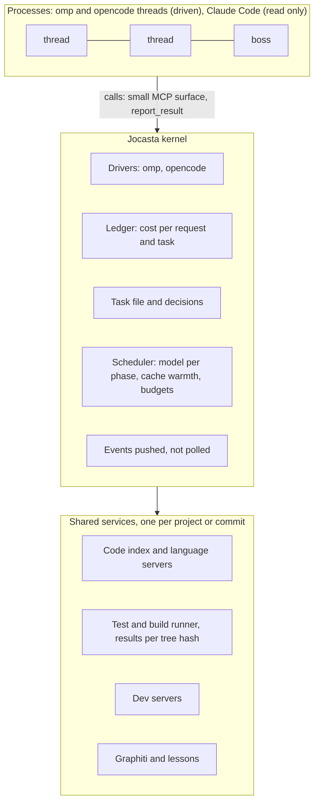
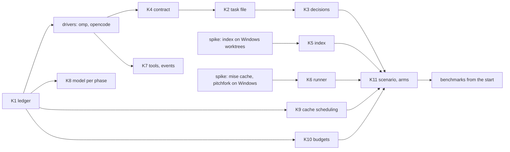

# Jocasta as an OS for harness processes: proposals from the 2026-11-08 brainstorm

- Date: 2026-11-08.
- Asked for: generic solutions to where coding agents waste tokens (context accumulation, repository exploration, tool output, reasoning and replanning, tool orchestration, final generation), built outside the harnesses: "we rely on the harnesses, we orchestrate them and we engineer the world around them like one big harness or maybe even an OS for multiple harness processes, similar to what the harness did to the LLMs." Open-source tools first, before building anything.
- Made from: three published studies (fetched that day, linked below), six research reports run that day (cost ledger, code index, test runner and services, task state, MCP gateways and orchestrators, harness control surfaces), and a read of Jocasta's seams. Items not seen in a source are marked [INFERENCE].
- Status: decided in the grilling session of the same day, records 0532–0543; where a record differs from this file (omp only, no opencode driver, 0537; the collab relay, 0536; K7–K10 mostly covered by omp, 0541; the index behind `graph_search`, 0542; the rerun's arms, 0543), the record holds.

## His answers in the brainstorm (to be recorded in grilling)

1. **Timing:** "we make the changes then we continue from start": the OS layer is built first, then the benchmarks run again from the beginning on that build.
2. **Scope:** all of K1–K11 below, with "before reimplementing the wheel we seek for good opensource implementations/tools that maybe we can use".
3. **Drivers:** omp and opencode get drivers (Jocasta controls them); Claude Code is read only (ledger, not control). Superseded in grilling: omp only, opencode and Claude Code benchmarked bare (0537).
4. **Handoff:** this file carries the brainstorm to the grilling session.

## The evidence that shapes the design

| Finding | Source | Consequence |
|---|---|---|
| Tool-output compression cut delivered tokens 38.4% and **raised** billed cost 6.8%; token reduction correlates weakly with cost reduction (r = 0.15); prompt-cache creation and reads dominate input cost; compression changed trajectories (more retrieval, testing and turns). | Weinberger, Hozez, "Token Reduction Is Not Cost Reduction", [arXiv 2607.12161](https://arxiv.org/abs/2607.12161) | Measure **cost per successful task**, paired, with cache traffic; never "tokens saved". |
| rtk (command-output compressor) advertised 60–90% savings; measured +7.6% cost at low effort (p = 0.004), ±0% at high effort, quality tied; its hook sees ~20% of tool-result characters; its own counter reported 96 M tokens saved while the bill rose. | JetBrains, [rtk benchmark](https://blog.jetbrains.com/ai/2026/07/rtk-claude-code-token-savings) (2026-07) | No output compressors. Anything Jocasta injects must not rewrite what the agent already saw. |
| Of three gateway levers, **tool-schema filtering** (21K–57K tokens per turn, linear in turns) is the only unambiguously reproducible saving; content compression saves ~2% of the cached prefix per turn; recall of compressed content is bounded. | Chen, Shi, [arXiv 2609.22114](https://arxiv.org/abs/2609.22114) (2026-08) | Keep every role's tool list small. |
| A warm, deterministic code-intelligence daemon (one server per project root, reused across calls) made Claude Code and Codex 20–30% more efficient, up to ~65%, correctness held or improved; gains largest for the strongest model at high effort; fewer tool calls to the same conclusion. | Netflix and JetBrains, [IDE intelligence study](https://blog.jetbrains.com/ai/2026/10/how-netflix-made-ai-coding-agents-more-efficient/) (2026-10) | The strongest case for a shared service outside the harness. |

Jocasta today: one MCP server whose threads see one tool (`graph_search`) and the boss 17 (`src/mcp/server.ts` `mcpTools`); compaction at 300k tokens, idle at 100k (`config/omp-config.yml`, 0448); `cacheWarming: streaming`; language servers per pane ("each pane holds its own", `config/omp-config.yml:13`); cost per day from the session files (0452); the benchmark's paired statistics on cost and tokens (`bun run evals compare`, bench/README.md).

## The model

The harness turned a stateless model into a process (loop, tools, memory). Jocasta does the same one level up: harness sessions are its processes.

| OS idea | Jocasta |
|---|---|
| Process control block | Task file per thread (K2) |
| Accounting (`top`, `ulimit`) | Ledger (K1), budgets (K10) |
| Shared libraries, page cache | Shared index (K5), cached runs (K6) |
| System calls | Small MCP surface (K7), output contract (K4) |
| Interrupts instead of polling | Events (K7) |
| Scheduler | Model per phase (K8), cache-aware batching (K9) |
| Device drivers | Harness drivers (below) |

## Proposals

### K1. Cost ledger

- **What:** one row per model request (thread, task, harness, session, agent and parent, request id, model, time, uncached input, cache read, cache write 5 min and 1 h, output, reasoning, cost and its source, main/subagent/compact). Tool rows (tool, args hash, file path, result tokens, error). Waste signals: re-reads of an unchanged file, identical calls repeated, oversized results, retry churn, loops, a cache write after an idle gap past the cache's life, compactions and the work after them.
- **Use:** tokscale ([github.com/junhoyeo/tokscale](https://github.com/junhoyeo/tokscale), MIT, Rust + Bun, v4.21.0 2026-11-02, Windows binary; reads omp, Claude Code and `opencode.db`; `--merge-worktrees`) and ccusage as **parity oracles** for our parsers, never as the live feed; LiteLLM's model-price JSON for prices; Claude Code's own OpenTelemetry (per request cost, cache 5 m/1 h split, `query_source`, a compaction event with tokens before and after; [monitoring docs](https://code.claude.com/docs/en/monitoring-usage)) as an extra feed through env vars; omp's OTLP traces only (its metrics collide across processes, omp #10840).
- **Build:** the ledger on the existing watcher (no open-source tool attributes cost per thread or task across harnesses); our own price table, since the three harnesses' cost fields mean different things (Claude Code's are client-side estimates); the waste detectors, re-implemented from token-optimizer's catalogue (its code is PolyForm Noncommercial: ideas only).
- **Must hold:** a row is stored when first seen, keyed by message id: Claude Code rewrites its transcript on resume and compaction and drops turns already written (tokscale's docs). OTel GenAI names only at export: every GenAI convention is still "development" and names changed twice since August.
- **Risk:** none to agent behavior; measuring only.

### K2. Task file per thread, with checkpoint lineage

- **What:** the thread's durable state outside its transcript: brief, acceptance (`done_when`), plan, decisions, status, summary; plus lineage {thread, harness, session, parent session, worktree commit}. A thread resumed, compacted or forked starts from it. Extends B3 (0513).
- **Use:** Backlog.md's format ([github.com/MrLesk/Backlog.md](https://github.com/MrLesk/Backlog.md), MIT, TypeScript/Bun, v1.55.3 2026-10-23, Windows; a task is a markdown file with acceptance criteria, plan, notes and summary; `--json`, `task list --json --watch`); the harnesses' own fork and resume (omp `--fork`, `/branch`, `/handoff`; opencode `--fork`, `POST /session/:id/fork`).
- **Rejected:** Beads (strong, but Dolt, writes hooks and AGENTS.md, `bd remember` overlaps Graphiti); claude-task-master (spends its own model calls, last release 2026-03); spec-kit and Kiro (templates, copy the shape at most).
- **Open:** where the file lives (worktree vs Jocasta's data folder; the brief isn't stored today, 0513); one more global install.

### K3. Decision ledger for agents

- **What:** settled choices an agent reads instead of reopening them. Merged with lessons rather than a second store.
- **Use:** nothing; no ADR tool is worth adopting (log4brains publishes, adr-tools is shell, AdrMcp and ai-adr too small).
- **Build:** search over a project's decisions and lessons through `graph_search` or one more thread tool; K4's `decisionsProposed` feeds new entries, which he approves like a lesson.

### K4. Output contract

- **What:** a thread ends with a structured report: outcome, files touched, tests run with their result, open questions, decisions proposed, blockers. Jocasta parses it; the boss, the review and the task file read it instead of prose.
- **Use:** opencode SDK `format: {type: "json_schema"}` (answer in `info.structured`); Claude Code `--json-schema` (`structured_output`) for headless runs.
- **Build:** a `report_result` thread tool (threads go from 1 tool to 2), validated in Jocasta against one `TaskReport` schema, since MCP clients may not enforce `inputSchema` [INFERENCE]. omp has no schema flag (closest: the SDK's `requireYieldTool` [INFERENCE]).

### K5. Shared warm code index

- **What:** one code index per repo at a commit, shared by every thread and worktree; language servers shared by a worktree's panes and stopped when idle.
- **Use:** codebase-memory-mcp ([github.com/DeusData/codebase-memory-mcp](https://github.com/DeusData/codebase-memory-mcp), MIT, one C binary, v0.12.1 2026-10-16, Windows first-class; tree-sitter plus type resolution for TS, C#, Python, Go; one daemon per OS account serving any number of clients; snapshot import then incremental updates). Install with `--skip-config --no-hooks`; one pinned build for every pane. Serena (HTTP mode) only if symbol-level edit tools are wanted: one instance per worktree.
- **Build:** no product shares an index across worktrees (all key by path). Jocasta keeps a snapshot per repo at the merge-base commit in its data folder, seeds each worktree from it and lets the daemon apply only the changed files; a small language-server mux per worktree (the lspmux pattern, ~300 lines; lspmux itself is EUPL and stale). SCIP per commit only as a later precise layer.
- **Spike first:** seeding a worktree from a snapshot is documented for clones, not worktrees. Overlaps the Graphiti watcher; memory per thread matters (0531: ~1.1 GB per working thread ran an 18 GB VM out).

### K6. Shared test and build runner, and dev servers

- **What:** the same test or build on the same tree runs once; later callers get its result. Agents get the failures (file, line, message, first frame) and a link to the full log, silent on pass. Dev servers belong to Jocasta; agents attach instead of starting duplicates.
- **Use:** mise's task cache (experimental; key from source contents, paths relative to the root, so worktrees share entries; `outputs = []` stores result and log; `lock` for machine-wide locks; [docs](https://mise.jdx.dev/tasks/caching.html)); mise `[daemons]` run by pitchfork (MIT, v2.33.1 2026-11-03; starting a running daemon leaves it running; a namespace, ports and URL per worktree; [docs](https://mise.jdx.dev/daemons.html)); Bun's JUnit reporter and the JUnit output of pytest, vitest and go test; ts-junit2json or a ~50-line parser.
- **Build:** a single-flight broker keyed by the git tree hash (`git write-tree` on a temporary index for a dirty worktree) and mise's cache key: mise decides to run before it takes the lock, so two threads starting the same test both run it. A failure digest. A thread tool for both.
- **Risks:** stale hits when a task's `sources` miss a file the test reads; mise's cache and pitchfork are both experimental and younger on Windows (`cmd /C`, no pty): spike on Windows first. Alternative to pitchfork: process-compose (REST, WebSocket, MCP with log search; weaker worktree isolation).

### K7. Lean tool surface and pushed events

- **What:** each role gets only the tools it needs, the hot ones always loaded; the boss is told when a thread changes state instead of asking.
- **Use:** Claude Code already defers MCP tools by default (`ENABLE_TOOL_SEARCH`, `alwaysLoad`), so the gain is in omp and opencode [INFERENCE: their deferral unchecked]; ACP `usage_update` and `session_info_update` for driven sessions (below); agent-deck's patterns (MIT, Go, WSL only) as a reference, not a dependency.
- **Build:** filtering `tools/list` by role and harness in `src/mcp/server.ts`; herdr's state events pushed to the boss. No gateway (Docker MCP Gateway, MetaMCP, ContextForge are far heavier than 17 tools).
- **Measure:** 0510 already plans a lean-tool-roster arm.

### K8. Model and effort per phase

- **What:** Jocasta picks harness, model and effort when it starts each phase (plan, execute, review), using omp's roles; never per request.
- **Why:** per-request routing breaks the prompt cache, which dominates cost (2607.12161). Gateways (claude-code-router, LiteLLM's beta auto-router) rewrite prompts and put a proxy in the auth path; with subscription accounts that is a terms risk [INFERENCE].

### K9. Cache-aware scheduling (new in the second pass)

- **What:** from the ledger, Jocasta knows each thread's cache warmth. Messages from the boss to a thread go while its cache is warm, or batched; nothing Jocasta does forces a cache write it could avoid.
- **Use:** `cacheWarming: streaming` (already set).
- **Open:** the cache life on his subscription (5 min; no 1-hour entries, 0184 [INFERENCE: re-check]).

### K10. Budgets per thread (new)

- **What:** caps on cost, turns and minutes per thread, like `ulimit`, checked by Jocasta from the ledger; Claude Code's native `--max-budget-usd` where it is driven headless.
- **Constraint:** 0187: "i wouldnt want a budget check on a subscription lets say but i would love it on api". Budgets apply to API-key runs; on a subscription, at most a warning [to decide].

### K11. A multi-thread benchmark scenario (new)

- **What:** N threads on one repo at once (the H8 fixtures), measuring cost per passing task and the ledger's waste signals.
- **Why:** each of the 40 tasks runs one thread on its own repo, so K5, K6 and K9 can't show a saving there.

## The driver layer

One interface in Jocasta, one implementation per driven harness: start a session with its context, tools and model; send and steer; interrupt; stream events in one shape; read usage; compact; fork and resume; collect the structured report. Every thread, whatever its harness, then gets the same ledger, task file, contract, services and budgets.

| Capability | omp | opencode 1.18 | Claude Code (read only) |
|---|---|---|---|
| Control channel | `omp --mode rpc` (JSON lines on stdio, `omp/docs/rpc.md`); SDK `createAgentSession`; `omp acp`; `rpc-ui` mode exists (`packages/coding-agent/src/cli/args.ts`) | `opencode serve` (HTTP, OpenAPI at `/doc`, SSE on `/event`); **the TUI with `--port N` runs the same server** | Agent SDK or `claude -p` stream-json; ACP through claude-agent-acp |
| Steer mid-turn | `steer`, `follow_up` | queues | queues |
| Interrupt | `abort` | `POST /session/:id/abort` | SDK `interrupt()` |
| Usage | `get_session_stats` (tokens incl. cache read/write, cost, context use) | every assistant message carries cost and tokens | `result.total_cost_usd`, OTel |
| Restrict tools | `--tools`, SDK `restrictToolNames`, `--config` overlay | per message `tools` map; `POST /mcp`; `OPENCODE_CONFIG_CONTENT` | `--tools`, `--strict-mcp-config` |
| Inject context | `--append-system-prompt`, hooks `before_agent_start`, `context` | per message `system`; `noReply` | `--append-system-prompt`, hooks |
| Compact | `compact`, `handoff` | `POST /session/:id/summarize` | `/compact` as a prompt |
| Fork / resume | `--fork`, `branch`, ACP `loadSession`, `resumeSession` | `POST /session/:id/fork`, `revert` | `--resume`, `--fork-session` |
| Structured output | none found | SDK `json_schema` | `--json-schema` |
| Budget cap | none | none | `--max-budget-usd` |
| Session at rest | `~/.omp/agent/sessions/<cwd>/<ts>_<id>.jsonl` | SQLite `opencode.db` | `~/.claude/projects/<cwd>/<id>.jsonl` |

The omp column was read from the local clone (omp 18.0.11); he runs 18.13.1, re-check before the build. opencode's docs now describe v2 (a shared background service, other keys): pin 1.18.22 and generate the client from its local `/doc`.

**The main tension: a pane against a control channel.** Threads live in herdr panes, with his TUI. opencode is both at once (`--port`). For omp, full control means `--mode rpc`, which has no TUI; inside a pane Jocasta has hooks and the session file only. `rpc-ui` may close the gap (UI extension events over RPC) but needs a renderer on Jocasta's side [INFERENCE]. ACP has the same constraint (the client owns the process) and a live omp bug (#10850: a permission answer never honoured). Options for the grilling: panes stay interactive and driven threads run headless (boss-started threads only); or omp threads move to `rpc-ui` with a Jocasta view; or omp keeps panes and only opencode is fully driven.

## The benchmark again from the start

- His answer reruns everything on the new build. The question for 0482's amendment is the arm set. With two driven harnesses, the natural design is two factors, harness {omp, opencode} × world {bare, Jocasta}, plus Claude Code bare as the reference (today's A4), plus K11's multi-thread scenario. It tests the thesis claim directly: the world around the harness matters as much as the harness.
- Size: today 40 tasks × 3 reps × 5 arms = 600 trials; the pilot's median was $0.53 and ~8.5 minutes per trial with two at once (0510). The 2026-11-02 attempt took days.
- The world must exist inside a trial: sidecars (index daemon, runner broker, ledger) per trial or per worker, and the task's own toolchain in mise terms [INFERENCE: per-task `sources` for the cache].
- Endpoints stay paired cost and pass rate (Wilcoxon, McNemar, Holm, already in `evals compare`), with cache read and cache write reported apart, as 2607.12161 and the rtk study did.

## Build order

The two spikes need no other K and can run beside K1.

## Installs to approve (0385 asks first)

| Item | For | Notes |
|---|---|---|
| codebase-memory-mcp 0.12.x | K5 | one pinned build; `--skip-config --no-hooks` |
| Backlog.md 1.55.x | K2 | or its format only, no install |
| pitchfork through mise `[daemons]` | K6 | mise is pinned; daemons and task cache are experimental |
| ts-junit2json | K6 | or our own parser |
| `@agentclientprotocol/sdk` | drivers (if ACP) | not needed for omp `rpc` or opencode HTTP |
| `@opencode-ai/sdk` for 1.18 | opencode driver | or a client generated from `/doc` |
| tokscale | K1 parity | test oracle only |

## Records this touches

- 0386: whole omp, unforked, as the one harness. A driven opencode makes it two engines.
- 0482: the pre-registered benchmarks and their arms; 0508–0510: the full run and the study after it; the runs made so far.
- 0187: run budgets after v1, and never checked on a subscription.
- 0513, 0514, 0515: after-v1 directions (B3 task file, the brief) that K2 and K4 pull into v1; the playbook's "Bounded work" and "Views are projections".
- 0448: compaction at 300k (K2 changes what a compacted thread starts from).
- 0485: OS isolation after v1 (shared services widen what a thread reaches).
- Plan appendix I: new seams (drivers, index, runner), new env vars, a new MCP tool (0027).

## Next

The grilling session takes K1–K11 and the driver layer in the build order above, one question per decision (0086, 0089), each with its facts re-checked that day.
